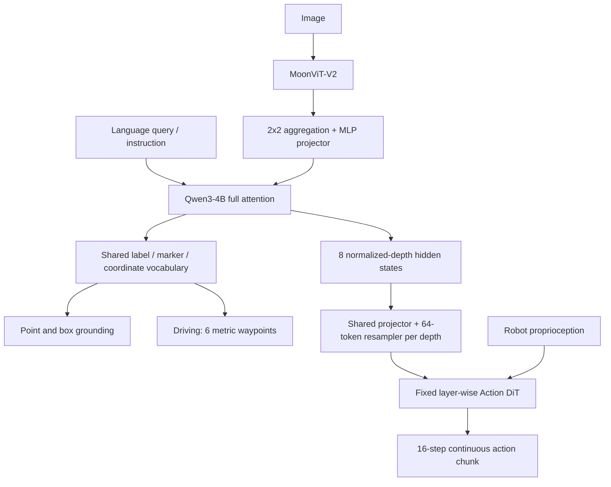

# 한 문장 결론

**더 큰 reasoning model을 붙이기 전에 '어떤 target의 어디를 조작해야 하는가'를 정밀하게 학습한 backbone이 희소 action data의 부담을 줄일 수 있다. 다만 nuScenes open-loop 개선과 simulation manipulation success는 real-world safety·real-time closed-loop driving의 증거가 아니다.**

## 문제와 기여

- 범용 VLM은 scene을 설명해도 tiny/dense target의 exact location을 놓칠 수 있다. Action demonstration이 perception과 control을 동시에 가르치면 data burden이 커진다.
- GroundingPI는 visual primitive를 shared output vocabulary로 통합한다. MoonViT-V2→projector→Qwen3-4B autoregressive decoder에 point/box token을 더한다.
- Staged multimodal/spatial training과 task-specific GRPO로 localization·coverage·format을 최적화한다.
- AD tokenized waypoint generation과 robot flow-matching Action DiT의 두 경로로 전이를 검증한다.
- Grounding scale·data mixture를 분석해 dense grounding의 marginal value와 OCR 포함 auxiliary group의 complementarity를 보여 준다.

## Taxonomy와 Language Role

Worldbench taxonomy는 VA의 action-only/perception-action/image·occupancy·latent world model과 VLA의 textual action/numerical action/explicit guidance/implicit representation transfer를 구분한다.

| 부분 | Taxonomy 위치 | Language 역할 | 실제 Action Grounding |
|---|---|---|---|
| Base GroundingPI | Language-conditioned perception; 단독 controller 아님 | target/category/referring query, OCR transcription | point/box라는 visual primitive만 생성 |
| Driving adaptation | Numerical Action Generator | history와 task context를 token interface에 공급 | 6 cumulative metric waypoint의 atomic coordinate 생성/decoding |
| Manipulation adaptation | representation transfer로 continuous policy condition | instruction-conditioned hidden state | 8 depth의 feature를 fixed Action DiT에 전달, flow matching으로 control chunk 생성 |
| System 1/2 discussion | Future dual-system design hypothesis | broad reasoning planner와 precision execution의 분업 | integrated controller experiment는 없음 |

GroundingPI는 video-generation WAM 자체가 아니고, textual explanation-only VLA도 아니다. Robot branch는 box output을 inverse kinematics로 곧바로 변환하는 구조가 아니라 **hidden feature→Action DiT** 경로다.

## Architecture / Pipeline

전체 multimodal parameter는 약 4.844B이며 '4B'는 language-family 명칭이다. Feature condition width는 1024이고, 8개 depth에서 각각 64 token을 읽는다. DiT는 8 cross-attention/8 self-attention의 **16 atomic block**이지 16 paired block이 아니다. Observation마다 backbone을 한 번 실행해 cache하고 inference는 4 Euler step을 쓴다.

## Input / Output

| Branch | Input | Output | 좌표/시간 convention |
|---|---|---|---|
| Grounding | Image + target query | Variable-length label/box/point/OCR | Image xyxy or x,y; atomic `<0>`–`<999>` |
| Driving | Current front RGB + up to 7 ego-state records | 6 cumulative positions over 3 s | 0.5 s spacing; x forward [-60,60] m, y left [-20,20] m |
| Manipulation | Observation + instruction + robot state | Continuous control chunk | Embodiment-specific input/output projection, horizon 16 |

Driving response의 coordinates는 image normalization과 다르다. 시간 순서·반복 point를 유지하고 cumsum을 재적용하지 않는다. Missing ego state를 zero로 조작하지 않는다.

## Training Recipe

1. Projector alignment: encoder/decoder frozen, caption causal loss.
2. Joint multimodal pretraining: all module update, text + image–text domain-normalized loss.
3. General visual/video QA: context 32,768, all-module update.
4. Spatial SFT: 8 task group, assistant-only label/coordinate/protocol CE, context 8192.
5. GRPO: G=8 rollout, language-only update, frozen encoder/projector/SFT reference. Grounding advantage = 0.7·Z(coverage)+0.3·Z(strict), 이후 batch normalization. OCR은 composite scalar를 먼저 만들고 standardize한다.
6. Task adaptation: driving response CE 또는 robot action-position flow-matching MSE.

원문 supervised setting은 128 GPU, RL은 256 GPU다. Compact inference family라고 저렴한 pretraining을 뜻하지 않는다. SFT 본문의 language-side refinement 표현과 appendix의 Stage 4 all-module 표는 세부 phase 대응이 완전히 분리되어 있지 않아 재현 시 released config 확인이 필요하다.

## Dataset / Benchmark / Metric

- Perception: 34 benchmark·11 capability·44 baseline. Headline Avg는 11 capability score의 mean이며 all table cell direct mean이 아니다.
- Dense200/VisDrone: dense scene·tiny box. RefCOCO/HumanRef: referring. RoboSpatial/RefSpatial: spatial pointing. GUI/OCR/layout/visual prompting도 평가한다.
- nuScenes: open-loop L2 Avg 0.296 m vs Qwen3-VL-4B 0.301 m, RynnBrain 0.308 m. 1/2/3초 **cumulative horizon mean**의 평균이다.
- RoboTwin2.0: Full SR 66.20%; Clean2Random OOD 17.60% vs Rex-Omni 14.10%. 네 OOD 중 하나다.
- RoboCasa-GR1: Full ID SR 37.75%는 RynnBrain 39.00%보다 낮다. Appearance/Combination/Object-Type OOD와 limited demonstrations를 따로 평가한다.
- 50% data에서 28.75% SR가 75% data baseline-best 27.75%보다 높다. Full data 최고 또는 total training cost 절감과 다른 주장이다.

## Open-Loop / Closed-Loop 경계

Driving은 recorded reference trajectory에 대한 offline prediction으로 policy-induced state shift·collision·rule compliance·recovery를 측정하지 않는다. Robot simulation은 interactive task outcome SR를 평가하지만 physical robot/vehicle을 deploy하지 않았다. 따라서 'closed-loop에 필요한 precise perception'이라는 motivation을 'closed-loop driving에서 검증됨'으로 바꾸면 안 된다.

## 강점

- Foundation-native perception이라 task-specific auxiliary module만으로 제한되지 않는다.
- Point·box·text region의 공통 interface는 parser와 supervision을 공유하기 쉽다.
- Action expert/data/budget을 맞춰 representation transfer를 비교했다.
- OOD suite의 scene shift와 entity shift를 구분했다.
- Appendix가 hypothesis와 empirical evidence를 구별하고 metric/protocol 예외를 명시한다.

## 한계와 과장 방지

- Absolute OOD SR 17.60%는 여전히 낮다. Relative improvement만 보고 robust deployment라고 판단하면 안 된다.
- Backbone은 scale, encoder, architecture, supervision이 달라 full causal isolation은 아니다.
- F group은 OCR+Layout+GUI다. F 제거의 손실을 OCR-only effect로 주장하면 안 된다.
- OCR catalyst, gating/DeepStack transfer, relative-depth superiority, System-1/2 division은 hypothesis다.
- Grounding scale sweep의 OOD는 monotonic하지만 ID는 마지막에 감소한다. Universal action scaling law가 아니다.
- N/A/parser mismatch/external score와 intrinsic capability를 구별해야 한다.
- Tiny box/high-IoU precision/TotalText/GUI frontier gap이 남는다.
- Shared coordinate token은 3D calibration, dynamics, contact feasibility, control stability를 보장하지 않는다.

## Safety / Latency / Deployment — 분석자 제안

다음은 원문 성능 주장이 아닌 배포 설계 제안이다.

1. Structured output parser에서 geometry validity·category scope·absence·coverage를 검증한다.
2. Image point와 metric waypoint의 coordinate contract를 다른 type으로 구현한다.
3. Timing watchdog과 observation timestamp를 검사하고 stale feature/action을 폐기한다.
4. Independent control safety/shield/fallback을 두고 perception score와 vehicle safety metric을 별도 기록한다.
5. Hardware별 end-to-end observation→action P50/P95/P99 latency, memory/thermal budget을 측정한다. Tokens/box나 0.25× textual configuration speed를 NPU speedup으로 외삽하지 않는다.
6. Hardware/NPU 실험은 이 논문의 범위 밖이다. Quantization/compiler support·operator coverage·dynamic length cost는 새로운 검증 과제다.

## 왜 찬호님의 관심사에 중요한가

AD/VLA의 병목을 reasoning length가 아닌 **spatial target fidelity와 action-interface accessibility**로 볼 수 있다. PerturBot의 training evidence, MotorMind의 measured execution harness, GroundingPI의 perception-native pretraining은 다른 layer의 해법이다. 차량 적용은 front camera·ego history tokenization의 calibration부터 closed-loop outcome까지 별도 검증해야 한다.

## 출처 및 중복 확인

[원문](https://arxiv.org/html/2609.39601v1), [HF](https://huggingface.co/papers/2609.39601), [Worldbench taxonomy](https://github.com/worldbench/awesome-vla-for-ad).

Raw/wiki에서 ID·GroundingPI·distinctive title을 확인했다. 2026-10-06 study note에 '보조 후보 GroundingPI'라는 한 문장만 있었으며 deep-read/translation/source page는 없었다. 따라서 existing main-subject analysis가 아닌 reference mention으로 판단했다. MotorMind는 이미 분석되어 제외했다.
