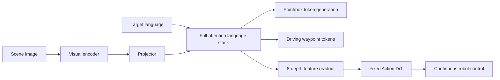

# GroundingPI 학습 자료

논문이 보고한 설계와 아래 **교육용 예제·배포 제안**을 구분합니다. 예제는 공식 inference code가 아니며 학습/성능 재현을 의미하지 않습니다.

## 1. 선수 지식

- Transformer가 visual/language token을 attention으로 결합한다는 개념.
- Autoregressive next-token prediction과 teacher-forcing cross-entropy.
- Bounding box의 xyxy/xywh, IoU, precision/recall/F1.
- Ego frame, waypoint와 trajectory, 누적 위치와 이동량의 차이.
- Continuous generative policy와 vector field의 기본 직관.

모든 수식을 한 번에 이해할 필요는 없습니다. 먼저 **target identity→spatial location→action representation→execution feedback** 순서로 읽으세요.

## 2. 용어 사전

| 용어 | 쉬운 설명 | 여기서의 역할 |
|---|---|---|
| Visual grounding | '빨간 컵'이 그림의 어느 instance인지 연결 | language와 physical target 사이 perception |
| Visual primitive | point/box 같은 기본 spatial 표현 | 여러 perception task의 shared interface |
| Atomic coordinate token | 한 정수를 한 vocabulary token으로 표현 | 수치 string을 여러 token으로 생성하는 비용 감소 |
| Dense grounding | 많은 근접 instance를 빠짐없이 구분 | clutter·small target의 spatial fidelity |
| Action grounding | 의미/위치를 실행 가능한 action과 연결 | waypoint decoding 또는 learned feature-to-action expert |
| Flow matching | noise→action으로 가는 velocity field 학습 | continuous robot action chunk |
| Resampler | 가변-length feature를 fixed query token으로 압축 | backbone별 hidden state의 common condition budget |
| GRPO | 같은 query의 여러 response를 reward로 상대 평가 | structured output의 quality·coverage optimization |
| OOD | training distribution 밖의 조건 | scene/entity generalization |
| Open-loop | 기록 데이터에서 future prediction 비교 | nuScenes L2; controller feedback 성능과 구별 |

## 3. 먼저 전체 지도를 이해하기



**핵심 구별:** base grounding output은 물체의 위치입니다. 로봇 action branch는 그 box를 직접 actuator에 보내지 않고 hidden feature를 Action DiT에 전달합니다. 운전 branch는 같은 vocabulary의 coordinate token을 **다른 metric-coordinate convention**으로 해석합니다.

## 4. 단계별 설명: 컵을 집는 예

### Step A — '어떤 컵인가'를 정하기

책상에 컵이 세 개 있고 instruction이 '접시 옆의 빨간 컵을 집어라'라면 scene caption이 '책상에 컵과 접시가 있습니다'인 것만으로 부족합니다. Instance identity와 relation을 grounding해야 합니다.

### Step B — '어디에 있는가'를 정밀하게 표현하기

Image width W, height H에서 coordinate token q를 pixel로 되돌립니다.

$$x=q_xW/999,\quad y=q_yH/999.$$

Box는 네 token `(x1,y1,x2,y2)`이며 point는 두 token `(x,y)`입니다. Label·marker를 포함한 structured response를 parser가 읽습니다. Requested category가 없으면 empty output을 임의로 성공 처리하지 말고 explicit `None` contract를 확인합니다.

### Step C — '어떻게 움직이는가'를 학습하기

Backbone에서 normalized depth 8개를 선택하고 common width 1024로 project한 뒤 depth마다 64 condition token으로 resample합니다. Robot state와 noisy action chunk를 받아 action expert가 continuous control을 생성합니다. Spatial perception은 control을 돕지만 contact mechanics와 reachability를 대신하지 않습니다.

### Step D — Feedback으로 검증하기

실제 배포라면 컵을 잡았는지, 다른 물체를 건드렸는지, observation이 최신인지, action이 deadline 내에 나왔는지를 따로 확인해야 합니다. **이 단계는 이 논문의 real-world experiment가 아니라 deployment 설계 과제**입니다.

## 5. Image Coordinate와 Metric Waypoint를 혼동하지 않기

원문 image protocol은 intermediate [0,1000] integer v를:

$$q(v)=\lfloor(999v+500)/1000\rfloor$$

로 encode합니다. 교육용 direct image mapping을 구현하더라도 원문의 annotation preprocessing convention과 일치하는지 확인해야 합니다.

Driving은 x∈[-60,60], y∈[-20,20] m라는 fixed bound를 사용합니다.

$$q=\operatorname{round}_{even}(999(z-a)/(b-a)),\quad \hat z=a+(b-a)q/999.$$

Image x=0은 left image boundary지만 ego x=0은 현재 ego origin입니다. 같은 `<q>`라고 같은 물리적 의미가 아닙니다.

교육용 구현:

```python
import math

def encode_metric(z: float, a: float, b: float) -> int:
    if not (math.isfinite(z) and a < b and a <= z <= b):
        raise ValueError('invalid metric coordinate')
    return round(999 * (z - a) / (b - a))  # Python: ties to even

def decode_metric(q: int, a: float, b: float) -> float:
    if not (isinstance(q, int) and 0 <= q <= 999 and a < b):
        raise ValueError('invalid code or bounds')
    return a + (b - a) * q / 999
```

Quantization으로 exact zero가 완벽히 복원되지 않을 수 있습니다. 이는 tokenizer 표현의 approximation이며 invalid geometry를 silently clamp하는 것과는 다릅니다. Parser validation과 quantization tolerance를 명시하세요. 위 예제는 finite z·bound check를 제공하지만 공식 parser 전체가 아닙니다.

Trajectory `(x1,y1)…(x6,y6)`는 이미 cumulative position입니다. 재차 cumulative sum하지 마세요. Point sorting을 x로 하면 시간 순서를 파괴할 수 있습니다.

## 6. 왜 Tiny Target가 어려운가

같은 크기 w×h인 두 box가 수평으로 δ 이동하면:

$$\mathrm{IoU}=\frac{w-|\delta|}{w+|\delta|},\qquad |\delta|\le w\frac{1-\tau}{1+\tau}\ \text{이면 IoU}\ge\tau.$$

같은 pixel 오차라도 w가 작으면 IoU 하락이 큽니다. Dense scene은 '컵 category를 안다'가 아니라 옆 instance를 분리하는 fine evidence를 요구합니다. Box precision과 point-in-mask correctness도 다른 task입니다. Dense200에서 box가 강하다고 point ranking까지 최고인 것은 아닙니다.

## 7. SFT와 GRPO의 역할 분담

### SFT: Output 문법과 coordinate alignment

Ground-truth response token을 예측합니다. Assistant position의 semantic label·marker·coordinate에 CE를 주고 prompt·visual·padding은 제외합니다. Coordinate regression loss가 별도로 들어간 구조는 아닙니다.

### GRPO: 전체 response의 quality

같은 image/query에 8개 response를 생성하고 reward를 비교합니다. Completeness만 높이면 중복 box·과대 box로 reward를 편법적으로 높일 여지가 있습니다. 따라서 strict localization·format·count·ordering과 penalties를 함께 사용합니다.

$$\widetilde A=0.7Z(R_{set})+0.3Z(R_{strict}).$$

각 reward의 scale이 다르므로 먼저 independently standardize합니다. 이후 전체 batch normalization을 수행합니다. OCR은 subterm을 composite scalar로 합친 뒤 Z를 적용합니다.

**주의:** $R_{set}$ matching은 reference별 독립 best-IoU라 prediction을 재사용할 수 있고 값이 1을 넘을 수 있습니다. OCR의 Hungarian one-to-one assignment와 다릅니다. 구현에서 이를 마음대로 같은 matcher로 바꾸면 논문의 objective가 바뀝니다.

## 8. Flow Matching을 직관적으로 이해하기

Random noise ε와 normalized action a 사이의 straight path를 만듭니다.

$$a_t=(1-t)\epsilon+ta,\quad v^*=a-\epsilon.$$

$t=0$은 noise, $t=1$은 action입니다. Network는 t와 condition을 보고 어느 방향으로 움직여야 target action에 도달하는지 velocity를 예측합니다.

$$\mathcal L=\|\hat v(a_t,t,condition)-v^*\|_2^2.$$

Inference는 적은 Euler step으로 velocity field를 적분합니다. GroundingPI 실험은 4 step과 observation당 one backbone forward cache를 사용합니다. 이것이 real-time deadline 보장을 뜻하지는 않으므로 hardware별 whole-pipeline latency를 측정해야 합니다.

## 9. Evaluation을 읽는 방법

| 보고된 사실 | 말할 수 있는 것 | 말할 수 없는 것 |
|---|---|---|
| nuScenes L2 0.296 m | recorded trajectory와의 평균 오차 | road safety·collision avoidance·closed-loop recovery |
| RoboTwin Full 66.20% | 해당 ID/full protocol task success | Clean2Random absolute robustness |
| Clean2Random 17.60% | held-out randomization에서 개선 | OOD가 해결됐음 |
| GR1 50% data SR 28.75% | action-demo 효율 | total pretraining cost 감소 |
| Grounding Avg 73.68% | 11 capability aggregation | 모든 benchmark/strict IoU에서 최고 |
| F 제거의 큰 loss | auxiliary group complementarity | OCR-only causal benefit |
| fewer tokens/box | output serialization efficiency | same-hardware action latency speedup |

L2@h는 endpoint-only metric가 아닙니다. Horizon까지의 step error 평균을 먼저 구하고 1/2/3초 값을 평균합니다. 이 정의를 사용하지 않은 다른 논문의 수치와 바로 비교하지 마세요.

## 10. 구현·배포 Checklist — 교육용 제안

- Dataset split과 scene/entity leakage를 확인한다.
- Image/metric coordinate를 type와 serializer로 분리한다.
- Atomic token ID, EOS/padding, `None`, tuple ordering, degenerate geometry를 unit-test한다.
- Stage별 loss mask·domain normalization·packed sample boundary를 확인한다.
- Backbone/Action DiT 조건 budget·training updates·inference solver를 맞춘다.
- Closed-loop observation timestamp와 cached feature lifetime을 관리한다.
- Independent control shield/watchdog를 유지한다.
- Latency는 P50/P95/P99·thermal·memory와 함께 측정한다.
- NPU 적용은 operator/tokenizer/runtime/quantization 지원을 별도로 실험한다. 본 논문은 NPU benchmark가 아니다.

## 11. Study Questions와 답

**Q1. Scene을 잘 설명하는 VLM이 왜 control에서 실패할 수 있나요?**
A. Semantic category recognition과 target instance의 exact position이 다르기 때문입니다. 잘못된 cup을 골라도 caption은 자연스러울 수 있습니다.

**Q2. Point/box output 자체가 VLA action인가요?**
A. 기본 모델에서는 perception output입니다. Driving adaptation은 metric waypoint를 생성하고 robot adaptation은 hidden feature→learned action expert로 continuous control을 만듭니다.

**Q3. 50% demonstration이 75% baseline을 이기면 학습 비용도 줄었나요?**
A. Downstream action demonstration만의 효율입니다. Grounding pretraining의 대규모 data/compute 비용은 별도입니다.

**Q4. OCR이 driving을 개선하는 인과를 입증했나요?**
A. 아닙니다. OCR/Layout/GUI group의 complementarity와 OCR mixing 비교는 있으나 sign-reading latency나 OCR-only causal effect는 분리되지 않았습니다.

**Q5. Full attention이 gated linear attention보다 항상 VLA에 좋나요?**
A. 아닙니다. Backbone 비교는 architecture·scale·pretraining이 함께 바뀌고 conditional gradient analysis도 empirical causal proof가 아닙니다.

**Q6. 성공률만 보면 어떤 safety 문제가 빠지나요?**
A. Unintended contact, collision, rule compliance, recovery, stale observation, timing failure, rare events를 놓칩니다. 이 논문은 real-vehicle deployment를 검증하지 않았습니다.

**Q7. Physical prompting의 이점은 이미 실험됐나요?**
A. Shared visual primitive가 그 가능성을 제공하지만 별도 prompting intervention이나 integrated dual-system effect는 future work입니다.

## 12. Reading Roadmap

- 1차 30분: paper-ko Abstract·1·4·5.2와 그림 1/5.
- 2차 40분: 3.3·appendix 7.1/8.1, coordinate encode/decode unit test.
- 3차 40분: appendix 8.2와 π0/Flow Matching reference, 16-block topology 직접 그리기.
- 4차 30분: 5.3 ablation과 appendix limitations; empirical fact/hypothesis/deployment proposal을 색으로 구분.
- 비교 학습: PerturBot의 evidence supervision, MotorMind의 measured execution feedback, GroundingPI의 perceptual pretraining을 각각 training/runtime/foundation layer에 배치.

최종 학습 목표는 'Grounding score가 높다'가 아니라 **어떤 representation이 어떤 contract로 numerical action에 연결되고 어떤 평가 범위에서 검증됐는가**를 설명하는 것입니다.
