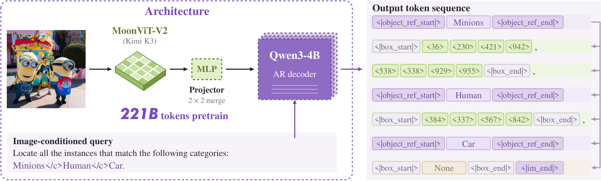
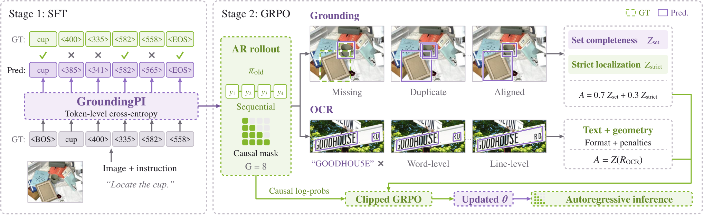
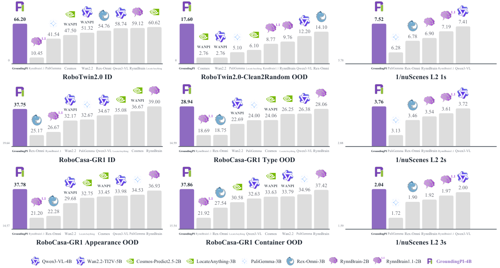
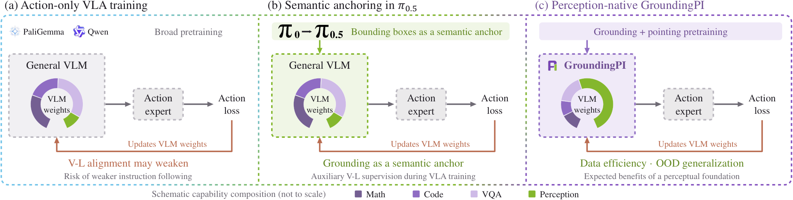
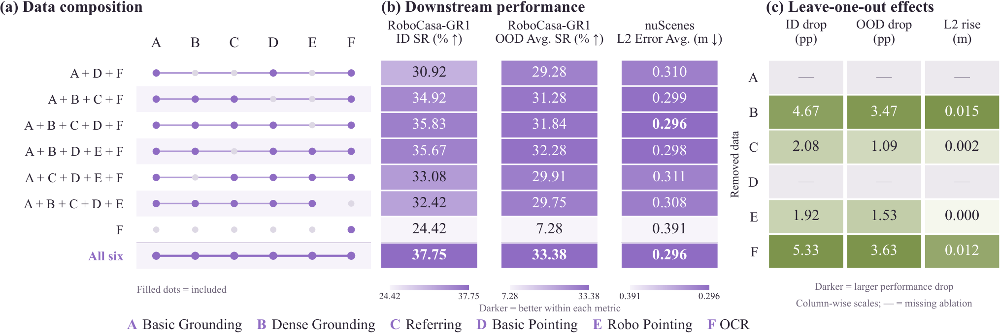

# GroundingPI: Visual Primitive로 Physical Intelligence를 지향하는 Grounding Foundation Model

원저자: Qize Yu 외. 원문은 CC BY 4.0이며 이 문서는 원문을 한국어로 번역·편집한 2차 저작물입니다. 원문 URL과 저자를 명시하며, 원저자의 승인 또는 Xpeng의 상용 제품 성능을 의미하지 않습니다. [라이선스](https://creativecommons.org/licenses/by/4.0/).

**번역 범위:** 원문의 핵심 본문 구조를 보존하고 수식과 주요 실험 수치를 유지했습니다. 44개 baseline의 모든 셀을 재인쇄하지 않고 핵심 비교 표를 재구성했습니다. 부록의 protocol·training·action interface·evaluation·limitations는 상세히 보존하되, GRPO OCR reward의 모든 분기 계수, Gated DeltaNet/DeepStack의 장문 Jacobian 유도, 전체 34 benchmark 표, 정성 예시의 모든 문장은 축약했습니다. 따라서 전 PDF의 무생략 대역 번역은 아닙니다. 수치는 원저자 보고이며 재현 실험을 하지 않았습니다.

## Abstract

정밀한 grounding은 중요하다. 복잡한 장면이나 매우 작은 물체에서도 목표가 **어떤 물체이고 어디에 있는지**를 특정해야 하며, closed-loop control에 충분히 빠르게 동작해야 한다. 그러나 Vision-Language-Action(VLA)과 World-Action Model(WAM)은 대체로 범용 vision-language 및 video-generation backbone에서 perception을 얻고, 이 backbone은 이러한 상황에서 여전히 실패한다.

우리는 point와 bounding box를 공유 vocabulary의 quantized coordinate로 생성하는 4B 계열 grounding foundation model인 GroundingPI를 제시한다. 학습은 공개 dataset과 전용 data engine의 supervision을 이용하는 multimodal·spatial pretraining, supervised fine-tuning(SFT), GRPO reinforcement learning을 결합한다. 11개 perceptual capability에 걸친 34 grounding benchmark에서 44개 baseline과 비교해 평균 73.68%를 기록했으며, 더 큰 GPT-6 Astra의 71.54%보다 높았다.

GroundingPI를 downstream visual backbone으로 사용하면 robotic manipulation과 autonomous driving 성능이 개선된다. RoboTwin 2.0에서는 평가한 네 OOD 조건 모두에서 비교한 mainstream backbone을 앞섰으며, 가장 강한 backbone 대비 최대 24.8%의 상대 개선을 보였다. RoboCasa-GR1에서는 demonstration의 50%로 학습한 모델이 비교 baseline의 75% 데이터 학습보다 높은 성능을 얻었다. nuScenes의 평균 open-loop L2 error는 0.296 m였다.

Pretraining의 scale과 data composition도 체계적으로 분석했다. Grounding pretraining을 확장하면 downstream 성능이 개선되며, dense grounding은 두 도메인에 중요한 이점을 제공한다. OCR은 perceptual learning의 촉매가 될 가능성을 보인다. 이 결과는 grounding을 perceptual foundation으로 삼고 전용 perceptual pretraining을 physical intelligence 모델의 출발점으로 사용하는 방향을 지지한다.

> 파라미터 주의: 원문은 '4B'라고 부르지만 이는 Qwen3-4B language-backbone 계열명이다. visual encoder와 untied vocabulary matrix까지 포함한 전체는 약 **4.844B**다.

## 1. Introduction

Visual grounding은 언어를 물체, 위치, 상호작용에 필요한 구조와 연결하므로 VLM의 핵심 perception 능력이다. UI element, region, task-relevant entity grounding은 발전했으나, physical intelligence에 필요한 넓고 정밀한 grounding은 여전히 어렵다.

어수선한 책상을 정리할 때 우리는 컵과 손잡이를 찾은 뒤 어떻게 잡고 옮길지 결정한다. 즉 **where to act를 먼저 확보한 다음 how to act를 정한다.** VLA와 WAM은 범용 VLM 및 video-generation backbone을 활용하지만, 이들의 주된 최적화 목표는 물리적 상호작용에 필요한 정밀 grounding이 아니다. 그 결과 perception이 downstream action learning의 병목으로 남는다.

저자들의 평가는 범용 VLM의 상당한 약점을 보이며 Rex-Omni·LocateAnything 같은 전용 모델에도 개선 여지가 있음을 보여 준다. 특히 dense scene과 tiny object가 어렵다. Perception의 빈틈이 크면 희소한 action demonstration이 perception과 control을 동시에 가르쳐야 한다. 계산량과 latency 때문에 더 큰 backbone에 의존하는 것도 제한된다.

최근 policy는 perceptual supervision을 더한다. π0에서 π0.5로 발전하며 broader knowledge-insulation recipe에 bounding-box prediction이 도입됐고, 다른 연구는 perception auxiliary module·objective를 추가했다. 본 연구는 그러한 능력을 foundation model의 native capability로 학습하는 것이 더 자연스럽고 확장 가능한 접근이라고 주장한다.

연구 질문은 다음과 같다.
1. Grounding foundation model의 perception을 어디까지 발전시킬 수 있는가?
2. 강한 grounding foundation은 physical intelligence에 무엇을 제공하고 어떤 perceptual capability가 특히 중요한가?
3. 이러한 발견은 future embodied foundation model의 설계에 무엇을 시사하는가?

GroundingPI는 semantic label·protocol marker·quantized coordinate의 shared vocabulary로 grounding, referring, pointing, OCR, GUI/layout grounding, visual prompting을 language-conditioned structured generation으로 통합한다. Manipulation에서는 benchmark별 Action DiT, action data, training budget을 고정해 backbone의 전이를 비교한다. Precise perception은 action acquisition, OOD generalization, limited-demonstration efficiency에 이점을 보인다.

핵심 기여는 (1) visual primitive 기반 compact grounding foundation과 staged training recipe, (2) driving·robot manipulation에서의 transfer, (3) scale·data recipe·System-1 execution foundation 설계에 대한 분석이다. System 2의 broad reasoning/planning을 대신한다기보다 그것을 보완할 perceptual foundation을 탐색한다.

## 2. Related Work

### 2.1 Visual Grounding Models

Grounding은 closed-set detection에서 grounded image–text pretraining을 통한 language-conditioned open-vocabulary localization으로 확장됐다. Generative grounding model은 autoregressive next-token prediction으로 label과 quantized coordinate를 structured sequence로 출력해 여러 perception task를 하나의 interface로 표현한다. LocateAnything은 parallel box decoding을 통한 빠르고 정밀한 grounding을 탐색한다. Affordance prediction과 spatial referring는 robotic interaction으로 연결되는 방향이다.

### 2.2 Foundation Models for Physical Intelligence

VLA는 VLM의 visual-semantic knowledge·language grounding을, WAM은 video/world model의 spatiotemporal·visual-dynamics prior를 활용한다. Embodied foundation은 semantic, dynamics, embodied experience를 결합한다. 그러나 broad capability가 precise task-conditioned perception을 보장하지 않으므로 pretraining과 action learning 사이에 capability mismatch가 생긴다.

### 2.3 Perceptual Learning for Action Transfer

Bounding-box prediction, task-relevant region reconstruction, affordance representation, spatial auxiliary supervision은 perception의 가치를 보여 준다. 하지만 보통 action learning 안의 task-specific proxy·auxiliary objective·intermediate representation으로 도입된다. 이들은 일부 perceptual signal만 다루고 추가 annotation·policy-specific component에 의존하기 쉽다. 본 연구는 action adaptation 전에 broad precise perception을 학습하는 perception-native foundation을 제안한다.

## 3. GroundingPI: A Grounding Foundation Model

### 3.1 Model Architecture and Grounding Formulation



*그림 1 번역:* GroundingPI의 architecture. 예시 출력은 minion 두 개와 human 하나를 포함하고, 존재하지 않는 car category는 `None`으로 표시한다.

MoonViT-V2(Kimi K3) visual encoder와 Qwen3-4B language decoder를 결합한다. Learnable projector는 인접 2×2 visual feature를 모아 GELU가 있는 two-layer MLP와 output normalization을 통해 language embedding space로 옮긴다.

이미지 $I$, query $P$에 대해:

$$V=C_{\phi}(E_{\psi}(I)),\qquad p_{\theta}(Y\mid I,P)=\prod_{i=1}^{|Y|}p_{\theta}(y_i\mid V,P,y_{<i}).$$

Semantic label, protocol marker, 1,000개 atomic coordinate token `<0>`–`<999>`는 하나의 vocabulary를 공유한다. Response 길이는 가변적이며, query가 요청한 category가 없으면 `None`을 출력한다. Point와 box는 별도 regression head가 아니라 같은 vocabulary head에서 생성한다.

### 3.2 GroundingPI Data

공개 dataset과 data engine의 annotation을 함께 사용한다. Engine은 multi-teacher annotation을 field 단위로 fusion하고 task-specific validation을 수행한다. 검증된 label로 unified grounding expert를 학습해 반복 annotation하고, 불확실한 항목은 complementary teacher와 local observation으로 해결해 supervision을 늘리거나 label을 수정한다.

*그림 2 번역:* multi-teacher fusion과 task-specific validation이 expert iteration을 안내하며, targeted observation이 unresolved label을 해결한다. 이 도표는 HTML-native 표현으로 별도 image file이 없으므로 [원문 그림 2](https://arxiv.org/html/2609.39601v1#S3.F2)를 참조한다.

Multi-teacher agreement만으로 correctness를 보장하지는 않는다. Semantic identity·geometry·coverage를 따로 확인한다. 빈 prediction은 target absence의 증거가 아니며, all-instance task의 일부 unresolved instance는 전체 supervision의 수용을 막을 수 있다. Object–part, word–line의 관계를 duplicate로 오인해 합치지 않는다.

### 3.3 Training Design

#### 3.3.1 Base VLM Training

처음에는 encoder와 language backbone을 freeze하고 image-caption supervision으로 projector만 align한다. 이후 모든 module을 열고 text·image–text joint pretraining을 수행하며, 다음 단계에서 QA·captioning을 통한 visual/video understanding을 학습한다. 모든 단계는 causal next-token prediction을 사용한다.

#### 3.3.2 Supervised Fine-Tuning

SFT는 coordinate token을 visual location에 align하고 shared output protocol을 학습한다. Teacher forcing으로:

$$\mathcal L_{\mathrm{SFT}}=-\frac{1}{|\mathcal S|}\sum_{t\in\mathcal S}\log p_{\theta}(y_t\mid I,P,y_{<t}).$$

$\mathcal S$는 assistant-response의 label·marker·coordinate position이며 prompt와 visual position은 제외한다. 본문은 all-module adaptation 뒤 language-side refinement를 설명한다. 부록 stage 표에서는 Stage 4 SFT를 all-module update로 명시하고 RL에서 vision/projector를 freeze한다. 별도 language-only SFT substage의 budget은 이 표에서 분리해 제시하지 않으므로 구현 시 stage 이름만으로 임의의 설정을 추가하면 안 된다.

#### 3.3.3 Reinforcement Post-Training



*그림 3 번역:* SFT는 token-level cross-entropy로 structured grounding output을 학습한다. 이후 GRPO는 grounding의 completeness·localization과 OCR의 text–geometry consistency·output reliability를 평가하는 task-specific reward를 사용한다. 예시 rollout은 prediction error와 OCR granularity 차이를 보여 준다.

Image–query pair마다 $G=8$ response를 생성한다. Grounding의 $R_{set}$은 reference별 maximum-IoU matching 뒤 class validation으로 coverage를 평가한다. $R_{strict}$는 multi-threshold F1, localization, format, count, ordering과 duplicate·oversized-box penalty를 결합한다.

$$\widetilde A_i=0.7Z(R_{set,i})+0.3Z(R_{strict,i}).$$

두 reward를 **각각 prompt 내에서 standardize한 뒤** 가중 결합하고 response batch 전체에서 다시 normalize한다. OCR은 Hungarian one-to-one matching으로 transcription과 geometry를 평가하고, format gating·output penalty를 합친 한 scalar를 standardize한다. OCR subterm은 각각 따로 standardize하지 않는다.

Frozen SFT reference를 사용하는 clipped GRPO objective로 language parameter만 업데이트한다. $\epsilon=0.2$, KL coefficient $\beta=0.02$다. Old-policy rollout에서 평가한 sampled KL regularizer는 unbiased current-policy KL estimate라고 해석하지 않는다.

## 4. GroundingPI Model towards Physical Intelligence

### 4.1 Autonomous Driving

nuScenes driving을 language-conditioned trajectory prediction으로 정의한다. 입력은 현재 front-camera image와 ego-state history다. 출력은 3초 동안 0.5초 간격의 여섯 waypoint이며, current ego frame에서 forward·left 방향의 **누적 위치(m)**다. Fixed metric range를 기존 `<0>`–`<999>` token에 대응시키고 language head가 autoregressively 생성한다. Response-only cross-entropy로 adapt하고 decoding으로 metric waypoint를 복원한다.

**이 실험은 offline open-loop trajectory agreement이며 vehicle closed-loop control 검증이 아니다.**

### 4.2 Robot Manipulation

π-style flow-matching policy와 StarVLA의 layer-wise connection을 따른다. Backbone은 observation과 instruction을 한 번 encode한다. Intermediate feature를 project·resample해 Action DiT의 대응 cross-attention layer로 공급한다. Robot state와 함께 conditioning된 action expert는 noisy action chunk를 continuous control로 denoise한다.

비교할 foundation은 general VLM, video-generation backbone, grounding model, embodied foundation의 네 family다. Benchmark 안에서 Action DiT, action data·representation, optimizer budget, inference procedure를 고정하고 pretrained foundation만 바꾼다. 따라서 native VLA/WAM action head를 그대로 비교한 end-to-end leaderboard는 아니다.

## 5. Experiments

### 5.1 Grounding Benchmark Results

34 benchmark·11 perceptual capability·44 baseline을 평가한다. 저자 모델 관련 수치는 5 seed×2 run의 평균이고, main leaderboard의 local baseline은 계산 비용 때문에 3 seed×1 run 평균이다. Astra는 thinking effort High로 평가한다. Box grounding·OCR에는 F1mIoU, object pointing에는 F1@Point, spatial/robot/GUI grounding에는 task-specific accuracy를 쓴다.

Suite는 COCO·LVIS, Dense200·VisDrone, RefCOCO family·HumanRef, RoboSpatial·RefSpatial, ScreenSpot·OSWorld-G, HierText·ICDAR2015·TotalText·SROIE, DocLayNet·M6Doc, FSC147 visual prompting 등을 포함한다. 평균 73.68%는 **11개 capability score의 mean**으로 34개 표 셀을 직접 평균한 값이 아니다.

주요 본문 표의 비교를 재구성하면 다음과 같다. 서로 다른 metric 행을 동일한 score로 합산하면 안 된다.

| Dataset / metric | GroundingPI | GPT-6 Astra | 해석 |
|---|---:|---:|---|
| Grounding Avg | 73.68 | 71.54 | 11 capability aggregate |
| Dense200 F1mIoU | 74.53 | 65.04 | dense box grounding |
| VisDrone F1mIoU | 40.44 | 37.12 | tiny target는 여전히 어려움 |
| HumanRef F1mIoU | 88.56 | 83.01 | referring localization |
| RefSpatial avg accuracy | 75.50 | 85.93 | frontier보다 낮은 영역도 존재 |
| RoboSpatial Context | 73.77 | 65.69 | contextual spatial pointing |
| ScreenSpot-Pro accuracy | 65.78 | 93.17 | substantial GUI gap |
| TotalText F1mIoU | 49.32 | 53.55 | OCR에서도 uniform dominance 아님 |
| SROIE F1mIoU | 72.47 | 53.57 | receipt OCR grounding |
| M6Doc F1mIoU | 74.82 | 60.59 | document layout |
| Dense200 F1@Point | 81.27 | 86.57 | point와 box ranking은 다름 |

Original 표의 `--`는 unreported, `N/A`는 unsupported evaluation, `UNK`는 zero-shot status 불명이다. Prompt/parser mismatch가 있으면 capability estimate로 단정할 수 없다. External reference score는 local reproduction이 아니며, protocol incompatibility를 해당 모델에 능력이 없다는 증거로 해석하지 않는다.

### 5.2 Physical Intelligence Performance



*그림 5 번역:* manipulation SR와 reciprocal nuScenes L2 error를 비교한다. 도표는 모든 panel에서 higher-is-better로 보이도록 driving error를 역수로 표현한다. 아래의 숫자 표는 원래 L2 error이므로 **낮을수록 좋다**.

#### 5.2.1 Autonomous Driving

GroundingPI의 평균 L2는 0.296 m로 Qwen3-VL-4B 0.301 m, RynnBrain 0.308 m보다 작다. 이 차이는 크지 않지만 보고된 horizon에서 일관된 개선이다. Embodied specialization 자체가 driving에 가장 유용한 perception을 보장하지 않는다는 점을 시사한다. Road-sign OCR은 동기를 제공하지만, 본 평가가 sign reading의 효과나 latency를 분리 측정한 것은 아니다. Closed-loop 성능 또는 큰 모델의 deployment limit도 입증하지 않는다.

#### 5.2.2 Robot Manipulation

모든 foundation의 한 번의 forward에서 얻은 intermediate feature를 common interface로 옮겨 같은 layer-wise Action DiT에 공급한다. Fixed-base bimanual RoboTwin 2.0은 50 tabletop task로 구성된다. Full은 Clean·Randomized를 학습/평가하고 Clean2Random은 Clean만 학습해 Randomized 환경에 평가한다. Clutter, lighting, background/table texture, tabletop height, instruction이 변한다.

Humanoid dexterous-hand RoboCasa-GR1은 wrist camera 없이 head-camera observation을 쓴다. OOD는 Unseen Appearance, Unseen Combinations, Unseen Object Types를 나누며 appearance·category·object–container relation generalization을 평가한다.

GroundingPI는 6개 평가 중 5개에서 최고이며, 네 OOD 조건 모두에서 최고다. RoboTwin Full 66.20%, RoboCasa-GR1 Full 37.75%를 얻는다. 후자는 RynnBrain 39.00%보다 낮다. RoboTwin Clean2Random은 17.60%로 차순위 Rex-Omni 14.10%보다 높지만, absolute success가 낮으므로 robustness가 해결됐다고 할 수 없다.



*그림 6 번역:* 범용 VLM의 action-only adaptation, π family의 perceptual supervision, native grounding foundation으로 이어지는 개념적 발전. Segment 크기는 측정된 parameter/data 비중이 아니다. Physical prompting 가능성은 interface의 제안이며 별도 prompting intervention 효과를 측정한 실험은 아니다.

#### 5.2.3 Data Efficiency

RoboCasa-GR1 ID에서 demonstration 비중 25/50/75/100%를 비교하고 나머지 action-learning 설정을 유지한다. GroundingPI는 reduced-data 세 조건에서 최고다. 50% 데이터의 SR 28.75%는 baseline 중 75% 데이터에서 가장 좋은 RynnBrain의 27.75%보다 높다. 그러나 full-data ID 최고는 RynnBrain이며, 이 결과가 total pretraining cost 절감이나 driving-data efficiency를 뜻하지는 않는다.

### 5.3 Ablations and Analysis

#### 5.3.1 Effects of Grounding Training

Grounding-training exposure를 88.4B에서 221B token으로 늘리는 동안 grounding과 RoboCasa-GR1 transfer를 추적한다. Grounding score와 OOD success는 매 setting에서 증가한다. 다만 부록의 ID success는 33.92→35.92→38.75→37.75%로 마지막에 감소한다. 따라서 모든 action metric이 monotonic하게 증가하는 universal scaling law는 아니다. 네 setting만으로 법칙이나 마지막 감소의 통계적 유의성을 확정할 수 없다.

#### 5.3.2 What Transfers from Grounding to Action?



*그림 9 번역:* 포함한 task group과 downstream 성능. Leave-one-out은 all-six mixture 대비 차이이며, 빠진 ablation은 `–`로 표기한다.

Group A는 Basic Grounding, B Dense Grounding, C Referring, D Basic Pointing, E Robo Pointing, F OCR/Layout/GUI다.

| Mixture | GR1 ID SR % | GR1 OOD Avg SR % | nuScenes L2 m |
|---|---:|---:|---:|
| A+D+F | 30.92 | 29.28 | 0.310 |
| A+B+C+F | 34.92 | 31.28 | 0.299 |
| A+B+C+D+F | 35.83 | 31.84 | 0.296 |
| A+B+D+E+F | 35.67 | 32.28 | 0.298 |
| A+C+D+E+F | 33.08 | 29.91 | 0.311 |
| A+B+C+D+E | 32.42 | 29.75 | 0.308 |
| F only | 24.42 | 7.28 | 0.391 |
| All six | 37.75 | 33.38 | 0.296 |

Dense grounding을 제거하면 manipulation 두 split과 driving이 referring/robo pointing 제거보다 크게 악화된다. 작은 물체·근접 instance의 spatial discrimination이 두 도메인에 중요하기 때문이다. 그러나 object size·crowding·coverage의 영향을 독립적으로 나눈 실험은 아니다.

F 제거의 manipulation 감소는 5.33/3.63 pp로 가장 크지만 F 단독은 약하다. 이는 auxiliary perception이 나머지 grounding과 **상보적**임을 보여 준다. OCR의 sharp character boundary와 localized transcription이 visual precision·vision-language alignment를 돕는 촉매라는 설명은 hypothesis다. F는 OCR만이 아니라 Layout·GUI를 함께 포함하므로 OCR 단독 causal effect가 아니다. Cold-start+batch OCR mixing은 manipulation에서 가장 좋았으나 driving L2는 displayed precision에서 같다.

Full mixture가 manipulation에서 가장 좋고 driving 최저와 동률이다. Leave-one-out 감소를 independent contribution으로 더해서는 안 된다.

#### 5.3.3 Discussion

RynnBrain1.1은 RynnBrain보다 driving은 개선되나 manipulation은 낮다. Gated DeltaNet recurrent compression·attention output gating이 새로운 action objective에서 spatial feature 접근에 영향을 줄 수 있다. DeepStack은 intermediate ViT feature를 공급하지만 shared projector/resampler가 여러 level을 align해야 하는 부담이 있을 수 있다. GroundingPI는 single visual interface와 full-attention decoder를 사용한다.

다만 foundation은 architecture, encoder, scale, pretraining 등이 동시에 다르다. 비교는 gate 또는 DeepStack이 원인임을 isolate하지 않는다. Gradient/Jacobian의 조건부 분석을 cross-model ranking의 인과 증명으로 읽으면 안 된다.

Image는 projected structure를 보여 주며 absolute metric scale은 모호할 수 있다. 25 m와 30 m의 차이를 구분하기 어려운 먼 object에 raw L1 depth loss가 5 m error를 매기는 것과 perceptual difficulty는 다르다. Box/point localization은 fine spatial evidence를 쓰도록 유도하고 relative depth는 complementary supervision이 될 수 있다. Absolute metric supervision보다 낫다는 주장은 본 연구에서 검증되지 않은 hypothesis다.

System 2 planning에는 broad knowledge·coding·long-horizon reasoning이, System 1 execution에는 timely feedback·precise perception·reliable control이 중요할 수 있다. GroundingPI는 후자에 필요한 foundation을 탐색한다. 그러나 integrated dual-system controller와 observation-to-action latency는 아직 평가하지 않았다. Grounding VLM을 곧바로 완성된 controller라고 부를 수 없다.

#### 5.3.4 Ablation Study

Quantized coordinate는 textual coordinate 대비 Avg 71.21→73.68로 개선했다. Textual configuration의 상대 속도는 quantized의 0.25×였으나 이는 vehicle/robot closed-loop latency 결과가 아니다. MoonViT-V2 73.68, MoonViT 73.17, Qwen3-ViT 71.65이며 Stage III RL을 제거하면 72.86이다.

| Output serialization | COCO tokens/box | Dense200 tokens/box |
|---|---:|---:|
| GroundingPI | 7.6 | 5.1 |
| SEED1.5-VL, external statistics | 148.8 | 74.5 |

Four atomic coordinate token이 box를 표현하고 label·wrapper overhead를 여러 instance가 공유한다. Dense scene에서는 box당 token은 줄어도 전체 response와 generation cost는 증가한다. 이 표는 **serialization efficiency**, matched-hardware latency speedup이 아니다.

## 6. Conclusion

GroundingPI는 broad precise perception을 위한 4B 계열 foundation이다. 34 benchmark에서 similarly sized model을 앞서고 frontier reference와 경쟁하며 driving·manipulation으로 전이한다. Reliable physical interaction에는 instruction을 precise spatial target과 연결하는 능력이 필요하고, general semantic understanding이나 희소한 action supervision만으로 부족할 수 있다.

Dedicated grounding pretraining은 perception gap을 직접 줄여 manipulation generalization과 action-data efficiency를 지원한다. Basic/dense grounding, complementary auxiliary perception, OCR catalyst hypothesis는 foundation의 data recipe를 설계할 실마리다. Broad System 2 planning과 precise System 1 execution의 서로 다른 foundation을 탐색할 근거를 제공하나, real-world autonomous deployment가 검증됐다는 의미는 아니다.

## 부록 7. Grounding Model Details — 주요 구현 번역

### 7.1 Input/Output Protocol

각 entry는 다음 형태다.

```text
<|object_ref_start|>label<|object_ref_end|> <|box_start|>payload<|box_end|>
```

Box는 xyxy 순서의 네 atomic coordinate, point는 두 coordinate다. 같은 label의 여러 instance는 wrapper를 공유하고 tuple 사이에는 공백 없는 comma를 둔다. 서로 다른 entry는 comma+space로 구분한다. 요청했지만 없는 category도 label을 남기고 ordinary-text `None` payload를 쓴다. `<|box_end|>`는 payload 종료이며 `<|im_end|>`는 response 종료다.

```text
<|object_ref_start|>cup<|object_ref_end|> <|box_start|><10><20><30><40>,<50><60><70><80><|box_end|>, <|object_ref_start|>car<|object_ref_end|> <|box_start|>None<|box_end|><|im_end|>
```

Image coordinate는 width/height에 normalize한다. Intermediate [0,1000] grid의 integer $v$에:

$$q(v)=\left\lfloor\frac{999v+500}{1000}\right\rfloor,\qquad x_{pixel}=q_xW/999,\quad y_{pixel}=q_yH/999.$$

xywh는 xyxy로, polygon은 enclosing axis-aligned box로 변환한다. Non-finite, out-of-range, inverted, degenerate geometry는 조용히 보정하지 않고 reject한다. Label 안의 box는 x1로 stable sort하고 unordered point는 x로 정렬한다. **Trajectory는 시간 순서를 유지하며 repeated location도 유지한다.**

### 7.2 Architecture

- Vision encoder: 27 layer, width 1024, FFN 4096, patch size 14.
- Projector: LayerNorm→2×2 aggregation→4096→4096→2560 MLP/GELU→RMSNorm.
- Language: 36 full-attention layer, width 2560, FFN 9728, 32 query head/8 KV head, no sliding window.
- 최대 4096 visual patch→최대 1024 projected visual token. Positional capacity 262,144는 training context limit와 다르다.
- Vocabulary: 151,669 base+1,000 coordinate+category separator=152,670. Embedding/head는 untied.
- 전체 parameter 4,843,664,384. EOS와 padding은 서로 다르다.

### 7.3–7.5 Data/Training Organization

Data engine의 field 상태는 accepted/rejected/unresolved다. Query가 필요로 하는 모든 field를 확인해야 supervision을 accept한다. Crop prediction은 original coordinate로 돌려놓으며 crop에서만 보이는 detail이면 training input에 필요한 local view를 남긴다. Label revision은 dependent task에도 전파한다.

Pretrain 1의 3 stage 뒤 Pretrain 2/SFT(Stage 4), 마지막 RL의 세 overall phase다. Exposure는 500.41B+221.17B token으로 보고한다. Supervised 단계는 128 GPU·BF16·ZeRO-1·FlashAttention·activation recomputation을 쓴다.

| Stage | Trainable module | Context | Global batch | Language peak LR | Vision/projector LR |
|---|---|---:|---:|---:|---:|
| 1 Caption alignment | Projector only | 8192 | 768 | frozen | projector 5e-5 |
| 2 Joint multimodal | All | 8192 | 256 | 1e-5 | 1e-6 |
| 3 Visual/video QA | All | 32768 | 256 | 1e-5 | 1e-6 |
| 4 Spatial SFT | All | 8192 | 256 | 1e-5 | 1e-6 |

Stage 4는 detection, GUI grounding, referring grounding/pointing, OCR, layout, dense pointing/counting, visual prompting을 학습한다. 별도 IoU regression loss 없이 semantic·coordinate·marker의 cross-entropy를 사용한다. Stage 2는 domain별 valid target로 normalize한 text/VLM loss를 더한다. Prompt·visual·padding position은 multimodal loss에서 제외하고 packing은 sample causal boundary와 mask를 보존한다.

### 7.6 RL 세부사항

256 GPU·BF16·ZeRO-2, 32 distinct prompt/256 response batch, 8 response/prompt, learning rate 5e-7 constant, language parameter만 update한다. SFT reference와 encoder/projector는 frozen이다.

$R_{set}$은 reference마다 best-IoU prediction을 독립 선택하므로 **한 prediction을 여러 reference가 재사용할 수 있다.** 따라서 이 F1-style coverage surrogate는 1을 초과할 수 있다. 이를 one-to-one metric과 혼동하면 안 된다. Strict reward의 F1 term은 IoU 0.50/0.75/0.95 평균이고 count·format·ordering·duplicate/oversize penalty를 포함해 [0,1]로 clip한다.

OCR은 Hungarian one-to-one assignment로 geometry와 normalized transcription similarity를 함께 매칭한다. NFKC, case folding, alphanumeric filtering을 사용하되 symbol-only string은 distinct Unicode key를 유지한다. Complete word/line reference view 중 적합한 granularity를 선택하고 invalid·duplicate·excessive output을 penalize한다. Training reward와 benchmark metric은 서로 다르다.

## 부록 8. Downstream Training/Evaluation — 주요 구현 번역

### 8.1 Driving

최대 7개 ego-state record를 0.5초 간격으로 사용하며 current state를 포함해 최대 3초 history다. Current ego pose 기준 historical position과 available velocity·acceleration·steering을 이용한다. 짧은 history는 관측 길이를 유지하며 missing state를 fabricated zero로 채우지 않는다.

Forward x∈[-60,60] m, left y∈[-20,20] m다. Axis bounds [a,b]에서:

$$q_z=\operatorname{round}_{even}\left(999\frac{z-a}{b-a}\right),\qquad \hat z=a+(b-a)q_z/999.$$

이는 image-coordinate convention과 다르다. 여섯 point는 cumulative position이므로 다시 cumsum하면 안 된다. $\bar d_k$가 future step k의 mean Euclidean error이면:

$$\mathrm{L2}@h=\frac{1}{2h}\sum_{k=1}^{2h}\bar d_k,\quad h\in\{1,2,3\};\qquad \mathrm{L2}_{Avg}=\frac13\sum_{h=1}^{3}\mathrm{L2}@h.$$

Endpoint error만 평균한 것이 아니라 horizon까지의 cumulative mean이다. Reference는 unquantized waypoint다.

### 8.2 Manipulation

Foundation의 $N_B$ block에서 normalized depth $\ell_j=\operatorname{round}(j(N_B-1)/7)$, j=0…7의 hidden state를 읽는다. 각 state를 normalize하고 backbone별 shared-width projector와 depth embedding을 더한 뒤 64 learned query로 resample한다. Depth마다 width 1024의 64 condition token을 얻는다. Backbone은 observation마다 한 번 실행하고 action denoising 동안 cache한다. Raw-text/proprioceptive cross-attention bypass는 제거한다.

Common Action DiT는 **16 atomic block: 8 cross-attention과 8 self-attention이 교대로 연결**된다. 16개의 paired block이 아니다. Action horizon 16, planning token 32, inference 4 Euler step이다. Proprioception·planning token·noisy action chunk를 action-side sequence에 공급한다.

$$a_t=(1-t)\epsilon+ta,\qquad v^*=a-\epsilon,\qquad \mathcal L_{flow}=\|\hat v_{\theta}(a_t,t)-v^*\|_2^2.$$

Downstream budget은 40,000 update, 40 accelerator, global batch 1280, action/interface LR 1e-4, adapted backbone LR 1e-5, warmup 2000 step으로 고정한다. Foundation별 width projector 크기만 native width 때문에 달라진다.

## 부록 9–11. 추가 분석과 한계

- Data efficiency는 total resource efficiency와 다르다. Control과 perception의 sample complexity를 따로 측정하지 않았다.
- Dense group 제거는 ID/OOD SR 4.67/3.47 pp 감소와 driving L2 0.015 m 증가를 보인다. 기본 grounding·pointing의 개별 필요충분성을 isolate하지 않는다.
- OCR transcription의 gradient를 분리하려면 reference text conditioning·loss denominator를 유지해야 한다. Token을 지우거나 mask 뒤 denominator를 바꾸면 다른 task/weight가 된다.
- Gated-memory·output-gate 분석은 fixed keys/query/gate 조건의 local path를 다룬다. Residual/full-attention path와 downstream amplification/cancellation이 남으므로 architecture 인과 결론을 얻지 못한다.
- Tiny box, high-IoU boundary, TotalText, FSC147, frontier-level GUI에 gap이 남는다. Backbone은 scale/architecture/supervision이 다르고, driving은 open-loop다.
- Physical prompting과 dual-system System-1 deployment는 future direction이다. Integrated latency·real-road safety·contact dynamics·independent control safety를 입증하지 않았다.

## 부록 12–14. 생략 범위와 Figure/Caption 안내

전체 benchmark의 R/P/F1 threshold별 수십 개 baseline 표는 원문 부록 12에서 확인한다. N/A를 zero로, external score를 reproduction으로 바꾸지 않았다. 부록 13 application은 industrial inspection·embodied/driving annotation·counting·document extraction·GUI의 **가능성**이며 deploy 검증이 아니다.

Figure 4/7/8/10/11은 HTML-native chart이며 별도 bitmap이 없었다. 이 번역은 해당 결과를 텍스트/표로 보존하고 [원문 전체](https://arxiv.org/html/2609.39601v1)를 참조한다. 15개의 실제 image asset은 내려받아 metadata.json에 URL·hash·caption을 기록했다.

정성 예시의 caption 번역:
- Figure 12: crowded classroom의 multi-scale grounding. **GT-completed display**가 포함되어 raw recall 증거가 아니다.
- Figure 13: occlusion이 있는 basket 속 dense fruit grounding. Container-level box와 instance-level box의 차이를 보여 준다.
- Figure 14: occluded spatial relation으로 person을 지칭한다. 단순 visible-hand detection이 아니다.
- Figure 15: sofa의 visible surface에 point를 지정한다. Coarse box overlap과 point-in-mask correctness는 다르다.
- Figure 16: aerial urban scene의 dense pointing. Query가 그림에 없으므로 target category를 추측하지 않는다.
- Figure 17: 작은 side-panel GUI control. Salient central cell과 requested target은 다르다.
- Figure 18/19: layered/slanted artistic typography OCR. Small-text error가 남고 word/line granularity 차이가 존재한다.
- Figure 20: multilingual packaging과 numeric field OCR. Punctuation·unit·spatial association이 중요하다.
- Figure 21: stacked pipe opening의 exemplar-guided grounding. Opening instance와 whole-stack unit을 구분한다.

## 윤리·재현성·Institutional Disclaimer

Driving은 nuScenes offline, manipulation은 simulation에서만 평가했고 실제 차량/로봇을 deploy하지 않았다. Public/licensed data의 사용 조건을 유지해야 하며 real-world 적용 전 별도 safety evaluation과 human oversight가 필요하다. 저자들은 code·weight·evaluation data·config·parser·metric을 공개해 재현을 지원하겠다고 밝혔다. 공개 여부와 완전성을 이 번역 작업에서 실험적으로 검증하지는 않았다.

연구는 Qize Yu의 Xpeng internship 중 학술 탐색에서 시작했다. Commercial application/product development/deployment가 아니며 commercial model과 data를 엄격히 분리했다고 밝힌다. Dataset internal legal review 날짜는 2026-09-21이다. Findings는 저자 견해이지 회사의 roadmap·commercial commitment·readiness 또는 safety claim이 아니다.

AI tool은 code support·writing polishing·일부 figure·pseudo-label annotation에 사용됐다고 밝힌다. 저자는 research idea/method, experiment design/interpretation/outline에는 쓰지 않았으며 최종 내용의 책임을 진다고 명시한다.
