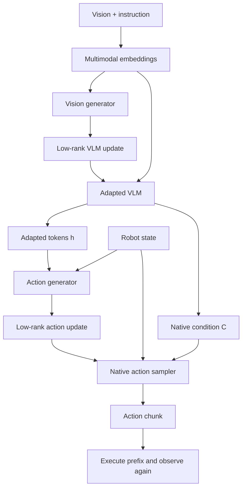

# MorphAct 핵심 기술 학습

## 준비 지식
linear projection, backpropagation의 chain rule, LoRA, Transformer prefix/KV, imitation learning, action chunk, conditional flow matching을 순서대로 이해하면 좋습니다. 아래 작은 예는 교육용이며 official model 구현이 아닙니다.

## 용어
- **Hypernetwork**: 다른 network에서 사용할 parameter를 생성하는 network.
- **Contextual parameterization**: 입력 context마다 effective weight가 달라지는 계산.
- **Low-rank factor**: 큰 update matrix 대신 저장·연산하는 작은 A/B matrix.
- **Representation coupling**: 앞 module을 수정해 얻은 feature로 뒤 module의 update를 생성하는 연결.
- **Replanning**: 새 observation으로 action chunk를 다시 예측하는 시점.
- **Action grounding**: instruction/perception을 실행 가능한 수치 action으로 연결하는 과정.
- **Native objective**: host backbone이 원래 사용하는 학습 target과 loss.

## 전체 흐름


## 1. LoRA를 먼저 숫자로 보기
row-vector convention에서 \(y=uW+s(uA)B\), \(s=\alpha/r\)입니다. dense update를 저장하지 않는다는 것이 핵심입니다. 예를 들어 \(u=(1,2)\), \(W=I\), \(A=(1,0)^T\), \(B=(0,1)\), \(s=1\)이면 출력은 (1,3)입니다. A/B가 고정이면 static adaptation이고, observation으로부터 생성하면 dynamic adaptation입니다.

```python
# Pure-Python educational residual; no actual MorphAct training.
def mm(a, b):
    return [[sum(x*y for x,y in zip(row,col))
             for col in zip(*b)] for row in a]
u = [[1.0, 2.0]]
W = [[1.0, 0.0], [0.0, 1.0]]
A = [[1.0], [0.0]]
B = [[0.0, 1.0]]
base, residual = mm(u,W), mm(mm(u,A),B)
y = [[x+d for x,d in zip(base[0], residual[0])]]
assert y == [[1.0, 3.0]]
```

## 2. 왜 action generator가 adapted feature를 받아야 하나
사진을 읽는 기준을 바꾼 뒤에도 제어 방식 생성기는 바꾸기 전 feature를 본다면 두 구성 요소의 기준이 어긋날 수 있습니다. MorphAct는 실제 action predictor가 사용하는 adapted perception과 action-side update generator의 condition을 연결합니다. 논문의 Unadapted ablation은 이 condition만 바꿔 분리합니다. 단순히 “VLM을 업데이트하면 항상 성공한다”는 주장이 아닙니다.

## 3. Gradient의 두 길
\(L(r,\Delta\theta_a(r))\)에서 \(r\)의 변화는 action condition과 generated action weight 둘 다 바꿉니다. chain rule에는 직접 경로와 generator를 통과하는 간접 경로가 함께 있어야 합니다. action-generator 입력을 detach하면 후자를 제거하므로 원래 학습법과 달라집니다. frozen backbone 역시 입력에 대한 gradient 전파는 필요합니다. frozen이라는 말은 그 weight를 optimizer로 갱신하지 않는다는 뜻입니다.

## 4. Flow target의 방향
\(z_\tau=(1-\tau)Y+\tau\epsilon\)로 정의했으므로 training velocity target은 \(\epsilon-Y\)입니다. 문헌마다 시간 방향이 다를 수 있으니 formula와 sampler를 함께 확인해야 합니다. 이 velocity를 그대로 robot actuator에 보내는 것이 아니라 native solver가 action chunk를 만들도록 사용합니다.

## 5. 두 clock: context와 solver
1. observation version t를 받습니다.
2. 두 generator와 adapted VLM을 실행해 factor/condition을 만듭니다.
3. action solver가 여러 번 expert를 부르는 동안 같은 version의 cache를 사용합니다.
4. chunk의 실행 prefix 뒤 새 observation을 받으면 cache를 교체합니다.

noise step마다 generator를 다시 실행하면 논문의 reuse 방식보다 비쌉니다. 반대로 다음 observation에서도 factor를 계속 쓰면 context-conditioned 의미가 사라집니다. concurrent serving에서는 요청별 cache 격리도 필요합니다.

## 6. 구현과 배포에서 체크할 것
- A/B의 dtype, scaling, block rank와 head layout을 명시합니다.
- 두 readout을 무조건 zero로 두면 generator trunk의 초기 gradient가 막힐 수 있습니다.
- validity mask와 batch reordering 후 sample별 factor 매칭을 검사합니다.
- generator parameter 수와 생성 tensor 수를 분리해 memory estimate를 만듭니다.
- chunk latency, executed-prefix schedule, observation age, measured control rate를 각각 profile합니다.
- dynamic matmul을 NPU가 지원하는지와 weight-change overhead를 실측해야 합니다. 이 논문은 NPU 성능표를 제공하지 않습니다.

## 자가 점검 Q&A
**Q1. inference에서 로봇이 loss를 계산해 학습하나요?** 아니요. 학습된 generator의 forward가 effective weight를 만듭니다.

**Q2. task-ID를 generator에 넣으면 같은 방법인가요?** 아니요. 같은 task 내부 context 변화가 빠집니다. 저자는 고정/Task-ID condition과 비교합니다.

**Q3. success가 8%에서 22%면 +14%인가요?** 정확한 절대 차이는 +14 percentage points입니다. 높은 개선 폭과 높은 최종 신뢰성은 별개입니다.

**Q4. 164 ms의 역수가 control Hz인가요?** 아닙니다. 실행 chunk의 길이와 scheduling이 개입하므로 논문의 measured 21.20 Hz를 별도로 봅니다.

**Q5. 자동차에 바로 옮길 수 있나요?** 방법의 가설은 옮길 수 있지만 vehicle action representation, independent safety, long-tail closed-loop와 timing을 새로 검증해야 합니다.

## 읽기 로드맵
1. HyperNetworks와 LoRA로 “weight 생성”과 “low-rank 표현”을 분리합니다.
2. π0의 native flow action interface를 확인합니다.
3. MorphAct Figure 3, Eq. 1–4, Algorithm 2를 연결합니다.
4. Table 3의 Unadapted ablation 및 Appendix D.2의 비용을 읽습니다.
5. task-weighted metric, OOD robustness와 deadline 관점에서 follow-up experiment를 설계합니다.

출처: [MorphAct v1](https://arxiv.org/html/2610.20019v1). 구현 제안과 교육 예시는 독자 해설입니다.
