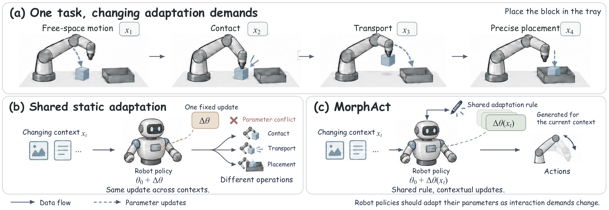
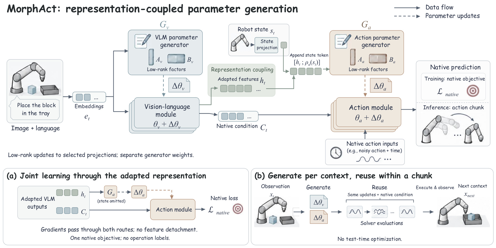

# MorphAct: 환경과 상호작용에 맞춰 변하는 로봇 정책

> 문서 성격: 원문의 절별 논점을 바탕으로 다시 구성한 **상세 한국어 기술 해설**입니다. 원문 전체의 대체 번역이나 축약 없는 Abstract 번역이 아닙니다. arXiv 페이지는 perpetual non-exclusive license로 표시되어 있어 전면 번역 대신 독자적인 요약·수식 설명·평가 비평을 제공합니다. 원문의 Appendix A–D 전체, 전수 실험표, 감사문은 재현하지 않았습니다. 아래 성능은 저자 보고이며 독립 재현 결과가 아닙니다.

- 원제: MorphAct: Robot Policies Morphing with the Worlds They Act In
- 저자: Ziyan Liu, Jiting Liu, Weihong Zhong, Wenda Yu, Yeqiu Chen, Jason Li, Xiaojiang Peng, Shuyuan Hu, Kai Wang, Bo Zhao
- 읽은 버전: arXiv:2610.20019v1, 2026-10-14
- 본문 근거: [versioned HTML](https://arxiv.org/html/2610.20019v1), §2–5, Appendix C/D.

## Abstract의 핵심 의미

하나의 로봇 조작 안에서도 물체에 접근할 때와 접촉한 뒤 정밀하게 놓을 때 필요한 시각 단서와 제어 성질은 다릅니다. 그런데 일반적인 VLA는 학습을 마친 동일한 weight로 이 과정을 모두 처리합니다. MorphAct의 질문은 입력에 따라 activation만 바꾸는 데서 더 나아가, **현재 상호작용에 맞는 작은 weight 변화도 생성하면 어떨까**입니다. 저자는 vision-language module과 action module의 low-rank update를 각각 생성하되, 앞쪽 module이 바뀐 뒤의 representation을 뒤쪽 generator에 전달합니다. 세 VLA backbone 및 실제 조작 평가에서 개선을 보고하지만, 추가 generator가 있기 때문에 inference 비용은 증가합니다.

## 1. Introduction: 같은 명령이 같은 제어 조건을 뜻하지 않는다

예를 들어 “물체를 서랍에 넣으세요”라는 문장은 바뀌지 않아도 접근·집기·운반·좁은 공간 정렬은 다른 연산을 요구합니다. task마다 고정 adapter를 선택하는 것만으로는 이러한 task 내부 변화를 충분히 표현하지 못할 수 있습니다. 저자의 목표는 task 이름별 전문 모델을 따로 저장하는 대신, 현재 observation에서 적합한 변화량을 만드는 **공유 생성 규칙**을 배우는 것입니다. 이는 world model을 추가하거나 언어로 행동을 장황하게 설명하는 접근과 구분됩니다.

## 2. Parameter conflicts: 동기는 무엇으로 측정했는가

RoboCasa365의 65 atomic task와 고정 π0.5 checkpoint를 사용합니다. 서로 다른 episode를 분리해 gradient cosine, 한 번의 update가 다른 task loss에 주는 영향, module 내부 parameter group의 상쇄를 봅니다. cross-task negative gradient alignment 비율은 VLM 47.80%, action 48.28%이고, within-task reference도 각각 38.94%, 42.69%로 적지 않습니다. 따라서 서로 다른 task 사이의 충돌만 문제인 것은 아닙니다.

260개의 one-step update는 모두 source batch loss를 낮췄지만, 다른 64개 task 중 22–46개의 target batch loss를 올렸습니다. 이것은 특정 checkpoint 주변의 local interference 근거이지, 모든 학습 경로의 필연적 실패 증명은 아닙니다. 또한 training loss 상승은 실제 rollout 실패와 같은 지표가 아닙니다.

## 3. Method / Architecture: 두 generator를 어떤 순서로 연결하는가

현재 context를 \(x_t=(o_t,\ell,s_t)\)로 둡니다. observation과 instruction의 embedding에서 vision-side generator가 update를 만듭니다. 수정된 VLM은 두 출력을 제공합니다. \(h_t\)는 action-generator condition이고 \(C_t\)는 host policy의 native action-conditioning interface입니다.

\[
\Delta\theta_{v,t}=G_v(E(o_t,\ell)),\qquad
(h_t,C_t)=F_v(E(o_t,\ell);\theta_v+\Delta\theta_{v,t})
\]
\[
\Delta\theta_{a,t}=G_a(C_a(h_t,s_t)),\qquad
\widehat Y_t=\pi_{\theta+\Delta\theta(x_t)}(x_t).
\]

중요한 구분은 **action predictor에 representation을 넣는 경로**와 **action weight 자체를 생성하는 경로**가 동시에 존재한다는 것입니다. π 계열에서는 adapted prefix pass의 final token과 layer-wise KV state가 이 역할에 대응합니다. state projection으로 만든 token을 condition에 더합니다.

### Structured low-rank update

행벡터 입력 표기에서 한 block의 update는 다음과 같습니다.

\[
A_t\in\mathbb R^{d_{in}\times r},\quad B_t\in\mathbb R^{r\times d_{out}},\quad
\Delta W_t=(\alpha/r)A_tB_t.
\]

실제로는 큰 dense matrix를 만들지 않고 \(uW+(\alpha/r)(uA_t)B_t\)를 계산합니다. rank는 **생성 block별 rank**이며 assembled multi-head matrix의 rank와 혼동하면 안 됩니다. generator는 HY-WU의 구조화 합성 방식에 기반하고, layer/projection/rank 정보를 query에 담아 condition token과 attention합니다.

### Native action objective와 gradient

기본 VLM/action backbone은 동결하고 generator, state projection 및 해당 설정의 trainable projector를 native action loss로 학습합니다. operation label이나 별도 expert-adapter target은 필요하지 않습니다. 생성된 A/B는 optimizer가 직접 저장·갱신하는 독립 parameter가 아니라 generator의 미분 가능한 출력입니다.

π 계열에서는 \(z_\tau=(1-\tau)Y+\tau\epsilon\)에서 \(\epsilon-Y\) velocity를 예측하는 flow-matching loss를 사용합니다. X-VLA integration은 clean action target을 유지합니다. 따라서 π의 학습 출력과 실행 시 얻는 action chunk를 같은 것으로 쓰면 안 됩니다. action loss의 gradient는 native condition 경로와 action-generator 경로 모두를 통해 upstream generator로 돌아갑니다.

### Replanning과 chunk reuse

각 observation에서 두 update와 adapted condition을 한 번 구한 뒤, 해당 action chunk를 만드는 solver step 전체에 재사용합니다. 새 observation으로 replan하면 다시 생성합니다. noisy action이나 solver time마다 generator를 재실행하지 않으며, 실행 중 gradient descent를 하는 test-time optimization도 아닙니다. 그렇다고 generator 비용이 0이 되는 것은 아닙니다.

## 4. Experiments: 무엇이 좋아졌고 무엇을 평균했는가

| 평가 | 비교 | 저자 보고 baseline → MorphAct | 해석 |
|---|---|---|---|
| LIBERO | π0.5 | 96.85 → 98.60% | 네 suite 평균, +1.75 pp |
| LIBERO | X-VLA | 93.05 → 97.20% | Long 개선이 큼 |
| Meta-World | π0 | 50.75 → 67.05% | 네 난이도 group의 동일 가중 평균 |
| 실물 Sort Hardware | π0.5 | 8 → 22% | +14 pp지만 절대 성공률은 낮음 |
| 실물 Cabinet Storage | π0.5 | 84 → 96% | 각 방법 50 physical rollout |

LIBERO는 40 task, task당 50 rollout이며 MorphAct 점수는 세 random seed 평균입니다. Meta-World는 MT50, task당 20 rollout이고 Easy/Medium/Hard/Very Hard의 task 수가 다르지만 네 group의 평균을 동일 가중으로 계산합니다. 따라서 표의 Avg.를 전체 task-weighted SR이라고 부르면 틀립니다. baseline variance는 보고되지 않아 불확실성 비교가 대칭적이지 않습니다. π0.5의 LIBERO Spatial은 98.80%에서 98.33%로 소폭 하락하므로 모든 항목에서 개선했다는 해석도 피해야 합니다.

### Inference cost

Appendix D의 matched setting에서 π0의 chunk latency는 120 → 145 ms, π0.5는 138.71 → 164 ms입니다. generator parameter는 300.09M, 활성 A/B scalar는 49.99M으로 두 수치의 뜻이 다릅니다. π0.5 memory는 7.88 → 9.53 GiB, 측정 control rate는 24.99 → 21.20 Hz입니다. control rate는 실제 action-execution schedule에서 측정했으므로 단순히 1/chunk latency로 계산한 숫자가 아닙니다.

## 5. Analysis / Ablation: coupling이 단순한 추가 용량인가

X-VLA/LIBERO에서 context condition을 고정하거나 Task-ID로 바꾸면 mean은 각각 87.50%, 88.25%로 full MorphAct 97.20%보다 낮습니다. Action-only 81.00%, VLM-only 43.50%이고, 두 module을 수정해도 action generator에 pre-adaptation feature를 쓰는 Unadapted는 86.00%입니다. 저자는 이를 현재 context 및 adapted representation coupling의 근거로 해석합니다. 다만 이 ablation을 모든 backbone·실세계 환경에 동일한 크기로 일반화하거나, gradient conflict가 완전히 사라졌다는 증거로 확대하면 안 됩니다.

## 6. Related work와 위치

Hypernetwork는 weight를 생성하는 일반 틀, LoRA는 low-rank adaptation의 효율적 표현입니다. MorphAct의 차별점은 두 개념 자체의 발명이 아니라 **upstream perception의 변경 결과를 downstream action parameter 생성에 사용하는 순서**입니다. numerical action VLA 연구이며 textual action generator나 driving slow/fast dual system이라고 분류하지 않습니다.

## 7. Conclusion와 한계

현재 representation과 control parameter를 함께 조정하는 인터페이스가 multi-task VLA에 유용할 수 있다는 연구입니다. 그러나 finite manipulation success는 safety guarantee가 아니며, contact failure와 OOD condition에서 급격한 weight 변화를 관리해야 합니다. 자율주행에의 적용은 독자의 연구 가설입니다. 논문은 CARLA/nuPlan closed-loop, 차량 collision rate, 교통규칙 준수, NPU 실행 성능을 입증하지 않습니다.

## Figure guide

Figure 1 읽기: 동일 명령 아래 서로 다른 단계의 요구를 관찰하고, static weight와 context-dependent update를 대비합니다.

Figure 3 읽기: adapted VLM에서 action generator와 native action condition으로 갈라지는 두 경로를 찾으세요. 이 설명은 원문 caption의 직역이 아니라 학습용 해설입니다.

Figure 4의 실물 예시는 figures/real-world-panel-000.png부터 003.png까지 내려받았습니다. HTML에서 image로 노출되지 않은 Figure 2/기타 plot은 [원문 해당 절](https://arxiv.org/html/2610.20019v1#S2)에서 확인할 수 있습니다.
