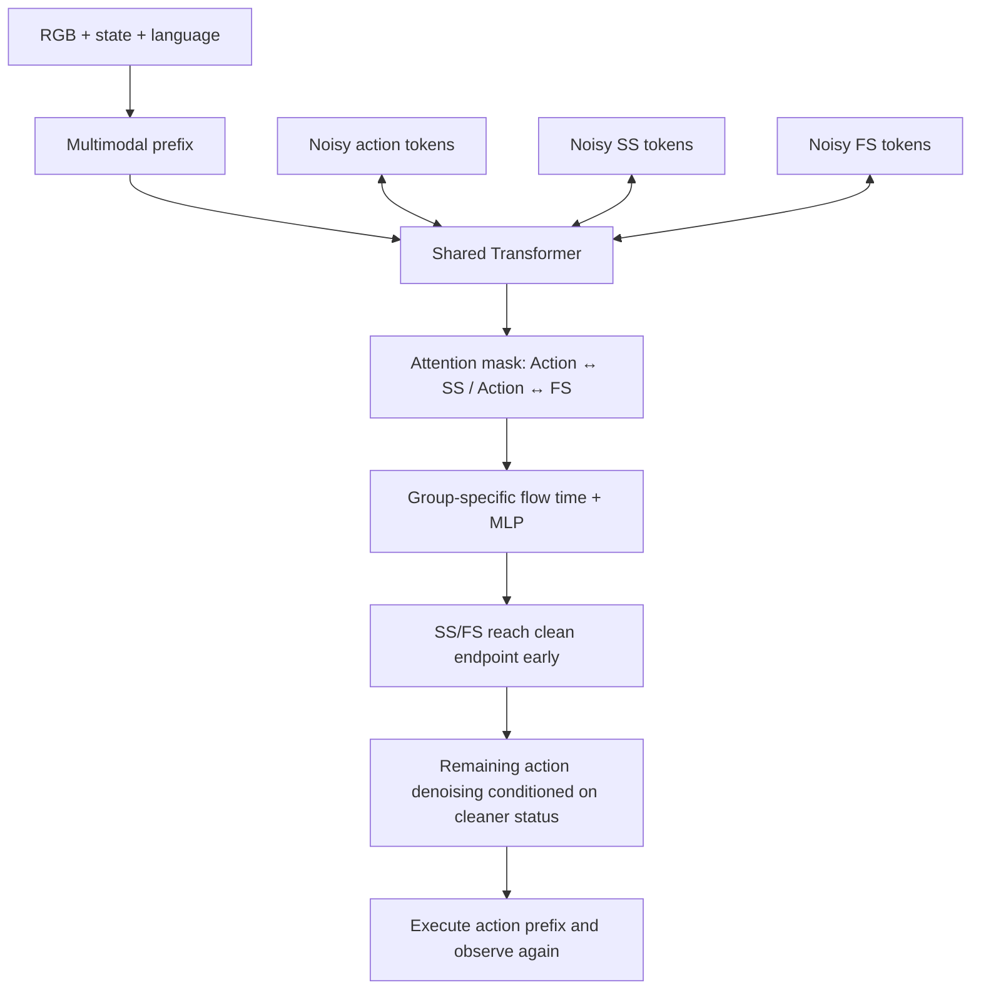

# Echo 분석

## 한 문장 결론

**실패를 알아차리는 auxiliary head만 붙이지 말고, 빠르게 정제한 stop/failure signal이 action denoising에 실제로 영향을 주도록 학습하자.** Echo의 핵심은 signal 추가 자체보다 **data semantics + attention topology + denoising schedule**의 결합이다.

> 근거 구분: 아래 실험 숫자·설계는 원문 저자 보고다. AD 전이·NPU deployment·보완 실험 제안은 이 문서의 해석이며 실제 차량/NPU에서 검증하지 않았다. 본문 번역과 원문 그림은 `paper-ko.md` 참조.

## 1. 무엇을 해결하는가?

일반 action-only VLA는 “다음에 무엇을 움직일까?”에는 답하지만 “이미 끝났나?”, “계속하면 안 되는 실패인가?”, “조금 빼고 다시 시도할 수 있나?”라는 execution lifecycle을 명시적으로 표현하지 않을 수 있다. 외부 evaluator를 두면 모듈·latency가 늘고, status head만 두면 status가 실제 action에 쓰이지 않을 수도 있다.

Echo는 이 두 문제를 한 policy 안에서 다룬다. Frame별 progress label은 요구하지 않되, **subtask boundary·segment type·recovery boundary**는 사용한다. 따라서 무주석 학습이나 failure-data-free 방법이 아니다.

## 2. Taxonomy와 선정 이유

WorldBench의 VA/VLA taxonomy는 VA의 action/perception/world-model 계열과 VLA의 textual action·numerical action·explicit guidance·implicit transfer를 구분한다. 이 taxonomy를 robotics에 확장해 읽으면 Echo는 **Numerical Action Generator VLA + policy-internal explicit status guidance**다. Language는 instruction conditioning이고 실제 출력은 continuous robot action chunk다. Textual explanation을 actuator에 그대로 넘기는 방식도, frozen VLM teacher의 representation distillation도 아니다.

- 당주 후보 HiSTEVE는 더 높은 topic score/upvote를 가졌지만 Minecraft keyboard/mouse control이다. 이번에는 physical robot recovery·bounded runtime interface를 집중적으로 다루는 Echo 한 편을 선정했다. HiSTEVE를 중복이라고 제외한 것은 아니다.
- Echo는 자율주행 논문은 아니다. AD에 중요한 **ongoing/recoverable/terminal 상태와 continuous action의 연결**을 학습할 가치가 있다.
- 후보 ID `2610.31569`와 distinctive title `Coupled Action and Task Status`를 raw/wiki에서 검색했고 기존 주제별 분석은 없었다.
- 현재 주 `2026-W44` 후보를 사용했다. 이전 주로 fallback할 필요가 없었다.

Taxonomy anchor: <https://worldbench.github.io/vla4ad>, <https://github.com/worldbench/awesome-vla-for-ad> (2026-10-28 확인).

## 3. Input / Output / Architecture

| 계층 | 내용 |
|---|---|
| 실물 입력 | Head RGB + 양 wrist RGB, robot state, subtask language instruction |
| 실물 출력 | H=60 action chunk + SS/FS 각각 H개; 20-DoF platform control |
| Simulation 입력 | Third-person/wrist RGB, state, instruction |
| Simulation 출력 | H=50, 7D end-effector/gripper action + SS/FS |
| Backbone | π0.5 기반 flow-matching VLA |
| Token group | Multimodal prefix, action, stop, failure |
| 학습 | Shared Transformer, group별 projection·feature MLP·output projection |
| Action grounding | Instruction/vision/state와 두 status group을 condition으로 continuous velocity field를 예측·적분 |

이 그림은 공통 Transformer 처리의 개념도다. 실제 mask는 SS↔FS direct edge를 차단한다. Shared action/prefix를 통한 간접 정보 경로까지 완전히 차단한다는 뜻은 아니다.

## 4. Training recipe의 핵심: Failure action을 배우지 않고 Failure state를 배운다

- **Success:** action·SS·FS를 학습한다. 완료 후 padding은 stop=1, failure=0.
- **Terminal failure:** action loss=0. Padded boundary로 stop=1/failure=1을 학습한다. Non-padded chunk에서는 FS loss를 끈다. Failure onset을 모르기 때문이다.
- **Pre-intervention failure:** action loss=0. Takeover는 과제 종료가 아니므로 SS=0. Padded boundary FS는 1.
- **Recovery:** correction action은 valid position에서만 imitation한다. Recovery가 전체 완료와 같지 않아 padded SS/action은 학습하지 않는다. FS 평균은 recovery progress에 맞춰 1→0으로 내려간다.

실물 sampling 20:1:2:20은 dataset count가 아니라 **training draw ratio**다. Simulation은 pre-intervention 없는 세 종류이며 40:1:20, recovery SS padding rule도 다르다. 부록 A.10 recipe를 실물 table에 덮어쓰면 잘못된 재현이다.

## 5. Asynchronous denoising을 왜 쓰는가?

\[
\tau_{signal}=\max(0,(\tau_A-c)/(1-c)).
\]

실물 c=0.5에서는 action이 여전히 중간 noise level일 때 signal을 clean하게 만든다. Signal이 먼저 안정된다는 motivating observation에 맞춰 설계한 것이다. Signal value는 endpoint 이후 고정하고 action은 계속 갱신한다. 모든 step의 signal value를 ground-truth처럼 믿거나 externally clamp하는 것은 정상 inference와 다르다.

실물 joint output tensor는 H×(da+2)이지만 model 내부 generated sequence는 action H + SS H + FS H = **3H**다. “두 dimension만 추가하므로 token cost가 무시 가능하다”는 해석은 틀리다. Compute 증가량은 prefix caching, projection, attention kernel, MLP 구조에 따라 측정해야 한다.

## 6. 결과에서 무엇을 믿을 수 있는가?

### 저자가 보인 것

- 실물 다섯 task의 0–10 completion score가 baseline보다 높다. 예: Flower 5.67→8.33, Drawer 5.40→7.90.
- Flower OOD 2.00→8.00이지만 ID는 9.33→8.67이다. “모든 조건에서 개선”은 아니다.
- Signal→Action attention을 제거하면 Flower score 8.33→5.00인데 status Frame F1은 92.18→90.78로 비교적 유지된다. Signal readability와 controllability를 분리하는 중요한 ablation이다.
- Simulation 4,500 trials에서 32.67→34.76%, 즉 **+2.09 pp**다. 89.97% status accuracy는 episode Macro-F1이 아니다.
- RTX 4090 latency는 115→120 ms이고 실물 query rate는 5 Hz다. 큰 overhead를 요구하지 않는 저자 setup의 증거다.

### 아직 보이지 않은 것

- 동일한 양의 failure observation을 다른 auxiliary objective에 줘도 이득이 같은지.
- 다수 training seed, 다양한 platform, 큰 failure taxonomy에 대한 robustness.
- Recoverable/terminal boundary의 보편적 calibration과 false-negative risk.
- Road driving closed-loop, emergency maneuver, collision rate 또는 NPU kernel-level 실험.
- External monitor와 결합했을 때의 성능. 원문은 architecture compatibility만 설명한다.

## 7. Metric 해석 함정

1. **Task score ≠ success rate.** 접촉·빈 grasp 감점과 Tanghulu partial credit이 있다.
2. **Frame Macro-F1 ≠ accuracy.** 실물은 episode별 실제 존재 class를 평균하고 그 후 episode 평균이다. Simulation은 평가 frame 수로 weight한다.
3. **Trajectory F1은 W에 의존한다.** 15 frames는 5 Hz에서 3초다. Task completion 상태를 수 초 늦게 알아차려도 인정할 수 있다. Emergency stop latency의 증거가 아니다.
4. **Failure GT coverage가 task마다 다르다.** Capsule/Drawer의 Echo evaluation에는 terminal-failure sample이 없다.
5. **Simulation rollout 종료가 비대칭이다.** Baseline은 first success stop, Echo는 끝까지 실행한다. SR은 ever-success이므로 성공을 유지했는지 보장하지 않는다.
6. **Evaluation seeds ≠ training seeds.** 세 simulation seed는 동일한 trained checkpoint의 환경 trial 변형이다.
7. **Continuous SS/FS ≠ calibrated probability.** Thresholded score이며 확률 calibration을 입증한 것은 아니다.

## 8. Safety / Latency / Deployment

**AD 전이 가설:** 주차·pull-over·lane-change 같은 maneuver segment에 stop/failure와 correction data를 붙이는 사고방식은 유용할 수 있다. 그러나 차량의 “stop”은 robot subtask completion과 물리적으로 다르며, 즉시 정차가 오히려 위험한 환경도 있다. Action interface에는 trajectory feasibility, traffic rule, collision check, low-level actuator constraint가 따로 필요하다. SS/FS를 E-stop의 유일한 trigger로 쓰면 안 된다.

**Runtime 설계 제안:** observation timestamp·deadline·signal freshness를 기록하고, stale observation이나 out-of-range action은 독립 monitor가 차단하도록 한다. Recovery invocation은 bounded horizon, reachable region, operator takeover 및 safe fallback과 함께 설계한다. 이 내용은 논문의 실험 결과가 아니라 deployment 제안이다.

**NPU 관점:** Token-wise flow time, group별 MLP, custom attention mask가 compiler fusion·quantization·static-shape graph에 어떤 영향을 주는지 검증해야 한다. RTX 4090의 +5 ms를 NPU overhead로 복사하면 안 된다. INT8에서 action error와 status threshold crossing을 별도로 측정해야 한다.

## 9. 기존 Wiki와의 연결

- VLA-Corrector: external feature monitor와 inference correction 대 Echo의 policy-internal signal/action coupling.
- MotorMind: asynchronous external harness lifecycle 대 Echo의 내부 learned signal. 결합 가능성은 있지만 검증은 별개다.
- PerturBot: input-evidence shortcut을 training data intervention으로 다룸. Echo의 status shortcut/copying 문제와 layer가 다르다.
- MorphAct: runtime effective-parameter generation 대 runtime status conditioning. 두 방법은 대체 관계라고 단정할 수 없다.

## 10. 다음 실험을 한다면

- Same failure data를 쓰는 joint-head/no-feedback, full feedback, async feedback을 비교한다.
- W=1/5/15별 detection delay와 false-stop/false-continue를 보고한다.
- Failure onset과 recoverability를 별도 annotate한 held-out set에서 calibration을 확인한다.
- Recovery action count·task score·contact cost·ever-success/retained-success를 함께 측정한다.
- End-to-end camera→action p50/p95/p99 latency, stale-frame behavior, quantized status drift를 보고한다.

## 검증 범위

원문 HTML/abs/HF metadata, Semantic Scholar references 38건, 10 figure assets를 수집했다. PNG 8개는 signature·chunk CRC·zlib decode와 SHA-256, SVG 2개는 XML parse·script 부재·SHA-256을 확인한다. 교육 예제는 실행 검증하지만 policy training·robot rollout·NPU deployment는 수행하지 않는다.
