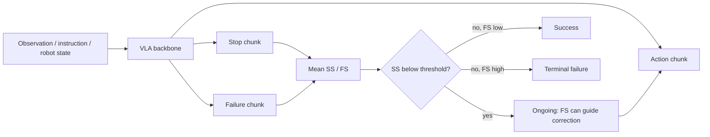

# Echo 핵심 기술 학습 자료

## 0. 학습 목표와 범위

이 자료를 읽고 나면 (1) stop과 failure를 분리하는 이유, (2) 실패 action을 imitate하지 않고 실패 상태를 배우는 mask, (3) signal을 먼저 clean하게 만드는 flow-time schedule, (4) 평가 window와 safety deadline의 차이를 설명할 수 있어야 한다.

아래 코드는 **논문 모델 구현이나 robot controller가 아니라 순수 Python 교육용 sanity check**다. 실제 학습·checkpoint inference·robot rollout은 하지 않는다. 원문 근거는 `paper-ko.md`의 수식 1–14 및 부록 A.4/A.10이다.

## 1. 선행 지식

1. Behavior cloning: 성공적인 state→action pair를 imitate한다. 실패 trajectory를 같은 loss로 넣으면 실패 행동도 학습할 수 있다.
2. Action chunk: 한 번의 query로 여러 미래 action을 생성하되 일부만 실행하고 observation을 갱신한다.
3. Flow matching: noise에서 clean sample로 가는 vector field를 학습한다.
4. Attention mask: token 사이의 정보 전달을 허용/차단한다. Loss mask와는 역할이 다르다.
5. Distribution shift: policy가 training demonstration 밖의 state를 방문하면 recovery 능력이 중요해진다.

## 2. Glossary

| 용어 | 이 논문에서의 뜻 | 헷갈리면 안 되는 것 |
|---|---|---|
| SS | 실행을 종료할지를 나타내는 stop signal | Physical emergency stop command 자체 아님 |
| FS | Failure-state 정도를 나타내는 learned signal | Calibrated failure probability로 검증된 값 아님 |
| Terminal failure | 실행 종료를 요구하는 failure | 모든 high-FS 상태와 같지 않음 |
| Recoverable failure | SS는 낮고 FS는 높은 수정 가능한 상태 | 무조건 성공적 복구를 보장하지 않음 |
| Padding | Segment 경계 밖 action position | 항상 success label을 의미하지 않음 |
| Supervision mask | 해당 position의 loss를 계산할지 | Transformer attention mask와 다름 |
| Flow time τ | 1=noise, 0=clean | Episode time t와 다름 |
| τclean | Signal이 clean해지는 action flow time | 실제 wall-clock latency 아님 |
| Trajectory F1 window W | Outcome onset 후 평가가 허용하는 prediction window | Online confirmation buffer나 E-stop deadline 아님 |

## 3. 먼저 상태 표현을 직관적으로 이해하기

꽃을 꽃병에 꽂는 과제를 생각한다.

- 꽃을 향해 손을 뻗음: SS 낮음, FS 낮음 → 계속 진행.
- 꽃이 병 입구에 걸림: SS 낮음, FS 높음 → 종료가 아니라 수정 행동.
- 꽃을 제대로 꽂음: SS 높음, FS 낮음 → 성공 종료.
- 꽃을 떨어뜨리고 재시도가 불가능한 종료 상태: SS 높음, FS 높음 → terminal failure.

“Stop=성공”이라고 묶으면 실패 종료를 표현하기 어렵다. “Failure=즉시 종료”라고 묶으면 recoverable error에서 다시 시도할 기회를 버린다. 두 axis는 이런 lifecycle을 분리한다. 다만 실제 recoverability 판정은 data와 environment 정의에 의존한다.



## 4. Binary sequence로 연속 recovery progress를 나타내기

H=8이고 recovery가 절반 진행됐으면 `00001111`을 FS target으로 쓸 수 있다. 평균은 0.5다. 시작은 `11111111` → 1, 끝은 `00000000` → 0이다.

이 sequence를 future failure-onset label로 읽으면 안 된다. \(n_t=round(Hu_t)\)는 **현재 chunk가 시작하는 frame의 recovery progress**로 정한다. Binary sequence의 평균이 progress-related failure target이 되도록 구성한 것이다. Intermediate progress는 frame별 수동 annotation이 아니라 recovery segment의 상대 위치에서 유도된다.

## 5. 실행 가능한 mask·schedule 예제

이 예제는 실물 네 data type의 target과 loss mask, status threshold, async schedule을 확인한다. 반환된 boolean mask는 학습 loss용이며 attention mask가 아니다. Padding action target의 실제 repeat-last-value 구현이나 robot action vector normalization은 포함하지 않는다.

```python
from math import isclose


def supervision(kind, H, n_valid, progress=0.0):
    assert kind in {"success", "failure", "pre", "recovery"}
    assert H > 0 and 0 <= n_valid <= H
    assert 0.0 <= progress <= 1.0
    p = [int(i >= n_valid) for i in range(H)]
    has_pad = n_valid < H
    all_mask = [True] * H
    no_mask = [False] * H
    valid_mask = [i < n_valid for i in range(H)]
    if kind == "success":
        return p, [0] * H, all_mask, all_mask, all_mask
    if kind == "recovery":
        n = round(H * progress)  # Python round: ties-to-even
        fs = [int(i >= n) for i in range(H)]
        # action, SS: valid only; FS: all positions
        return [0] * H, fs, valid_mask, valid_mask, all_mask
    ss = p if kind == "failure" else [0] * H
    # Unknown FS targets on non-padded failure chunks are masked out.
    fs = p if has_pad else [0] * H
    return ss, fs, no_mask, all_mask, all_mask if has_pad else no_mask


def signal_time(action_time, clean=0.5):
    assert 0 <= action_time <= 1 and 0 <= clean < 1
    return max(0.0, (action_time - clean) / (1.0 - clean))


def status(ss_chunk, fs_chunk, threshold=0.5):
    assert len(ss_chunk) == len(fs_chunk) and ss_chunk
    s = sum(ss_chunk) / len(ss_chunk)
    f = sum(fs_chunk) / len(fs_chunk)
    if s < threshold:
        return "ongoing"
    return "success" if f < threshold else "terminal_failure"


# Short chunk for illustration, NOT the paper's H=60.
ss, fs, ma, ms, mf = supervision("success", 8, 5)
assert ss == [0, 0, 0, 0, 0, 1, 1, 1]
assert fs == [0] * 8 and all(ma) and all(ms) and all(mf)
assert status(ss, fs) == "ongoing"  # mean SS=3/8, below 0.5
ss, fs, ma, ms, mf = supervision("failure", 8, 8)
assert not any(ma) and not any(mf) and all(ms)
ss, fs, ma, ms, mf = supervision("pre", 8, 5)
assert ss == [0] * 8 and fs[-3:] == [1, 1, 1]
assert not any(ma) and all(mf)
ss, fs, ma, ms, mf = supervision("recovery", 8, 5, 0.5)
assert fs == [0, 0, 0, 0, 1, 1, 1, 1]
assert sum(ma) == sum(ms) == 5 and all(mf)
assert status([0] * 8, [1] * 8) == "ongoing"
assert status([1] * 8, [0] * 8) == "success"
assert status([1] * 8, [1] * 8) == "terminal_failure"
assert supervision("recovery", 8, 8, 0)[1] == [1] * 8
assert supervision("recovery", 8, 8, 1)[1] == [0] * 8
assert round(2.5) == 2 and round(3.5) == 4

schedule = [(a, signal_time(a)) for a in [1, 0.75, 0.5, 0.25, 0]]
assert schedule == [(1, 1.0), (0.75, 0.5), (0.5, 0.0),
                    (0.25, 0.0), (0, 0.0)]
assert isclose(signal_time(0.5, 0), 0.5)  # synchronous case
assert isclose(signal_time(0.7, 0.7), 0.0)  # simulation endpoint
print("mask/status/schedule checks passed")
```

**이 예제가 보여 주는 미묘한 점:** Success segment의 끝을 일부만 넘어간 chunk라도 SS 평균이 0.5보다 작으면 ongoing으로 판정한다. Padding bit 하나가 있다고 즉시 stopping하는 것이 아니다. Model이 생성한 연속 estimate는 위의 binary target과 정확히 같지도 않을 수 있다.

## 6. Flow matching의 부호 확인

원문 convention은 \(x_\tau=(1-\tau)x_0+\tau\epsilon\), target velocity는 \(\epsilon-x_0\)다. 따라서 inference에서 \(\tau\)를 **감소**시키는 update를 해야 한다. 아래는 학습된 model이 아니라 정확한 toy velocity로 산식을 확인한다.

```python
from math import isclose

x0, noise, tau = 2.0, -1.0, 0.75
x_tau = (1 - tau) * x0 + tau * noise
velocity = noise - x0
clean_estimate = x_tau - tau * velocity
assert isclose(clean_estimate, x0)

# Integrate exact constant velocity from noise (tau=1) to data (tau=0).
x = noise
old_tau = 1.0
for new_tau in [0.75, 0.5, 0.25, 0.0]:
    x += (new_tau - old_tau) * velocity
    old_tau = new_tau
assert isclose(x, x0)
print("flow-time sign check passed")
```

실제 Transformer의 velocity는 current noisy input/context에 의존하므로 constant velocity 예제가 실제 diffusion/flow sampler를 대체하지는 않는다. Signal의 clean endpoint 뒤에는 signal을 고정하고 action group만 계속 update해야 한다.

## 7. Attention과 Loss의 역할을 구분하기

- **Loss mask:** “이 target을 맞히도록 학습할 것인가?”를 정한다. 실패 action은 loss=0이어도 status supervision에는 그 observation을 쓸 수 있다.
- **Attention mask:** “이 token이 어떤 token을 읽을 수 있는가?”를 정한다. Echo는 action↔signal을 허용하지만 direct SS↔FS는 막는다.
- **별도 MLP:** 같은 attention stack을 쓰더라도 feature transformation을 group별로 다르게 유지한다.
- **Async flow time:** 읽는 signal의 noise level을 낮춘다. Attention만 연결한다고 언제나 유용한 signal이 되는 것은 아니다.

저자 ablation에서 Signal→Action을 막으면 status F1은 유지되지만 task score가 크게 떨어진다. 이것이 readout probe의 성능만으로 feedback 효과를 주장할 수 없는 이유다.

## 8. Implementation / Deployment 체크리스트

1. Real-world recipe와 simulation recipe를 별도 config로 관리한다. H=60/50, τclean=0.5/0.7, recovery SS rule이 다르다.
2. Successful padding action은 repeat-last-action, recovery padding action은 loss off다. 동일한 zero padding 처리로 덮지 않는다.
3. FS supervision이 없는 failure chunk에서 임의로 FS=0 loss를 주지 않는다.
4. Sampling ratio와 dataset count를 별도 log에 남긴다.
5. Final chunk mean→threshold를 원문대로 구현하고 first token만 쓰거나 clipped score를 probability라고 부르지 않는다.
6. Generated token 3H, token-wise time B×L, group별 projection/MLP의 shape를 test한다.
7. Quantization에서는 action deviation뿐 아니라 threshold-near SS/FS drift를 확인한다.
8. Camera timestamp와 stale observation, replan interval, action-prefix cancellation을 runtime contract에 넣는다.
9. Learned SS/FS와 별개로 joint/torque/workspace constraint 및 hardware stop을 유지한다.
10. Wall-clock camera→actuation latency의 tail을 측정한다. RTX 4090의 120 ms나 3초 evaluation window로 safety deadline을 추정하지 않는다.

## 9. 공부 질문과 답

**Q1. 왜 실패 data에서 action loss를 끄나요?**

A. 실패 상태는 배울 가치가 있지만 그 action을 그대로 imitate하면 실패 행동을 강화할 수 있기 때문이다. Correction은 recovery demonstration에서 배운다.

**Q2. Frame-level progress annotation이 없다는 것은 label이 전혀 없다는 뜻인가요?**

A. 아니다. Success/failure segment label, subtask instruction/boundary, operator takeover와 recovery 구간이 필요하다. Progress-like FS target은 구간 상대 위치에서 만든다.

**Q3. FS=1이면 왜 stop이 아닌가요?**

A. SS가 낮으면 recoverable failure일 수 있다. Terminal failure는 SS와 FS가 함께 높을 때다.

**Q4. Signal이 먼저 clean해지면 더 정확해진다는 보장이 있나요?**

A. 없다. Faster denoising은 earlier usable estimate를 주는 inductive design이다. Wrong signal의 action contamination과 OOD calibration은 여전히 검증해야 한다.

**Q5. H×(da+2)이면 token도 두 개만 늘어나나요?**

A. 아니다. Target feature dimension의 두 column과 model 내부 두 H-token group은 다르다. 원문 실물 generated sequence는 60→180이다.

**Q6. Simulation 89.97% accuracy가 terminal-failure detector의 정확도인가요?**

A. 아니다. Ongoing/success 평가 frame의 count-weighted accuracy다. Timeout을 terminal-failure GT로 annotate하지 않는다.

**Q7. Simulation success 개선을 어떻게 표현하나요?**

A. 32.67%→34.76%, +2.09 percentage points다. Relative improvement와 pp를 구분한다.

**Q8. 외부 planner와 결합한 시스템의 개선도 증명했나요?**

A. 아니다. 원문 A.9는 architecture compatibility를 논의하고 별도 검증이 필요하다고 명시한다.

## 10. 짧은 Reading Roadmap

- 20분: `analysis.md`와 위 SS/FS 네 상태를 설명한다.
- 30분: `paper-ko.md` 표 1을 보지 않고 네 data type mask를 작성한다.
- 30분: 위 두 Python block을 실행하고 H·n_valid·progress·τclean을 바꿔 본다.
- 30분: 원문 ablation과 W sensitivity를 읽어 readability/action influence/detection delay를 나눈다.
- 20분: `references.md`에서 VLA-Corrector·ProgressVLA·Robometer를 비교한다.
- 20분: AD에 전이한다면 “stop”과 “failure”의 ground truth를 어떻게 정의할지 적고, learned signal과 independent safety mechanism의 역할을 분리한다.
