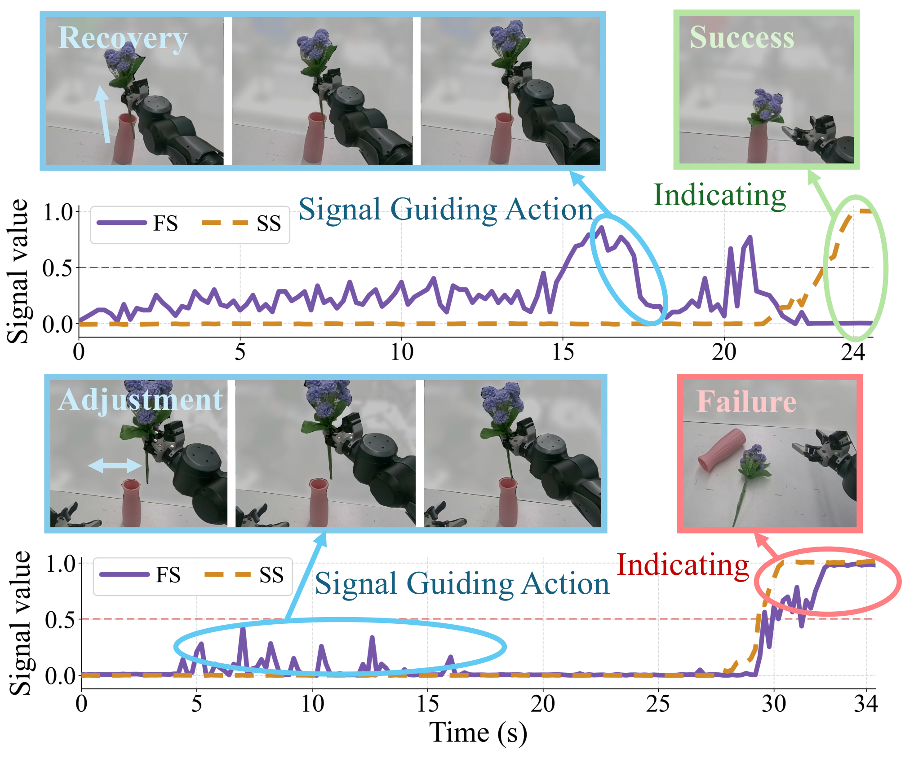
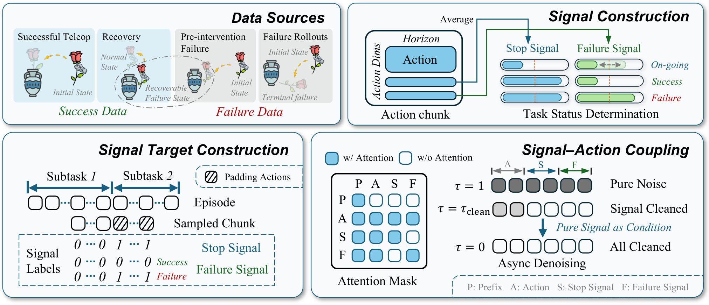
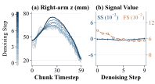
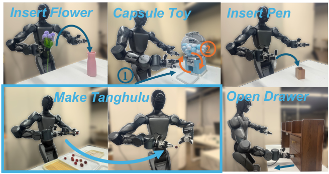
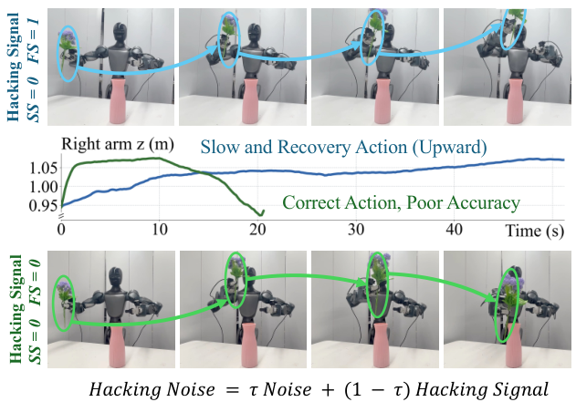
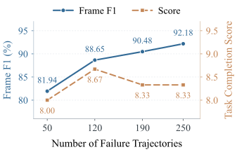
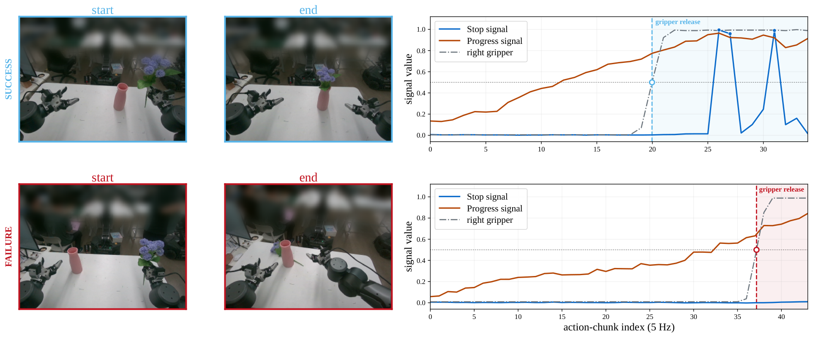
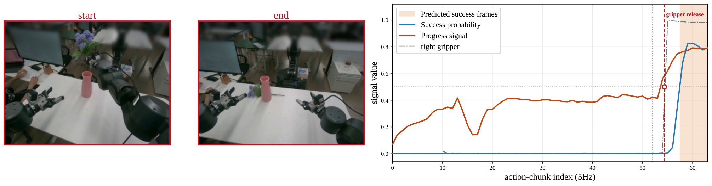
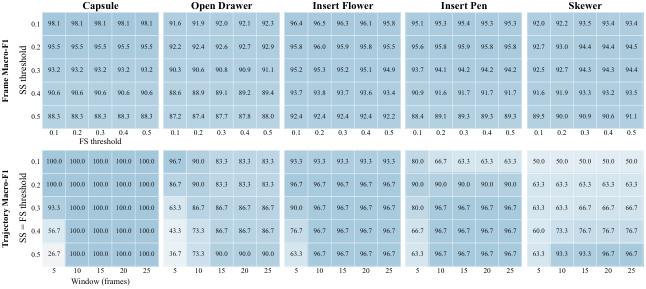
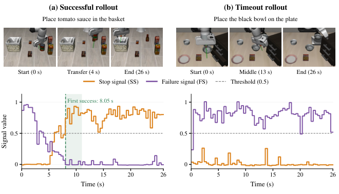

# Echo: VLA의 Action과 Task Status Signal을 함께 Denoising하기

원제: **Echo: Coupled Action and Task Status Signal Denoising for Vision Language Action Models**

원저자: Yufeng Liu, Bohao Fan, Juntu Zhao, Xinyi Wang, Hang Yu, Wenzhuan Luo, Yingzhi Wang, Qinghai Li, Yingdong Hu, Junliang Guo, Richard Wang, Dequan Wang, Yang Gao, Cheng Ma. 소속: SJTU, Spirit AI, THU, USTC, Tongji, HIT. 원문 arXiv v1, 2026-10-22 제출. 원문과 아래 8개 그림의 라이선스는 arXiv abs에서 **CC BY 4.0**을 확인했다. 이 문서는 Hermes가 한국어로 번역·편집한 파생물이며 원저자의 승인이나 공식 번역을 의미하지 않는다. 원문: <https://arxiv.org/html/2610.31569>, 라이선스: <https://creativecommons.org/licenses/by/4.0/>.

**읽기 범위:** 본문을 중심으로 번역하되 반복되는 인용 묶음은 참고문헌 지도에 연결했다. 부록 전체의 문장별 번역은 아니며, 부록의 모든 추가 수치표·heatmap 숫자와 baseline 구현 설명은 일부 축약했다. 원문의 표/그림 교차 참조 몇 곳은 표시 번호와 어긋나므로 아래에서는 실제 caption의 번호를 기준으로 정리했다. 별도 분석은 `analysis.md`, 선행 연구는 `references.md`, 예제는 `learning.md`에 있다. 이하 성능 수치는 모두 **저자 보고**이며 이 작업에서 독립적인 로봇 실험을 재현한 결과가 아니다.

## Abstract

로봇이 과제 완료와 실패를 알아차릴 수 있으면 성공했을 때 멈추고, 실패했을 때 복구나 재계획을 시작할 수 있다. 기존 연구는 VLA policy에 task status signal 예측을 추가해 이런 실행 판단을 지원했다. 하지만 signal의 학습과 통합에 세밀한 supervision, 외부 monitoring model 또는 복잡한 architecture가 필요한 경우가 있다. 또한 task status signal이 action generation 자체를 직접 안내할 가능성은 충분히 연구되지 않았다.

우리는 frame-level progress annotation 없이 task status signal을 학습하고, 하나의 VLA 안에서 status prediction과 action generation을 간결하게 결합하는 **Echo**를 제안한다. Echo는 stop signal과 failure signal을 각 action chunk에 두 개의 dimension으로 추가하고, robot action과 함께 denoising한다. 두 signal의 조합으로 실행 중, 성공적 완료, 실패를 구분한다. 세밀한 progress annotation 없이 이를 배우기 위해, 서로 보완적인 supervision을 제공하는 성공·실패·복구 trajectory를 구성한다.

상태 정보가 action generation을 안내하도록 signal과 action의 상호작용을 제어하고, signal을 action보다 빨리 denoising한다. 그러면 status prediction 정확도를 보존하면서 이후 action denoising step이 더 깨끗한 status estimate를 조건으로 사용할 수 있다. 실제 로봇 조작 실험은 Echo가 task status를 정확히 예측하고 policy performance를 일관되게 개선함을 보여 준다.

## 1. Introduction

**그림 1 번역:** 낮은 stop signal(SS, 주황색)은 실행이 계속됨을 뜻한다. 이때 높은 failure signal(FS, 보라색)은 복구 가능한 실패를 표시하고 수정 행동을 안내한다. 높은 SS에 낮은 FS가 동반되면 성공, 높은 FS가 동반되면 terminal failure다.

VLA는 visual observation과 language instruction을 robot action으로 연결하며 강한 조작 능력을 보여 왔다. 그러나 신뢰할 수 있는 실행에는 현재 과제가 진행 중인지, 성공했는지, 실패했는지도 알아야 한다. 그래야 계속할지, 멈출지, 개입할지 결정할 수 있다. 기존 방법은 policy 내부 또는 별도의 monitoring model로 progress·completion·failure를 예측한다.

이 접근에는 두 가지 한계가 있다. 첫째, signal 학습·통합에 frame-level supervision이나 외부 model, 복잡한 architecture가 요구될 수 있다. 둘째, 예측 결과를 주로 monitoring에만 쓰므로 action generation 개선 가능성이 남는다.

Echo는 하나의 VLA에서 action과 status를 jointly denoise한다. SS는 실행을 종료해야 하는지, FS는 실패 상태에 있는지를 나타낸다. SS가 낮으면 ongoing이다. SS가 높을 때 FS가 낮으면 success, FS도 높으면 terminal failure다. **낮은 SS와 높은 FS**는 진행 중이지만 수정 가능한 오류에 대응한다. 두 signal은 action chunk에 추가되어 visual·language·robot-state feature를 재사용하며 추가 parameter overhead가 작다.

학습에는 성공 demonstration, 실패 policy rollout, 사람이 개입하기 전의 failure segment, 개입 이후의 recovery demonstration을 사용한다. Subtask-level instruction 및 성공/실패 label을 이용하고, 실패 행동 자체는 imitation에서 제외한다. Pre-intervention segment는 복구 가능한 실패를 알려 주고, recovery demonstration은 그와 대응하는 corrective action을 제공한다.

SS·FS·action 사이의 정보 교환을 조절하면서 signal을 먼저 clean 상태로 만든다. 이후 action update는 current observation과 cleaner status를 함께 보고 recovery demonstration에서 배운 행동을 생성할 수 있다. 다섯 real-world manipulation task에서 status prediction과 action-only baseline 대비 실행 개선을 확인하며, OOD에서 더 큰 개선이 관찰된다.

**기여:** (1) action chunk에 간결한 stop/failure 표현을 통합한다. (2) frame-level progress label 없이 성공·실패·복구 data로 supervision을 만든다. (3) 제어된 attention과 asynchronous denoising으로 status prediction을 action generation에 연결한다.

## 2. Related Works

### Task Status Signal Modeling

Task status signal은 progress·completion·failure를 표현한다. Visual-language reward model은 representation learning, temporal supervision, trajectory comparison으로 실행 품질을 학습하지만, 독립 evaluator로 사용하면 control policy와 별도의 계산이 필요하다. 다른 방법은 policy feature, temporal consistency, uncertainty, visual reasoning으로 completion 또는 failure를 판별한다. Lightweight probe도 progress를 읽을 수 있다. 그러나 signal을 잘 읽는 것만으로 그 정보가 action에 되먹임되는 것은 아니다. 정확한 status와 signal-guided adjustment를 낮은 비용으로 함께 얻는 문제가 남는다.

### Task Status Signals for Action Improvement

VLAC는 critic token으로 online RL reward를 추정하며 GRAPE는 trajectory preference로 policy를 최적화한다. 둘 다 추가 policy update가 필요하다. 다른 계열은 backtracking·human intervention·corrective control을 유발한다. VLA-Corrector는 예측/관측 visual dynamics의 차이를 감지하고 gradient-guided corrective replanning을 수행한다. ProgressVLA는 world model을 통해 progress gradient를 action denoising으로 전달한다. 이런 기법은 feedback의 유용성을 보이지만 추가 optimization·monitor/recovery component·inference-time gradient computation을 도입한다. Echo의 질문은 정확한 status estimate를 유지하며 작은 overhead로 action generation을 직접 개선할 수 있는가이다.

## 3. Methodology

**그림 2 번역:** 네 종류의 data가 서로 다른 action/signal supervision을 제공한다. 실패 action은 imitation하지 않는다. SS·FS를 action chunk에 추가하고 padding으로 target을 만든다. Attention mask는 action을 두 signal에 연결하되 SS–FS 직접 상호작용은 차단한다. Asynchronous denoising으로 cleaner signal이 나머지 action update를 안내한다.

### 3.1. Preliminaries

#### Action chunk와 padding

Episode는 하나의 task 또는 연속 subtask로 이루어진다. 다중 subtask에서는 경계를 수동 annotation하고 각 segment에 language instruction을 붙인다. 시점 \(t\)의 observation·robot state·instruction에서 policy는

\[
\mathbf A_t\in\mathbb R^{H\times d_a}
\]

를 예측한다. \(H\)는 horizon, \(d_a\)는 action dimension이다. \(\mathbf a_{t,i}\)는 \(t+i\) 시점 action이며 chunk 시작 robot state에 대해 표현된다. Segment의 마지막 유효 action 시점이 \(T\)라면

\[
p_{t,i}=\begin{cases}0&t+i\le T\\1&t+i>T\end{cases},\qquad i=0,\ldots,H-1. \tag{1}
\]

Padding에는 마지막 유효 action target을 반복한다.

\[
\tilde{\mathbf a}_{t,i}=(1-p_{t,i})\mathbf a_{t,i}+p_{t,i}\mathbf a_{t,T-t}. \tag{2}
\]

Padding은 segment 밖 action을 식별할 뿐 아니라 경계 기반 signal label을 제공한다. 성공으로 끝난 segment라면 padding 위치가 stopping target이 된다. Echo는 mask와 segment type을 결합하여 별도 frame-level progress annotation 없이 status target을 구성한다.

#### Flow matching

Clean sample \(\mathbf x_0\)와 Gaussian noise \(\epsilon\sim\mathcal N(0,I)\)로

\[
\mathbf x_\tau=(1-\tau)\mathbf x_0+\tau\epsilon,\quad \tau\in[0,1] \tag{3}
\]

을 만든다. \(\tau=0\)은 clean data, 1은 noise다. Model은 context \(\mathbf c\), 즉 observation·robot state·instruction을 조건으로 velocity \(v_\theta(\mathbf x_\tau,\tau,\mathbf c)\)를 예측한다. Training target은 \(\epsilon-\mathbf x_0\)이며 inference는 flow time을 1에서 0으로 적분한다.

### 3.2. Echo Framework

#### 3.2.1. Task-Status Representation

SS와 FS는 action과 같은 horizon을 갖는 column vector다.

\[
\mathbf S_t=[s_{t,0},\ldots,s_{t,H-1}]^\top,\quad
\mathbf F_t=[f_{t,0},\ldots,f_{t,H-1}]^\top. \tag{4}
\]

Joint target은 feature dimension으로 합친다.

\[
\mathbf X_t=[\tilde{\mathbf A}_t,\mathbf S_t,\mathbf F_t]
\in\mathbb R^{H\times(d_a+2)}. \tag{5}
\]

Chunk 전체의 예측 평균을 current timestep의 scalar estimate로 사용한다.

\[
\bar s_t=H^{-1}\sum_i\hat s_{t,i},\qquad
\bar f_t=H^{-1}\sum_i\hat f_{t,i}. \tag{6}
\]

Threshold \(\delta_s,\delta_f\)에 대해

\[
z_t=\begin{cases}
\mathrm{Ongoing}&\bar s_t<\delta_s\\
\mathrm{Success}&\bar s_t\ge\delta_s\land\bar f_t<\delta_f\\
\mathrm{Terminal\ failure}&\bar s_t\ge\delta_s\land\bar f_t\ge\delta_f.
\end{cases} \tag{7}
\]

Ongoing 중 elevated FS는 recoverable failure를 뜻한다. 즉 FS가 높다는 이유만으로 종료시키지 않는다.

#### 3.2.2. Data Construction and Supervision

성공 demonstration은 teleoperation, terminal failure는 policy test에서 수집한다. Recoverable failure가 생기면 operator가 개입하여 takeover 이전 segment와 이후 recovery demonstration을 얻는다. Recovery는 local correction만 마치거나 전체 instructed task를 마칠 수 있다. 수집 data는 다음 collection round의 policy update에 사용된다.

**Action supervision:** success와 recovery만 action imitation에 사용한다. Terminal/pre-intervention failure action은 제외한다. Success는 padded position도 학습한다. Recovery는 segment가 전체 task 완료를 뜻하지 않을 수 있으므로 non-padding position만 학습한다.

**SS supervision:** padding이 없으면 모두 0이다. Padding이 있는 success 및 terminal failure는 execution endpoint를 뜻하므로 padding mask를 target으로 하고 전체 chunk를 supervise한다. Pre-intervention segment는 takeover 후에도 실행이 이어져 padding까지 SS=0으로 supervise한다. Recovery도 SS target은 0이지만 non-padding만 supervise한다. Recovery endpoint가 task 완료인지 local correction 완료인지 일관되지 않기 때문이다.

**FS supervision:** success는 전체 0이다. Failure 및 pre-intervention failure에서는 failure onset을 모르므로 non-padded chunk의 FS를 supervise하지 않는다. Padding이 있는 chunk는 endpoint가 failure임을 아니까 padding mask를 FS target으로 하여 전체 chunk를 supervise한다. 정확한 failure 시작 frame을 주지 않고 경계 기반 target을 제공하는 것이다.

Recovery interval \([t_0,t_1]\)에서는 진행 정도를

\[
u_t=\frac{t-t_0}{t_1-t_0},\qquad n_t=\operatorname{round}(Hu_t) \tag{8}
\]

로 정의하고

\[
r_{t,i}=\begin{cases}0&i<n_t\\1&i\ge n_t\end{cases} \tag{9}
\]

를 FS target으로 쓴다. Round는 ties-to-even이다. 첫 frame은 all ones, 마지막 frame은 all zeros다. 평균 \(1-n_t/H\)는 recovery progress에 따라 거의 선형 감소한다. 이것은 chunk 내부에서 실패가 미래 어느 시점에 생긴다는 뜻이 아니라 **chunk 시작 frame의 recovery 위치를 binary vector의 평균으로 인코딩한 것**이다. FS는 padding 포함 전체에서 학습한다.

**표 1 재구성:** \(p\)는 padding mask, \(r\)은 식 (9)의 recovery target. `all`은 전체 chunk, `valid`는 non-pad만이다.

| Data | Action loss | SS target / supervision | FS target / supervision |
|---|---|---|---|
| Success, no pad | all | 0 / all | 0 / all |
| Success, pad | all | p / all | 0 / all |
| Recovery, no pad | all | 0 / all | r / all |
| Recovery, pad | valid | 0 / valid | r / all |
| Terminal failure, no pad | 없음 | 0 / all | supervision 없음 |
| Terminal failure, pad | 없음 | p / all | p / all |
| Pre-intervention failure, no pad | 없음 | 0 / all | supervision 없음 |
| Pre-intervention failure, pad | 없음 | 0 / all | p / all |

#### 3.2.3. Status-Guided Action Generation

Action, SS, FS를 각각 token group에 투영하고 multimodal prefix와 연결한다.

\[
\mathbf H=[\mathbf H^P;\mathbf H^A;\mathbf H^S;\mathbf H^F],\quad
\mathbf H^q=\phi_q(\mathbf x^q_{\tau_q}),\ q\in\{A,S,F\}. \tag{10}
\]

Shared Transformer에서 함께 처리하되 group별 feature MLP와 velocity output projection은 분리한다. 서로 다른 noise level을 같은 sequence에서 쓰기 위해 flow time을 sample당 하나가 아니라 generated token당 하나로 확장한다. Batch \(B\), token length \(L\)이면 time tensor는 \(B\times L\)이며 group time embedding이 AdaRMS로 들어간다.

**Attention 제어:** action token은 prefix와 양쪽 signal을 보고, SS와 FS도 action을 본다. 그러나 SS와 FS 사이의 직접 attention은 양방향 모두 막는다. 이렇게 termination과 failure semantics의 간섭을 줄인다.

동기 denoising reference model에서 중간 clean-sample estimate는

\[
\hat{\mathbf x}_0(\tau)=\mathbf x_\tau-\tau v_\theta(\mathbf x_\tau,\tau,\mathbf c) \tag{11}
\]

다. 그림 3에서는 SS/FS가 초기에 최종 estimate에 가까워지는 반면 action은 마지막 두 step 사이에도 변한다. 이를 동기로 signal을 먼저 해결한다. 이는 모든 상태 예측이 항상 정확하다는 주장이 아니다.

**그림 3 번역:** synchronous denoising의 intermediate clean estimate. 오른팔 vertical action은 뒤 step까지 변하지만 SS/FS는 먼저 수렴하는 모습을 보인다. 각 signal은 별도의 scale로 표시한다. 원문 HTML의 SVG object asset을 별도로 저장했다.

**Asynchronous denoising:** action flow time이 \(\tau_A\)일 때 signal group \(q\in\{S,F\}\)에

\[
\tau_q=\max\left(0,\frac{\tau_A-\tau_{\mathrm{clean}}}{1-\tau_{\mathrm{clean}}}\right),\quad 0\le\tau_{\mathrm{clean}}<1 \tag{12}
\]

을 쓴다. \(\tau_{clean}=0\)은 synchronous다. 양수이면 signal이 action보다 먼저 clean endpoint에 도달한다. Training에서는 action time을 뽑아 signal time을 계산하고 각 group을 perturb한다.

\[
\mathcal L=\mathbb E\left[\sum_{q\in\{A,S,F\}}\lambda_q
\left\|M^q\odot\big(\hat v^q_\theta-(\epsilon^q-\mathbf x^q_0)\big)\right\|_F^2\right]. \tag{13}
\]

\(M^q\)는 표 1의 supervision mask이고 feature dimension에 broadcast된다. Action weight는 1이다. Non-padding chunk의 signal weight는 padded/non-padded sample 수를 보정하며, padding이 있으면 둘 다 1이다. Inference에서 각 group은 Gaussian noise에서 자신의 schedule로 갱신된다. Signal이 clean endpoint에 도달하면 값을 고정하고 action denoising을 계속한다. 최종 평균은 execution decision에 쓴다.

## 4. Experiments

### 4.1. Experimental Setup

**그림 4 번역:** 다섯 실물 manipulation task와 목표 조작 방향.

다섯 실물 task는 Insert Flower, Capsule Toy, Insert Pen, Make Tanghulu, Open Drawer다. Grasping·정밀 insertion·articulated object interaction을 포함한다.

평가 metric은 (1) 0–10의 **Task Completion Score**, (2) trajectory 전체 ongoing/success/failure를 비교하는 **frame-level Macro-F1**, (3) outcome onset 후 제한된 window 안에 결과를 알아차리는 **trajectory-level F1**이다. Window 안에 failure가 한 번이라도 나오면 failure로 판정한다. 그렇지 않으면 success가 한 번이라도 있으면 success, 둘 다 없으면 missed outcome이다. 각 rollout에 실제 존재하는 GT class의 F1을 먼저 평균한 뒤 rollout 간 평균한다.

기본값은 model/task당 30 trials, SS/FS threshold 0.5, query interval 0.2초, outcome window 15 frames=3초다. 평균±standard error(SE)를 보고한다. 모든 주요 실험 backbone은 π0.5다. Echo와 action-only baseline은 같은 success/recovery action supervision 및 training step·optimizer setting을 사용한다. Echo만 failure/pre-intervention data를 status supervision에 추가하고 그 action은 imitate하지 않는다.

### 4.2. Main Results

**표 2: 실물 task, 평균±SE. Score는 성공률(%)이 아니라 0–10 점수다. F1만 %이다.**

| Task | π0.5 Score | Echo Score | Frame F1 | Trajectory F1 |
|---|---:|---:|---:|---:|
| Insert Flower | 5.67±0.92 | 8.33±0.69 | 92.18±0.71 | 96.67±3.33 |
| Capsule Toy | 8.40±0.18 | 8.57±0.16 | 88.31±0.57 | 100.00±0.00 |
| Insert Pen | 6.87±0.84 | 8.60±0.46 | 89.33±1.45 | 96.67±3.33 |
| Make Tanghulu | 4.33±0.92 | 5.33±0.93 | 91.11±1.13 | 93.33±4.63 |
| Open Drawer | 5.40±0.77 | 7.90±0.26 | 88.01±1.22 | 90.00±5.57 |

Frame-level 성능은 실행 과정의 상태를 추적함을, trajectory-level 성능은 timely outcome recognition에 유용함을 뒷받침한다. 같은 action-supervision data에서 모든 task score가 증가한 결과는 status를 jointly predict하고 action의 condition으로 쓰는 것이 monitoring 외의 이점을 제공함을 시사한다. 다만 status data까지 동일한 실험은 아니다.

### 4.3. Comparison with Existing Methods

Insert Flower에서 CycleVLA, VLA-Corrector, 외부 video-language reward model인 Robometer와 비교한다. Robometer에는 termination prediction이 없으므로 binary success/non-success Macro-F1을 쓰며 Echo도 같은 조건의 결과를 별도로 보고한다.

| Method | Score | Frame F1 | Trajectory F1 | Protocol |
|---|---:|---:|---:|---|
| CycleVLA | 3.00±0.85 | 43.10±1.80 | 36.67±8.95 | 3-state |
| VLA-Corrector | 5.67±0.92 | 미평가 | 미평가 | action only |
| Echo | 8.33±0.69 | 92.18±0.71 | 96.67±3.33 | 3-state |
| Robometer | 미평가 | 75.54±7.05 | 90.00±5.57 | binary |
| Echo | 8.33±0.69 | 93.09±0.81 | 96.67±3.33 | binary |

저자 setup에서 Echo가 비교 가능한 지표의 최고 결과를 얻었다. Baseline adaptation·data 차이는 부록에 제시된다. Binary와 3-state F1을 동일 metric처럼 직접 비교하면 안 된다.

### 4.4. Ablation and Mechanism Analysis

#### 4.4.1. ID와 OOD

Insert Flower와 Open Drawer의 주요 trial을 각각 ID 15, OOD 15로 나눈다. Flower score는 π0.5의 ID/OOD 9.33/2.00에서 Echo의 8.67/8.00으로 변한다. Drawer는 8.40/2.40에서 8.93/6.87로 변한다. ID 개선은 task-dependent이고 Flower ID는 오히려 낮다. OOD에서 더 큰 이점이 나타난다. Frame F1 변화는 크지 않고 trajectory F1은 distribution shift에서 일부 하락한다. 저자는 status가 recovery demonstration의 조정 행동으로 policy를 유도한다는 가설을 제시한다.

#### 4.4.2. Component Ablations

| Insert Flower variant | Score | Frame F1 | Trajectory F1 |
|---|---:|---:|---:|
| Echo | 8.33±0.69 | 92.18±0.71 | 96.67±3.33 |
| Signal→Action attention 제거 | 5.00±0.93 | 90.78±0.49 | 100.00±0.00 |
| SS–FS 직접 attention 허용 | 7.67±0.79 | 86.14±1.40 | 100.00±0.00 |
| Async 제거 | 7.33±0.82 | 87.29±1.73 | 86.67±6.31 |
| Group MLP 공유 | 6.67±0.88 | 78.68±3.31 | 83.33±6.92 |

Action이 signal을 못 보게 하면 signal quality는 유지되지만 task score가 action-only 수준으로 돌아간다. SS–FS direct attention은 signal copying을 일으켜 서로 다른 의미를 약화한다. MLP 공유는 더 큰 저하를 보인다. Synchronous denoising도 task completion과 timely detection을 떨어뜨린다. 이는 status를 읽는 것과 그 정보를 행동에 이용하는 것이 별개임을 보여 준다.

#### 4.4.3. Signal이 Action을 바꾸는가?

Denoising step마다 지정한 target \(h^q\)를 해당 noise level로 넣는다.

\[
\mathbf x^q_{\tau_q}\leftarrow(1-\tau_q)\mathbf h^q+\tau_q\epsilon^q,\quad q\in\{S,F\}. \tag{14}
\]

SS=0을 유지하고 FS를 0 또는 1로 고정한다. FS=0에서는 task-directed motion, FS=1에서는 반복적인 upward recovery motion이 나타난다. 이 정성적 개입은 signal input이 corrective behavior를 직접 유도할 수 있음을 보이지만 보편적인 causal safety 검증은 아니다.

**그림 5 번역:** SS=0에서 FS=1은 위로 빼는 recovery motion, FS=0은 task-directed motion을 유발한다.

**그림 6 번역:** terminal-failure trajectory 수가 늘 때 Frame F1과 Task Score의 변화. 원문 HTML의 SVG object asset을 별도로 저장했다.

#### 4.4.4. Failure Data Quantity

Terminal failure trajectory를 50·120·190·250개의 nested subset으로 늘리되 training sampling 비중과 다른 세 data type은 고정한다. Failure data가 많아지면 Frame F1은 좋아지지만 completion score는 대체로 안정적이다. Terminal failure는 상태 구분만 supervise하고 corrective action을 주지 않기 때문이다. Recovery 능력에는 고정한 pre-intervention/recovery data가 더 직접적으로 기여한다는 해석과 일치한다.

### 4.5. Simulation Evaluation

150개 고정 LIBERO-Recovery scene에서 model당 4,500 trials를 평가한다. Three-type Echo는 success/recovery action data가 같은 baseline의 32.67% 대비 34.76% task success를 얻고, frame-level signal accuracy는 89.97%다. 실물 실험과 달리 simulation metric은 Macro-F1이 아니라 **frame-count-weighted accuracy**이며 terminal failure onset을 별도로 평가하지 않는다.

## 5. Conclusions

Echo는 한 VLA에서 action과 task status signal을 jointly denoise하는 compact framework다. 성공·실패·복구 data로 frame-level progress annotation 없이 학습하고 controlled interaction과 asynchronous denoising으로 status가 action generation에 참여하도록 한다. 다섯 real-world task 결과는 정확한 상태 예측 및 task completion 개선을 보여 주며 signal을 monitoring과 action generation 양쪽에 쓰는 방향을 지지한다.

**원문 AI use statement 번역:** 저자들은 generative AI로 원고의 명료성·문법·가독성을 개선했으며, 모든 AI-assisted edit를 검토하고 최종 내용의 책임을 진다고 명시했다.

## 부록 선별 번역: 재현과 평가에서 빠뜨리면 안 되는 조건

### A.1–A.3. Platform·Scoring·Sampling

실물 platform은 두 7-DoF arm, gripper, 6-DoF waist–leg를 가진 wheeled humanoid다. Base는 task 중 정지한다. Policy는 20 DoF를 제어하고 head RGB 1개와 wrist RGB 2개를 본다. Episode limit은 5분이다. Task 미완료 timeout 또는 tipping 위험을 나타내는 unsafe posture는 failure다.

성공 시 기본 10점이고 Flower/Pen의 vase·holder 접촉당 1점(최대 3점), Capsule/Drawer의 empty grasp당 1점(최대 5점)을 감점한다. Make Tanghulu는 insertion 후 놓았을 때 과일이 떨어지면 실패지만 5점의 partial credit을 준다. 따라서 task score를 binary success rate로 환산할 수 없다.

실물 sampling ratio는 Success:Failure:Pre-intervention:Recovery = **20:1:2:20**이다. Subtask boundary와 operator intervention boundary는 필요하므로 “annotation-free”는 아니다.

### A.4–A.5. Hyperparameter와 Inference Cost

| 항목 | 실물 기본값 |
|---|---:|
| H | 60 |
| λA | 1 |
| λS, non-padding | 0.1 |
| λF, non-padding | 1 |
| Padding이 있는 chunk의 λS/λF | 각각 1 |
| τclean | 0.5 |
| δs / δf | 0.5 / 0.5 |
| Outcome window | 15 frames, 3초 |
| Policy query rate | 5 Hz |

Generated token은 60에서 180으로 증가한다. RTX 4090에서 inference latency는 115→120 ms로 5 ms 늘어난다. **120 ms의 역수를 deployment query rate라고 부르면 안 된다.** 실제 보고된 query rate는 5 Hz다. Motivating figure는 한 query의 10 denoising step을 기록하고 observation·state·instruction을 고정한 진단이다.

### A.6–A.9. Baseline·Sensitivity·External Planner

CycleVLA는 success와 DAgger recovery로 train하고 executed frames의 stop max와 progress mean을 thresholding하는 adaptation을 쓴다. VLA-Corrector는 frozen baseline에 corrector를 학습하고 gradient guidance와 cutoff-only 중 좋은 결과를 보고한다. Robometer는 released 4B를 LoRA fine-tuning한 offline binary evaluator다. 따라서 원래 방법의 모든 setting이 동일한 일대일 비교로 해석해서는 안 된다.

**Caption 번역:** 저자 setup에서 CycleVLA의 real-world failure 구분 능력이 약한 예시다.

**Caption 번역:** Robometer도 실제 실패를 구분하지 못하는 경우를 보인다.

Frame ongoing recall은 모든 task에서 99%를 넘지만 success/failure recall은 더 낮다. Capsule Toy와 Open Drawer의 Echo 평가에는 GT terminal failure sample이 없다. High trajectory F1만으로 해당 task의 failure detection을 검증했다고 주장할 수 없다.

**Caption 번역:** 위는 독립적인 SS/FS threshold 변화의 frame Macro-F1, 아래는 공통 threshold와 outcome window 변화의 trajectory F1이다. Main setting은 0.5/0.5, W=15다. Capsule과 Skewer는 Capsule Toy와 Make Tanghulu를 뜻한다.

Threshold는 0.1–0.5, W는 5–25 frames에서 시험한다. 같은 threshold 0.5에서 W=5→15는 Capsule trajectory F1을 26.7→100.0, Drawer를 36.7→90.0으로 올린다. 이는 평가가 허용하는 detection delay의 영향이다. W를 바꾼 offline 평가가 이미 기록한 action이나 task completion을 바꾸지는 않는다.

SS/FS를 external monitor·recovery·planner에 전달하는 architecture는 가능하지만, 결합 시스템의 성능은 별도 평가가 필요하다. Echo 자체가 독립 safety monitor를 대체한다는 주장은 없다.

### A.10. Simulation Protocol

LIBERO-Recovery의 880-scene asset release 중 spatial/object/goal/LIBERO-10/LIBERO-90에서 각각 30개, 총 150 scenes를 고정한다. 입력은 third-person/wrist RGB와 robot state, 출력은 7D end-effector/gripper action이다. Control은 20 Hz, query마다 8 actions, horizon은 520 actions=26초다. Scene마다 initial gripper open 5회/closed 5회, object XY ±2 cm perturbation을 적용한다. Seeds 7·17·27은 trial randomness만 바꾸며 model당 학습 checkpoint는 하나다.

학습 data: 성공 6,193, recovery 3,184, unsuccessful policy rollout 9,521. Echo의 success:failure:recovery sampling은 40:1:20, baseline의 success:recovery는 2:1이다. 공통 released LIBERO-tuned π0.5에서 2,500 updates, train seed 42, global batch 128, 4 GPUs, AdamW, 125 warmup 후 learning rate 1e−5→1e−6 cosine decay다. Simulation에서는 **H=50, τclean=0.7**이고 recovery도 padding SS=1로 supervise한다. 이것을 실물 recovery SS rule과 혼동하면 안 된다.

Success는 520 actions 중 한 번이라도 simulator success가 true이면 인정한다. Baseline은 첫 성공 때 종료하지만 Echo는 signal 분석을 위해 계속 수행하며 signal이 rollout을 terminate하지 않는다. Timeout은 execution failure지만 failure onset annotation이 없어 signal 평가의 terminal-failure GT로 쓰지 않는다. 첫 success 전/timeout rollout은 ongoing, 첫 success 후 3초는 success로 평가하고 이후 frame은 제외한다.

| Evaluation seed | Trials/model | Baseline SR | Echo SR | Echo signal accuracy |
|---|---:|---:|---:|---:|
| 7 | 1,500 | 32.87% | 34.47% | 89.76% |
| 17 | 1,500 | 31.07% | 34.67% | 90.55% |
| 27 | 1,500 | 34.07% | 35.13% | 89.58% |
| Aggregate | 4,500 | 32.67% | 34.76% | 89.97% |

Echo는 1,564/4,500, baseline은 1,470/4,500 성공으로 **2.09 percentage points** 개선이다. Signal accuracy는 1,725,710/1,918,181 frames다. 이는 ongoing/success recognition이지 terminal-failure timing metric이 아니다. Seed별 trial을 independent training replicate로 간주할 수 없다.

**Caption 번역:** 왼쪽은 tomato-sauce placement 성공(8.05초 첫 성공, 이후 3초 scoring window), 오른쪽은 26초 bowl-placement timeout이다. Signal은 H=50 평균이며 query 사이에는 smoothing/clipping 없이 값을 유지한다. 그림은 scoring window 후 행동도 보여 주지만 해당 이후 frame은 accuracy에 포함되지 않는다.

## 이 번역에서 축약·생략한 범위

- 참고문헌 39개 항목의 서지 전문·중복 인용 표시: 핵심 8편을 `references.md`에 따로 정리했다.
- 부록 A.2의 SE·F1 산식 전체, A.5의 진단 산식 반복, A.6의 baseline 학습 세부 문장 및 A.7의 class-wise 상세 표: 주요 정의와 비교 한계만 보존했다.
- A.8 heatmap의 모든 cell 수치: 그림과 핵심 sensitivity 사례를 보존했다.
- 이 문서는 저자가 별도의 Limitations 절을 제공한 것처럼 만들지 않는다. 독자 관점의 limitations/safety 분석은 `analysis.md`에 분리했다.
