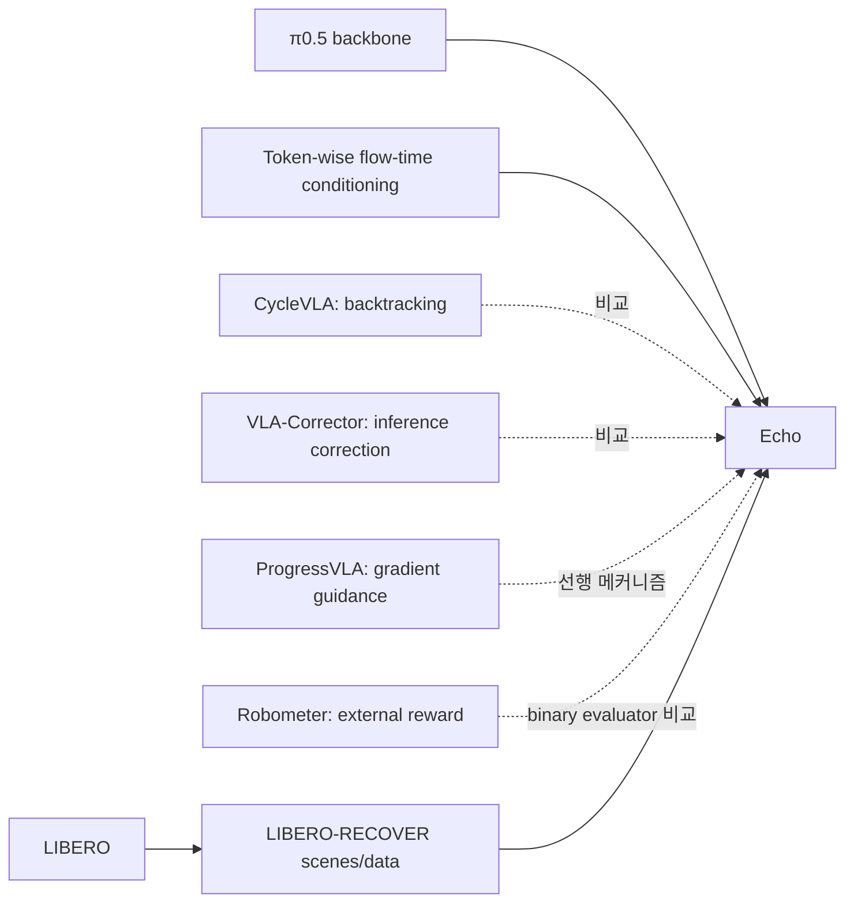

# Echo 참고 레퍼런스 논문 요약

## 수집 방법과 범위

- Semantic Scholar Graph API `paper/arXiv:2610.31569/references?fields=title,authors,year,externalIds,url&limit=100`에서 **38건**을 얻었다.
- 원문 HTML의 bibliography에는 **39개 항목**이 있으며 주요 서지 ID를 양쪽에서 교차 확인했다. API 목록이 원문 bibliography와 완전히 같다고 가정하지 않는다.
- 아래 8편은 원문에서 직접 인용되고 API에도 연결되는 주요 연구다. 요약은 **Echo의 Related Works 및 실험 설명에서 파악한 관계**를 중심으로 작성했다. 8편을 모두 별도 full-text 정독하거나 재현했다는 뜻은 아니다.
- 원문 전체 bibliography: <https://arxiv.org/html/2610.31569#bib>. Reference API는 metadata discovery용이고 기술적 주장의 근거는 Echo 원문의 인용 문맥이다.

## 1. π0.5: A Vision-Language-Action Model with Open-World Generalization

- 저자: Physical Intelligence, Kevin Black 외; 2025.
- ID: `2504.16054`; DOI: `10.48550/arXiv.2504.16054`.
- 원문: <https://arxiv.org/abs/2504.16054>.
- **요지:** 시각·언어 입력을 실제 로봇 continuous action으로 연결하는 범용 VLA foundation을 다룬다. Echo에서는 flow-based policy backbone이자 action-only baseline이다.
- **Echo와의 관계:** Success/recovery action supervision과 training budget을 맞춘 π0.5 비교를 통해 status feedback의 효용을 본다. 다만 Echo는 status용 failure data를 추가로 받으므로 모든 supervision이 동일한 ablation은 아니다.
- **읽을 질문:** Backbone의 action representation·normalization·chunking을 바꾸지 않고 SS/FS group을 어디에 넣을 수 있는가? Action head와 VLM prefix의 계산이 latency에 어떻게 기여하는가?

## 2. Training-Time Action Conditioning for Efficient Real-Time Chunking

- 저자: Kevin Black, Allen Z. Ren, Marielle Equi, Sergey Levine; 2025.
- ID: `2512.05964`; DOI: `10.48550/arXiv.2512.05964`.
- 원문: <https://arxiv.org/abs/2512.05964>.
- **요지:** Real-time chunking에서 training-time action conditioning을 다루는 연구다. Echo는 같은 generated sequence 안에 서로 다른 flow time을 부여하는 token-wise time representation의 문맥에서 인용한다.
- **Echo와의 관계:** Sample당 단일 scalar time이 아니라 B×L time tensor를 쓰는 근거가 된다. 그러나 Echo의 두 signal semantics나 failure target construction을 이 선행 연구가 제안했다고 해석해서는 안 된다.
- **읽을 질문:** Group/time conditioning을 바꾸면 기존 checkpoint와 data pipeline의 어느 부분이 호환되지 않는가? Asynchrony가 실제 control-loop deadline과 어떻게 다른 개념인가?

## 3. CycleVLA: Proactive Self-Correcting Vision-Language-Action Models via Subtask Backtracking and Minimum Bayes Risk Decoding

- 저자: C. Ma 외(원문 bibliography 표기); 2026.
- ID: `2601.02295`; DOI: `10.48550/arXiv.2601.02295`.
- 원문: <https://arxiv.org/abs/2601.02295>.
- **요지:** Progress-aware VLA, external failure prediction, subtask backtracking을 결합해 self-correction을 다룬다.
- **Echo와의 관계:** Echo의 직접 비교 대상이다. Echo 재현에서는 success/recovery data로 학습하고, 실제 실행한 frame의 stop max와 progress mean을 thresholding해 3-state 판정으로 adapt했다. 원래 protocol 전체가 그대로 보존되었다는 뜻은 아니다.
- **해석 주의:** Echo setup의 Flower score 3.00과 status 약점은 이 adaptation·data 조건의 결과다. 다른 benchmark에서 CycleVLA가 일반적으로 열등하다고 결론내릴 수 없다.

## 4. VLA-Corrector: Lightweight Detect-and-Correct Inference for Adaptive Action Horizon

- 저자: Y. Pan 외(원문 bibliography 표기); 2026.
- ID: `2607.01804`; DOI: `10.48550/arXiv.2607.01804`.
- 원문: <https://arxiv.org/abs/2607.01804>.
- **요지:** Predicted/observed visual feature의 dynamics mismatch를 monitor하여 action chunk를 자르고 corrective replanning을 유발한다. Online Gradient Guidance가 correction에 사용된다.
- **Echo와의 관계:** External detect-and-correct inference와 policy-internal status-guided denoising의 차이가 선명하다. Echo 저자는 gradient-guidance와 cutoff-only 중 좋은 결과를 보고했다. Terminal failure 판정을 제공하지 않아 F1은 비교하지 않았다.
- **읽을 질문:** Detect delay·replan latency·correction efficacy를 분리 측정했는가? Feature mismatch와 semantic task failure가 언제 일치하지 않는가?

## 5. ProgressVLA: Progress-Guided Diffusion Policy for Vision-Language Robotic Manipulation

- 저자: H. Yan, Q. Li, J. Yang, Y. Mu(원문 bibliography 표기); 2026.
- ID: `2603.27670`; DOI: `10.48550/arXiv.2603.27670`.
- 원문: <https://arxiv.org/abs/2603.27670>.
- **요지:** World model을 거쳐 progress gradient를 action denoising으로 전달하는 접근이다. Status/progress가 단순 monitor가 아니라 행동 생성에 영향을 주는 선행 축이다.
- **Echo와의 관계:** Echo는 inference-time gradient propagation 대신 learned attention과 async flow schedule로 cleaner status를 action에 전달한다. 따라서 두 방법은 모두 feedback을 쓰지만 computation graph와 추가 component가 다르다.
- **읽을 질문:** Progress evaluator가 틀렸을 때 gradient guidance가 error를 증폭하는가? Echo의 learned coupling도 같은 종류의 semantic error에 취약한가?

## 6. Robometer: Scaling General-Purpose Robotic Reward Models via Trajectory Comparisons

- 저자: A. Liang 외(원문 bibliography 표기); 2026.
- ID: `2603.02115`; DOI: `10.48550/arXiv.2603.02115`.
- 원문: <https://arxiv.org/abs/2603.02115>.
- **요지:** Trajectory comparison 등을 이용해 progress·success를 추정하는 외부 video-language reward model이다. Control policy와 분리하여 실행을 평가하는 계열을 대표한다.
- **Echo와의 관계:** Echo 저자는 Robometer-4B를 task data로 LoRA fine-tuning하여 offline 평가했다. Termination prediction이 없어 ongoing을 non-success로 합친 binary F1을 사용했다. Echo의 별도 binary F1과만 비교해야 한다.
- **읽을 질문:** Standalone reward model의 reuse 가능성과 policy-coupled signal의 low overhead 사이에 어떤 tradeoff가 있는가? Reward score를 calibrated success probability처럼 써도 되는가?

## 7. LIBERO: Benchmarking Knowledge Transfer for Lifelong Robot Learning

- 저자: Bo Liu 외; 2023.
- ID: `2306.03310`; DOI: `10.48550/arXiv.2306.03310`.
- 원문: <https://arxiv.org/abs/2306.03310>.
- **요지:** Lifelong robot learning의 knowledge transfer를 평가하기 위한 manipulation benchmark다. Echo simulation은 spatial/object/goal/LIBERO-10/LIBERO-90 suites의 task와 공개 success data를 이용한다.
- **Echo와의 관계:** 6,193 successful demonstrations와 150개 고정 recovery scene의 task 기반을 제공한다. Echo simulation은 원래 LIBERO standard SR 숫자를 그대로 가져온 것이 아니라 별도 recovery protocol의 실험이다.
- **읽을 질문:** Initial state·gripper·perturbation·time budget 차이가 기존 leaderboard와 어떤 비교 불가능성을 만드는가?

## 8. LIBERO-RECOVER: Beyond Task Success Towards Failure Recovery in Robotic Manipulation Models

- 저자: L. Liu 외(원문 bibliography 표기); 2026. Initial에서 full name을 추정하지 않는다.
- ID: `2609.05178`.
- 원문: <https://arxiv.org/abs/2609.05178>.
- **요지:** Nominal task success뿐 아니라 failure state에서의 recovery를 benchmark 관점에서 평가하는 연구다. Echo 본문에서는 자원/scene을 `LIBERO-Recovery`라고 부르고 bibliography 제목은 `LIBERO-RECOVER`다.
- **Echo와의 관계:** Original 880-scene asset release 중 150개를 고정하고 recovery demonstrations 3,184개를 쓴다. Echo가 자체 수집한 unsuccessful rollout은 9,521개다. Dataset 이름 변형을 새로운 별도 benchmark라고 만들지 않는다.
- **읽을 질문:** Recoverability의 ground truth가 정의되어 있는가? Timeout은 task execution failure이지만 signal-level terminal failure onset과 왜 같지 않은가?

## 관계 지도

## 권장 읽기 순서

1. `learning.md`로 SS/FS와 flow-time convention을 먼저 익힌다.
2. π0.5의 numerical action chunk와 condition interface를 읽는다.
3. Echo method의 supervision table을 직접 재구성한다.
4. VLA-Corrector / ProgressVLA / Robometer를 각각 correction·guidance·evaluation 계열로 비교한다.
5. LIBERO와 LIBERO-RECOVER의 protocol을 확인하고 실물 Macro-F1과 simulation accuracy를 분리해 읽는다.
