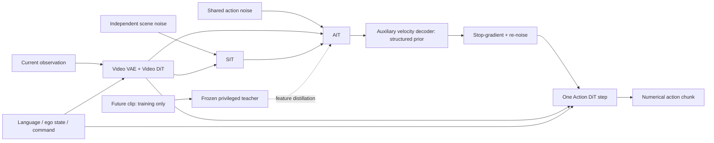

# OSWAM 분석

## 한 문장 결론

**미래를 매번 생성하는 대신 미래를 본 teacher에게 학습하고, action denoising의 시작점을 현재 observation에 맞게 구조화하면, action refinement 한 번으로 multi-step에 가까운 성능을 얻을 수 있다.** 이는 저자의 실험 범위 안에서의 결론이며 실차 안전성이나 모든 환경에서의 one-step 충분성을 보증하지 않는다.

## 1. 문제와 선택 이유

Fast-WAM/SimWAM의 direct-policy는 video rollout은 없앴지만 action expert를 반복 호출한다. Pure Gaussian noise에서 한 번만 update하면 temporal coherence와 물리적 실행가능성을 동시에 복구하기 어렵다. OSWAM은 sampler를 그대로 두고 횟수만 바꾸는 대신 **학습된 initialization interface**를 바꾼다.

현재 ISO week 2026-W45 후보를 우선했으며, 더 많은 vote를 가진 일반 manipulation 논문보다 NAVSIM 자율주행을 직접 평가한 이 논문을 선택했다. Live discovery의 score 19, upvote 7, rank 49는 수집 당시 값이다. `2610.35850`, `OSWAM`, `One-Step Action Generation`을 raw/wiki에서 검색해 기존 주제 분석이 없음을 확인했다. 이전 주의 generic VLA나 게임 agent로 범위를 넓힐 필요가 없었다.

## 2. Taxonomy — VLA라는 이름보다 실제 interface

WorldBench [VLA4AD](https://worldbench.github.io/vla4ad)와 [awesome list](https://github.com/worldbench/awesome-vla-for-ad)의 VA/VLA taxonomy를 기준으로 정리한다.

| 축 | 위치 | 주의 |
|---|---|---|
| VA 계보 | video/image-based world prior를 사용하는 direct numerical-action WAM | explicit online video generation은 아님 |
| VLA 계보 | optional language-conditioned numerical action generator | language reasoning/CoT가 핵심 기여는 아님 |
| 지식 전이 | full-future teacher → first-frame-only AIT representation | training-only privileged transfer |
| End-to-End / Dual-System | shared video/action MoT 기반 direct policy | 느린 LLM planner와 빠른 controller의 dual-system 아님 |
| 출력 | driving waypoint chunk / robot action chunk | text action을 actuator가 직접 읽는 모델 아님 |

모델 이름에 VLA가 없다고 관심 밖인 것은 아니다. VLA/WAM의 action grounding·실시간성에 직접 관련되지만 language understanding을 별도 개선했다는 근거도 없다.

## 3. Architecture와 Input → Action

| 항목 | Driving | Robot |
|---|---|---|
| Observation | front RGB 384×672 | head+2 wrist composite 384×320 |
| Conditioning | ego state, driving command | task language |
| Action horizon | 8 waypoint / 4 sec / 2Hz | 32 action step |
| Future training data | current+8 future frame | 9 frame, stride 4 |
| Test-time future | 없음 | 없음 |
| Grounding | demonstrated waypoint를 맞추는 velocity loss | demonstrated motor-action chunk를 맞추는 velocity loss |

위 표의 driving 출력 좌표를 전부 nuScenes의 $(x,y,\theta)$와 동일하다고 단정하지 않는다. 원문 부록은 nuScenes에 대해서만 해당 좌표 계약을 명시한다. 로봇의 구체적인 joint/action dimension도 이 문서에서 새로 추정하지 않는다.

## 4. 핵심 기여의 인과적 해석

1. **AIT:** first-frame context에서 coherent action prior를 먼저 생성한다. 최종 Action DiT가 순수 noise가 아니라 유용한 위치에서 시작한다.
2. **SIT:** scene context를 모아 AIT가 참조할 추가 slot을 제공한다. 별도의 semantic label이나 teacher처럼 future를 직접 보는 token이 아니다.
3. **Role-aware RoPE:** video/AIT/SIT에 서로 다른 spatial anchor를 두고 sampling stride를 latent time coordinate에 반영한다.
4. **Privileged distillation:** frozen full-future teacher AIT의 여러 depth feature를 student에 정렬한다. Teacher를 제거해 deployment graph의 future access를 막는다.
5. **One-step residual target:** $(a^{init}-a_{gt})/\sigma$를 학습하므로 step size $\sigma$의 Euler update와 일치한다.

Ablation에서 가장 큰 변화는 AIT(71.04→89.81 PDMS)이며 distillation과 SIT의 추가 개선은 상대적으로 작다. 모든 개선을 teacher에게 귀속하면 핵심 결과를 잘못 읽게 된다. Teacher timestep 800의 성능도 높아 full-future access 자체만이 유일한 causal explanation이라고 단정할 수 없다.

## 5. Training recipe

Wan2.2-5B + T5/VAE, Action DiT width 1024, LoRA rank 8/alpha 4. Video flow loss, AIT action-velocity loss, multi-depth feature loss, final action-refinement loss를 결합한다. $\lambda_{dist}=10$, teacher timestep 200, alignment block 8/16/24/30이다. AIT timestep 1000, re-noise 500, $\sigma=0.5$이며 prior를 detach한다. Teacher/student의 action noise는 같고 SIT noise는 AIT와 독립이다.

NAVSIM은 40k step/batch 256, RoboTwin은 29,335 step/batch 1024. AdamW $10^{-4}$, weight decay 0.01, cosine decay/5% warm-up. Distillation 500-step 지연 시작과 500-step ramp-up이 있다. Pure-noise one-step baseline에 inference 설정만 바꿔 적용할 수 있는 training-free trick은 아니다.

## 6. Evaluation과 metric 경계

| 평가 | 주요 결과 | 의미 | 입증하지 못한 것 |
|---|---|---|---|
| NAVSIM | PDMS 90.3, 136ms(H20); SimWAM 90.3,410ms | recorded-data 기반 non-reactive simulation에서 성능/속도 trade-off | reactive traffic/실차 closed-loop safety |
| NAVSIM-v2 | EPDMS 90.3 vs SimWAM 90.2 | 확장된 comfort/rule 지표 | rare-event 통계적 우월성 |
| nuScenes | average L2 0.41m, collision 0.03% | open-loop trajectory 평가 | deployed vehicle의 실제 collision rate |
| RoboTwin | mean SR 90.00% vs Fast-WAM 91.83% | simulated closed-loop manipulation | task 전반의 성능 dominance |
| PiPER | 2 task 각각 20 trial, SR 85/80% | 제한된 real robot physical execution | 대규모 OOD/general safety |

**PDMS 사용 주의:** normalized factor의 episode score 식과 표의 이미 집계된 percentage를 구분한다. Dataset-average NC/DAC/EP 등을 다시 곱하면 원래 PDMS를 복원하지 못할 수 있다.

**성공률 사용 주의:** 91.83%→90.00%는 -1.83 pp다. 실물 trial 20개에서 +5 pp는 성공 한 번 차이다. Success-only completion time은 실패 episode의 delay/cost를 포함하지 않는다.

## 7. Latency/배포/NPU 함의

- H20 NAVSIM 136ms와 RTX 5090 compiled NAVSIM 52.64ms, compiled RoboTwin 40.81ms는 서로 다른 측정 조건이다. 최저 40ms를 자율주행 전체 stack 수치로 인용하지 않는다.
- RTX 5090 RoboTwin: visual GPU time은 18.45→23.93ms로 증가하고 action time은 67.61→6.78ms로 감소한다. One-step은 모든 submodule이 가벼워진다는 뜻이 아니다.
- GPU substage timer 합계, wall-clock overall latency, cached-language compiled latency는 다르다. Sensor exposure, transfer, trajectory validation, actuator 및 communication까지 포함하는 sensor-to-actuation budget은 별도로 측정해야 한다.
- $1/\text{chunk latency}$는 chunk generation throughput의 상한 해석일 뿐 low-level control Hz나 effective replanning Hz를 증명하지 않는다. Action horizon과 실행 prefix, async inference, observation age가 함께 필요하다.
- Peak memory 약 12.9GB라는 GPU 수치가 남는다. NPU의 operator support, attention mask, RoPE, quantization precision, on-chip memory, host sync, compile warm-up은 검증되지 않았다. **NPU speedup 주장은 없다.**

## 8. 강점, 한계와 다음 실험

**강점:** action initialization을 명시적인 학습 대상으로 만들고, privileged future access와 deployment를 분리한다. Driving과 robotics 양쪽에서 평가하며 component breakdown/ablation을 제공한다.

**저자 명시 한계:** SIT/privileged supervision의 Action DiT 직접 강화는 탐구하지 않았다.

**분석자의 추가 한계:** single-front-camera perception의 blind spot, limited real-world task, learned prior의 OOD collapse, imitation demonstration coverage, uncertainty calibration과 rare-event safety가 남는다. 미래를 학습한 representation은 실제 future observation을 대체하거나 physical dynamics의 정확성을 보장하지 않는다.

**제안 실험(실행하지 않음):** 동일 hardware·precision·batch·cache에서 p50/p95/p99 latency 측정; action prior만/정제 후 constraint violation 비교; stale observation/dropout에서 independent fallback 시험; teacher access/noise/freeze를 분리하는 paired ablation; reactive driving 및 NPU port profile.

## 9. 기존 wiki와 연결

SimWAM의 video-rollout-free design에서 action 반복만 추가 제거하는 관점이다. THAW-VLA의 teacher representation transfer와 닮았지만 OSWAM은 AIT prior + Action DiT refinement라는 initialization interface를 직접 바꾼다. Echo는 action과 task status의 coupling이고 MorphAct는 runtime parameter generation이므로 방법의 개입 위치가 다르다. 충돌되는 주장보다 **deployment interface를 어디서 바꾸는가**라는 비교 축을 추가한다.

## 출처와 실행 경계

내용 근거는 원문 §1–5, Appendix A/B 및 Tables 1–8/A.1–A.4/B.5다. 라이선스·figure provenance는 `metadata.json`, 절별 번역은 `paper-ko.md`, 관련 논문은 `references.md`, 실행 가능한 작은 수식 예제는 `learning.md`에 있다. 본 작업은 paper의 모델 훈련·benchmark 재현·실차/로봇 rollout·NPU deployment를 수행하지 않는다.
