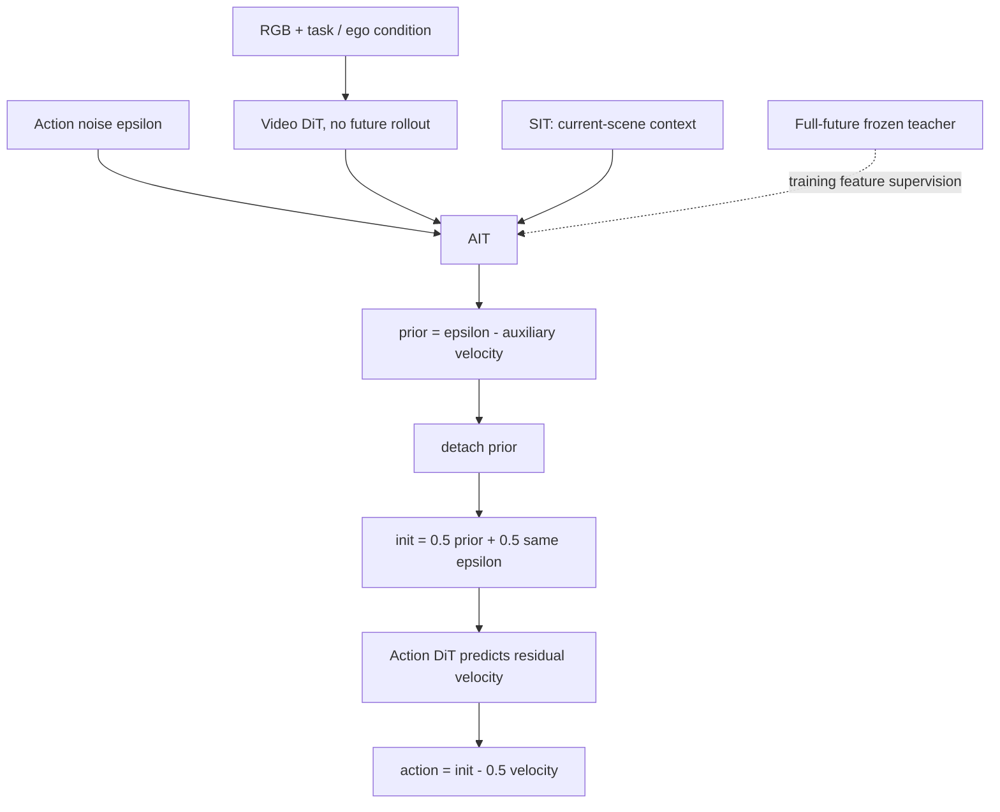

# OSWAM 핵심 기술 학습

## 1. 먼저 알아야 할 것

- **Transformer attention:** query가 어떤 key/value를 볼 수 있는지 mask가 정한다. Teacher가 미래를 보고 student는 보지 않는 차이는 설명 문장이 아니라 실제 information-flow constraint여야 한다.
- **Diffusion/flow matching:** noise에서 action으로 가는 velocity field를 학습하고 numerical integration한다. Step을 줄이는 것은 model approximation error와 integration error에 영향을 준다.
- **Action chunk:** 여러 미래 action을 한 번에 출력한 배열이다. 32-step chunk를 40ms에 만든다고 robot이 반드시 800Hz 제어하는 것은 아니다.
- **Imitation learning:** demonstration의 action을 맞추는 supervision이다. 학습된 action이 모든 새로운 상태에서 안전하다는 증명은 아니다.
- **Teacher–student:** 학습 때 teacher에게만 허용한 정보로 student representation을 감독한다. 추론 graph에서 teacher와 future input을 제거해야 한다.

## 2. 용어 사전

| 용어 | 쉬운 의미 | OSWAM의 구체적 역할 |
|---|---|---|
| Direct-policy WAM | 추론 때 미래 video를 만들지 않는 WAM | current observation → numerical action |
| AIT | 행동을 상상하는 작은 latent token 집합 | action initialization prior 생성 |
| SIT | scene context를 모으는 추가 slot | AIT에 complementary context 제공 |
| Structured prior | 시작부터 환경에 맞는 행동 정보 | pure-noise 초기화의 부담 완화 |
| Re-noising | 학습된 prior에 일정량 noise를 다시 섞기 | refinement가 쓸 intermediate state |
| Stop-gradient | 값은 전달하되 gradient는 차단 | final action loss가 prior를 직접 역전파하지 않음 |
| Flow velocity | state가 noise/data 사이에서 움직이는 방향 | one-step Euler refinement |
| Role-aware RoPE | token 역할과 시간 위치를 좌표로 분리 | AIT grid 밖, SIT 중앙, video 원좌표 |
| Privileged information | 학습 teacher만 볼 수 있는 미래 정보 | AIT multi-depth feature distillation |
| PDMS | 여러 driving quality factor를 합친 score | NAVSIM의 non-reactive evaluation |
| Compiled latency | compile/cache 최적화 조건의 timing | 일반 eager latency와 구분 |

## 3. 큰 그림: 먼저 초안을 만들고 한 번 고친다

백지에서 설계도를 한 번에 그리는 것보다 현재 장면에 맞는 초안을 먼저 만든 뒤 수정하는 편이 쉽다. OSWAM의 AIT는 그 초안을 만드는 representation이다. 다만 이 비유에서 초안은 language text가 아니라 **numerical action prior**다.



중요한 구분은 AIT를 만드는 Video DiT forward도 계산이라는 점이다. **One-step**은 Action DiT denoising이 한 step이라는 말이지 전체 model이 하나의 layer이거나 teacher까지 포함한 학습이 한 번이라는 뜻이 아니다.

## 4. Flow matching 부호를 손으로 확인하기

원문의 time convention은 다음과 같다.

$$a_t=(1-t)a_{gt}+t\epsilon.$$

$t=0$은 data, $t=1$은 noise다. $t$가 증가하는 방향의 velocity target은 $\epsilon-a_{gt}$다. 추론은 noise에서 data로 이동하므로 $t$를 줄인다. 따라서 Euler step에서 velocity를 **빼야** 한다.

OSWAM은 $\bar a$라는 prior를 먼저 만들고 $a^{init}=(1-\sigma)\bar a+\sigma\epsilon$에서 시작한다. 학습 target을 $v^*=(a^{init}-a_{gt})/\sigma$로 정하면,

$$a^{init}-\sigma v^*=a_{gt}$$

가 대수적으로 성립한다. 실제 network는 $v^*$를 정확히 모르므로 근사 error가 남는다. 이것이 단 한 step의 완전한 품질을 이론적으로 보장하는 식은 아니다.

### 실행 예제 1 — residual target과 update 부호

아래는 표준 라이브러리만 사용하는 교육용 scalar/vector 산술이다. 실제 OSWAM neural network나 robot controller가 아니다.

```python
from math import isclose

gt = [1.0, -2.0, 0.25]
noise = [0.4, 0.7, -0.1]
prior = [0.8, -1.6, 0.2]
sigma = 0.5
init = [(1 - sigma) * p + sigma * e for p, e in zip(prior, noise)]
velocity_target = [(x - y) / sigma for x, y in zip(init, gt)]
reconstructed = [x - sigma * v for x, v in zip(init, velocity_target)]
wrong_sign = [x + sigma * v for x, v in zip(init, velocity_target)]
assert all(isclose(x, y, abs_tol=1e-12) for x, y in zip(reconstructed, gt))
assert any(not isclose(x, y, abs_tol=1e-12) for x, y in zip(wrong_sign, gt))
print('one-step residual target: PASS')
```

**어떻게 해석하나?** Target을 알고 대입하면 정확히 복원된다. Network가 target을 예측하도록 학습하는 문제는 여전히 남는다. 이 toy example의 PASS를 paper의 benchmark 재현으로 보고하면 안 된다.

## 5. Attention mask를 implementation contract로 읽기

| Query token | Current frame | Future video | SIT | AIT |
|---|---|---|---|---|
| Student AIT | 가능 | 불가 | 가능 | 가능 |
| Student SIT | 가능 | 불가 | 가능 | 불가 |
| Teacher AIT | 가능 | 가능 | teacher에 없음 | 가능 |

이 표는 AIT/SIT의 access를 설명하며 전체 video block의 mask를 완전히 정의한 implementation은 아니다. 학습 batch에 future video가 있다는 사실과 student action path가 미래를 볼 수 있다는 사실은 다르다. 한 번의 attention뿐 아니라 여러 layer를 통한 간접 경로도 audit해야 한다.

구현 점검 질문:
1. Video latent가 current/future로 올바르게 나뉘었는가?
2. AIT→SIT→future처럼 우회하는 leak가 없는가?
3. Teacher/student가 공유해야 하는 action/video noise가 맞는가?
4. Teacher parameter가 freeze되었고 feature target에 stop-gradient가 적용되었는가?
5. `prior.detach()`와 AIT auxiliary loss가 동시에 존재하는가?
6. 추론에서 teacher가 로드되지 않고 미래 frame을 입력받지 않는가?

## 6. Sampling stride와 RoPE time alignment

$n$번째 action이 $n$초라는 뜻은 아니다. Action sampling stride $s_a$, video stride $s_v$, VAE temporal downsampling $d_t$를 이용하여 $t_n=ns_a/(s_vd_t)$로 바꾼다.

- NAVSIM: $s_a=s_v=1,d_t=4$이므로 $t_n=n/4$, $n=1\ldots8$.
- RoboTwin: $s_a=1,s_v=4,d_t=4$이므로 $t_n=n/16$, $n=1\ldots32$.

두 경우 마지막 token의 time coordinate가 2인 것은 latent video timeline에 맞춘 결과이며 두 task의 wall-clock duration이 같다는 뜻이 아니다.

### 실행 예제 2 — temporal mapping과 latency 비교

```python
from math import isclose

def latent_time(n, action_stride, video_stride, vae_downsample):
    assert n > 0 and min(action_stride, video_stride, vae_downsample) > 0
    return n * action_stride / (video_stride * vae_downsample)

assert isclose(latent_time(8, 1, 1, 4), 2.0)
assert isclose(latent_time(32, 1, 4, 4), 2.0)
assert isclose(latent_time(1, 1, 4, 4), 0.0625)
# Paper Table 3, same-hardware overall latency, not action-only GPU time.
robot_speedup = 323.67 / 95.35
compiled_robot_speedup = 73.64 / 40.81
driving_speedup = 330.80 / 99.70
assert 3.39 < robot_speedup < 3.40
assert 1.80 < compiled_robot_speedup < 1.81
assert 3.31 < driving_speedup < 3.32
print(f'RoboTwin eager speedup: {robot_speedup:.3f}x')
print(f'RoboTwin compiled speedup: {compiled_robot_speedup:.3f}x')
print(f'NAVSIM eager speedup: {driving_speedup:.3f}x')
print('RoPE timeline and latency arithmetic: PASS')
```

Eager 약 3.39배와 compiled 약 1.80배를 혼합하지 않는다. Baseline도 compile로 빨라지므로 speedup은 비교 조건에 종속된다.

## 7. 네 가지 loss가 맡는 일

- $L_{vid}$: backbone의 future visual dynamics representation을 유지/학습한다.
- $L_{AIT}$: AIT에서 action-velocity prior가 나오도록 직접 감독한다.
- $L_{dist}$: student AIT가 full-future teacher의 중간 representation을 따라가게 한다.
- $L_{act}$: detached/re-noised prior를 demonstrated action으로 한 번 refine하도록 학습한다.

Stop-gradient 때문에 final loss만으로 prior를 학습한다고 이해하면 틀린다. Auxiliary loss와 distillation이 prior의 독립적인 learning signal이다. SIT는 AIT에 영향을 주는 attention path를 통해 간접 감독된다.

## 8. 구현/배포 메모 — 제안이며 실제 port 아님

**최소 prototype 순서:** 먼저 기존 direct-policy baseline을 재현하고, 같은 loss/time convention에서 pure-noise one-step baseline을 측정한다. 그다음 AIT, distillation, SIT를 순서대로 추가한다. 각 단계에서 prior-only output, final action output, constraint violation, latency를 별도 저장한다.

**Re-noising 주의:** AIT에 넣은 epsilon과 다른 epsilon을 섞으면 paper의 noise contract와 다르다. `sigma=0`이면 residual target이 정의되지 않으므로 잘못된 설정을 assertion으로 막는다.

**배포 audit:** observation timestamp, action chunk coordinate/units, route condition freshness, batch=1 warm latency, cold compile cost, p95/p99, data movement와 controller prefix 정책을 정한다. Output trajectory에는 speed/curvature/road-boundary check와 independent emergency fallback을 둔다. 이는 이 문서의 engineering 제안이지 OSWAM이 이를 모두 구현했다고 주장하는 내용은 아니다.

**NPU로 옮길 때:** attention mask/RoPE 연산 지원, dynamic shape, VAE cost, quantization sensitivity, host sync, on-chip memory를 profile해야 한다. NVIDIA GPU의 40.81ms를 NPU 예측치로 쓰지 않는다.

## 9. 학습 질문과 답

**Q1. 미래를 보지 않는데 왜 world model인가?** 학습 시 video prediction과 pretrained video prior가 representation을 형성한다. Deployment에서 미래를 출력하는 것과 world-model prior를 학습한 것은 다르다.

**Q2. AIT는 text CoT인가?** 아니다. Action noise/context를 처리하는 numerical latent token이다. Language instruction을 condition할 수 있지만 자연어 reasoning trace 생성이 핵심은 아니다.

**Q3. One-step 성능 향상의 가장 큰 기여는 teacher인가?** 본문의 ablation은 AIT에서 가장 큰 폭의 개선을 보인다. Teacher와 SIT는 추가 이득이다.

**Q4. Full-future teacher는 data leakage인가?** Training-only privileged supervision 자체는 배포 입력과 분리하여 사용할 수 있다. 하지만 test split 격리와 student attention 차단을 실제 구현에서 검증해야 한다.

**Q5. RoboTwin 90%면 Fast-WAM보다 정확한가?** 아니다. 비교 multi-step Fast-WAM 평균은 91.83%다. 속도를 얻으며 평균 1.83 pp를 잃는 trade-off다.

**Q6. 40ms면 autonomous driving이 25Hz인가?** 아니다. 최저 compiled robot chunk inference 수치다. NAVSIM compiled는 52.64ms이고 센서·validation·controller를 포함한 control loop Hz는 별도다.

**Q7. NAVSIM PDMS와 nuScenes collision은 같은 safety 평가인가?** 아니다. NAVSIM은 non-reactive simulation의 composite score이고 nuScenes는 기록 기반 open-loop trajectory 평가다. 실제 도로 collision 통계로 읽으면 안 된다.

**Q8. 실물 +5 pp가 확실한 개선인가?** 20 trial에서 성공 한 번 차이다. Confidence interval과 더 많은 seed/task가 필요하며 paper의 관찰을 부정하지 않되 통계적 확실성을 과장하지 않는다.

## 10. 짧은 읽기 roadmap

1. **20분:** paper Fig. 3/4에서 training-only edge를 다른 색으로 표시한다.
2. **25분:** Eq. 5/6/11을 하나의 algebra chain으로 연결하고 위 예제를 실행한다.
3. **25분:** Table 4에서 AIT/teacher/SIT의 marginal gain을 분리한다.
4. **20분:** Table 1/2/3의 hardware와 cached/compiled 조건을 적는다.
5. **20분:** NAVSIM 원문의 non-reactive 의미와 real vehicle closed-loop의 차이를 정리한다.
6. **15분:** Fast-WAM/SimWAM/Flash-WAM/Light-WAM의 online future generation, action step, SR/PDMS, latency를 비교한다.

최종 산출물: `observation → structured prior → one-step refinement → bounded execution`의 각 interface마다 input/target/timestamp/safety check를 한 줄씩 적은 설계 메모. 이 문서의 code 실행은 산술적 일관성 검사이며 모델 훈련이나 rollout은 수행하지 않는다.
