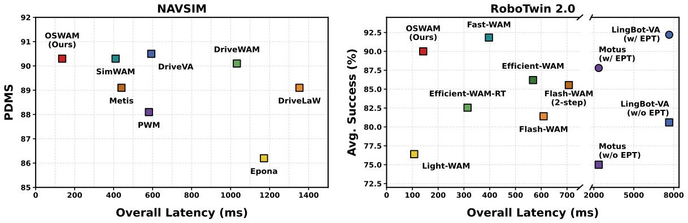
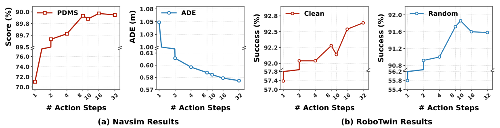
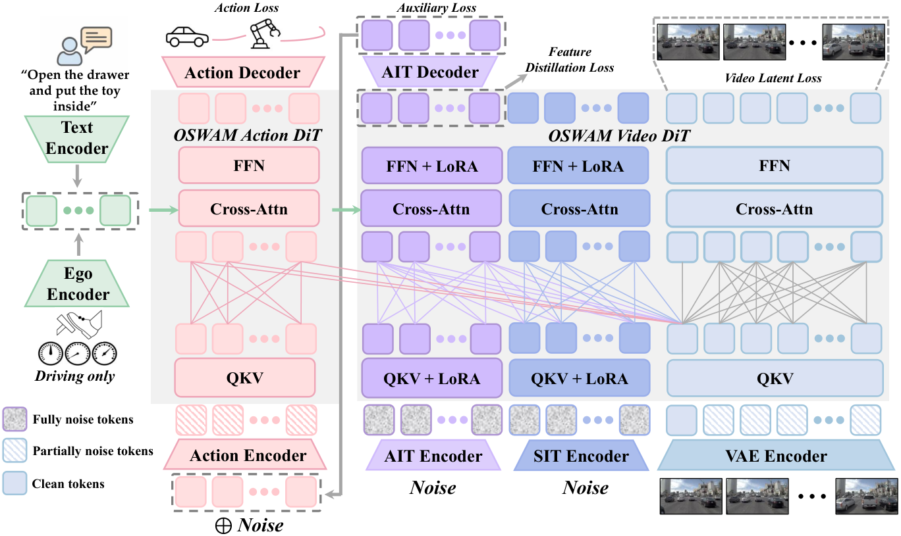
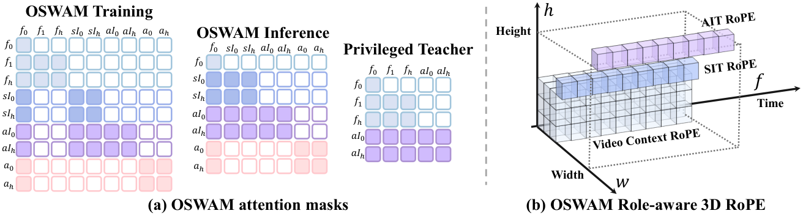
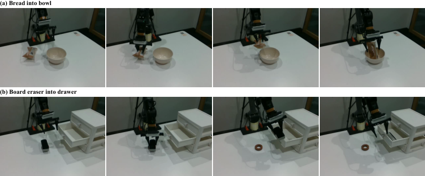
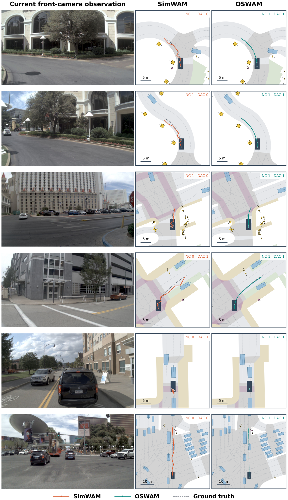

# OSWAM: One-Step Action Generation을 위한 효율적인 World Action Model

**원저자:** Guowen Zhang, Liyi Chen, Xu Hu, Pengfei Wang, Jingfan Chen, Chenhang He, Lei Zhang. The Hong Kong Polytechnic University. Guowen Zhang과 Liyi Chen 공동 제1저자, Lei Zhang 교신저자.

**원문:** arXiv:2610.35850v1, 2026-10-26. [HTML](https://arxiv.org/html/2610.35850v1) · [PDF](https://arxiv.org/pdf/2610.35850) · [Project](https://gwenzhang.github.io/OSWAM/) · [Code](https://github.com/PolyU-VCLab/OSWAM).

**권리와 변경 표시:** 원문과 아래 figure는 [CC BY 4.0](https://creativecommons.org/licenses/by/4.0/)에 따라 저자에게 귀속됩니다. 한국어 번역·수식 재작성·표 선별 및 해설을 추가했습니다. 본문 구조를 유지하되 반복 설명과 대형 비교표를 축약했습니다. Abstract, Introduction, Method, Experiments, Conclusion/Limitations는 아래에서 다루며 부록 A는 주요 설정·결과를 선별 번역했고 부록 B의 전체 50-task 표는 생략했습니다. 따라서 무생략 전문 번역은 아닙니다. 수치는 별도 재현 실험이 아닌 **저자 보고**입니다.

## Abstract

Direct-policy World Action Model(WAM)은 action generation을 명시적인 미래 visual prediction에서 분리함으로써 자율주행과 embodied control의 추론 효율을 개선했다. 그러나 경쟁력 있는 action 품질을 얻기 위해 여전히 수십 회 denoising을 요구하므로 latency가 크고 실시간 배포가 어렵다. Denoising step을 단순히 줄이면 비선형 다단계 trajectory가 거친 update로 압축되어 action 품질이 크게 떨어진다.

본 논문은 실시간 action generation을 위해 one-step action generation을 수행하는 OSWAM을 제안한다. 저자들은 random-noise initialization에 구조화된 action prior가 없기 때문에 direct-policy WAM이 반복적인 denoising으로 일관된 action sequence를 복원해야 한다고 본다. 이를 해결하기 위해 physical prior와 action-conditioned representation을 제공하는 imagination token으로 diffusion을 초기화한다. 또한 future conditioning을 사용하는 privileged-information distillation으로 미래를 고려하는 action generation을 강화한다.

이 설계로 한 번의 diffusion step에서 고품질 action을 생성한다. 자율주행과 embodied control 실험에서 수십 step을 사용하는 direct-policy WAM 및 Joint-WAM에 필적하거나 더 나은 결과를 얻었다. Direct-policy baseline 대비 약 3배 빨라졌으며 NVIDIA RTX 5090에서 compiled inference latency가 최저 약 40ms로 보고된다. 이 최저치는 로봇 benchmark의 특정 설정이며 자율주행 수치와 구분해야 한다.

## 1. Introduction

Physical intelligence는 위험하거나 반복적이고 힘든 육체 작업을 사람 대신 수행할 가능성을 제공한다. 범용 physical agent는 visual observation에서 action을 선택하는 데 그치지 않고 그 action의 물리적 결과를 예상해야 한다. 기존 VLA는 환경의 미래 변화를 명시적으로 모델링하지 않고 action을 직접 예측하는 경우가 많다. 이에 pretrained video generative model에서 출발해 미래 visual state와 대응 action을 함께 예측하는 WAM이 주목받았다.

그러나 imagine-then-execute WAM은 미래를 생성한 다음 실행하므로 자율주행처럼 latency가 중요한 분야에 부담이 크다. Video/image generation의 few-step distillation을 적용해도 control 정확도가 하락할 수 있다. Direct-policy WAM은 video prediction을 학습 때의 representation 형성 목적에만 사용하고, 추론에서는 현재 observation에서 action을 직접 만든다. 이로써 explicit imagination 방식보다 3배 이상 빨라져도 action diffusion의 반복 계산은 남는다.

**Figure 1 번역:** NAVSIM과 RoboTwin 2.0의 inference 효율–성능 비교. EPT는 embodied pretraining이다. 이 그림의 latency는 NVIDIA H20에서 측정했다.

**Figure 2 번역:** Fast-WAM의 action denoising step 수에 따른 NAVSIM 자율주행 및 RoboTwin embodied-control 성능 변화.

단순한 one-step 설정에서 NAVSIM과 RoboTwin 성능이 각각 약 20%, 40% 하락한다는 것이 저자의 문제 제기다. 다단계 denoising은 시간적·물리적 일관성을 서서히 부여하지만, unstructured Gaussian noise에서 시작하는 one-step은 이 작업을 한 번에 해야 한다. Step distillation과 trajectory rectification도 Gaussian noise에서 출발하면 부족한 action structure를 직접 공급하지 못한다. 따라서 추론 시작점에 구조화된 action prior가 필요하다.

다른 문제는 first-frame-only representation이 장기 미래 정보를 충분히 담기 어렵다는 점이다. Future feature를 추론 중 다시 생성하면 caching이나 sparse interaction으로 비용을 줄여도 추가 overhead가 남는다. OSWAM은 Video DiT에서 적은 수의 imagination token을 한 번에 생성해 structured initialization으로 사용한다. Teacher는 미래 전체를 보고, student는 첫 frame만 보도록 학습하여 미래 정보의 이점을 추론 graph에 미래 rollout 없이 전달한다.

핵심 기여는 세 가지다. 첫째, compact imagination token으로 Action DiT의 one-step 시작점을 학습한다. 둘째, privileged-information distillation으로 full-horizon context를 token에 전달한다. 셋째, 자율주행과 manipulation에서 multi-step WAM에 경쟁력 있는 성능을 유지하며 latency를 줄인다.

## 2. Related Work

### 2.1 Autonomous Driving의 WAM

자율주행은 perception과 planning을 나누는 modular pipeline에서 end-to-end framework로 확장되어 왔다. World-model 접근에는 BEV 기반과 video-generation 기반이 있다. BEV는 occupancy 변화, ego motion, future latent 또는 BEV layout을 예측해 trajectory를 평가한다. 계산 효율은 좋지만 대규모 video-generative prior를 직접 활용하지 않는 경우가 있다. Video-generation 계열은 pretrained generator의 prior를 전이하지만 추론 중 video feature rollout이 비싸다. SimWAM은 Fast-WAM처럼 test-time rollout을 없애지만 multi-step action denoising은 남는다. OSWAM은 video prior를 유지하면서 그 마지막 반복 계산을 한 step으로 줄인다.

### 2.2 Embodied Control의 WAM

근접 manipulation에서는 물체 간 접촉과 외형 변화가 중요하므로 pretrained video generator가 유용하다. Explicit-imagination 모델은 미래 visual representation을 생성해 action을 안내하지만 rollout latency를 지불한다. Direct-policy 모델은 학습에서 video prediction으로 dynamics representation을 만들고 추론에서는 현재 observation만 사용한다. OSWAM은 두 번째 계열에서 action denoising까지 one-step으로 만든다.

### 2.3 효율적인 WAM

Flash-WAM은 modality-aware distillation로 video/action diffusion을 줄이지만 미래 video 생성이 남는다. Fast-WAM은 video rollout을 제거하지만 action 반복은 유지한다. Light-WAM은 가벼운 fusion head로 single-pass action을 만들지만 어려운 RoboTwin task에서 성능이 낮다. SimWAM도 action 반복 계산을 유지한다. OSWAM의 차이는 future video를 생성하지 않는 조건에서 structured action initialization을 학습한다는 점이다.

## 3. Method

**Figure 3 번역:** Video DiT 한 번으로 AIT의 observation-conditioned action prior와 SIT의 보완적 scene context를 만든다. 이 representation이 one-step Action DiT의 구조화된 시작점을 제공한다. 학습에서는 privileged-information distillation로 future-informed representation을 주입하고 추론에서는 현재 observation만 사용한다.

### 3.1 Preliminary

현재 observation을 $o$, 선택적인 command를 $l$, action chunk를 $a_{1:H}$, 미래 visual state를 $v_{1:T}$라 하자. Inverse-dynamics WAM은 미래를 예측하고 그 미래로부터 action을 추론한다.

$$
p(a_{1:H}\mid o,l)=\int p(v_{1:T}\mid o,l)\,p(a_{1:H}\mid o,l,v_{1:T})\,dv_{1:T}. \tag{1}
$$

Joint-WAM은 $p(a_{1:H},v_{1:T}\mid o,l)$을 공동 생성한다. 두 방식 모두 control과 반복적 미래 video 생성을 결합한다. Direct-policy WAM은 학습 때만 video prediction을 사용하고 추론에서는 한 번의 Video DiT forward가 representation $z(o)$를 만든다.

$$
p(a_{1:H}\mid o,l)=p(a_{1:H}\mid z(o)). \tag{2}
$$

이 표기는 원문을 따른 것으로 command conditioning을 새롭게 제거했다는 뜻은 아니다. Flow matching에서는 $a_t=(1-t)a+t\epsilon$, velocity target은 $\epsilon-a$이고 noise $t_K=1$에서 data $t_0=0$으로 적분한다.

$$
a_{t_{k-1}}=a_{t_k}+(t_{k-1}-t_k)v_\theta(a_{t_k},t_k),\quad k=K,\ldots,1. \tag{3}
$$

고품질 action에 필요한 velocity 평가 횟수 $K$가 latency의 병목이다. 한 번의 update는 다음과 같다.

$$
\hat a=a_t-t\,v_\theta(a_t,t),\quad t\in(0,1]. \tag{4}
$$

Pure-noise 시작에서는 $t=1$이다. OSWAM은 $t<1$의 구조화된 intermediate state를 사용한다. **학습된 시작점**이 있으므로 단순히 기존 sampler의 step 수만 줄이는 것과 다르다.

### 3.2 Overall Architecture

입력은 현재 frame $f_0$, optional task instruction, 자율주행에서는 ego state와 driving command다. Backbone은 Wan2.2-5B Video DiT와 pretrained T5 encoder, video VAE다. Action DiT는 pretrained Video DiT weight를 interpolation/downsampling하여 초기화한다. Ego encoder가 driving state/command를 인코딩하며 language와 ego state는 cross-attention으로 token에 제공된다. Video/action block이 attention을 공유하는 Mixture-of-Transformer(MoT) 구조를 사용한다.

기존 direct-policy는 Video DiT를 첫 frame의 feature encoder로 사용했다. OSWAM은 여기에 두 token group을 넣는다.

- **Action Imagination Tokens(AIT):** 첫 frame과 상호작용하여 Action DiT의 Gaussian-noise initialization을 대체하는 structured action prior를 만든다.
- **Scene Imagination Tokens(SIT):** AIT가 참조할 scene context를 모으는 latent slot이다. AIT의 auxiliary action loss와 feature distillation을 통해 간접 학습된다.

두 group은 첫 frame visual token보다 훨씬 적다. Teacher의 AIT는 full clip을 참조하고 student의 AIT는 첫 frame만 참조한다. 중간 feature를 정렬하여 추론에서 미래 frame을 추가 생성하지 않고 미래 context를 전달한다.

**Figure 4 번역:** (a) OSWAM과 privileged teacher의 attention mask. (b) Role-aware RoPE가 video, AIT, SIT의 좌표 역할을 구분한다. sI는 SIT, aI는 AIT다.

### 3.3 Imagination Tokens

**Action/Scene Imagination Tokens.** Video DiT는 LoRA로 추가 token을 지원하도록 적응한다. Video token은 임의 noise level을 사용하는 diffusion 학습을 하고 AIT는 최초 action noise $\epsilon\sim\mathcal N(0,I)$를 encoding하여 고정 timestep $t_{max}$를 받는다. AIT는 first-frame visual token, SIT, 다른 AIT를 attend하고 cross-attention으로 task conditioning을 받는다.

Auxiliary decoder가 AIT representation에서 velocity $\hat v^A$를 예측하면 action prior는 $\bar a=\epsilon-\hat v^A$다. 이 prior를 detach한 뒤 **AIT에 사용한 동일한 noise**로 다시 noise를 섞는다.

$$
a^{init}_{\tau_r}=(1-\sigma_r)\operatorname{sg}(\bar a)+\sigma_r\epsilon,
\qquad \sigma_r=\tau_r/t_{max}. \tag{5}
$$

$\operatorname{sg}$는 stop-gradient다. First-frame feature와 task input에 conditioned된 Action DiT가 refinement velocity를 예측한다.

$$
\hat a=a^{init}_{\tau_r}-\sigma_r\hat v^{act}. \tag{6}
$$

그 velocity의 학습 target은 $(a^{init}_{\tau_r}-a_{gt})/\sigma_r$이다. 이는 structured initialization을 한 번에 demonstrated action으로 refine하도록 학습한다.

SIT는 AIT와 독립인 Gaussian noise에서 시작해 별도의 encoder로 Video DiT input space에 투영되며 고정 $t_{max}$를 받는다. SIT는 first-frame visual token과 다른 SIT를 attend한다. AIT는 SIT에도 attend하여 집약된 scene context를 받는다. SIT에 별도 direct target을 부여하는 대신 AIT loss의 gradient가 attention connection을 통해 전달된다.

**Role-aware 3D RoPE.** Video token은 원래의 시공간 좌표를 유지한다. AIT는 video grid 밖의 spatial coordinate를, SIT는 grid 중앙을 갖는다.

$$
p^V_{t,h,w}=(t,h,w),\qquad p^A_n=(t_n,H_v,W_v),
\qquad p^S_n=\left(t_n,\frac{H_v-1}{2},\frac{W_v-1}{2}\right). \tag{7}
$$

여기서 $H_v,W_v$는 video-token grid 크기다. Action index $n$에 대한 시간 좌표는 $t_n=ns_a/(s_vd_t)$다. $s_a,s_v$는 action/video sampling stride이고 $d_t$는 VAE의 temporal downsampling factor다. 따라서 AIT/SIT는 같은 latent timeline에 정렬되면서 역할별 공간 anchor를 갖는다.

### 3.4 Privileged-Information Distillation

First-frame representation만으로는 장기 미래 context가 충분하지 않을 수 있다. 별도 학습한 teacher Video DiT는 video token과 AIT를 갖고 AIT가 전체 clip에 attend한다. Student는 SIT를 추가하되 AIT/SIT의 visual access를 first frame으로 제한한다.

Distillation에서는 teacher를 freeze한다. Teacher는 ground-truth full-horizon video latent를 받으며 첫 frame은 clean하게 유지하고 미래 frame에는 고정 diffusion timestep $\tau_v^T$의 noise를 넣는다. Teacher AIT 자체는 $t_{max}$의 pure noise에서 출발한다. Student는 video timestep을 random sample하는 기존 학습 방식을 유지한다. Teacher와 student는 video noise, action noise sample을 각각 공유한다.

여러 Video DiT block 집합 $\mathcal J$에서 student와 teacher AIT feature를 정렬한다. SIT는 AIT와의 attention을 통해 간접 감독된다. 추론에서는 teacher를 버리므로 future-observation 입력이나 추가 teacher computation이 없다.

### 3.5 Training Objective

Video flow-matching loss는 clean future latent $z^+$와 video noise $\epsilon^V$로 정의한다.

$$
\mathcal L_{vid}=\mathbb E\left[\|\hat v^V-(\epsilon^V-z^+)\|_2^2\right]. \tag{8}
$$

AIT auxiliary decoder는 action prior를 만들도록 학습한다.

$$
\mathcal L_{AIT}=\mathbb E\left[\|\hat v^A-(\epsilon-a_{gt})\|_2^2\right]. \tag{9}
$$

Multi-depth privileged feature alignment는 다음과 같다.

$$
\mathcal L_{dist}=\frac1{|\mathcal J|}\mathbb E\left[\sum_{j\in\mathcal J}\|h^{stu}_j-\operatorname{sg}(h^{tea}_j)\|_2^2\right]. \tag{10}
$$

Action DiT의 one-step refinement loss는 다음과 같다.

$$
\mathcal L_{act}=\mathbb E\left[\|\hat v^{act}-\sigma_r^{-1}(a^{init}_{\tau_r}-a_{gt})\|_2^2\right]. \tag{11}
$$

Residual을 $\sigma_r^{-1}$로 scaling하면 크기 $\sigma_r$의 Euler update가 target action까지 이동한다. 총 loss는 다음과 같다.

$$
\mathcal L=\mathcal L_{vid}+\mathcal L_{AIT}+\lambda_{dist}\mathcal L_{dist}+\mathcal L_{act}. \tag{12}
$$

## 4. Experiments

### 4.1 Dataset과 Evaluation Metric

**자율주행:** NAVSIM은 real-world driving data를 사용한다. 원문은 2Hz, 360°를 담당하는 8개 camera와 LiDAR observation, train/test 1192/136 scenario로 설명한다. 실제 모델 설정은 single front camera다. PDMS는 NC(No At-Fault Collision), DAC(Drivable Area Compliance), TTC(Time-to-Collision), C(Comfort), EP(Ego Progress)를 결합한다.

$$
PDMS=NC\cdot DAC\cdot(5EP+5TTC+2C)/12.
$$

이 식은 정규화된 score 단위에서 사용하며, 표에 표시된 0–100 집계치를 그대로 곱하는 계산식으로 이해하면 안 된다. NAVSIM은 기록 기반 non-reactive simulation으로 open-loop/closed-loop의 간극을 줄이는 평가이며 실제 reactive traffic closed-loop나 실차 안전성 검증과 동일하지 않다.

**Embodied control:** RoboTwin 2.0의 multi-task bimanual manipulation을 평가한다. Clean scene 2,500 demonstration, heavy randomization 25,000 demonstration을 사용한다. 50 task 각각 100회 trial의 성공률을 clean/randomized 조건에서 평균한다.

### 4.2 Implementation

- Wan2.2-5B 초기화, Action DiT hidden dimension 1024.
- Imagination-token LoRA rank 8, alpha 4.
- NAVSIM: front RGB 384×672, 4초/2Hz의 8 waypoint, 학습에 current+8 future frame.
- RoboTwin: head+두 wrist view를 384×320으로 concatenate, action horizon 32, video는 temporal stride 4로 9 frame.
- 두 benchmark 모두 $s_a=1,d_t=4$. NAVSIM은 $s_v=1$이므로 $t_n=n/4$, RoboTwin은 $s_v=4$이므로 $t_n=n/16$. 학습 video latent의 time coordinate는 {0,1,2}.
- AdamW, learning rate $10^{-4}$, weight decay 0.01, cosine decay, 5% linear warm-up.
- NAVSIM: 40,000 step, global batch 256. RoboTwin: 29,335 step, global batch 1024.
- Teacher video timestep 200, block [8,16,24,30]에서 feature alignment, $\lambda_{dist}=10$.
- Distillation은 500 step 후 시작하고 다음 500 step 동안 weight를 선형 증가.
- $t_{max}=1000$, re-noise timestep $\tau_r=500$, $\sigma_r=0.5$. 추론은 Action DiT 한 step.
- 별도 명시가 없으면 latency는 NVIDIA H20 + Intel Xeon Max 9468. 아래 compiled 비교표는 RTX 5090 + Xeon Platinum 8470Q의 별도 설정이다.

### 4.3 Main Results

**NAVSIM 주요 비교(원문 Table 1 선별)**

| Method | Action step | PDMS | Latency ms |
|---|---:|---:|---:|
| SimWAM, RL 제외 | 10 | 90.3 | 410 |
| Metis | 10 | 89.1 | 440 |
| DriveVA, CARLA mix 제외 | 2 | 90.5 | 593 |
| OSWAM | 1 | 90.3 | 136 |

OSWAM은 SimWAM과 PDMS가 같으면서 3.01배 빠르다. Metis보다 PDMS 1.2 높고 3.24배 빠르며, DriveVA보다 PDMS가 0.2 낮지만 4.36배 빠르다. 모든 baseline을 성능으로 지배한다는 주장은 아니다.

**RoboTwin 주요 비교(원문 Table 2 선별)**

| Method | EPT | Action step | Clean % | Randomized % | Mean % | Latency ms |
|---|---|---:|---:|---:|---:|---:|
| Fast-WAM | 없음 | 10 | 91.88 | 91.78 | 91.83 | 397 |
| Flash-WAM one-step variant | 없음 | 1 | 82.56 | 80.26 | 81.41 | 609 |
| Light-WAM | 없음 | direct head | 76.40 | 76.30 | 76.40 | 107 |
| OSWAM | 없음 | 1 | 90.04 | 89.96 | 90.00 | 142 |

Fast-WAM 대비 성공률은 **1.83 percentage point 낮고** 약 2.80배 빠르다. Flash-WAM variant 대비 +8.59 pp, Light-WAM 대비 +13.60 pp이고 latency는 약 35ms 증가한다. One-step이 항상 더 빠른 모든 architecture보다 좋거나 multi-step보다 정확하다는 뜻은 아니다.

**추론 breakdown: RTX 5090, cached language(원문 Table 3)**

| Dataset/Model | VAE GPU ms | Visual GPU ms | Action GPU ms | Peak GB | Overall ms | Compiled ms |
|---|---:|---:|---:|---:|---:|---:|
| RoboTwin Fast-WAM | 5.27 | 18.45 | 67.61 | 12.70 | 323.67 | 73.64 |
| RoboTwin OSWAM | 5.27 | 23.93 | 6.78 | 12.75 | 95.35 | 40.81 |
| NAVSIM SimWAM | 9.83 | 22.80 | 72.78 | 12.87 | 330.80 | 90.53 |
| NAVSIM OSWAM | 9.82 | 30.87 | 7.32 | 12.90 | 99.70 | 52.64 |

RoboTwin action GPU time은 67.61→6.78ms로 감소하고 visual cost는 5.48ms 증가한다. Overall latency는 323.67→95.35ms로 3.39배 빨라진다. NAVSIM은 330.80→99.70ms로 3.32배 빨라진다. `torch.compile`과 CUDA Graph 최적화 후 각각 40.81ms, 52.64ms다. GPU substage 합계와 host-inclusive overall latency는 측정 범위가 다르다. Cached-language 및 compile 조건 없는 H20 표와 숫자를 혼합하면 안 된다.

### 4.4 Ablation

**원문 Table 4:** baseline은 one-step Fast-WAM이다.

| 구성 | NAVSIM PDMS | ADE | RoboTwin Clean % | Randomized % |
|---|---:|---:|---:|---:|
| Baseline | 71.04 | 1.049 | 57.38 | 55.80 |
| +AIT | 89.81 | 0.594 | 87.42 | 88.16 |
| +Distillation | 89.96 | 0.589 | 89.42 | 89.62 |
| +SIT | 90.28 | 0.587 | 90.04 | 89.96 |

가장 큰 개선은 AIT가 만든 structured initialization에서 나온다. Distillation은 inference latency를 추가하지 않으며 SIT는 작은 추가 비용으로 성능을 더 개선한다.

**Distillation weight(Table 5):** weight 0.01, 0.1, 1, 10의 PDMS는 각각 89.71, 89.92, 90.01, 90.28이다. Baseline은 89.81이다. 충분히 강한 distillation이 유리하되 모든 weight에서 항상 개선되지는 않는다.

**Action initialization(Table 6):** rectified-flow refinement는 89.97 PDMS/0.609 ADE다. Re-noising timestep 400,500,600은 각각 90.17/0.587, 90.28/0.587, 90.08/0.598이며 400–600 uniform은 90.02/0.591이다. 고정 intermediate noise 500을 채택한다.

**Teacher timestep(Table 7):** timestep 0,200,400,600,800의 PDMS는 각각 90.20,90.28,90.19,90.16,90.16이다. 저자는 800에서 future input이 pure noise인 경우도 유용한 supervision을 제공한다고 해석한다. 다만 이 결과만으로 clean future input이 향상의 유일한 원인임을 주장할 수는 없다. 기본값은 200이다.

### 4.5 Real-World Evaluation

PiPER arm에서 packaged bread를 bowl에 넣는 task와 board eraser를 열린 drawer에 넣는 task를 평가했다. 각 task에 학습 demonstration 50개, method당 평가 trial 20개다. 물체가 target 안에 release되고 마지막까지 내부에 남으면 성공이다.

| Task | Fast-WAM SR | OSWAM SR | Fast-WAM time s | OSWAM time s |
|---|---:|---:|---:|---:|
| Bread into bowl | 80% | 85% | 24.6 | 16.2 |
| Eraser into drawer | 75% | 80% | 17.6 | 13.8 |

시간은 **성공 episode만 대상으로 video에서 추정**했다. 각각 34.2%, 21.8% 감소했다고 보고한다. 두 task 모두 +5 pp 성공률 차이는 trial 20개에서 성공 한 번 차이므로 큰 통계적 확실성으로 과장하지 않는다.

**Figure 5 번역:** PiPER에서 (a) bread를 bowl에 넣기, (b) board eraser를 열린 drawer에 넣기.

## 5. Conclusion / Limitations

OSWAM은 AIT로 structured initialization을 학습하고 SIT로 scene context를 보완하며, full-future teacher의 privileged-information distillation로 AIT를 강화한다. 한 번의 Video DiT forward와 한 번의 Action DiT denoising으로 action을 생성해 NAVSIM/RoboTwin에서 latency를 크게 줄이면서 경쟁력 있는 성능을 유지한다.

저자가 명시한 한계는 연구 초점이 Action DiT의 **시작점 학습**에 있다는 것이다. SIT와 privileged supervision을 Action DiT 자체를 직접 강화하는 데 활용하는 방안은 아직 탐구하지 않았다. 번역자 분석으로는 non-reactive driving simulation, 제한된 실물 task, GPU 중심 timing을 실차 closed-loop, formal safety, NPU 실시간성의 입증으로 확대해서는 안 된다.

## Appendix A — 선별 번역

### A.1 nuScenes 설정

nuScenes의 train/val/test는 700/150/150 scene이며 2Hz, 360° 6 camera를 갖는다. 모델은 384×672 single front camera를 쓴다. Current+8 future frame과 8 action step으로 4초 horizon을 구성하되 supervision/evaluation은 첫 3초에 한정하고 padding·unsupervised position은 action loss에서 제외한다. Action은 current LiDAR coordinate의 $(x,y,\theta)$다. $s_a=s_v=1,d_t=4$, AIT/SIT time coordinate $n/4$, video coordinate {0,1,2}를 쓴다. 10,000 training step, global batch 128이며 optimizer/distillation/re-noise 설정은 본문과 같다.

### A.2 추가 결과

- NAVSIM-v2 EPDMS는 driving direction, traffic light, lane keeping, extended/history comfort를 더 고려한다. OSWAM 90.3, SimWAM 90.2, Metis 89.5이며 OSWAM action step은 1이다.
- nuScenes **open-loop** average L2는 OSWAM과 PWM 모두 0.41m, average collision은 각각 0.03%,0.04%다. OSWAM의 1/2/3초 L2는 0.19/0.36/0.66m이고 collision은 0.00/0.01/0.07%다. 기록 trajectory 기준 결과이지 실차 collision rate가 아니다.
- One-step NAVSIM 별도 표에서 SimWAM 68.9, Metis 87.0, DriveVA 13.2, OSWAM 90.3 PDMS다. 본문 ablation baseline 71.04와 별도 비교표 68.9는 서로 다른 baseline 표기이며 임의로 같은 실험으로 합치지 않는다.
- RoboTwin one-step Fast-WAM은 Clean 57.38%, Randomized 55.80%, 평균 56.59%이고 OSWAM은 90.04%,89.96%,90.00%다.

## Appendix B — 정성 비교와 생략 범위

**Figure B.1 번역:** NAVSIM-v1에서 one-step SimWAM과 OSWAM의 정성 비교. 저자는 SimWAM의 회전·주변 interaction trajectory에서 drivable-area violation과 at-fault collision이 발생하고 OSWAM 예시는 더 smooth하다고 설명한다. 선별 장면은 전체 안전성 증명이 아니다.

전체 50-task success table B.5는 원문에서 확인한다. OSWAM은 Light-WAM 이상인 task가 clean 49개/randomized 46개이며 Fast-WAM 이상은 각각 22개/15개로, multi-step Fast-WAM에 비해 모든 task가 개선된 것은 아니다. 긴 baseline full table과 전체 bibliography는 이 번역에서 축약했고 핵심 9편의 관계는 `references.md`에 별도로 정리했다.

## 로컬 그림 검증

4 PNG는 signature, 각 chunk CRC와 IDAT zlib decompression을 검증했다. 2 SVG는 XML parse와 script 부재를 확인했다. 원본 URL, caption 대응, byte 수와 SHA-256은 `metadata.json`에 기록했다. Figure는 원저자 attribution과 원문 CC BY 4.0을 따른다.
