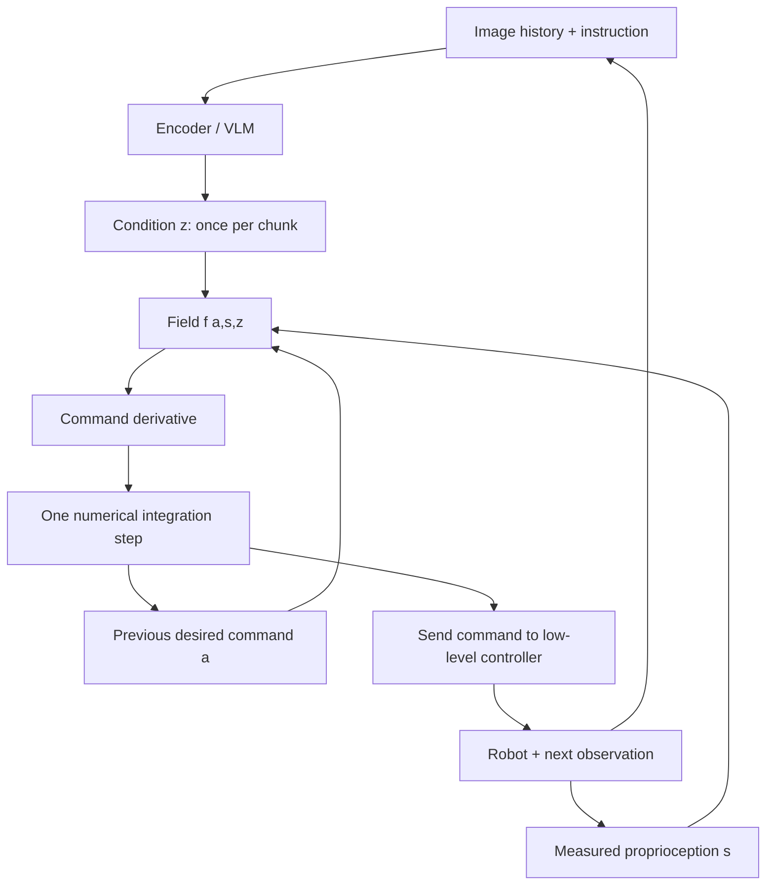

# ODE Policy 핵심 기술 학습

> 중급 입문자를 위한 독자 작성 자료입니다. 원 논문의 학습 코드나 학습된 weight를 재현하지 않습니다. 아래 Python 예제는 선형 field의 적분·경계 연속성 및 multi-modal regression의 위험만 검증하는 toy experiment입니다.

## 1. 먼저 알아둘 개념
- **Behavior cloning:** demonstration에서 observation-action 대응을 맞추는 지도학습.
- **Action chunk:** 한 번 perception한 조건으로 실행할 여러 시점 command.
- **Desired action / measured state:** controller가 추종할 목표와 sensor가 측정한 실제 상태.
- **Vector field:** 현재 위치와 조건을 받아 그 위치에서의 변화 방향/속도를 주는 함수.
- **Neural ODE:** 변화율을 network로 parameterize하고 numerical integration으로 경로를 만드는 모델.
- **Generation time τ:** noise sample을 데이터 sample로 바꾸는 계산상 시간. 로봇의 elapsed time과 다릅니다.
- **FiLM:** condition으로 feature의 scale/shift를 조절하는 방식.
- **Stop-gradient:** 값을 전달하되 특정 loss의 gradient가 upstream network로 가지 않게 하는 연산.
- **Mode / mixture:** 하나의 관측에 가능한 여러 분리된 행동과 그 확률 모델.
- **RMS jerk:** acceleration의 시간 변화율을 요약한 smoothness 지표. 좌표/단위/sample rate가 같아야 비교할 수 있습니다.

## 2. Architecture를 두 Clock으로 보기



무거운 encoder가 매 command마다 돌아야 하는 것은 아닙니다. 반대로 command를 빨리 생성한다고 perception이 신선한 것도 아닙니다. Chunk 주기와 controller 주기, solver substep을 세 개의 별도 값으로 기록하세요.

## 3. 1차원 예로 적분 이해하기

현재 commanded position a=0이고 condition이 목표 g=1을 가리킨다고 합시다. 교육용 field를 `f(a)=2(g-a)`라 두면 가까워질수록 속도가 줄어듭니다. Euler는 `a_next=a+dt*f(a)`, RK4는 한 구간의 중간 기울기를 여러 번 평가합니다. 실제 ODE Policy의 field는 학습된 비선형 network이며 이 단순 목표복귀 식으로 고정되어 있지 않습니다.

```python
import math

def field(a, goal):
    return 2.0 * (goal - a)

def euler(a, goal, dt):
    return a + dt * field(a, goal)

def rk4(a, goal, dt):
    k1 = field(a, goal)
    k2 = field(a + dt*k1/2, goal)
    k3 = field(a + dt*k2/2, goal)
    k4 = field(a + dt*k3, goal)
    return a + dt*(k1 + 2*k2 + 2*k3 + k4)/6

x_e = x_r = 0.0
for _ in range(10):
    x_e = euler(x_e, 1.0, 0.1)
    x_r = rk4(x_r, 1.0, 0.1)
truth = 1.0 - math.exp(-2.0)
assert abs(x_r-truth) < abs(x_e-truth)
# Condition changes at a chunk boundary; initial command is retained.
last_command = x_r
next_chunk_start = last_command
assert next_chunk_start == last_command
next_command = rk4(next_chunk_start, 0.5, 0.1)
assert 0.5 < next_command < last_command
# Smaller dt does not by itself refresh the camera condition.
print('toy integration passed', round(x_e, 6), round(x_r, 6), round(truth, 6))
```

이 예제에서 field의 smoothness가 좋아도 controller saturation/obstacle은 없으므로 robot safety를 검증한 것이 아닙니다. dt를 키우면 Euler의 안정성이 달라지고, physical time 단위를 바꾸면 gain도 함께 해석해야 합니다.

## 4. 왜 Initial-Condition Perturbation인가

Teacher data에서 시작할 때의 field와 자기 예측이 틀어진 위치에서의 field는 다를 수 있습니다. `a_start + δ`에서 출발하게 하고 target 편차를 `ρ^(k+1)δ`로 줄이면 recovery neighborhood를 학습할 기회가 생깁니다. 이는 단순히 target에 임의 noise를 더하는 augmentation과 다릅니다. Perturbation 크기와 command normalization을 같은 단위로 맞춰야 합니다.

## 5. 왜 평균 Action이 위험한가

왼쪽과 오른쪽 gap으로 가는 demonstration이 반반이면 평균은 벽 중앙일 수 있습니다. 방향 ε을 chunk마다 한 번 뽑아 유지하는 것은 일관된 mode를 고르기 위한 것입니다. 매 command마다 왼쪽·오른쪽을 번갈아 샘플링하면 다시 진동할 수 있습니다.

```python
import random
routes = [-1.0, 1.0]
mean_route = sum(routes)/len(routes)
assert mean_route == 0.0  # A blocked center corridor in this toy geometry.
rng = random.Random(17)
rollouts = []
for _ in range(100):
    eps = rng.choice(routes)
    path = [eps*(k+1)/8 for k in range(8)]
    assert all(v*eps > 0 for v in path)
    rollouts.append(path[-1])
assert set(rollouts) == {-1.0, 1.0}
# 4-route balance uses only successful route counts; SR must be separate.
counts = [10, 10, 10, 10]
balance = 4*min(counts)/sum(counts)
success_rate = sum(counts)/100
assert balance == 1.0 and success_rate == 0.4
print('mode consistency passed; perfect balance does not imply high success')
```

## 6. 구현 체크리스트

1. **단위:** absolute pose, delta command, joint target을 구별하고 a와 s를 따로 저장합니다.
2. **Reset:** episode 시작·실패 복구·hardware stop 후 last commanded action을 무엇으로 초기화할지 정합니다.
3. **Rate:** model-time step과 실제 seconds, chunk refresh interval, solver step 수를 기록합니다.
4. **Bounds:** action clamp와 derivative limit, independent collision/safety check를 둡니다. 이 추가 제약은 원 논문의 universal safety proof가 아닙니다.
5. **Discrete signal:** binary gripper와 contact event를 연속 ODE에 억지로 넣지 않습니다.
6. **Latent lifecycle:** z가 어느 frame을 반영하는지 timestamp를 유지합니다. Field가 싸다고 encoder output을 무한 재사용하지 않습니다.
7. **Deployment measurement:** head-only latency, full-model latency, first-command latency, p95/p99, control overrun을 따로 잽니다.
8. **NPU 가설:** FiLM-MLP의 static shape는 유리할 수 있지만 sequential solver와 CPU dispatch가 병목일 수 있습니다. 실제 compile/quantization 후 field integration drift를 검증해야 합니다.

## 7. Study Questions와 답

**Q1. Flow matching도 ODE인데 무엇이 다른가요?**
A. Flow matching은 통상 noise-to-sample transport의 generation time을 적분합니다. 이 논문은 commanded action을 physical time에 따라 이어갑니다. 적분이라는 수학 도구가 같아도 상태 변수와 시간 의미가 다릅니다.

**Q2. 이전 measured joint angle에서 시작하면 더 정확하지 않나요?**
A. Controller lag 때문에 desired command보다 뒤에 있는 값일 수 있습니다. 매번 measured state로 restart하면 command lead를 지워 경계 jump를 만들 수 있습니다. 다만 센서 feedback을 버리는 것은 아니며 s는 condition으로 들어갑니다.

**Q3. Continuous command이면 jerk도 bounded인가요?**
A. 아닙니다. Condition switching·field regularity·solver·actuator tracking이 별개입니다. Position continuity만으로 acceleration과 jerk의 물리적 상한을 증명할 수 없습니다.

**Q4. 8 action/5.7ms이면 robot은 1,400Hz 이상인가요?**
A. 아닙니다. Chunk generation cost와 command consumption period는 다른 값입니다. 영상 처리·controller·hardware가 실제 control rate를 결정합니다.

**Q5. Multi-modal mixture 수 K=12이면 실제 12개 전략을 학습하나요?**
A. 아닙니다. Component는 mode와 일대일이 아닙니다. Route coverage와 balance, SR을 직접 측정해야 합니다.

**Q6. 자율주행에 적용된 결과인가요?**
A. 아닙니다. Steering/acceleration command의 continuity 연구에 참고할 수 있지만 vehicle simulator와 real-road safety 검증이 추가로 필요합니다.

## 8. 짧은 학습 Roadmap

- 1차: Neural ODE → Euler/RK4 → action/state 단위 차이.
- 2차: ACT/Diffusion Policy/Flow Matching → chunk와 generation time.
- 3차: 원문 Method 4.1–4.4 → path loss·perturbation·mode head.
- 4차: Figure 5/8/17/19 → pretrained baseline·latency boundary·ablation·예비 연구.
- 5차: 본 자료 toy code를 실행한 뒤, 원 코드로 공개 benchmark를 재현하기 위한 dataset/seed/controller protocol을 별도 설계합니다.

학습 완료 기준은 “ODE가 부드럽다”를 반복하는 것이 아니라, **어떤 변수를 어떤 시간에 적분하고, 어느 조건을 언제 갱신하며, 무엇이 아직 검증되지 않았는지** 설명하는 것입니다.
