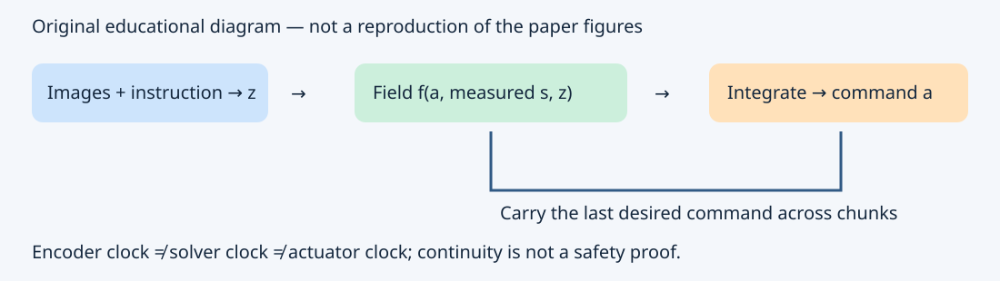

# ODE Policy: Action 값이 아닌 Action Dynamics를 학습하기

> **문서 범위와 권리:** Jindou Jia 외, arXiv:2611.01729v1(2026-11-01)의 전체 HTML 본문과 선별 부록을 읽고 독자적으로 재구성한 한국어 기술 해설입니다. 원문 라이선스는 arXiv perpetual non-exclusive distribution이며 전체 번역·그림 재배포 권한을 확인하지 못했습니다. 따라서 Abstract를 포함한 원문 문장을 연속 번역하지 않으며, 긴 표·부록·캡션도 대체본 형태로 재현하지 않습니다. `paper-ko.md`라는 자동화 파일명과 달리 **전문 번역본이 아닙니다**. 아래 수식은 방법 이해에 필요한 수학적 관계이며, 한국어 설명·도식·교육 예제는 독자 작성입니다. 수치와 성능 주장은 저자 보고이며 재현 실험이 아닙니다.

## 0. 제목과 Abstract의 핵심 내용

제목의 의미는 “다음 명령을 바로 맞히지 말고, 명령이 변하는 법칙을 배운다”입니다. 관측에서 각각의 action을 직접 출력하는 대신, 현재 명령과 관측 조건이 주어졌을 때 action의 시간 변화율을 예측합니다. 이 변화율을 적분하면 다음 명령이 나오고, 그 결과가 다시 다음 적분의 초기조건이 됩니다. VLA의 언어 이해를 새롭게 만드는 논문이라기보다, 기존 visuomotor policy·VLA·WAM·model-based RL의 **출력 인터페이스**를 바꾸는 연구입니다.

저자는 짧은 demonstration chunk의 적분 결과에 supervision을 주고, 초기조건 perturbation과 별도 diversity head로 오차 누적과 다중 행동 모드를 다룹니다. LIBERO에서 초기 학습 속도, pretrained policy의 action head 교체, 네 종류 실물 로봇의 14개 task를 시험합니다. 연속 명령이 유용한 inductive bias라는 증거이지, 모든 RL이나 안전 제어 문제에 최적인 해법이라는 주장은 아닙니다.

## 1. Introduction의 문제를 제어 관점으로 풀기

카메라와 언어를 이해하는 거대한 backbone이 있어도 최종적으로는 매 제어 시점에 숫자를 보내야 합니다. 시점마다 독립적으로 예측한 joint target이나 pose target은 이전 명령과 어긋날 수 있습니다. Action chunking은 여러 시점의 명령을 함께 예측해 계산을 amortize하지만, 새 chunk가 시작하는 경계에서 점프가 생길 수 있습니다. 저자는 이 시간적 관계를 데이터에서만 배우게 두는 대신 구조로 넣습니다.

여기서 중요한 분리는 **desired command**와 **measured state**입니다. 목표 위치를 보냈다고 로봇이 즉시 그 위치에 있지는 않습니다. 따라서 실제 측정 pose로 매번 명령 적분을 재시작하면 controller lag를 반복해서 되돌리는 결과가 됩니다. ODE policy는 이전에 보낸 desired action을 이어받고, 측정 proprioception은 vector field의 조건으로 넣습니다.

## 2. Related Work를 읽는 세 축

1. **Dynamical movement primitive / stable vector field:** 움직임을 dynamical system으로 기술한다는 선행 관점입니다. ODE policy는 미리 고정한 attractor 형태 대신 neural field의 표현력을 사용합니다. 그 자유도는 안정성 보장이 자동으로 따라오지 않는다는 뜻이기도 합니다.
2. **Diffusion / flow matching:** 이들 역시 ODE 또는 유사한 반복 생성 절차를 쓸 수 있으나, noise에서 action sample로 옮겨가는 generation time과 로봇이 움직이는 physical time은 다른 변수입니다.
3. **Action chunking / historical-action conditioning:** 이전 action을 condition하거나 chunk 경계를 보완하는 접근과 목표가 겹칩니다. ODE policy의 특징은 한 field를 현재 action 위치에서 다시 평가하면서 경로를 이어간다는 것입니다. 단순히 H개의 delta를 한 번에 출력해 더하는 것과 구별해야 합니다.

## 3. Preliminaries: 무엇의 Dynamics인가

직접 예측은 대략 `action_chunk = policy(images, instruction, proprioception)`입니다. 반면 이 논문의 수학적 상태는 환경 상태가 아니라 **명령 action 자체**입니다. 영상/언어 이력의 embedding을 z, 측정 상태를 s, 명령을 a라 쓰면 핵심 관계는 다음과 같습니다.

\[
\frac{da}{dt}=f_\theta(a,s,z),\qquad
 a(t+\Delta)=a(t)+\int_t^{t+\Delta}f_\theta(a(u),s,z)du.
\]

원문의 t 단위는 control step입니다. 초 단위 구현으로 옮길 때는 sample period와 field 단위를 일관되게 변환해야 합니다. Joint position command의 변화율과 motor torque는 같은 물리량이 아닙니다. 모델이 robot/environment dynamics를 식별한 것으로 해석해서도 안 됩니다.

## 4. Method의 상세 작동 원리

### 4.1 Condition과 Vector Field

영상 이력과 instruction으로 z를 계산하고, proprioception s와 현재 command a를 FiLM-MLP field에 공급합니다. IL의 기본 구현에서는 chunk 동안 z와 s를 유지합니다. 따라서 **streaming command output**이라고 해서 카메라를 매 integration substep에 갱신하는 것은 아닙니다. 저비용 field evaluation과 무거운 perception update의 주기가 다릅니다.

### 4.2 Derivative Label 없이 Path를 맞히기

Demonstration의 직전 명령에서 시작하여 H개 시점까지 적분하고 해당 명령들과 비교합니다.

\[
L_{path}=\frac1H\sum_{k=0}^{H-1}\|\hat a_{t+k}-a_{t+k}\|^2.
\]

학습 대상은 field지만 loss는 적분한 path에 걸립니다. Demonstration을 수치 미분해서 velocity target을 만드는 방식과 다르므로 미분 연산이 증폭하는 label jitter를 피하려는 설계입니다. 짧은 chunk의 solver 연산을 통해 역전파하고, 전체 episode를 역적분하는 adjoint 방식은 쓰지 않습니다.

### 4.3 Contractive Perturbation

Teacher의 초기 action으로만 학습하면 자기 예측에서 시작하는 배포와 다릅니다. 초기조건에 δ를 더하고, 목표 경로에도 시간에 따라 줄어드는 편차를 적용합니다.

\[
\hat a_{start}=a_{t-1}+\delta,\qquad
 a^*_{t+k}=a_{t+k}+\rho^{k+1}\delta,\quad 0<\rho<1.
\]

이 목표는 “처음부터 정답으로 순간 이동”이 아니라 “근처에서 출발한 명령이 점진적으로 demonstration으로 복귀”하도록 유도합니다. **Contractive라는 이름을 전역 수축성 증명으로 읽으면 안 됩니다.** 논문이 주는 것은 demonstration 주변 학습 신호와 ablation이지, 모든 외란에서의 안정성 certificate가 아닙니다.

### 4.4 Seamless / Streaming Inference

각 command를 적분한 즉시 controller에 보냅니다. 다음 chunk도 이전 마지막 desired action에서 시작합니다. 초기 action의 정의, episode reset, emergency stop 후 재시작은 실제 구현에서 명시해야 합니다. Command a가 이어지더라도 condition 갱신으로 field가 바뀌면 derivative는 달라질 수 있습니다. 따라서 position continuity와 bounded acceleration/jerk, robot tracking safety는 서로 다른 조건입니다.

### 4.5 Diversity Head

장애물 좌/우 회피처럼 같은 관측에 여러 유효한 mode가 있을 때 deterministic regression은 중간 경로를 택할 수 있습니다. 별도 head가 Gaussian mixture에서 방향 ε을 선택하고 단계별 nonnegative scale λ를 산출합니다.

\[
\dot a=f_\theta(a,s,z)+\lambda_k\odot\epsilon.
\]

ε은 chunk 안에서 유지되므로 매 시점 백색잡음을 더하는 것과 다릅니다. Head는 stop-gradient 처리한 base feature와 base-path residual로 학습합니다. 이 분리 덕분에 diversity loss가 base field의 gradient를 바꾸지 않습니다. K는 잠재 mixture component의 상한이며 task의 진짜 mode 수와 동일한 값이 아닙니다.

### 4.6 RL Actor

SuperMimic에서는 H=1이고 이전 action에 한 Euler update를 더하는 actor로 해석합니다. Critic, world model, reward를 유지한 비교이므로 IL의 path loss나 demonstration perturbation을 그대로 RL에 넣은 실험이 아닙니다. Action chain Jacobian에 identity term이 있다는 설명은 gradient 통로의 개선 가능성을 뜻합니다. 전체 Jacobian이 항상 norm 1이고 exploding/vanishing 문제가 불가능하다는 정리는 아닙니다.

## 5. Experimental Setup을 비교 가능한 단위로 정리

| 설정 | 역할/데이터 | Action head / 적분 | 근거의 한계 |
|---|---|---|---|
| Visuomotor IL | LIBERO 네 suite, LIBERO-plus OOD | 기본 H=8, RK4, K=12; binary gripper classifier | 주요 결과 3 seeds, successful episode 위주 smoothness |
| π0.5 VLA | LIBERO fine-tuning | 13.7M ODE/query/gripper vs 430M action expert | scale 실험 1 seed; 75.5% 비교는 random-init FM-R |
| ImageWAM | 동일 suite와 공유 OOD subset | H=12, Euler | pretrained WAM 전체 비용과 head 비용 구분 |
| SuperMimic | G1, LAFAN1 40 clips | H=1, Euler, action/change bounds | model-based RL 특정 설정 |
| 실물 로봇 | Franka·Galaxea·Sharpa·G1, 14 tasks | platform별 head와 controller | method/task별 주로 20 trials, real-road 아님 |

기본 작은 policy 설정을 모든 backbone에 동일하게 적용했다고 쓰면 틀립니다. 특히 humanoid GR00T 쪽은 H=16과 Euler를 사용합니다. π0.5의 약 3%는 **action module 크기** 비교이며 전체 VLM이 97% 작아졌다는 뜻이 아닙니다.

## 6. Simulation Results의 핵심 근거

- Visuomotor LIBERO에서 1 epoch 79.2%, 100 epoch 93.8%를 보고합니다. 1 epoch의 가장 높은 baseline은 43.2%입니다. Abstract의 5.9배는 특정 flow-matching 비교이므로 모든 baseline 대비 배수로 일반화하지 않습니다.
- π0.5에서 1 epoch ODE 96.0% 대 random-init FM expert 75.5%입니다. Pretrained FM expert는 별도 baseline이며 두 번째 epoch부터 따라잡습니다. “기존 pretrained π0.5가 항상 75.5%”라고 적으면 비교조건을 잃습니다.
- ImageWAM 1 epoch 82.6% 대 original head 24.6%이고 여러 head가 약 6 epoch부터 수렴합니다. 빠른 adaptation의 근거와 asymptotic superiority를 구별합니다.
- Visuomotor의 Euler inference는 8 action chunk당 5.7ms, FM-DiT 대비 10.8배 빠르다고 보고합니다. 기본 RK4 숫자나 sensor-to-actuator latency와 같지 않습니다. π0.5에서는 head 약 14배와 full model 약 1/3 시간 절감이 구별됩니다.
- LIBERO-plus에서 camera change는 모든 비교 방법에 어렵습니다. 초기 학습의 높은 robustness를 모든 OOD shift에서의 최종 우위로 해석할 수 없습니다.
- Four-route navigation의 mode balance는 `4 × 가장 드문 성공 route의 비율`입니다. 성공 route만 균등해도 전체 success가 낮을 수 있으므로 SR과 함께 읽습니다.

## 7. Real-World Results의 읽을거리

Single arm의 sock folding과 block insertion은 각각 20회 중 15회·14회로 best baseline의 8회·4회보다 높습니다. Dual arm의 microwave는 75% 대 20%이며, two-flower chaining은 두 번째 삽입이 여전히 어렵습니다. Dual-arm drawer에서 두 팔 assignment를 모두 사용하지만 전체 성공은 60%입니다.

Sharpa의 다른 실험실에서 얻은 demonstration을 쓰는 실험은 환경/물체 변화에 대한 transfer입니다. Same robot/hand라는 조건이 있으므로 새로운 arbitrary embodiment로 zero-shot transfer했다고 해석하지 않습니다. G1의 두 long-horizon task는 60%와 70%, 기존 GR00T head는 35%와 30%입니다. 가장 우수한 결과와 절대적 reliability는 별개이며 실패율이 남습니다.

## 8. Ablation이 보여 주는 설계 의존성

H=1은 encoder를 자주 돌리는 대신 최종 success가 낮았고, 큰 H는 계산 효율과 함께 occasional training loss spike를 가져왔습니다. H=16 실험의 한 seed는 diverge했습니다. 이 결과는 “적분을 길게 하면 무조건 좋다”를 반박합니다.

Perturbation 제거는 10 episode/task ablation의 초기 success를 79.8%에서 58.4%로 낮춥니다. 본 실험 79.2%와 차이는 evaluation protocol입니다. Measured state로 chunk를 재시작하면 초기 success 47.8%, 경계 command jump와 jerk도 커집니다. 반면 Euler/RK2/RK4의 최종 success 차이는 작아, numerical accuracy만으로 gain을 설명하기 어렵습니다.

## 9. Discussion / Limitations / 향후 연구

원문은 독립된 일반 Limitations section보다 Discussion에서 범위를 드러냅니다. Measured-pose-only learning에 reference velocity를 PD damping에 넣는 예비 실험은 Long task success를 높이지만 Spatial의 정확한 배치는 악화시킵니다. 속도 증가가 항상 좋은 제어는 아닙니다.

Control-rate 변경은 20Hz에서 학습한 field를 더 촘촘하게 적분하는 실험이며, 40/80Hz에서의 success를 보고합니다. 이는 perception refresh rate 증가나 NPU의 실측 지원을 뜻하지 않습니다. Binary gripper는 별도 classifier가 유리하고, 초기 model-free RL에서는 smooth exploration 때문에 gain이 작거나 나쁜 경우도 있었습니다.

**학습자 관점의 결론:** 연속시간 action representation은 action head 설계의 유력한 대안입니다. 하지만 actuator limit·contact event·reset·fresh perception·safety fallback을 별도로 다루고, task와 metric별로 검증해야 합니다. 자율주행의 steering/acceleration command에 적용하는 것은 후속 연구 제안이지 이 논문의 차량 실험 결과가 아닙니다.

## 10. 원본 Figure/Captions 읽기 지도

원본 그림은 권리 범위 때문에 저장소에 재배포하지 않았습니다. HTML asset URL은 실제 version 경로를 기준으로 확인했고 로컬 검토용 다운로드는 `build/`에만 보관했습니다. 다음 설명은 캡션 번역이 아니라 독자적인 읽기 안내입니다.

- [Figure 2](https://arxiv.org/html/2611.01729v1#S1.F2): 왼쪽 direct prediction과 오른쪽 field integration에서 **무엇이 다음 단계로 전달되는지** 비교합니다.
- [Figure 3](https://arxiv.org/html/2611.01729v1#S4.F3): mode mixing과 sampled field offset의 차이를 봅니다.
- [Figure 7](https://arxiv.org/html/2611.01729v1#S6.F7): solver별 latency, jerk, successful episode 분모를 함께 읽습니다.
- [Figure 17](https://arxiv.org/html/2611.01729v1#S8.F17): perturbation 제거와 measured-state restart의 다른 효과를 비교합니다.
- [Figure 19](https://arxiv.org/html/2611.01729v1#S9.F19): PD velocity와 control-rate 변경은 예비 연구라는 점을 기억합니다.

Appendix A/B의 모든 hyperparameter·전체 benchmark 표·추가 rollout 및 전체 참고문헌은 재현하지 않았습니다. 설정을 실제로 재현할 때는 원문과 공개 코드를 다시 확인해야 합니다.
