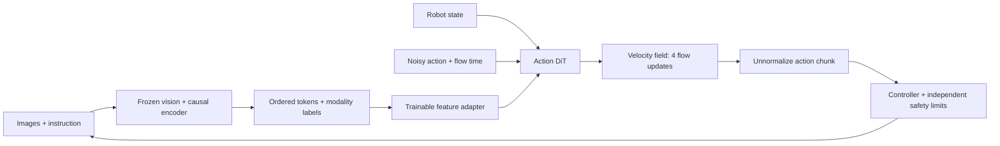

# ScaleVLA 분석: 더 큰 VLM representation이 action learning을 돕는가

## 한 문장 결론

552B frozen VLM의 **중간 feature를 한 번 읽어** scratch-trained action DiT에 전달하면 제한된 robot demonstration에서도 generalization과 정밀 insertion이 개선될 수 있지만, 이는 4×H200 manipulation 실험이며 차량/NPU safety 또는 순수 parameter scaling law의 증거는 아닙니다.

## 문제와 선정 이유

지금까지 frontier VLM을 robot에 쓰는 대표 경로는 reasoning→tool/controller였습니다. ScaleVLA는 더 큰 model의 지식을 **text output이 아닌 representation interface**로 직접 continuous action에 옮깁니다. 이번 주(2026-W47) 후보 중 VLA backbone scaling, VLM feature transfer, numerical action, latency/deployment를 직접 다루므로 선정했습니다. Repo raw/wiki의 `2611.21607`, `ScaleVLA`, distinctive title 검색에서 기존 분석은 없었습니다. HF pre-run 시점 41 upvotes/rank 11은 선정 맥락이지 품질 보증은 아닙니다.

## 기여와 taxonomy

- **Numerical Action Generator:** image/instruction/state→continuous action chunk. Textual Action Generator가 아닙니다.
- **Representation transfer:** frozen frontier backbone 지식을 scratch action head에 전달합니다. 별도 teacher→small student distillation은 아닙니다.
- **동일 action-side 비교:** action DiT 구조, common initialization, benchmark 내부 data/budget을 맞춥니다. Adapter 입력 dimension은 backbone별로 달라집니다.
- **World model과 구분:** future video 또는 latent rollout을 planning하는 model이 아닙니다.
- **세 축 평가:** sample efficiency, perturbation generalization, contact-sensitive manipulation. 평균 SR뿐 아니라 task-level time을 봅니다.

## Input → Representation → Action

| 단계 | 표현 | 역할/조건 |
|---|---|---|
| Input | camera RGB, language instruction, robot state | 실물 top/wrist camera 3개 |
| Frozen VLM | 552B sparse MoE, causal encoder 20층까지만 | 5120-dimensional ordered image/non-image token, decoder 미실행 |
| Trainable adapter | layer norm, 2 linear, width 2048, 4-layer self-attention | VLM feature를 action space에 맞춤 |
| State/action encoder | embodiment-specific MLP, padding/mask, position/time embedding | 서로 다른 embodiment layout 처리 |
| Action DiT | 32층, self/cross-attention 교대, modality별 cross attention | noisy action의 flow velocity |
| Output | 4-step flow integration 후 numerical action chunk | LIBERO 16개 예측/8개 실행, DexJoCo 30개, 실물 16개 |

Language의 역할은 instruction conditioning입니다. Explicit linguistic explanation이나 매 chunk CoT가 없으며 grounding은 demonstration-supervised adapter/DiT가 수행합니다. 그러므로 '더 큰 reasoning chain이 더 좋은 action을 만든다'는 결과가 아닙니다.

## Training recipe

1. Backbone freeze 후 ordered feature와 modality label을 precompute/cache합니다.
2. State/action은 training dataset 1st/99th percentile로 normalize합니다.
3. Demonstration A와 noise ε를 flow time τ로 interpolate하고 target velocity A−ε를 regress합니다.
4. Padding dimension/time을 loss에서 제외합니다. Adapter, state/action encoder, DiT, action decoder만 학습합니다.
5. LIBERO 5k AdamW step, lr 1e-4, cosine/5% warmup. DexJoCo 20k step. Global batch 640, H200 64개, policy seed 42입니다.
6. Sample sweep은 5/10/25/50 nested demonstration과 fixed 5k update budget을 비교합니다. **Normalization은 full-dataset statistics**이므로 총 정보 사용량까지 5/10 demonstration에 제한된 실험은 아닙니다.
7. 실물은 full demonstration 171개 + insertion segment 132개, 303 episode/0.52M frame, validation 26개, 40k step입니다.

## 근거와 평가 경계

| 실험 | 저자 보고 결과 | 해석 경계 |
|---|---|---|
| LIBERO full-data | four-suite mean 96.1%; Goal 96.8, Long 90.2 | 모든 개별 suite 최고는 아님 |
| LIBERO-PRO | 3-setting mean 45.1%, best smaller 31.3% | Object-Env 31.2%는 best 32.4%보다 낮음 |
| LIBERO Goal sample sweep | 10 demos 87.8% vs 2B 50 demos 85.6% | fixed compute/preprocessing 조건; convergence 비교 아님 |
| RoboCasa | Gen-30 30.7%, Gen-100 54.9% | OOD kitchen simulation, vehicle 실험 아님 |
| DexJoCo | Obj/Full 평균 42.1/24.4% | Full Assembly 1.3%로 매우 어려움 |
| Real robot | ID 9/10, OOD 8/15 | π0.5의 8/10, 7/15보다 각각 1 trial 우위; seed/표본 작음 |
| RoboCasa latency | median 215.8ms, 4×H200, 568 tokens | small model은 1×H200, 212 tokens; equal hardware 아님 |
| Real robot timing | latency 384ms; successful-trial completion 114.4s | latency와 task time, failure-inclusive cost를 구분 |

**Open-loop와 closed-loop:** cached demonstration supervised loss/validation action MAE는 open-loop 진단입니다. LIBERO/PRO/RoboCasa/DexJoCo 및 실물 execution의 task SR은 manipulation feedback loop 결과입니다. 차량의 CARLA/nuPlan/NAVSIM closed-loop 검증은 없습니다. 2B와 ScaleVLA action MAE 0.0095/0.0094가 거의 같아도 real SR은 다르므로 log action error만으로 deployment를 예측할 수 없습니다.

## Latency를 읽는 법

- Chunk latency 215.8ms는 RoboCasa client round trip이고 384ms는 실물입니다. Benchmark와 measurement context가 다릅니다.
- Parameter 수 대비 latency가 완만한 것은 sparse MoE, encoder truncation, no autoregressive decoding, chunk feature reuse와 더 많은 GPU가 함께 작용한 결과입니다.
- 약 70ms head는 고정 비용에 가깝습니다. 거대 backbone만 최적화해도 이 비용은 남습니다.
- Buffer controller가 빠르게 command를 보내도 새로운 observation에 빠르게 반응하는 것은 아닙니다. **Observation age, chunk completion timestamp, buffer starvation, worst-case latency**가 중요합니다.
- vLLM timing과 성공률을 낸 Hugging Face feature는 elementwise equivalence를 검증하지 않았습니다. Small-model prompt parity는 16 observation에서만 점검했고 ScaleVLA는 예외입니다.
- Successful trial의 completion time이 짧다는 사실은 실패의 cost나 tail-risk까지 포함한 deployment efficiency를 보장하지 않습니다.

## 강점

Representation 전달 경로가 단순하고 autoregressive reasoning 없이 continuous action에 연결됩니다. Sample-budget sweep, perturbation suite, 양손 dexterity, 실물 insertion을 함께 사용하며 latency와 task-level time을 분리합니다. 논문 부록은 full-data normalization, checkpoint selection, one training seed, timing backend parity 미검증을 명시해 결과의 범위를 해석하는 데 도움이 됩니다.

## 한계·대안 해석

1. Backbone family, architecture, training corpus/recipe, readout depth, token count, hardware가 함께 바뀝니다. 'parameter 수만 늘렸기 때문에 향상'이라는 causal conclusion은 과합니다.
2. Policy training seed 하나와 실물 10/15 trial은 training instability와 rare-event risk를 충분히 측정하지 못합니다.
3. Small backbone도 training step을 늘리면 개선됩니다. Fixed-budget 이득과 asymptotic 성능 이득을 구분해야 합니다.
4. Object-Env/DexJoCo Assembly의 낮은 결과는 강한 foundation이 OOD·contact problem을 해결한 것이 아님을 보입니다.
5. No safety-stop 관찰은 formal safety가 아닙니다. Independent limit/collision checking/fallback이 필요합니다.
6. 4×H200와 64-GPU training recipe는 edge/NPU 실험 근거가 아닙니다. Distillation/quantization/compiler optimization은 후속 연구 제안입니다.

## 자율주행 및 NPU 관점 — 해석/제안, 논문 실험 아님

AD에서는 frozen VLM representation을 compact trajectory head에 전달하는 가설을 생각할 수 있습니다. 하지만 action contract를 vehicle waypoint/trajectory와 dynamics constraint로 다시 정의하고, stale-observation handling, control deadline, rare-event closed-loop, perception freshness를 별도 검증해야 합니다. Manipulation SR을 driving safety로 환산할 수 없습니다.

NPU에서는 total/active parameter, expert routing, memory bandwidth, interconnect, shape support, quantization, adapter/head cost, end-to-end p95/p99를 측정해야 합니다. 이 논문은 특정 NPU compatibility/throughput/power를 보고하지 않습니다.

## 실행과 미실행

이 job은 원문/metadata/CC BY 확인, 그림 asset decode/XML 검증, Markdown 교육 toy example 실행, source hash/coverage 및 wiki/graph integrity를 확인합니다. 실제 ScaleVLA training, model weight deployment, robot rollout, 차량 closed-loop, NPU benchmark는 수행하지 않습니다.

## 출처

- arXiv v1 본문·수식 1·표 1–9·부록 A–D: https://arxiv.org/html/2611.21607v1
- HF paper: https://huggingface.co/papers/2611.21607
- Project: https://galaxygeneralrobotics.github.io/scalevla/
- 구조/정확한 표/조건 번역: [paper-ko.md](paper-ko.md)
- 관련 연구: [references.md](references.md), 학습: [learning.md](learning.md)
