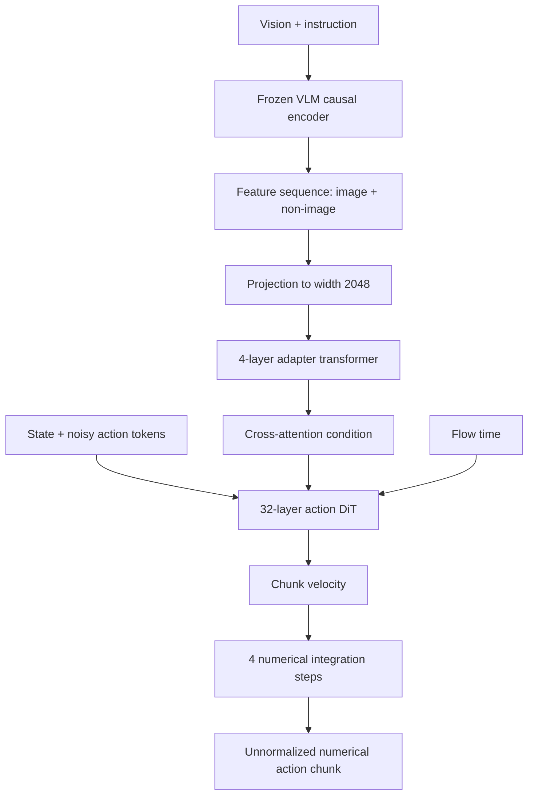

# ScaleVLA 핵심 기술 학습: Frozen Feature와 Flow-Matching Action Head

## 학습 목표와 선수 지식

먼저 Transformer의 token, self/cross-attention, layer norm, MLP를 복습합니다. 다음으로 imitation learning의 observation→action pair, multi-step action chunk, diffusion/flow generation을 이해하면 좋습니다. 이 자료는 pretrained model을 실제로 다운로드하지 않고 작은 수학 예제로 interface와 시간 축을 익힙니다. **아래 Python은 교육용 toy이며 ScaleVLA 구현/재현 또는 safety controller가 아닙니다.**

## 1. '큰 model'을 '말하는 agent'로만 쓰지 않기

예를 들어 image에는 charger와 socket이 있고 instruction은 '충전기를 꽂으세요'입니다. VLM이 이를 설명하는 문장을 생성한 후 다른 model에 전달할 수도 있습니다. ScaleVLA는 설명 문장을 만들지 않습니다. VLM의 중간 token vector들을 읽어 action head에 넘깁니다. Action head는 robot demonstration에서 이 vector와 현재 state가 어떤 continuous action을 의미하는지 배웁니다.

이는 backbone이 로봇의 joint coordinate를 이미 안다고 가정하는 구조가 아닙니다. Backbone은 representation을 제공하고 embodiment-specific encoder/decoder와 action DiT가 numerical action grounding을 담당합니다. 범용 의미 지식과 robot-specific coordinate contract를 분리해 생각해야 합니다.



## 2. 용어 사전

| 용어 | 쉬운 설명 | 흔한 오해 |
|---|---|---|
| Frozen backbone | weight update 없이 feature만 추출 | runtime 계산도 공짜인 것은 아님 |
| Feature adapter | foundation feature를 action head의 width/interface에 맞춤 | 단순한 출력 text parser가 아님 |
| MoE | token마다 expert 일부를 실행 | 전체 parameter를 한 GPU에 저장할 필요가 없다는 뜻은 아님 |
| Causal encoder readout | decoder 전에 계산을 끊고 중간 feature를 읽음 | autoregressive CoT 생성과 다름 |
| Flow matching | noise→data 경로의 velocity를 학습 | robot physical velocity와 같은 뜻이 아님 |
| Action chunk | 여러 미래 numerical command 묶음 | chunk rate와 actuator Hz는 다름 |
| Valid mask | padding action/time을 loss에서 제외 | missing sensor 정보를 복원하는 기능은 아님 |
| Observation age | 실행 command가 의존하는 관측이 얼마나 오래됐는가 | controller가 빠르면 자동으로 작아지지 않음 |
| OOD | training distribution 밖의 환경/배치 | 모든 실제 환경이나 adversarial safety를 포괄하지 않음 |

## 3. Feature adapter를 단계별로 이해하기

1. Camera image와 instruction을 reference prompt로 encoding합니다.
2. ScaleVLA는 causal encoder 끝의 5120-dimensional token들을 순서를 유지해 읽습니다. Decoder는 실행하지 않습니다.
3. Token마다 image/non-image label을 보존합니다. Cross-attention에서 modality별로 접근할 수 있습니다.
4. Layer norm 및 두 linear projection으로 width 2048에 맞춥니다.
5. 4층 self-attention으로 action supervision에 유용한 image/text interaction을 학습합니다.
6. State/noisy-action token은 32층 DiT의 self-attention을 통과하고 cross-attention으로 adapted feature를 읽습니다.
7. Embodiment-specific decoder가 action token에서 chunk velocity를 출력합니다.

작은 backbone과 공통 head를 쓴다고 trainable parameter 수가 문자 그대로 완전히 같은 것은 아닙니다. Input feature width가 바뀌면 projection matrix shape가 달라집니다. 비교의 핵심은 action-side 설계와 학습 protocol을 통제했다는 점입니다.

## 4. Flow matching의 두 시간 축

Demonstration chunk $A$와 같은 shape의 Gaussian noise $\epsilon$를 만들고 generation time $\tau$에서 $A^\tau=(1-\tau)\epsilon+\tau A$를 구성합니다. Ground-truth vector field는 $A-\epsilon$입니다. 실제 model은 condition $Z,s,e$를 보고 이를 예측하며 유효 dimension/timestep에서 squared error를 최소화합니다.

Inference는 네 step으로 noise를 numerical chunk로 옮깁니다. 여기의 flow time은 **생성 과정의 시간**이지 robot이 physical world에서 이동하는 시간축이 아닙니다. Chunk 내부의 16/30 timestep은 실행 시간의 여러 command를 나타냅니다. 이 둘을 혼동하면 'flow velocity를 actuator velocity로 직접 보낸다'는 잘못된 구현이 됩니다.

### 실행 예제 1 — Oracle field와 valid mask

```python
# Toy: exact straight-path velocity; no learned policy or robot.
noise = [-1.0, 0.5, 99.0]
action = [1.0, 1.5, 0.0]
valid = [True, True, False]
velocity = [a - e for a, e in zip(action, noise)]
x = noise[:]
for _ in range(4):
    x = [v + 0.25 * u for v, u in zip(x, velocity)]
assert all(abs(x[i] - action[i]) < 1e-9 for i in range(3))
pred = [2.0, 1.0, -500.0]
errors = [(p-u)**2 for p,u,m in zip(pred,velocity,valid) if m]
loss = sum(errors) / len(errors)
assert loss == 0.0  # padded coordinate must not dominate loss
print('oracle_endpoint=', x, 'valid_loss=', loss)
```

이 toy의 endpoint가 정확한 이유는 정답을 아는 constant oracle field를 사용하기 때문이지, 실제 learned field의 네 번 Euler integration에 오차가 없다는 뜻이 아닙니다.실제 model에는 representation 오류, conditional ambiguity, integration error가 있습니다. Padding은 loss masking 대상이지 arbitrary unsafe physical command를 허용한다는 뜻이 아닙니다.

## 5. Chunk latency와 feedback freshness

LIBERO는 16개 action을 예측하고 8개만 실행한 후 새 decision을 구합니다. DexJoCo는 timestamped 30개 command를 buffer로 보내고 다음 chunk를 비동기로 생성합니다. 이때 controller는 계산을 기다리지 않고 계속 움직일 수 있지만 오래된 관측에 근거한 action을 실행할 수 있습니다.

### 실행 예제 2 — Chunk rate와 오래된 관측

```python
# Toy timing model. Values are illustrative, not ScaleVLA controller settings.
chunk_latency_ms = 215.8  # author-reported RoboCasa median
sequential_chunks_per_second = 1000.0 / chunk_latency_ms
observation_timestamp_ms = 1000.0
chunk_ready_ms = observation_timestamp_ms + chunk_latency_ms
execute_ms = chunk_ready_ms + 120.0
age_ms = execute_ms - observation_timestamp_ms
assert 4.6 < sequential_chunks_per_second < 4.7
assert age_ms > chunk_latency_ms
print('sequential_chunk_rate=', round(sequential_chunks_per_second, 3))
print('illustrative_observation_age_ms=', round(age_ms, 1))
```

실제 control에서는 capture, request, chunk-ready, command-execution timestamp를 따로 기록해야 합니다. 위 예제는 observation age가 inference latency보다 클 수 있다는 점만 보여 줍니다.실제 deadline/acceptable age는 robot/environment dynamics와 safety analysis로 정해야 하며 논문 median으로 임의 결정하지 않습니다.

## 6. 결과를 읽는 체크포인트

- **Sample efficiency:** 10 demonstration과 50 demonstration 비교에서 normalization 통계는 full dataset에서 옵니다. 같은 5k optimizer budget이지 convergence 후 비교가 아닙니다.
- **Generalization:** LIBERO-PRO 45.1%는 3-setting 평균입니다. Original LIBERO 96.1%와는 다른 distribution/aggregation입니다. 큰 backbone도 OOD에서 많이 실패합니다.
- **Real robot:** π0.5와의 성공 차이는 ID/OOD 각각 trial 하나입니다. 더 많은 seed/trial 및 uncertainty 분석이 필요합니다.
- **Latency:** 4×H200 215.8ms와 1×H200 small backbone을 단일 hardware scaling law로 해석하지 않습니다. 실물은 384ms입니다.
- **Task time:** 더 늦게 계산해도 더 정확히 조작하면 성공 trial의 completion이 빠를 수 있습니다. Failure cost까지 포함한 expected time과는 다릅니다.
- **Open-loop vs closed-loop:** action MAE가 유사해도 rollout 성공이 달라질 수 있습니다. Covariate shift와 contact transition이 결과를 바꿉니다.

## 7. Implementation / Deployment 메모 — 제안

Feature cache에는 backbone version, readout layer, image preprocessing, prompt/tokenizer, token ordering/modality mask, dtype를 함께 기록해야 합니다. 같은 text instruction이라도 tokenization/template가 바뀌면 cache compatibility가 깨질 수 있습니다. Full-dataset normalization은 학습 metadata에 명시하고 deployment의 unnormalization을 맞춰야 합니다.

Training feature backend와 deployment backend를 바꾸면 shape뿐 아니라 실제 feature 값과 downstream action equivalence를 검증해야 합니다. 논문의 vLLM timing은 이를 elementwise 확인한 실험이 아닙니다. p50뿐 아니라 p95/p99, observation age, empty buffer, invalid command, interruption/replan consistency를 측정해야 합니다.

AD 전이는 numerical waypoint/trajectory의 coordinate frame, horizon, dynamics/actuation limit, independent fallback을 새로 정의해야 합니다. NPU 전이는 MoE routing/memory/interconnect 및 supported op/shape를 검증하고 distillation/quantization을 검토해야 합니다. 이는 논문이 수행한 결과가 아니라 후속 engineering roadmap입니다.

## 8. 공부 질문과 답

**Q1. 552B라서 매 chunk 552B 전체 연산을 하는가?** 아니요. Sparse MoE이며 token당 일부 expert를 활성화하고 causal encoder까지만 실행합니다. 다만 전체 weight 저장/분산 비용이 사라지지는 않습니다.

**Q2. Backbone을 freeze하면 무엇이 action grounding을 배우는가?** Adapter, state/action encoder, action DiT, decoder가 demonstration-supervised flow loss로 배웁니다.

**Q3. Flow의 velocity는 joint velocity인가?** Noise→action representation의 vector field입니다. 최종 unnormalized command의 physical 의미는 embodiment action contract로 결정됩니다.

**Q4. 낮은 validation action MAE면 성공도 같은가?** 아닙니다. 2B/ScaleVLA MAE가 유사해도 실물 task 성공은 달랐습니다. Log prediction과 feedback rollout은 다릅니다.

**Q5. 215.8ms이므로 control frequency는 약 4.6Hz인가?** Sequential chunk request rate는 그 정도입니다. Chunk 안의 command execution frequency나 새 관측에 대한 reaction rate와는 구분해야 합니다.

**Q6. LIBERO-PRO 향상이 driving safety를 뜻하는가?** 아닙니다. Robot manipulation perturbation 결과이며 vehicle dynamics/traffic interaction/rare event는 별도 실험이 필요합니다.

**Q7. '10개 demo로 충분'이라는 결론은 일반적인가?** 특정 task, backbone, fixed optimizer budget, full-data normalization 조건입니다. General universal threshold가 아닙니다.

## 9. 짧은 읽기 roadmap

1. Diffusion Policy / Flow Matching: generative action head의 기본 원리.
2. π0 / GR00T N1: VLM과 continuous action expert를 연결하는 구조.
3. LIBERO 및 LIBERO-PRO: original task distribution과 perturbation evaluation.
4. ScaleVLA §3→Appendix A→Table 7/9: representation interface와 fixed-budget/data-budget의 차이.
5. Appendix B/C→real-robot Table 8: backend equivalence, observation age, successful-trial time의 해석.
6. [analysis.md](analysis.md)에서 AD/NPU 적용 경계를 확인하고 [references.md](references.md)에서 선별 논문을 읽습니다.

## 출처

모든 논문별 architecture/metric/실험 조건은 https://arxiv.org/html/2611.21607v1 의 §3–4, Table 1–9, Appendix A–D를 바탕으로 합니다. 그림/번역은 [paper-ko.md](paper-ko.md), educational diagram과 toy code는 이 자료 작성자의 해설입니다.
