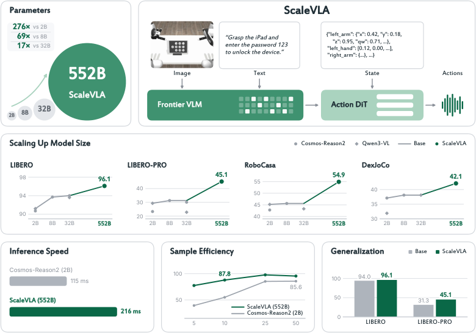
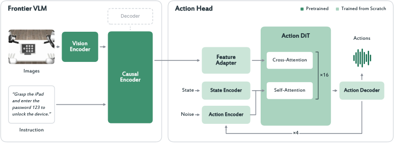
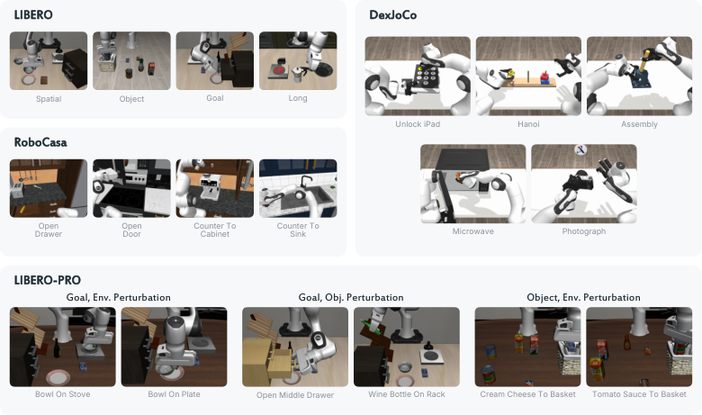
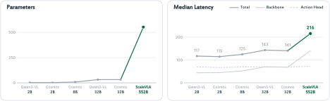
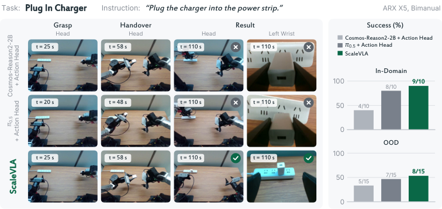

# ScaleVLA: Vision-Language-Action 모델을 5,520억 parameter로 확장하기

> 원문: Ruixi Yu, Dairu Liu, Xuchuan Chen, Zekun Qi, Zekai Li, Zhuo Cao, Luyang Niu, Yingsheng Zhang, Sikai Liang, Ke Fan, He Wang, Li Yi, *ScaleVLA: Scaling Vision-Language-Action Models to 552 Billion Parameters*, arXiv:2611.21607v1, 2026-11-16. https://arxiv.org/html/2611.21607v1
>
> 원문 및 그림: **CC BY 4.0**, https://creativecommons.org/licenses/by/4.0/ . 이 문서는 한국어 기술 번역·편집본이며 저자가 검수한 공식 번역이 아닙니다. 본문 절 구조, 핵심 수식, 모든 표의 수치, 그림 1–5와 부록 A–D의 핵심 실험 조건을 보존합니다. Related Work의 긴 인용 열거와 101개 전체 서지 항목은 축약하고 핵심 9편은 `references.md`, 전체 서지 추출은 `metadata.json`으로 분리합니다. 표의 원래 model/task 명칭은 영어로 유지합니다. 본문 수치는 모두 **저자 보고 결과**이며 이 저장소에서 policy training 또는 robot rollout을 재현한 결과가 아닙니다.

## Abstract — 초록

GPT-6 Astra와 같은 frontier Vision-Language Model(VLM)이 robot control에서 보여 준 능력은 광범위한 pretraining이 물리적 action에 유용한 지식을 제공함을 시사한다. 그러나 대부분의 Vision-Language-Action(VLA) policy는 훨씬 작은 VLM backbone에 의존하므로 이 잠재력을 충분히 활용하지 못한다. 우리는 frontier 규모의 representation이 robot learning에 더 강력한 기반이 될 수 있는지 묻는다.

ScaleVLA는 552B DeepSeek-V4.1-Flash backbone을 학습 가능한 action DiT와 연결한다. 동일한 학습 설정 아래 2B부터 552B까지의 VLM을 비교하며 robot foundation model의 세 가지 기본 능력을 평가한다. **Sample efficiency**에서는 demonstration 10개만으로, 50개로 학습한 2B backbone을 앞선다(87.8% 대 85.6%). **Generalization**에서는 LIBERO-PRO 성공률이 45.1%로, 작은 backbone의 최대 31.3%보다 높다. **Precise manipulation**에서는 실물 charger insertion 성공이 4/10에서 9/10으로 개선되며, 이득은 접촉에 민감한 alignment에 집중된다. 이 규모에도 action chunk당 median latency는 216ms다. Frontier VLM은 reasoning agent일 뿐 아니라 효율적이고 일반화 가능한 robot policy의 강력한 representation 기반이 될 수 있다.



**그림 1 번역.** 왼쪽 위는 backbone 크기, 오른쪽 위는 image와 instruction을 encoding한 VLM feature 및 robot state로 action chunk를 만드는 action DiT다. 가운데는 backbone 규모별 task 성공률이며 Base는 각 크기 이하의 가장 좋은 dense backbone이다. 아래는 RoboCasa inference latency, LIBERO Goal sample efficiency, LIBERO 및 LIBERO-PRO 성공률이다.

## 1. Introduction — 서론

Frontier VLM은 physical control에서 주목할 능력을 보이기 시작했다. 최근 GPT-6 Astra 연구는 범용 model이 robot action을 만들고 manipulation을 수행하며 physical feedback으로 행동을 개선할 수 있음을 보여 준다. 흥미로운 점은 이러한 능력이 주로 robot demonstration을 통해 얻어진 것이 아니라는 사실이다. Visual perception, spatial understanding, reasoning, code generation을 포함한 대규모 pretraining의 폭넓은 지식에서 유래하는 것으로 보인다. 더 나은 robot policy에 필요한 지식이 이미 frontier VLM 내부에 존재할 가능성이 있다.

하지만 대부분의 VLA는 GR00T N1.7의 2B Cosmos-Reason2 같은 비교적 작은 VLM backbone을 사용한다. 이들은 효과적이지만 frontier VLM에서 나타나는 풍부한 지식을 충분히 담지 못할 수 있다. 따라서 핵심 질문은 **frontier-scale representation이 학습된 robot policy의 잠재력을 더 끌어낼 수 있는가**이다.

이를 조사하기 위해 DeepSeek-V4.1-Flash-1017을 이용해 backbone을 552B까지 확장한다. GR00T의 action-expert 구조에서 영감을 받아 VLM과 학습 가능한 diffusion transformer(DiT)를 연결하고 multimodal representation을 continuous robot action으로 변환한다. 매 control step에서 explicit reasoning을 수행하는 대신 pretrained representation을 직접 action으로 옮기는 mapping을 학습한다. 2B–552B 비교에서 action architecture, initialization, robot demonstration, optimization budget을 고정한다. 추가 action-side supervision이나 pretrained robot-action expert 없이 더 강한 pretrained representation의 효과를 조사하려는 것이다.

Robot foundation model의 가치는 익숙한 task 성능뿐 아니라 얼마나 효율적으로 학습하고, 잘 일반화하며, 정밀하게 행동하는가로 평가해야 한다. LIBERO, LIBERO-PRO, RoboCasa, DexJoCo, 실물 manipulation에서 이를 측정한다. LIBERO-Goal에서는 task당 10개 demonstration으로 87.8%를 얻어 50개를 사용한 2B의 85.6%를 앞선다. LIBERO-PRO perturbation에서는 평균 45.1%로 작은 backbone의 최대 31.3%보다 높다. 실물 양팔 charger insertion은 기준 layout에서 9/10에 성공하고 2B는 4/10이다. 개선은 reaching이나 grasping보다 contact-sensitive alignment와 insertion에서 뚜렷하다. Robot data 부족, 환경 변화, 정밀 coordination이 요구될 때 frontier representation이 특히 유용하다는 결과다.

큰 parameter 수가 반드시 감당 불가능한 latency를 뜻하지는 않는다. Sparse MoE인 DeepSeek-V4.1-Flash는 token당 전체 parameter 일부만 활성화한다. 또한 autoregressive reasoning/text generation 없이 VLM causal encoder의 feature만 추출한다. 4개 H200에서 chunk당 median 216ms로 subsecond robot control을 지원하지만 작은 backbone보다 hardware 비용은 높다. 실물에서는 ScaleVLA의 chunk latency가 가장 높아도 성공한 trial의 median completion time은 114.4초로 π0.5 + Action Head의 132.0초보다 짧다. Plug alignment/insertion이 더 빨라지기 때문이다.

핵심 기여는 다음과 같다.

1. Autoregressive reasoning 없이 552B frontier VLM과 trainable action DiT를 continuous control로 연결하는 VLA framework.
2. 2B–552B의 체계적 backbone 비교를 통해 sample efficiency, generalization, contact-sensitive control의 이득을 실험.
3. Sparse frontier VLM에서 subsecond inference가 가능함을 보여 pretrained representation을 learned policy로 활용할 가능성을 제시.

## 2. Related Work — 관련 연구

### VLM as Policy

Language model은 skill을 선택하거나 task plan을 작성할 수 있다. PaLM-E는 sensor observation으로 planning을 condition한다. 다른 접근은 controller code, spatial value map, keypoint constraint를 생성해 motion planning과 연결한다. Astra 연구는 직접 action 생성, learned policy와의 협력, weight를 고정한 feedback 기반 개선을 평가한다. ScaleVLA는 이처럼 매번 reasoning하거나 code를 만드는 경로가 아니라 내부 representation을 learned continuous policy에 전달한다.

### Vision-Language-Action Models

초기 policy는 여러 task 또는 multimodal prompt에서 학습했고, cross-embodiment policy는 서로 다른 robot으로 확장됐다. BridgeData V2/DROID는 실물 robot data, MimicGen은 synthetic demonstration, EgoDex는 egocentric hand trajectory를 제공한다. RT-2/OpenVLA/FAST는 action을 token으로 표현한다. Regression, diffusion, flow matching은 continuous action chunk를 예측한다. 최근 연구는 open-world transfer와 cross-embodiment alignment를 다룬다.

Visual pretraining은 transferable feature를 제공한다. OpenVLA는 DINOv2/SigLIP feature를 활용하며 RoboFlamingo는 pretrained VLM을 imitation에 adapt한다. GR00T N1.5는 backbone을 freeze하고 Knowledge Insulation은 action-expert gradient와 VLM adaptation을 분리한다. Compact model 및 효율적인 action interface는 training/inference cost를 줄이고, controlled comparison은 backbone choice, feature readout, policy design을 다시 살핀다. 본 연구는 action DiT와 demonstration budget을 고정하면서 비교 규모를 552B로 넓힌다.

### Spatial Reasoning for Robot Manipulation

Manipulation policy는 language-conditioned spatial map, multiview feature, point cloud를 사용한다. Spatial supervision에는 point, 3D reference, action trace가 포함된다. Intermediate language, trace prompt, high-level trajectory prediction으로 action selection을 안내할 수도 있다. 이 논문은 별도 spatial reasoning output 대신 대형 pretrained representation의 action transfer를 조사한다.

### World Action Models

Video는 task specification, visual subgoal, synthetic demonstration을 제공할 수 있다. UniPi는 generated video에서 action을 복원하며 다른 접근은 visual/action prediction을 공동 학습한다. DreamVLA는 perceptual feature를 예측하고 DeFI는 forward/inverse dynamics를 분리하며 ImageWAM은 image-editing feature를 control에 쓴다. ScaleVLA 자체는 future video rollout을 생성하는 world model이 아니다.

## 3. Method — 방법



**그림 2 번역.** VLM은 image와 instruction을 encoding하고 action head는 causal encoder output을 읽는다. Action DiT는 cross-attention과 self-attention을 번갈아 사용하며 네 번의 flow step으로 action chunk를 생성한다.

### 3.1 Model Architecture

ScaleVLA는 camera image와 language instruction을 encoding하는 frontier vision-language backbone, 그리고 이 representation과 robot state를 flow matching으로 continuous action chunk에 옮기는 action head로 이루어진다. Feedback-guided interaction과 learned policy 협력은 유용하지만 reasoning/action review를 반복하면 decision이 느리고 비싸진다. ScaleVLA는 **text로 reason하지 않는다**. Chunk마다 backbone을 한 번 읽어 representation을 직접 action으로 mapping한다. Vision/language backbone은 frozen이며 feature adapter, state/action encoder, diffusion transformer, action decoder만 학습한다.

**Vision-language backbone.** DeepSeek-V4.1-Flash-1017은 552B parameter의 MoE다. Vision encoder가 camera image를 visual token으로 바꾸고, 20-layer causal encoder와 20-layer decoder로 구성된 language backbone이 reference chat format의 instruction과 함께 처리한다. Causal encoder를 실행한 뒤 다음 layer의 attention에 전달되는 feature를 읽는다. Visual/text token의 dimension은 $D_{\mathrm{vlm}}=5120$이다. 이 interface에서 계산을 중단하므로 decoder는 실행되지 않는다. Token 순서와 modality label을 보존해 action head가 image/non-image token에 따로 attention할 수 있게 한다.

**Action head.** GR00T N1.7 architecture를 따르며 feature adapter, state/action encoder, DiT, action decoder를 random initialization하여 robot demonstration으로 학습한다. Feature adapter는 layer norm과 두 linear projection으로 backbone token을 공통 width 2048로 mapping한 뒤 4-layer self-attention transformer를 통과시킨다. 이 단계에서 visual/language feature는 action supervision 아래 상호작용한다.

Embodiment-specific MLP는 common layout으로 padding한 robot state와 noisy action을 encoding한다. 미래 action마다 learned position embedding이 붙은 token을 만들고 action encoder는 flow time도 받는다. 32-layer action DiT는 self-attention과 cross-attention을 번갈아 수행한다. Self-attention은 state/noisy-action token 전체에서 이루어지고, cross-attention은 adapted backbone feature를 읽는다. 연속한 cross-attention layer는 non-image/image token을 차례로 읽으며 mask로 padding을 제외한다. Adaptive layer norm이 flow time을 제공하고 embodiment-specific decoder가 action token을 chunk 전체의 predicted velocity로 바꾼다. Backbone 비교에서는 이 head 구조와 common random initialization을 고정하고 adapter의 입력 width만 backbone에 맞춘다.

### 3.2 Training and Inference

**Flow matching.** Demonstration chunk $A$, Gaussian noise $\epsilon\sim\mathcal N(0,I)$, flow time $\tau\in[0,1]$로 다음 noisy chunk를 구성한다.

$$A^\tau=(1-\tau)\epsilon+\tau A.$$

이는 noise에서 demonstration으로 직선 이동한다. Head는 경로 velocity $A-\epsilon$을 학습한다.

$$\mathcal L_{\mathrm{FM}}=\mathbb E\left[\left\|v_\theta(A^\tau,\tau\mid Z,s,e)-(A-\epsilon)\right\|_{\mathrm{valid}}^2\right].\tag{1}$$

$Z$는 adapted backbone feature, $s$는 robot state, $e$는 embodiment다. Loss는 유효한 action dimension과 timestep에서의 squared error 평균이다. State/action은 training data의 1st/99th percentile로 normalize한다. Gradient는 action head만 갱신하므로 backbone feature를 한 번 precompute해 학습 중 재사용한다.

**Action chunk generation.** Inference는 Gaussian noise에서 시작해 predicted velocity를 네 번 적분한다. 네 step 모두 동일한 backbone feature를 재사용하므로 backbone은 chunk당 한 번 실행된다. Normalization을 되돌린 numerical command를 순차 실행한다. LIBERO는 16-step chunk를 예측하고 8개 command 실행 후 replan한다. DexJoCo는 30-step chunk를 예측한다. Timestamped command buffer를 controller가 소비하는 동안 replacement chunk를 비동기로 생성한다. Command execution과 VLM inference를 분리하고 sustained control을 평가할 때 execution rate와 chunk latency를 따로 측정한다.

## 4. Experiments — 실험

### 4.1 Experimental Setup



**그림 3 번역.** LIBERO는 tabletop manipulation, LIBERO-PRO는 LIBERO의 object/scene perturbation, RoboCasa는 OOD kitchen task, DexJoCo는 두 dexterous hand를 조율하는 다섯 task를 평가한다.

LIBERO의 Spatial/Object/Goal/Long suite를 사용한다. Sample efficiency에서는 Goal/Long의 task당 $N\in\{5,10,25,50\}$ nested demonstration subset을 모든 backbone에 동일하게 적용한다. Full-data LIBERO policy를 추가 학습 없이 LIBERO-PRO의 environment/object perturbation에 평가한다. RoboCasa는 Panda gripper의 OOD kitchen manipulation이며 task당 generated demonstration 30개(Gen-30) 또는 100개(Gen-100)를 쓴다. DexJoCo는 Unlock iPad, Hanoi, Assembly, Microwave, Photograph의 다섯 양손 task를 사용하고 task당 human demonstration 100개를 쓴다. Object/full randomization은 따로 보고하고 각 설정에서 하나의 policy를 다섯 task로 co-train한다.

DeepSeek-V4.1-Flash-1017, Qwen3-VL, Cosmos-Reason2 backbone을 비교한다. GR00T N1.7에서 사용하는 Cosmos-Reason2-2B가 주된 소형 기준이다. Benchmark 내부에서 action DiT, initialization, training data를 고정하고 adapter 입력 width만 바꾼다. Pretrained robot-action expert는 불러오지 않는다. Action-side component만 optimize하며 별도 표시한 variant 외에는 동일한 training budget/checkpoint rule을 쓴다. Benchmark가 initial state를 제공하면 동일한 state에서 평가한다.

### 4.2 Simulation Results

ScaleVLA는 모든 simulation benchmark에서 가장 높은 평균 성공률을 얻었고 평균 개선이 가장 큰 곳은 LIBERO-PRO였다.

**LIBERO.** Spatial/Object 성공은 대체로 포화 상태다. 큰 차이는 instruction grounding이 중요한 Goal과 여러 단계가 이어지는 Long에 나타난다. ScaleVLA는 Goal 96.8%, Long 90.2%, four-suite 평균 96.1%다. Cosmos-Reason2는 평균 90.7%(2B)에서 94.0%(32B), Qwen3-VL은 91.2%(2B)에서 93.6%(32B)로 개선된다. ScaleVLA의 평균은 논문에 인용한 세 prior policy보다 높지만 개별 Spatial/Object 열까지 모두 최고인 것은 아니다.

**LIBERO-PRO.** Perturbation 아래 모든 policy가 크게 하락한다. ScaleVLA는 평균 45.1%로 best dense backbone 31.3%보다 약 14 percentage point 높고, 두 Goal perturbation에서 앞선다. 다만 Object suite environment perturbation은 여전히 어렵다. Best entry는 32.4%이고 ScaleVLA는 31.2%다. 따라서 OOD 개선을 모든 조건의 일률적 dominance로 해석해서는 안 된다.

**RoboCasa.** OOD kitchen에서 ScaleVLA는 Gen-30 30.7%, Gen-100 54.9%다. 작은 backbone은 각각 대략 22–26%, 43–46%다. Data가 늘면 우위가 대략 5에서 9 percentage point로 커져 pretrained feature와 robot supervision의 상보성을 보인다.

**DexJoCo.** ScaleVLA는 object/full randomization 모두 다섯 task 평균이 가장 높다(42.1%/24.4%). 작은 backbone의 object 평균은 2B 31.9–37.1%, 8B/32B 38.1%다. 이득은 어려운 Unlock iPad, Hanoi, Assembly에서 일관적이다. Full randomization에서는 각각 15.3%, 14.0%, 1.3%다. 특히 Assembly는 여전히 거의 풀지 못한다. Microwave/Photograph는 설정마다 우열이 달라진다. Published DP-T/π0.5 baseline 평균 16.0%/10.1%는 외부 논문의 값을 인용한 것이므로 본 연구 backbone 비교와 구분한다.

### 4.3 Inference Latency



**그림 4 번역.** 왼쪽은 source model의 전체 parameter 수, 오른쪽은 RoboCasa chunk median latency의 backbone/head 분해다. ScaleVLA는 H200 4개, 나머지는 각각 1개를 쓴다.

Chunk마다 VLM feature를 한 번 forward pass로 읽는다. Client가 observation을 보낸 순간부터 chunk를 받은 순간까지 timing한다. RoboCasa에서 parameter 수는 Cosmos-Reason2-2B의 276배이지만 median latency는 약 1.9배(216 대 115ms)다. Sparse MoE, causal encoder까지만의 실행, chunk 내부 feature 재사용이 이를 가능하게 한다. 실물 Plug In Charger에서는 median round-trip latency가 384ms다.

Action head는 모든 backbone에서 약 70ms로 소형 backbone에서는 전체의 절반 이상이다. 따라서 2B→32B 확장이 전체 시간을 배수로 늘리지는 않고 비교적 고정된 head 비용에 backbone 비용이 더해진다. 그러나 ScaleVLA는 tensor/expert parallelism으로 GPU 4개를 사용하며 작은 model은 1개다. Observation당 input token 수도 더 많고 이 차이가 latency에 기여하는 정도는 분리하지 않았다. 즉 parameter scaling만 바꾼 equal-hardware latency 실험은 아니다.

### 4.4 Sample Efficiency

Goal/Long에서 5,000 optimizer step을 고정하고 demonstration 수를 바꾼다. 동일한 nested subset과 evaluation state를 사용한다. 5 demonstration에서 Goal은 2B의 39.4%에서 ScaleVLA의 77.4%로 상승한다. 10 demonstration의 87.8%가 2B 50 demonstration의 85.6%를 앞선다. Data-scarce regime에서 풍부한 pretrained representation의 이득이 특히 크다.

Demonstration이 늘면 일반적으로 gap이 줄어든다. Goal은 25 demonstration에서 거의 포화지만 Long은 추가 supervision으로 계속 개선된다. 다만 표 7의 모든 열이 단조롭지는 않다. Backbone 확장은 demonstration 의존도를 줄여도 long-horizon task-specific experience를 대체하지 않는다. 또한 아래 부록의 normalization/full-data statistics와 training-budget 차이를 함께 읽어야 한다.

### 4.5 Real-Robot Experiments



**그림 5 번역.** In-domain layout에서 세 policy 모두 charger를 grasp/handover한다. ScaleVLA는 plug를 정렬해 삽입하지만 다른 두 policy의 예시는 socket에 도달한 뒤 insertion에 실패한다. 오른쪽은 in-domain/OOD 성공률이다.

**개요와 data.** RoboDojo의 Plug In Charger를 양팔 robot에 구현했다. 오른팔이 charger를 잡아 전달하면 왼팔이 power-strip socket에 맞춰 삽입하고 놓는다. Top camera와 양쪽 wrist camera로 관찰한다. Full teleoperation demonstration과 insertion-focused segment를 학습하며 대부분은 한 기준 charger 위치 근처에서 시작한다. 이 task는 multi-stage manipulation, contact-rich insertion, spatial perturbation 아래 robustness를 함께 살핀다.

**Model과 평가.** Cosmos-Reason2-2B, π0.5 backbone, ScaleVLA가 동일한 action DiT/data/budget을 쓴다. π0.5의 VLM은 다른 두 model과 달리 robot data pretraining을 받았으므로 작은 backbone의 robot prior가 frontier representation을 대체할 수 있는지 비교한다. Plug 삽입 후 왼쪽 gripper가 놓으면 성공이다. Policy당 in-domain 10회, OOD 15회이며 OOD에서는 charger를 이동/회전하거나 power strip 위치를 바꾼다.

**성공.** ScaleVLA는 9/10과 8/15, π0.5 + Action Head는 8/10과 7/15, 2B는 4/10과 5/15다. ScaleVLA와 π0.5의 차이는 각각 trial 하나로 작으며 반복 training seed 결과는 아니다. 성공 trial의 grasp/handover 시간은 유사하고 차이는 fine alignment/insertion에 집중된다. π0.5 median insertion 81.2초에 비해 ScaleVLA는 58.1초다. In-domain 실패는 모두 insertion에서 발생했다. OOD insertion은 여전히 어렵다. 저자는 2B의 arm-clearance 부족 safety stop이 여러 번 발생한 반면 ScaleVLA에서는 관찰되지 않았다고 보고한다. 이는 제한된 trial 관찰이지 일반 safety 보증이 아니다.

**Completion time와 latency.** ScaleVLA는 chunk inference가 가장 느리지만 성공 trial completion median은 가장 짧다. 정밀하게 행동해 재정렬을 줄이면 더 높은 inference cost를 상쇄할 수 있다. 따라서 policy efficiency는 inference latency만이 아니라 task-level execution으로도 평가해야 한다. 단, successful-trial median을 실패까지 포함한 전체 expected completion cost로 해석하면 안 된다.

## 5. Conclusion — 결론

ScaleVLA는 flow matching으로 학습한 action DiT를 통해 552B VLM representation을 continuous robot action에 grounding한다. LIBERO, LIBERO-PRO, RoboCasa, DexJoCo 평균 성능 및 실물 charger insertion에서 대형 backbone의 이득을 보인다. 적은 data, distribution shift, precise contact에서 frontier feature가 특히 유용하며, 더 많은 hardware를 사용하면 subsecond control이 가능하다. Frontier VLM은 high-level reasoning agent뿐 아니라 learned robot policy의 representation 기반이 될 수 있다.

## Appendix A. Implementation Details — 구현 세부사항

DeepSeek의 causal encoder–decoder interface에서 5120-dimensional visual/text feature를 읽고 token 순서/modality label을 유지해 cache한다. 작은 backbone은 상대 depth를 맞추는 규칙 $\operatorname{round}(16L/28)$로 intermediate layer를 읽는다. 기록된 2B/8B/32B의 readout은 16/28, 21/36, 37/64다. 동일한 절대 layer 수를 읽는 실험은 아니다.

Feature adapter는 layer norm, 2048-width 두 linear projection, self-attention 4층이다. Action DiT는 32층이며 state/noisy-action encoder, flow-time conditioning, embodiment-specific velocity decoder는 본문의 구조를 따른다. 모두 random initialization이며 pretrained robot-action expert는 없다.

Policy training은 H200 64개(8-node × 8-GPU), global batch 640, training seed 42다. LIBERO 초기 full-data recipe는 AdamW 5,000 step, learning rate $10^{-4}$, cosine decay, 5% warmup이다. Sample-efficiency sweep은 이 budget을 고정한다. 별도 5-demonstration study는 update 수를 늘린다. DexJoCo는 20,000 step, learning rate $10^{-4}$와 동일한 decay/warmup을 사용한다.

**중요한 preprocessing 조건:** demonstration sweep의 policy update는 선택한 subset만 쓰지만 state/action normalization은 **full training dataset의 1st/99th percentile**을 유지한다. 따라서 '5/10 demonstrations'는 policy update에 사용한 trajectory 수이며 preprocessing을 포함한 모든 information budget이 그만큼으로 제한된다는 뜻은 아니다.

## Appendix B. Execution and Latency Measurement — 실행 및 시간 측정

LIBERO는 16-step chunk 중 8개를 실행 후 새 decision을 얻고 DexJoCo는 30개 timestamped command를 buffer에 두어 비동기 replacement를 계산한다. 둘 다 한 번의 backbone feature로 flow step 네 번을 수행한다. Deployment timing은 hardware allocation, batch, warmup, 측정 call 수, concurrent workload를 밝혀야 한다. Preprocessing, backbone, feature transfer, head, postprocessing을 합쳐 end-to-end chunk latency를 측정해야 한다.

비동기 실행은 buffer를 소비하며 inference를 이어갈 수 있지만 오래된 observation으로 만든 command를 실행할 수 있다. Controller frequency만으로 feedback reaction speed를 평가할 수 없다. Chunk latency, execution 시점의 observation age, valid command가 없는 buffer 공백을 함께 보고해야 한다.

RoboCasa timing은 H200 8개가 있는 한 machine에서 batch 1, request 한 개씩 진행했다. Warmup 50회 후 3,000 call을 측정하며, Cosmos-Reason2-2B의 8개 RoboCasa task rollout에서 얻은 1,000 observation을 세 번 replay한다. Observation은 세 camera image, state, instruction이다. Client timing은 server보다 약 3ms 길며 ScaleVLA median은 sequential request 약 4.6 chunks/s에 해당한다. 이는 low-level actuator Hz가 아니다.

Backbone time은 message passing/preprocessing을 포함한다. Head time은 adapter, 네 flow step, state/action 처리를 포함한다. 이 timing의 head는 8-step chunk를 만들며 backbone이 쓰는 GPU에서 CUDA graph 없이 실행한다. vLLM 0.31은 batch-invariant kernel, eager mode, prefix cache 없음으로 timing에만 사용한다. Readout layer에서 model을 잘라 call당 prefill 한 번을 수행한다. ScaleVLA는 GPU 4개, 작은 model은 1개이며 각각 Gen-100 checkpoint를 쓴다.

**측정 한계:** 성공률을 얻은 Hugging Face deployment feature와 vLLM timing feature를 elementwise 대조하지 않았다. ScaleVLA를 제외한 model은 16 observation에서 prompt token id/type이 두 경로에 일치했다. Single-GPU model은 네 parallel lane으로 측정했고 다른 네 GPU에서는 RoboCasa evaluation이 실행됐다. ScaleVLA는 같은 setting의 앞선 run에서 timing했다. 그러므로 통제된 dedicated-machine simultaneous 비교나 tail-latency 보증은 아니다.

## Appendix C. Evaluation Protocols — 평가 protocol

- **LIBERO:** suite당 10 task, task당 official initial state 50개. LIBERO-PRO는 official instruction, setting당 500 episode. Overall score는 각각 4 suite/3 setting의 unweighted mean이다.
- **RoboCasa:** 24 task × task당 50 episode, 720-step limit. Gen-30은 48k/96k checkpoint 중 더 좋은 결과, Gen-100은 96k checkpoint를 쓴다.
- **DexJoCo:** official evaluator, evaluation seed 3개, task/seed당 50 episode. Overall은 5 task의 unweighted mean이며 published baseline은 원 benchmark Table IV에서 인용한다.
- **실물:** full teleoperation 171개 + insertion segment 132개, 총 303 episode/0.52 million frame. Validation으로 26 episode를 남긴다. 대부분 reference 위치 몇 cm 이내이며 일부는 약 13cm 이동한다. 40k training step 후 2B/ScaleVLA training loss는 모두 0.0016, validation action MAE는 0.0095/0.0094다. 작은 open-loop action error 차이와 실제 성공률 차이를 동일시할 수 없다.
- **π0.5 비교:** PaliGemma layer 10 feature에서 같은 action DiT를 같은 data로 40k step 학습한다. 세 model은 같은 client와 safety limit 아래 16-step chunk를 실행한다.
- **OOD layout:** charger를 robot 또는 작업 공간 중앙으로 최대 약 16cm 이동하거나 좌우 약 30° 회전하고, power strip을 약 10cm 이동하거나 table 뒤 edge로 옮긴다. 성공은 operator가 판단한다.
- **시간:** client log의 wall-clock으로 inference를 포함한다. Completion은 첫 action request에서 마지막 chunk까지, insertion은 client에 기록한 insertion stage 시작부터 마지막 chunk까지다. Latency median은 각 policy의 모든 trial/chunk round trip에서 계산한다.
- **Seed 한계:** 각 policy는 training seed 하나만 사용한다. 여러 evaluation episode는 test condition 변화를 측정하지만 training seed uncertainty는 측정하지 않는다.

## Appendix D. Additional Results — 추가 결과

5 demonstration을 고정한 training-budget sweep에서는 Goal의 frontier policy가 일찍 안정되고 Long은 추가 update로 개선된다. Small backbone도 두 suite에서 더 긴 학습의 이득을 얻는다. 그러므로 fixed-budget sample efficiency와 각 model이 convergence한 뒤의 comparison은 다르다. Table 9의 5k column은 Table 7의 N=5 행이다.

Table 7의 N=50 결과는 demonstration sweep에서 온 값이며 Table 2 full-data evaluation과 같은 run이 아니다. 둘 다 official initial state 50개/task, 720-step limit이지만 sweep은 하나의 nested subset sequence를 쓴다. 표 간 수치 차이를 오타라고 임의 수정하지 않는다.

## 편집자 해설 — 원문의 주장과 구분

이 논문은 Numerical Action Generator 유형 VLA로 읽는 것이 적절하다. Language는 instruction/token feature로 condition을 주며 explicit CoT를 실행하지 않는다. 실험은 manipulation의 closed-loop 성능이지 autonomous driving의 closed-loop safety가 아니다. 4×H200의 median chunk latency는 NPU/edge 배포 근거가 아니며 parameter 수, pretraining corpus/recipe, MoE family, token 수, hardware가 함께 달라지므로 순수 parameter scaling의 causal law로 읽지 않는다.

## 원문 표 데이터 — Table 1–9

다음 표들은 원문 HTML의 cell을 보존해 아래에 수록한다. 다중 header의 span은 원문 순서대로 유지한 행 목록으로 표시한다. Model/task 이름은 영어 원문이고, 수치는 변경하지 않았다.

### S4.T1

Table 1 : VLM backbones used in the experiments. Sizes refer to the total parameter count of each source model. MoE denotes a mixture of experts.

```text
Backbone | Size label | Architecture
Qwen3-VL-2B | 2B | Dense
Cosmos-Reason2-2B | 2B | Dense
Cosmos-Reason2-8B | 8B | Dense
Qwen3-VL-32B | 32B | Dense
Cosmos-Reason2-32B | 32B | Dense
DeepSeek-V4.1-Flash-1017 | 552B | MoE
```

### S4.T2

Table 2 : LIBERO success rates (%). The first three rows report published results. Our policies train on each suite’s full demonstration set. The last column averages the four suites. Bold marks the highest success rate in each column.

```text
Model | Spatial | Object | Goal | Long | Average
π 0 \pi_{0} [ 5 ] | 96.8 | 98.8 | 95.8 | 85.2 | 94.2
OpenVLA [ 36 ] | 84.7 | 88.4 | 79.2 | 53.7 | 76.5
CoT-VLA [ 93 ] | 87.5 | 91.6 | 87.6 | 69.0 | 83.9
Qwen3-VL-2B | 98.4 | 98.2 | 90.4 | 77.8 | 91.2
Cosmos-Reason2-2B | 98.8 | 97.6 | 83.2 | 83.2 | 90.7
Cosmos-Reason2-8B | 99.8 | 99.0 | 88.6 | 87.2 | 93.7
Qwen3-VL-32B | 98.8 | 99.4 | 93.2 | 83.0 | 93.6
Cosmos-Reason2-32B | 98.4 | 98.4 | 95.2 | 83.8 | 94.0
ScaleVLA (552B) | 98.6 | 98.6 | 96.8 | 90.2 | 96.1
```

### S4.T3

Table 3 : LIBERO-PRO success rates (%). We test our LIBERO policies from table 2 under environment (Env.) and object (Obj.) perturbations without retraining [ 100 ] .

```text
 | Goal | Object |
Backbone | Env. | Obj. | Env. | Mean
Qwen3-VL-2B | 24.2 | 38.4 | 25.2 | 29.3
Cosmos-Reason2-2B | 20.6 | 37.6 | 11.8 | 23.3
Cosmos-Reason2-8B | 32.6 | 37.6 | 23.6 | 31.3
Qwen3-VL-32B | 11.6 | 44.2 | 12.6 | 22.8
Cosmos-Reason2-32B | 19.2 | 38.8 | 32.4 | 30.1
ScaleVLA (552B) | 47.8 | 56.4 | 31.2 | 45.1
```

### S4.T4

Table 4 : RoboCasa success rates (%). Gen-30 and Gen-100 use 30 and 100 generated demonstrations per task, respectively. We test in out-of-distribution kitchens.

```text
Backbone | Gen-30 | Gen-100
Qwen3-VL-2B | 22.4 | 45.2
Cosmos-Reason2-2B | 23.2 | 42.8
Cosmos-Reason2-8B | 25.6 | 45.6
Qwen3-VL-32B | 25.5 | 43.3
ScaleVLA (552B) | 30.7 | 54.9
```

### S4.T5

Table 5 : DexJoCo success rates (%). We train one policy on all five bimanual tasks for each backbone and randomization setting (object or full). Bold marks the best of our backbones.

```text
 | DP-T [ 13 ] | π 0.5 \pi_{0.5} [ 64 ] | Qwen3-VL-2B | Cosmos-Reason2-2B | Cosmos-Reason2-8B | Qwen3-VL-32B | ScaleVLA (552B)
Task | Obj. | Obj. | Obj. | Full | Obj. | Full | Obj. | Full | Obj. | Full | Obj. | Full
Unlock iPad | 0.0 | 0.0 | 17.3 | 8.7 | 15.3 | 4.7 | 26.7 | 6.0 | 26.7 | 14.0 | 31.3 | 15.3
Hanoi | 8.0 | 4.7 | 11.3 | 8.7 | 24.0 | 4.7 | 24.0 | 13.3 | 24.0 | 10.7 | 28.0 | 14.0
Assembly | 1.3 | 4.0 | 4.7 | 0.0 | 10.0 | 0.7 | 10.7 | 0.0 | 4.0 | 0.0 | 11.3 | 1.3
Microwave | 42.7 | 34.7 | 84.7 | 61.3 | 81.3 | 62.7 | 82.0 | 62.0 | 89.3 | 62.7 | 73.3 | 67.3
Photograph | 28.0 | 7.3 | 41.3 | 32.0 | 54.7 | 30.7 | 47.3 | 24.0 | 46.7 | 22.7 | 66.7 | 24.0
Avg. | 16.0 | 10.1 | 31.9 | 22.1 | 37.1 | 20.7 | 38.1 | 21.1 | 38.1 | 22.0 | 42.1 | 24.4
```

### S4.T6

Table 6 : RoboCasa inference latency. Times are medians per action chunk on H200 GPUs. Bold marks the lowest latency in each timing column.

```text
 |  |  | Median latency (ms)
Backbone | GPUs | Tokens | Backbone | Action head | Total
Qwen3-VL-2B | 1 | 212 | 44.0 | 69.8 | 117.2
Cosmos-Reason2-2B | 1 | 212 | 44.7 | 67.1 | 114.7
Cosmos-Reason2-8B | 1 | 212 | 52.3 | 69.3 | 124.8
Qwen3-VL-32B | 1 | 212 | 69.7 | 70.5 | 143.3
Cosmos-Reason2-32B | 1 | 212 | 68.4 | 69.0 | 140.7
ScaleVLA (552B) | 4 | 568 | 140.7 | 72.1 | 215.8
```

### S4.T7

Table 7 : LIBERO success rates (%) by demonstration count. On Goal and Long, we vary the number of demonstrations per task ( N N ) and keep the training budget fixed. The 2B, 8B, and 32B backbones are Cosmos-Reason2 models. Bold marks the best backbone at each demonstration count within each suite.

```text
 | Goal | Long
N N | 2B | 8B | 32B | 552B | 2B | 8B | 32B | 552B
5 | 39.4 | 60.6 | 61.2 | 77.4 | 24.0 | 40.0 | 37.6 | 62.2
10 | 55.0 | 70.0 | 83.0 | 87.8 | 56.0 | 65.2 | 66.4 | 75.0
25 | 85.2 | 83.0 | 90.4 | 97.6 | 69.6 | 65.6 | 83.6 | 84.6
50 | 85.6 | 88.6 | 95.2 | 95.4 | 82.4 | 87.2 | 83.8 | 86.8
```

### S4.T8

Table 8 : Real-robot success rates and timing. Successes are counted over ten in-domain and fifteen out-of-distribution (OOD) trials. Insertion and completion times are medians over successful in-domain trials. Latency is the median round trip per action chunk at the robot client. Bold marks the most successes or the shortest time.

```text
 | Successes | In-domain, median (s) | Latency
Policy | In-domain | OOD | Insertion | Completion | (ms)
Cosmos-Reason2-2B + Action Head | 4/10 | 5/15 | 85.9 | 147.1 | 311
π 0.5 \pi_{0.5} + Action Head | 8/10 | 7/15 | 81.2 | 132.0 | 262
ScaleVLA (552B) | 9/10 | 8/15 | 58.1 | 114.4 | 384
```

### A4.T9

Table 9 : LIBERO success rates (%) by training budget. Cosmos-Reason2-2B and ScaleVLA each train with five demonstrations per task. Bold marks the higher success rate when both backbones have results. A dash indicates an unreported result.

```text
Suite | Backbone | 2k | 5k | 10k | 20k | 40k
Goal | 2B | 33.4 | 39.4 | 51.4 | 67.4 | 69.6
 | 552B | 77.8 | 77.4 | 76.4 | 77.2 | –
Long | 2B | 10.4 | 24.0 | 39.0 | 50.6 | 55.2
 | 552B | 46.4 | 62.2 | 67.0 | 71.8 | –
```
