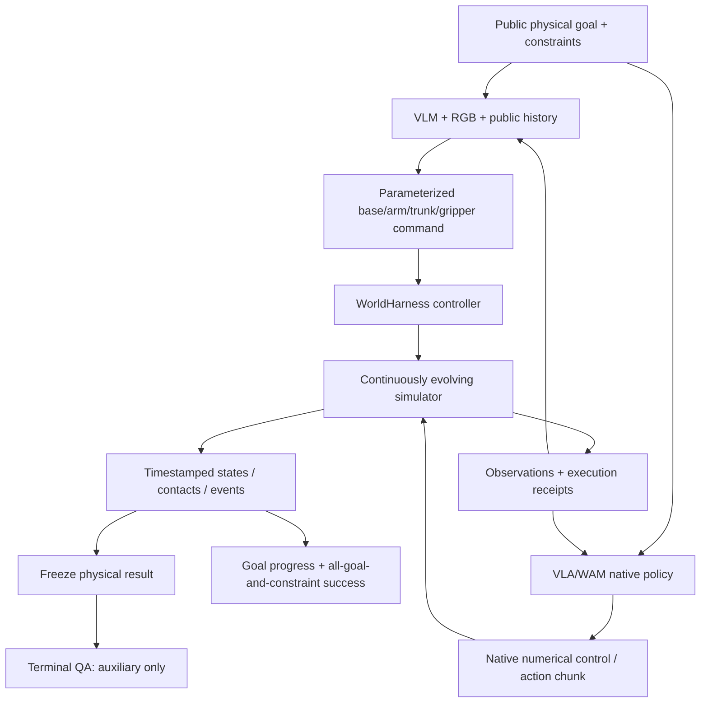

# WorldLeague 분석: 정답에서 물리적 목표 달성으로

## 한 문장 결론

**VLM이 scene을 정확히 설명하거나 controller가 command를 완료해도, goal predicate와 constraint를 모두 만족하는 closed-loop physical outcome은 별도 검증해야 합니다.**

## 문제와 기여

기존 평가의 cup delivery 같은 activity 이름은 보이는 컵을 고르는 능력과 과거에 이동한 컵을 기억해 고르는 능력을 구분하지 못합니다. WorldLeague는 goal의 주된 요구로 60개 task를 세 track·여섯 차원에 묶고, partial progress와 full success를 함께 측정합니다. 새 VLA policy가 아니라 **VLM/VLA/WAM system-level benchmark와 harness**입니다.

- WorldSeek: navigation 5, grounding 17.
- WorldShape: geometry 17, physics 7.
- WorldShift: memory 8, constrained recovery 6.
- 13 systems의 seed-0 episode 775개; Sol의 seed-1 전체 suite 추가.
- Episode 종료 후 QA를 측정하므로 QA가 해당 run의 control을 돕지 않습니다.

## Taxonomy 위치

Worldbench 분류의 **Datasets & Benchmarks / VLA evaluation**에 가깝고 자체 textual/numerical action generator를 학습하는 논문은 아닙니다. VLM–WorldHarness branch는 explicit action guidance와 유사한 계층적 interface, VLA branch는 numerical control, WAM branch는 world-model-conditioned control을 비교합니다. 이는 robotics benchmark의 AD 인접성 분석이며 autonomous-driving benchmark라는 뜻은 아닙니다.

## Architecture와 I/O

| Branch | Input | Output / action grounding | 주요 경계 |
|---|---|---|---|
| VLM | goal, RGB, history, feedback | target/motion parameters → controller → actual pose/contact | controller 성공과 goal 성공은 다름 |
| VLA | instruction, native observation/history | native numerical command/chunk | robot·control 차원 상이 |
| WAM | native instruction/observation | native policy/action chunk | plausible prediction은 달성된 상태가 아님 |
| Evaluator | timestamped physical trajectory | item credit, constraints, terminal outcome | private predicate를 agent에 노출하지 않음 |

Language는 task instruction, VLM decision, history/note와 terminal QA에 사용됩니다. QA 답을 직접 motor command로 쓰거나 QA 정답을 success label로 사용하는 구조는 아닙니다.

## Training recipe

연구의 중심은 evaluation이며 통합 policy-training loss를 제안하지 않습니다. 기존 pretrained model/native controller를 사용하고 goal specification, scene binding, physical predicate, reference verification, evaluation harness를 구성합니다. Generator를 future RL 데이터에 쓰는 것은 연구 제안이지 완료된 online RL 결과가 아닙니다. Predicate reward 구상을 모든 피평가 model의 실제 training recipe로 오해하면 안 됩니다.

## Metric 해석과 결과

\(I=100\,\mathrm{mean}(p_j)\)는 goal-item progress입니다. \(S=\prod_j1[G_j]\prod_k1[C_k]\)는 모든 goal/constraint를 요구합니다. Task별 episode mean을 먼저 구한 뒤 dimension/overall에서 task를 동등 가중합니다.

- Fable I=28.58/100, goal success 13/60은 seed-0 주표 결과입니다.
- 공통 59 task에서 Fable 12, Sol 8, Astra 7개 성공이며 모든 system이 합쳐 성공한 고유 task는 16개입니다. 초기부터 성립한 T52 포함 시 17개입니다.
- QA 전부 정답인 347 episode 중 249개의 I=0, 즉 71.8%입니다. Conditional descriptive rate이지 QA가 실패를 유발한다는 인과 근거는 아닙니다.
- Command completion 95.26%인 Jev는 T52에서만 성공합니다. Local execution status는 진단 신호이지 task-level success가 아닙니다.
- Kimi T41은 I=100이지만 constraint 불충족으로 S=0입니다.
- 겹칠 수 있는 three-decision window 6,241개에서 88.75%는 completed command를 포함하고 56.55%는 원래 stop status가 반복됩니다. 둘의 공존은 47.54%입니다. Episode-first mean과 분모가 다릅니다.

## Open-loop vs closed-loop

이 결과는 simulation physical interaction의 **closed-loop** 결과이며 offline trajectory error가 아닙니다. Terminal QA는 interaction 후 reporting probe이지 control metric이 아닙니다. Reference run은 유한 scene의 달성 가능성을 확인하지만 실제 robot safety를 입증하지 않습니다. CARLA/nuPlan/NAVSIM이나 실차 closed-loop 평가는 없습니다.

## 강점

1. Activity 이름 대신 goal의 인지·물리 요구로 task를 구성합니다.
2. Item progress와 constraint-aware success를 병행해 “도착했지만 안정적으로 release하지 않음”을 분해합니다.
3. 같은 episode에서 보고와 실제 달성을 짝지어 cross-dataset 혼동을 줄입니다.
4. State/event/contact와 command receipt로 구체적인 failure attribution을 지원합니다.
5. Inference 중 세계가 멈추지 않아 observation freshness 문제를 노출합니다.

## 한계, safety와 배포

- 고정 instance 60개, scene identifier 23개이며 대부분 system/task당 한 episode입니다. Sol만 seed를 전체 추가했으므로 순위 불확실성과 task-distribution 민감성이 남습니다.
- Model, robot, controller, history, action abstraction이 다릅니다. Shared goal이 동일 training data·compute나 backbone-only causal comparison을 뜻하지 않습니다.
- T52로 인한 60/59 분모 차이를 overall 비교에 유지해야 합니다.
- Grasp assistance와 controller의 능력도 성능에 포함됩니다. Decision-preserving abstraction이 motor prior의 부재를 뜻하지 않습니다.
- DONE은 신뢰 가능한 success certificate가 아닙니다. Agent 외부에서 constraint·deadline·stale observation·robot limit·fallback을 독립 검증해야 합니다.
- 원문 cost는 task당 wall-clock/token이며 AD planner의 millisecond latency가 아닙니다. World advancing이 현실적이더라도 vehicle-certified response time을 도출할 수 없습니다.
- NPU kernel, quantized deployment, energy profile, sim-to-real 또는 formal safety 결과는 없습니다.

## 찬호님 연구 방향으로의 연결 — 분석자의 전이 제안

“잘 설명하는 VLA”와 “실제로 안전한 trajectory를 남기는 VLA”를 분리해 평가하는 설계에 참고할 만합니다. AD에서는 goal item을 route progress·lane-change completion 등으로, constraint를 collision·red-light·off-road·comfort·deadline 등으로 분리할 수 있습니다. 실제 metric과 threshold는 주행 benchmark에 맞춰 새로 설계해야 합니다.

기존 [[ScaleVLA]]의 representation scaling, [[MotorMind]]의 runtime harness, [[Echo]]의 status signal, [[DriveZero]]의 closed-loop training과 연결할 때, 모델 크기·설명·status readability·평균 점수보다 **독립 evaluator가 확인한 실행 결과와 실패 분해**를 공통 축으로 삼을 수 있습니다.

## 실제 수행과 미수행

본 작업은 원문 HTML/HF metadata/bibliography 확보, 라이선스 확인, 한국어 문서 생성, figure validation 및 교육용 scoring toy 실행을 수행합니다. 원문 13-system benchmark 실행, policy 학습, 실물 robot/차량 rollout, NPU profiling은 수행하지 않습니다.
