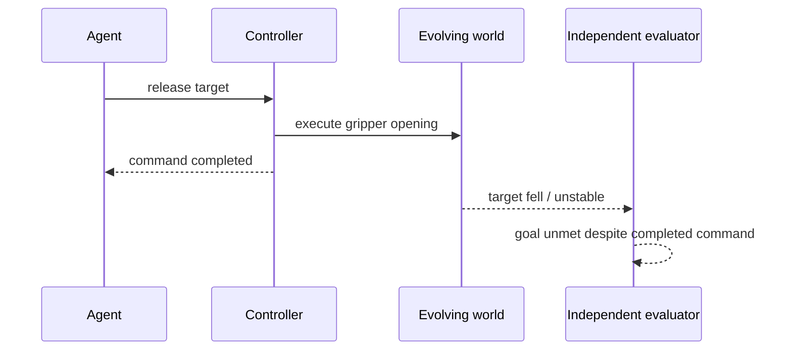

# WorldLeague 핵심 기술 학습 자료

## 학습 목표와 선수 지식

이 노트를 읽고 나면 observation→decision→controller→world→evaluator를 분리하고, partial progress와 constraint-aware success가 다른 이유를 코드로 확인할 수 있어야 합니다. 선수 지식은 imitation-learning policy의 기본 I/O, closed-loop와 open-loop 차이, 평균과 conditional probability, state·action·trajectory입니다. VLM training이나 rigid-body simulator 구현을 먼저 완성할 필요는 없습니다.

## 용어 사전

| 용어 | 의미 | 주의점 |
|---|---|---|
| physical agency | 몸을 통해 action을 선택·실행해 목표를 달성하는 능력 | 언어로 의도를 설명하는 능력과 다름 |
| goal predicate | 원하는 결과를 검사하는 조건 | event order·stability interval도 포함 가능 |
| constraint | 수행·종료 중 지켜야 하는 제한 | item progress와 별도 검사 |
| action abstraction | agent가 고르는 결정과 controller가 실행하는 운동의 경계 | 추상화가 높아지면 agent 책임도 바뀔 수 있음 |
| timestamped trajectory | state·control·event와 시각의 기록 | final image만으로 event/history를 복원하기 어려움 |
| Interactive Score | goal-item 진행의 평균 ×100 | success certificate가 아님 |
| physical success | 모든 goal 및 constraint 만족 | score 100이어도 constraint 위반 시 0 |
| terminal QA | interaction 종료 후 episode에 관한 질문 | 물리 결과를 먼저 고정 |
| observation freshness | 관측 시각부터 실행까지 정보의 유효성 | inference 중 world 변화가 누적 |

## 1단계: 목표를 자연어에서 검사 가능한 조건으로

“컵을 가져다 놓아라”를 단순 bounding-box 근접으로 평가하면 grasp한 채 목적지 위에 머무는 경우까지 성공으로 오판할 수 있습니다. 예시 decomposition은 target identity, destination region, release, stable interval입니다. 보호 물체 보존은 별도 constraint로 둡니다. 이 예시는 교육용이며 원문의 특정 task와 동일한 validator는 아닙니다.

## 2단계: controller receipt와 world outcome을 분리



Controller receipt는 요청한 low-level 동작의 실행 상태입니다. 물체가 안정적으로 남았는지는 world trajectory로 따로 검사합니다. 같은 원칙을 AD에 적용하면 steering-command 전달 성공과 lane-change 성공, route completion과 collision-free completion을 구분해야 합니다.

## 3단계: partial credit과 success를 계산

아래는 **교육용 toy**이며 원문 benchmark 코드나 재현 결과가 아닙니다. Kimi T41처럼 goal item credit이 100이어도 constraint가 실패할 수 있다는 논리를 확인합니다.

```python
def score(progress, goals, constraints):
    assert progress and len(progress) == len(goals)
    assert all(0 <= x <= 1 for x in progress)
    interactive = 100 * sum(progress) / len(progress)
    success = int(all(goals) and all(constraints))
    return interactive, success

assert score([1, 1, 0, 0], [True, True, False, False], [True]) == (50.0, 0)
assert score([1, 1], [True, True], [False]) == (100.0, 0)
assert score([1, 1], [True, True], [True]) == (100.0, 1)
# Task-equal mean differs from item-pooled mean.
tasks = [[1], [0, 0, 0, 0, 0]]
task_equal = sum(sum(t) / len(t) for t in tasks) / len(tasks)
item_pooled = sum(map(sum, tasks)) / sum(map(len, tasks))
assert task_equal == 0.5
assert round(item_pooled, 6) == 0.166667
print('goal/constraint and task-equal weighting checks passed')
```

공식은 \(I_i=100\sum_jp_{ij}/m_i\), \(S_i=\prod_j1[G_{ij}]\prod_k1[C_k]\)입니다. 식의 두 번째 product를 빼면 constraint 위반을 누락합니다. Overall에서 task 대신 goal item을 pooling하면 item이 많은 task에 가중치가 쏠립니다.

## 4단계: history가 필요한 task인지 확인

같은 현재 image에서 정답 target이 달라지는 두 history를 만들 수 있으면 현재 frame만으로는 풀 수 없습니다. 원문 식 10의 \(o_t(h)=o_t(h')\), \(y(h)\ne y(h')\)가 그 조건입니다. “이전에 shelf에 있던 물체”를 찾는 문제에서는 현재 object appearance만 정확해도 과거 identity가 없으면 실패합니다.

Training 제안으로 memory를 넣으려면 단순 note length를 늘리는 것보다 observation ID, object identity, event ordering, 현재 유효성을 함께 저장하는 편이 좋습니다. 이는 분석자의 설계 제안이며 원문의 학습 ablation 결과가 아닙니다.

## 5단계: latency와 안정성 interval을 구분

아래 toy는 observation age와 timestamp gap을 검사합니다. Threshold는 교육용 상수이며 WorldLeague나 차량 safety 규격이 아닙니다. Stale response를 폐기하는 구현 제안과 성공 predicate의 time coverage가 다른 검사임을 보여 줍니다.

```python
def fresh(observed_at, execute_at, max_age):
    return 0 <= execute_at - observed_at <= max_age

def stable_window(samples, duration, max_gap, max_speed):
    # samples: ordered (time, absolute_speed), educational simplification
    if len(samples) < 2:
        return False
    times = [t for t, _ in samples]
    return (times[-1] - times[0] >= duration
            and all(0 < b - a <= max_gap + 1e-9 for a, b in zip(times, times[1:]))
            and all(abs(v) <= max_speed for _, v in samples))

assert fresh(1.0, 1.2, 0.25)
assert not fresh(1.0, 1.4, 0.25)
assert not fresh(1.0, 0.9, 0.25)
assert stable_window([(0.0, .01), (.1, .01), (.2, .0)], .2, .1, .02)
assert not stable_window([(0.0, .0), (.2, .0)], .2, .1, .02)
assert not stable_window([(0.0, .0), (.1, .03), (.2, .0)], .2, .1, .02)
print('observation-age and stability-window checks passed')
```

원문 reflection task의 sample-gap/stability 조건은 단지 final frame에 물체가 보인다는 것보다 강합니다. Toy는 contact, angular speed, collision, sample precision, real simulator dynamics를 구현하지 않습니다.

## 구현·배포 checklist

- Public task specification과 private scoring predicate를 분리합니다.
- Controller command, observation timestamp, execution start/end, receipt, world event를 같은 clock domain으로 기록합니다.
- DONE 이후 물리 결과를 고정하고 terminal QA를 실행합니다.
- Goal progress, full success, constraint violation, invalid command, budget exhaustion을 별도로 저장합니다.
- Task-equal / episode-equal / pooled-window weighting을 결과에 명시합니다.
- Simulator seed와 interface/context budget, robot controller, model version을 함께 기록합니다.
- Deployment에는 독립 limit·watchdog·fallback이 필요합니다. Learned QA나 self-declared success를 safety gate로 쓰지 않습니다.
- NPU 검토 시 backbone inference만이 아니라 image preprocessing, controller queue, host transfer, memory retrieval, effective observation age를 측정해야 합니다. 이 논문은 그런 profiling을 수행하지 않았습니다.

## 학습 질문과 답

1. **QA를 맞히면 physical task도 성공인가요?** 아닙니다. 결과를 정확하게 보고하면서도 action은 실패할 수 있고, terminal QA는 물리 결과가 고정된 뒤 측정합니다.
2. **I=100이면 왜 S=0이 가능한가요?** I는 goal-item credit이고 S는 별도 constraint까지 모두 검사하기 때문입니다.
3. **모든 model이 같은 robot을 쓰나요?** 아닙니다. 목표·채점은 공유하지만 VLM R1과 native policy의 PandaOmron/R1Pro 및 action space가 다릅니다.
4. **많은 token은 더 좋은 control인가요?** 보장되지 않습니다. Quality와 cost를 함께 보되 inference 중 world가 바뀌는 효과도 고려해야 합니다.
5. **한 command가 성공한 뒤 stop이 재발하면 recovery 성공인가요?** 아닙니다. 원래 장애와 최종 goal을 따로 확인해야 합니다.
6. **이 결과를 AD safety evidence로 쓸 수 있나요?** 평가 설계에는 참고 가능하지만 robot simulation의 finite-task 결과를 real-vehicle safety로 대체할 수 없습니다.

## 짧은 reading roadmap

- 먼저 paper-ko.md의 3.4에서 score와 success의 차이를 익힙니다.
- 그림 2·4에서 goal specification→physical trajectory→predicate를 연결합니다.
- Show-Harness와 Inner Monologue로 action abstraction과 feedback을 비교합니다.
- BEHAVIOR-1K, ESI-Bench, ALFRED에서 activity·QA·goal condition의 평가 단위를 비교합니다.
- 마지막으로 analysis.md의 AD 전이 제안과 원문 부록 D.7을 읽고 본인 연구의 성공 predicate를 작성합니다.

## 실행 범위

위 Python 두 block만 실제 실행·assertion 검증 대상입니다. Toy 통과는 WorldLeague benchmark 재현이나 실제 안전 보증이 아닙니다.
