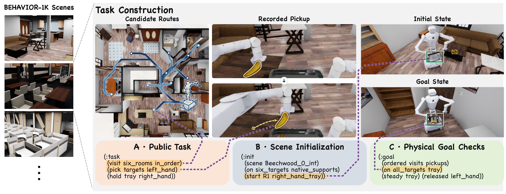
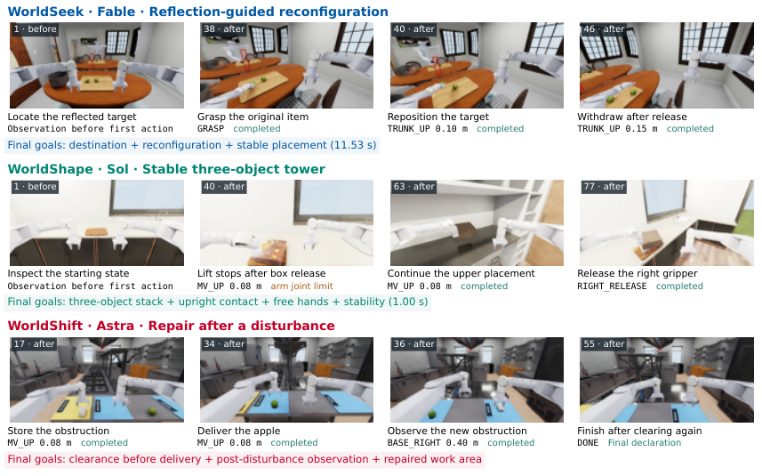
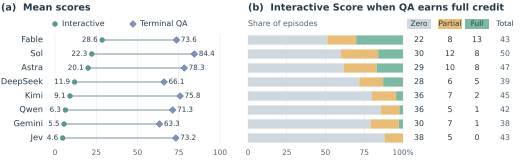
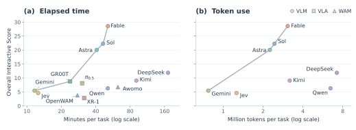
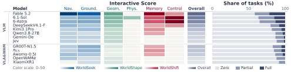
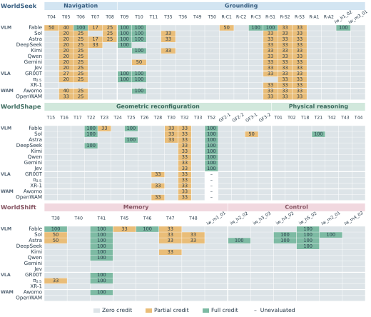
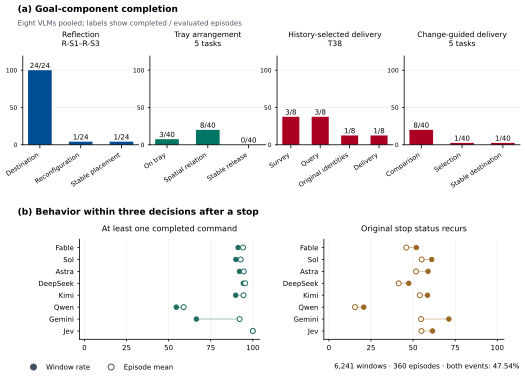
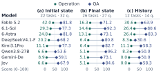
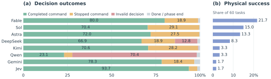
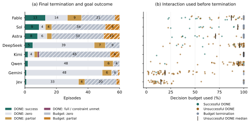

# WorldLeague: 물리적 행위 능력(Physical Agency) 벤치마킹

> 원저자: Xinyang Zhou, Qi Li, Xinchao Wang, xML Lab / National University of Singapore. 원문 arXiv:2611.30989v1, 2026-11-23. CC BY 4.0에 따른 한국어 기술 번역·편집본입니다. 본문 1–5의 논지와 수식 1–4를 절별로 옮기고, 부록 A–F는 평가 재현에 중요한 조건을 선별 번역했습니다. 인용 나열과 부록의 세부 서술은 축약했으며 모든 표의 원문 cell rows는 뒤에 보존했습니다. 원문과 대조할 때 수치·실험 결과는 저자 보고이며 이번 작업의 재현 실험이 아닙니다.

## Abstract — 초록

AI 시스템은 이제 Blender를 조작하고, 복잡한 비디오 게임에서 지시를 따르며, 로봇 팔로 물체를 다룰 수 있다. 그렇다면 오늘날 AI 시스템은 어느 범위의 물리적 목표를 자율적으로 달성할 수 있는가? 이 질문에 답하려면 perception, memory, planning, action의 서로 다른 조합이 필요한 과제로 시스템을 시험해야 한다.

WorldLeague는 로봇의 trajectory로 각 물리적 목표에 대한 진행 정도를 측정하여, 공통된 60개 시뮬레이션 과제에서 AI 시스템을 비교하는 benchmark다. 로봇은 WorldSeek에서 증거를 수집하기 위해 탐색하고, WorldShape에서 물체를 재배치하며, WorldShift에서 변화에 적응한다. 목표를 단 하나의 control interface에 묶으면 비교 가능한 시스템이 제한된다. 따라서 VLM은 목표와 motion을 선택하고, VLA 및 world-action model(WAM)은 각자의 native control을 사용한다.

여섯 capability dimension 각각에 대해 목표를 향한 진행 정도인 Interactive Score와 실제 달성 빈도인 physical success rate를 측정한다. 이 두 지표의 쌍으로 Physical Agency Profile을 구성한다. 13개 대표 시스템 중 Claude Fable 5.2는 60개 목표 중 13개를 달성하고 가장 높은 평균 Interactive Score 28.58/100을 기록한다. 네 차원에서 Fable이 앞서고, constraint-management 과제에서는 GPT-6.1-Sol과 GPT-6-Astra가 공동 선두다. VLM이 마지막 질문을 모두 맞힌 episode에서도 71.8%는 Interactive Score가 0이다. 이 benchmark는 부분적인 물리적 진행에서 완전한 목표 달성까지, AI가 자율적으로 무엇을 해내는지 비교하는 공통 기반을 제공한다.

## 1. Introduction — 도입

Foundation model은 범용 로봇을 만드는 유망한 방향이 되었다. 디지털 환경에서는 frontier model 기반 agent가 open-world 게임의 지시를 따르고 시각적 참고자료를 편집 가능한 3D scene으로 바꾼다. 물리적 로봇이 수행할 수 있는 과제도 넓어져, 학습 중 보지 못한 가정에서 부엌이나 침실을 정리하는 장기 작업이 가능해졌다.

낯선 부엌을 정리하려면 로봇은 지금 보는 정보를 다음 행동으로 연결해야 한다. VLM은 공간적 설명에서 물체를 찾거나 다른 물체까지의 거리를 추정하고, robot interface를 통해 이동·grasp 위치를 고를 수 있다. VLA는 시각 관측과 지시로부터 로봇 action을 직접 생성한다. WAM은 미래 관측과 action을 함께 예측한다. 이처럼 연결 방식은 다르지만 공통된 목표는 사람이 원하는 물리적 결과를 지정하면 시스템이 달성 방법을 스스로 결정하는 것이다.

저자들은 그런 의사결정 주체를 agent, 신체를 통해 행동을 선택하고 실행하는 능력을 physical agency라고 부른다. 숨겨진 물체를 찾는 데에는 어디를 보고 무엇을 치울지 결정해야 한다. 그 물체를 좁은 구멍으로 넣으려면 통과 가능한 orientation까지 선택해야 한다. 올바른 물체를 찾는 능력과 그것을 정리하는 능력은 같지 않다.

일상 활동 이름으로 benchmark를 구성하면 이 차이가 가려진다. 눈앞의 지정된 컵을 배달하는 것과 이전 방문 이후 위치가 바뀐 컵을 배달하는 것은 모두 cup delivery이지만 후자는 과거 관측을 사용해야 한다. 따라서 agent가 직접 알아내야 하는 요구를 변화시키고, 실제 행동이 요청한 결과를 만들었는지 확인해야 한다.

WorldLeague의 60개 과제는 성공을 결정하는 물리적 요구에 따라 세 track으로 나뉜다. WorldSeek는 navigation과 goal grounding, WorldShape는 geometric reconfiguration과 physical reasoning, WorldShift는 temporal memory와 constraint management를 시험한다. 개별 과제는 여러 능력을 요구할 수 있지만 주된 challenge에 따라 묶는다.

각 목표는 지정된 물체·초기 조건·제약을 가진 scene으로 구현된다. Physical predicate는 안정적인 placement나 disturbance 후 recovery 같은 조건을 확인한다. 저자들은 60개 task–scene pair를 모두 검사하고 reference run의 달성 가능성과 scoring 조건을 확인했다. VLM interface는 세밀한 motor execution을 controller에 맡기되 target, action parameter, sequence, feedback에 대한 대응은 agent가 선택하도록 설계한다. VLA/WAM은 native interface를 사용하며 목표·제약·물리 채점 규칙은 공유한다.

핵심 기여는 세 가지다. 첫째, 서로 다른 능력 조합을 요구하는 목표 달성으로 physical agency를 시험한다. 둘째, 여섯 차원의 부분 진행과 완전 성공을 측정하는 검증된 60개 과제를 제공한다. 셋째, 13개 시스템의 profile을 비교해 정답이나 부분적 물리 진행 뒤에도 충족되지 않은 요구를 찾아낸다.

## 2. Related Work — 관련 연구

### 2.1 물리적 목표가 요구하는 능력

BEHAVIOR-1K는 household activity를 평가 단위로 삼는다. 하지만 하나의 activity에서도 다음 결정을 위해 필요한 정보는 변한다. RoboQuest는 trial impression으로 찍을 무늬를 고르게 하고, MeMoREval은 이전 경험에 의존하는 나중 요청을 제시하며, RobotAgentBench는 진행 중인 조작을 바꿔야 하는 disturbance를 넣는다. WorldLeague는 목표의 주된 challenge로 과제를 묶어 탐색·물리 변환·적응에서 성공이 어떻게 달라지는지 추적한다.

### 2.2 Embodied AI의 action abstraction

Action interface는 어떤 결정을 agent가 담당하는지 규정한다. SayCan은 skill feasibility를 이용해 skill을 고르고, Code as Policies는 프로그램으로 action을 조합한다. Inner Monologue는 실행 결과를 planning으로 되돌려준다. Show-Harness는 선택된 명령을 embodiment-specific interpreter로 변환하며 HumanCLAW는 action selection과 motor execution의 분리를 연구한다.

WorldHarness는 Show-Harness를 바탕으로 grasp 위치, 이동량, release 시점, motion 중단 후의 다음 시도를 VLM이 결정하게 한다. Controller는 motion을 실행하고 feedback을 돌려준다. VLA/WAM은 동일한 목표를 자신의 native interface로 추구한다.

### 2.3 물리적 달성 측정

ESI-Bench는 공간 질문의 증거를 수집하기 위해 이동·조작을 허용한다. ALFRED는 task success와 goal condition 달성 비율을 평가한다. IMBench는 understanding, planning, execution을 단계별로 본다. WorldLeague는 선택된 ESI-Bench scene에서 같은 episode의 실제 결과와 VLM의 보고를 짝짓는다. 물리적 결과를 고정한 다음 terminal QA를 수행하므로 QA가 이후의 실행을 개선하지 않는다.

### 2.4 기존 benchmark와의 비교

원문 표 1은 17개 benchmark의 capability coverage와 agent의 action control 범위를 비교한다. WorldLeague는 물체를 찾고 조작하는 능력뿐 아니라, scene 변화 중 그 물체를 추적하는 능력까지 동일한 physical goal-achievement 관점에서 평가한다. 표의 full coverage는 dimension의 요구들을 함께 채점한다는 뜻이며 benchmark 전체가 현실의 모든 문제를 다룬다는 뜻은 아니다.

## 3. WorldLeague Benchmark

### 3.1 Physical Goals and Task Demands

사람은 원하는 결과를 명시하고 agent가 방법을 정한다. WorldSeek에서는 이동 위치가 도달 가능 영역과 관측 가능한 증거를 결정한다. Ordered pickup은 여섯 방을 지정 순서로 방문하고 요청된 물체를 tray에 수집하도록 한다. Hidden-object search는 무엇을 치우고 어디를 관찰할지 선택한 뒤 증거로 대상을 식별·회수해야 한다.

WorldShape는 가구가 있는 공간에서 물체 배치를 바꾼다. Cutting board를 좁은 storage slot에 넣으려면 orientation과 clearance를 고려해야 한다. Board와 두 상자로 tower를 만드는 과제는 수집뿐 아니라 안정적인 stacking order와 release 이후의 결과를 요구한다.

WorldShift에서는 scene 변화가 배달할 물체를 결정하거나 끝난 단계를 다시 수행하게 만든다. Temporal memory 과제는 이전 관측과 현재를 비교해 바뀐 물체를 지정 목적지에 놓게 한다. Constraint management 과제는 작업대를 치우고 사과를 배달한 다음 재검사하게 한다. 장애물이 되돌아왔다면 다시 보관하여 작업대를 비운 상태로 끝내야 한다.

| Track | Dimension | 주된 요구 | 과제 수 |
|---|---|---|---:|
| WorldSeek | D1 Navigation | spatial topology | 5 |
| WorldSeek | D2 Grounding | evidence acquisition | 17 |
| WorldShape | D3 Geometry | geometric feasibility | 17 |
| WorldShape | D4 Physics | action consequences | 7 |
| WorldShift | D5 Memory | state evolution | 8 |
| WorldShift | D6 Control | constrained recovery | 6 |

각 task는 다음 tuple로 정의한다.

\[
\mathcal T_i=(\mathcal E_i,\rho_i,g_i,\mathcal C_i,\mathcal G_i,B_i).\tag{1}
\]

\(\mathcal E_i\)는 physical scene, \(\rho_i\)는 initial conditions, \(g_i\)는 공개 목표, \(B_i\)는 interaction budget이다. \(\mathcal G_i\)는 목표 요건의 predicate이고 \(\mathcal C_i\)는 수행 중 지켜야 하는 constraint다.

### 3.2 Task Construction and Validation

각 목표에 공개 instruction, constraint, requirement별 physical predicate를 먼저 작성한다. Object role을 실제 scene entity에 binding하고 pose와 로봇 시작 위치, task event를 정한다. Evaluator도 같은 object binding으로 비공개 predicate를 검사한다. 여섯 방 pickup에서는 방문 순서가 room-entry event sequence로 표현되고 수집은 release 뒤 tray 위 안정성을 요구한다.

BEHAVIOR-1K layout·asset을 사용하며 47개 instance는 ESI-Bench scene record를 수정하고 나머지 13개는 새 scene configuration으로 만든다. InteractiveWorld는 아홉 challenge의 설계에 영향을 주었다. 60개 고정 instance가 evaluation suite를 이루며 generator는 predicate를 유지하면서 object, layout, robot start, event를 바꾼 추가 instance를 만들 수 있다.

### 3.3 Action Interfaces and Decision Responsibility

VLM이 goal을 추구하는 방식을 평가하려면 target, motion, 실패 후 다음 대응을 직접 선택하게 해야 한다. Sensorimotor feedback이 선택된 동작의 미세 운동을 조정하는 것처럼 interface는 motor execution을 맡고 의사결정을 숨겨서 대신하지 않는다.

WorldHarness는 R1에서 Show-Harness를 확장한다. 입력은 공개 goal, camera observation, 유지된 history다. VLM은 base, arm, trunk, gripper command를 선택한다. Controller는 실행 결과와 feedback을 돌려주고 evaluator는 physical state와 task event를 기록한다. VLA와 WAM은 학습된 embodiment와 native controller로 command 또는 action chunk를 출력한다. 공유되는 것은 목표·제약·채점 기준이지 동일 robot이나 동일 action space가 아니다.

### 3.4 Measuring Physical Goal Achievement

Timestamped trajectory \(\tau_i\)에는 state, control, task event가 포함된다. 목표는 종료 시 특정 region 점유, 일정 시간의 안정성, 특정 event 뒤 목적지 도달 등을 요구할 수 있다. 각 goal item의 진행값 \(p_{ij}(\tau_i)\in[0,1]\)은 task 정의에 따라 fractional 또는 binary credit이다.

\[
I_i(\tau_i)=\frac{100}{m_i}\sum_{j=1}^{m_i}p_{ij}(\tau_i).\tag{2}
\]

나눌 수 없는 목표는 item 하나로 둔다. 완료 선언이 요구되면 선언 자체도 goal predicate다. Physical success는 모든 goal과 constraint를 동시에 검사한다.

\[
S_i(\tau_i)=\prod_{j=1}^{m_i}\mathbf1[G_{ij}(\tau_i)]\prod_{C\in\mathcal C_i}\mathbf1[C(\tau_i)].\tag{3}
\]

따라서 item credit 100이라도 별도 constraint 위반이 있으면 success는 0이다. T38은 사전 survey, 지연 요청 도달, 원래 object identity 선택, 전부 배달의 네 item으로 이루어진다. 앞의 두 개만 충족하면 I=50이지만 S=0이다. 이 분해는 관측에서 기억을 이용한 action으로 넘어가는 지점의 실패를 드러낸다.

차원 d의 profile은 task별 episode 평균을 task 수로 동등 가중한다.

\[
(I_d,S_d)=\frac1{|\mathcal T_d|}\sum_{i\in\mathcal T_d}(\bar I_i,\bar S_i).\tag{4}
\]

여섯 쌍이 Physical Agency Profile이다. Track과 overall도 task-equal mean이다. Item 수가 많은 task를 더 무겁게 합산하지 않는다.

VLM에는 별도의 terminal QA를 적용한다. 질문은 공개 instruction에 있으며 interaction이 종료되어 물리적 결과가 고정된 후 initial overview, terminal observation, public memory로 답한다. 73개 질문은 초기 scene 32개, final state 27개, history/change 14개다. Task 내부 질문 평균 후 task를 동등 가중한다. QA는 scene understanding·outcome recognition·memory의 보조 지표이지 physical success의 대체물이 아니다.

## 4. Experiments — 실험

### 4.1 평가 protocol

VLM 8개는 WorldHarness로 R1을 제어한다. VLA 3개와 WAM 2개는 PandaOmron 또는 R1Pro native controller를 쓴다. VLM은 60개 task 전부, continuous-control policy는 T52를 제외한 59개를 수행한다. T52는 초기화부터 containment가 성립한다. Seed 0에서 system–task당 episode 하나이므로 총 775개이며, Sol은 seed 1로 전체 suite를 추가 반복한다.

Interface family 내부에서 task별 budget은 같으며 VLM 10–342 decisions, continuous policy 1,000–40,000 control steps다. VLM 여섯은 parameterized motion과 history image·note를 쓰고 Gemini·Jev는 현재 view/public record에서 command와 repetition count를 고른다. 원문 수치는 모든 task의 동등 가중 평균이다.

### 4.2 시스템별 물리적 달성

Fable은 60개 중 13개 goal에 성공하고 평균 I=28.58이다. 나머지는 partial 12개, zero 35개다. 공통 59개 task로 제한하면 Fable 12개, Sol 8개, Astra 7개 성공이며 13개 시스템을 합쳐 성공한 고유 goal은 16개다. T52를 포함한 전체에서는 고유 성공 task가 17개이므로 두 숫자를 혼동하면 안 된다.

Fable은 navigation, grounding, geometry, memory에서 두 지표 모두 선두다. Sol과 Astra는 constraint management 6개 중 각각 3개에 성공하되 두 성공만 겹친다. Astra는 returning obstruction을 치우고 Sol은 object allocation을 달성한다. Seed 0의 physical reasoning에서 실제 성공한 task는 Sol의 세 물체 tower뿐이다.

Continuous-control policy에서는 GR00T와 π0.5가 각각 3개, Awomo가 2개 goal을 달성한다. 일부 navigation·geometry credit은 얻지만 그 차원의 완전 성공은 없다. 예컨대 T05의 Awomo 40점은 다섯 방 중 두 방의 요구를 만족한 결과이지 전체 navigation task 성공이 아니다.

### 4.3 Task coverage와 남은 요구

공통 59개 task 중 27개는 모든 시스템이 0점, 16개는 누군가 partial progress를 보였지만 아무도 성공하지 못했고, 16개는 적어도 한 시스템이 성공했다. 다섯 navigation task 모두 누군가는 진행하지만 성공한 task는 하나다. WorldShape 공통 23개 중 15개는 전 시스템 0점이며 physical-reasoning 7개 중 6개가 여기에 속한다.

T41에서 Kimi는 comparison item credit을 전부 얻어 I=100이지만 별도 constraint를 위반하여 physical failure다. Goal progress와 constraint compliance를 별도 기록해야 하는 실제 사례다.

Mirror-guided rearrangement에서 선택한 물체는 모든 VLM episode 24개에서 목적지에 도달한다. VLA 9개 중 8개와 WAM 6개 전부도 도달한다. 하지만 요구 relation과 release 후 stability까지 만족한 것은 R-S1의 Fable 하나뿐이다. 이 episode에서는 release 후 11.53초 동안 안정적이다. T32는 VLM 여덟 모두 object separation을 달성하지만 tray placement는 하나도 달성하지 못한다.

T38에서 Fable·Sol·Astra는 survey와 delayed request까지 도달하나 원래 요청 물체를 배달하는 것은 Fable뿐이다. Change-guided delivery 다섯 task의 VLM 40개 episode 중 두 phase 비교를 끝내는 것은 8개이며, changed object를 맞게 골라 지정 목적지에 안정적으로 둔 것은 T46의 Fable 하나다.

### 4.4 Decision, feedback, termination

480개 VLM episode에 총 32,455 decisions가 기록된다. Qwen의 4,440 decisions 중 3,127개는 valid command를 만들지 못한다. Jev는 시작한 motion의 95.26%를 완료하지만 task 성공은 초기 goal이 이미 성립한 T52뿐이다. Sol은 motion 70.74%를 완료하며 9개 goal을 달성한다. Command completion은 goal completion이 아니다.

Object-level grasp/place skill을 추가해도 Sol은 target을 workspace로 가져오는 결정을 해야 한다. Named grasp 52회 중 30회가 도달 범위 밖의 target을 선택했다. T24에서는 motion baseline이 성공하지만 skill condition은 0점이다. Skill이 더 높게 추상화되었다고 항상 더 강한 system이 되는 것은 아니다.

Stopped command 다음 세 decision을 볼 수 있는 window 6,241개 중 88.75%에는 completed command가 나타나고, 56.55%에는 원래 stop status가 재발한다. 47.54%는 둘 다 발생한다. 다시 움직였다는 사실은 원래 장애가 해결되었다는 뜻이 아니다.

T22에서 execution status·failure reason·recovery hint를 제공하면 Sol은 decision 41에서 placement를 검증하고 완료를 선언한다. 이 feedback을 가리면 52-decision limit까지 placement가 검증되지 않는다. 두 run의 terminal QA는 모두 정답이다.

최종 DONE으로 끝난 279개 episode 중 41개만 실제 성공하고, 42개는 goal 또는 constraint가 남아 있으며, 196개는 0점이다. Budget을 소진한 201개는 partial 31개와 zero 170개다. Saved note ablation의 allocation task는 note 유무 모두 네 placement 중 세 개를 만족하지만 놓친 물체와 종료 budget이 달라진다.

### 4.5 Episode를 보고하는 능력

Terminal QA를 전부 맞힌 VLM episode 347개 중 249개, 즉 71.8%는 physical progress가 0이다. 전체 480개 VLM episode의 zero-credit rate는 76.3%다. 이 관측을 “정답이 무의미하다”거나 “정답이 실패를 유발한다”는 인과 주장으로 바꾸지 않아야 한다.

T42에서 Sol은 eligible physical trial을 끝낸 후보가 없다고 정확히 답하지만 physical score는 0이다. 반대로 T21에서는 실제 tower를 안정적으로 만들면서 maximum-stability ordering 질문은 틀린다. 초기 질문을 action 전에 별도로 물어 답을 control context에 넣지 않은 12-task 실험에서는 처음 6개 정답, 마지막 10개 정답이다. 처음부터 정답이었던 6개 중 절반만 실제 성공하고 나머지 절반은 physical progress 0이다.

### 4.6 Seed variation과 computational cost

Sol의 overall I는 두 seed에서 22.28→21.44로 비슷하지만 60개 중 11개 task의 점수가 바뀐다. Memory는 27.08→41.67, physical reasoning은 14.29→0이다. T21 tower는 seed 0에서만, T46 change-guided delivery는 seed 1에서만 성공한다. Overall mean만 보면 이런 변화가 상쇄된다.

Elapsed time과 token 사용량에서 Gemini-Decision은 관측된 Pareto frontier의 low-resource 끝에 있고, GR00T는 elapsed-time frontier에 있는 유일한 continuous-control policy다. Fable과 Qwen은 task당 약 51분을 쓰지만 I는 각각 28.58과 6.31이며 token은 각각 3.07M과 6.47M이다.

GR00T의 task당 23.83분 중 simulator execution은 16.39분, inference는 1.08분이다. Sol의 46.36분 중 inference는 14.74분이다. 총 elapsed에는 observation·harness overhead도 들어간다. Terminal QA가 VLM inference 시간에서 차지하는 비중은 0.10–2.70%이므로 대부분의 model time은 실제 interaction 중 action selection에 쓰인다.

**환경은 model inference 중에도 계속 진행한다.** Observation에서 action execution까지 scene이 변할 수 있어 inference latency는 물리 interaction의 실질적 변수다. 이는 자동차용 real-time latency를 직접 측정했다는 뜻은 아니다.

## 5. Conclusion — 결론과 향후 연구

WorldLeague는 탐색·물리 변환·적응의 60개 task에서 physical agency를 평가한다. 높은 QA나 completed command가 곧 물리적 goal 달성을 뜻하지 않으며, predicate-level trajectory 분석은 안정적인 release부터 scene 변화 후 올바른 object delivery까지 남은 요구를 드러낸다. 세계가 reasoning 중에도 변하기 때문에 latency 역시 평가에 포함되어야 한다.

향후에는 V-JEPA 2-AC 같은 action-conditioned latent planner를 적용해 geometry/recovery 개선을 시험할 수 있다. Task template i를 확률 w_i로 고르고 그 안의 instance z를 p_i(z)로 뽑으면 p(z,i)=w_i p_i(z)이다. Split은 scene, object-role assignment, layout, event별로 묶고 기존 60개 고정 instance는 test set으로 유지한다. Generator의 screening pool을 online RL에 활용하고 physical progress와 terminal success를 reward로 사용할 수 있다는 제안도 한다. 이들은 원문의 향후 계획이지 이번 논문에서 완료된 RL 실험이 아니다.

## 부록 A–F 선별 번역 — 전체 부록 전문은 아님

### A. 비교의 단위와 interface

평가가 success를 어디에서 측정하느냐에 따라 agent의 어느 결정이 점수에 반영되는지가 달라진다. QA를 위한 exploration, symbolic traversal, delegated skill, feedback-guided robot motion은 같은 execution capability가 아니다. WorldHarness는 mobile R1/OmniGibson에서 base, trunk, wrist translation/rotation, grasp/release를 제공한다. Motion이 얼마나 진행했고 왜 멈췄는지 본 뒤 다음 command를 고른다. VLM 여섯은 parameter를 직접 지정하고 Gemini·Jev는 command와 repetition count를 고른다.

### B. Scene 구성

고정 suite는 23개 scene identifier를 쓴다. ESI-Bench에서 47개 instance를 수정했으며 나머지는 iw task 아홉 개와 household geometry task 네 개다. 후자는 carton cubby, cutting-board slot, cucumber compartment, spice-jar shelf에서 orientation과 clearance를 바꾼다. Scene 공유가 goal 공유를 뜻하지는 않는다.

### C. Budget·context·control

Sol/Astra/Fable/Kimi/DeepSeek/Qwen은 현재 관측, 최근 public result, saved note로 parameterized command를 정한다. Sol은 과거 RGB retrieval과 최대 네 perception round, decision당 128-character note를 지원한다. Gemini/Jev repetition count는 1,2,4,8이다. R1 arm translation은 robot-base frame을 쓴다. PandaOmron은 20Hz의 12D controller, π0.5 R1Pro는 30Hz의 23D interface다. Continuous-control simulation physics는 120Hz다. 이는 각 VLM의 fresh-observation planning frequency나 inference throughput과 동일하지 않다.

### D. 물리 조건과 ablation 해석

Insertion task T22–25는 현재 container pose와 내부 geometry로 insertion을 검사한다. Release 뒤 0.5초 안정성, 양손이 비었음, gripper와 최소 2cm clearance, 작업 gripper open을 요구한다. Container와 support는 움직일 수 있으나 object scale은 고정된다. Shared container의 자리를 비우기 위해 sequential verification 후 target을 제거할 수 있다.

Reflection placement의 stable interval은 0.5초, 최대 linear speed 0.02m/s, angular speed 0.1rad/s, sample gap 0.1초다. R-S1은 선택 물체가 다른 물체보다 고정 pot에서 최소 20cm 더 멀어야 한다. Physical trial T42–44는 3초 구간을 쓰고 arrival 차이가 0.15초 이내면 tie다. 이런 threshold는 이 benchmark의 성공 정의이며 보편적 로봇 안전 인증 기준이 아니다.

Stopped-command window는 겹칠 수 있고 pooled window mean과 episode-first mean이 다르다. 세 decision window의 episode-first mean에서는 90.62%가 completed command를 포함하고 46.81%에서 stop status가 반복된다. Main text의 88.75/56.55%와 분모·가중 방식이 다르다.

### E. Cost

Task당 elapsed는 model inference만이 아니라 simulator, observation, harness overhead를 포함한다. Token 수가 많거나 wall-clock을 많이 썼다는 사실 자체가 성공 향상을 보장하지 않는다. 실험 model endpoint, robot, observation history와 action abstraction도 달라 leaderboard를 backbone-only causal ranking으로 읽으면 안 된다.

### F. Goal-preserving scene generation

Instance 변수는 z=(e,o,x,r,η), 즉 scene, object, pose, robot start, event parameter다. Proposal q_i(z)에 initialization validity V_i, dimension challenge K_d, human review H_i를 적용한다.

\[
p_i(z)=\frac{q_i(z)V_i(z)K_d(z)H_i(z)}{Z_i}.\tag{5}
\]

Navigation은 traversable-region graph에 required room sequence를 ordered subsequence로 포함하는 경로가 있어야 한다(식 6). Goal grounding은 처음에는 후보가 여러 개지만 접근 가능한 관측 sequence로 intended target을 유일하게 식별할 수 있게 한다(식 7). Orientation-sensitive geometry에서는 feasible orientation에서 projected extent와 clearance margin이 aperture 안에 들어가고 초기 orientation에서는 그렇지 않게 만든다(식 8). Physical reasoning은 성공 sequence와 실패 sequence의 outcome을 구분할 수 있어야 한다(식 9).

Memory template는 같은 현재 관측이라도 필요한 target은 다른 두 history를 만든다.

\[
o_t(h)=o_t(h'),\qquad y_i(h)\ne y_i(h').\tag{10}
\]

이 조건은 단일 frame으로 풀리는 shortcut을 줄이려는 설계다. Recovery는 disturbance 이후에도 feasible plan set이 비어 있지 않으면서 기존 plan을 수정해야 하는 instance를 고른다.

\[
\Pi_i(s)=\{\pi:G_i(\tau_{s,\pi})=1,\ C_i(\tau_{s,\pi})=1\}.\tag{11}
\]

Generator의 존재만으로 자동 생성된 모든 scene의 solvability가 보장되는 것은 아니다. Manual screening·reference verification·finite candidate budget이 함께 필요하다.

## 번역·편집 범위와 한계

- 본문 구조·핵심 논거·실험 수치·수식 1–4를 보존한 기술 번역이며 문장 단위 대역 전문은 아닙니다. 부록 A–F는 선별 번역이며 상세 task catalog 설명과 반복 인용은 생략했습니다.
- 다음 section에 원문의 모든 table cell rows와 확보한 figure asset을 보존합니다. 표는 숫자 대조용 원문이며 열 이름을 억지로 번역하지 않았습니다.
- 원문 figure 1·3은 HTML에 다운로드할 image/object/SVG가 없어 caption·원문 위치를 남겼습니다. 나머지 10개 asset은 local 저장·PNG decode 또는 SVG XML parse·SHA-256 기록을 수행했습니다.
- 원문 CC BY 4.0 attribution은 번역에도 유지합니다. 원문 저자가 이 번역이나 분석을 검토·보증했다는 뜻은 아닙니다.


## 그림과 한국어 캡션

### 그림 1

WorldSeek(파랑), WorldShape(초록), WorldShift(빨강)의 여섯 차원 과제 예시.

원문 HTML의 figure 1에 다운로드 가능한 image/object/SVG가 없어 [원문 위치](https://arxiv.org/html/2611.30989v1#S0.F1)를 보존합니다.

원문 caption: Figure 1: Example tasks across six dimensions in WorldSeek (blue, right), WorldShape (green, left), and WorldShift (red, below).

### 그림 2

목표에서 executable task로: 방문 순서·pickup·tray constraint를 instruction, scene 배치, evaluator의 순서·내용물·stability·release 검사로 연결한다.



원문 caption: Figure 2: From goal to executable task. (A) The instruction specifies the visit order, pickups, and tray constraint. (B) The scene fixes object placements and the robot’s starting configuration. (C) The evaluator checks visits and pickups in order, tray contents, stability, and release.

### 그림 3

WorldHarness는 VLM command를 실행하고 observation·feedback을 반환하며 physical outcome과 terminal QA를 따로 채점한다.

원문 HTML의 figure 3에 다운로드 가능한 image/object/SVG가 없어 [원문 위치](https://arxiv.org/html/2611.30989v1#S3.F3)를 보존합니다.

원문 caption: Figure 3: WorldHarness executes VLM commands and returns observations and feedback. The evaluator scores physical outcomes and terminal QA separately.

### 그림 4

반사로 물체를 재배치하는 Fable, joint-limit 뒤 안정 tower를 만드는 Sol, 배달 뒤 되돌아온 장애물을 치우는 Astra의 성공 trajectory.



원문 caption: Figure 4: Three goals achieved through interaction. Fable uses a reflection to reposition an object (top), Sol builds a stable tower after an arm joint-limit stop (middle), and Astra clears an obstruction that returns after delivery (bottom). Frame labels identify the decision and whether the view precedes or follows it.

### 그림 5

VLM 여덟의 같은 episode에서 Interactive Score와 QA, 그리고 QA 전부 정답인 episode의 zero/partial/full physical credit 분포.



원문 caption: Figure 5: What eight VLMs report and achieve in the same episode. Left, mean Interactive Score and terminal QA over all tasks. Right, the distribution of zero, partial, and full Interactive Scores among the episodes in which each VLM answers every question correctly.

### 그림 6

전체 system의 task당 elapsed minutes 및 VLM token 수 대비 overall I. 두 가로축은 log scale이며 선은 관측된 Pareto frontier다.



원문 caption: Figure 6: Overall Interactive Score versus mean elapsed minutes per task (left, all models) and mean millions of tokens per task (right, VLMs). Both horizontal axes are logarithmic. Lines connect the observed Pareto-optimal points. Colors identify models and shapes distinguish model families.

### 그림 7

Dimension별 mean I와 zero/partial/full item credit task 비중. Full item credit과 constraint-aware success는 구분된다.



원문 caption: Figure 7: The left panel shows mean Interactive Scores by dimension and overall (darker is higher, color scale 0–50). The right panel shows each model’s share of evaluated tasks with zero ( I = 0 I=0 ), partial ( 0 < I < 100 0<I<100 ), and full ( I = 100 I=100 ) credit.

### 그림 8

Track·dimension별 task–model I heatmap. Dash는 continuous policy에서 T52 미평가를 뜻한다.



원문 caption: Figure 8: Task-level Interactive Scores by model. Each panel groups tasks from one track by dimension. Gray, amber, and green mark zero, partial, and full credit. Numbers show nonzero scores rounded to integers. Dashes mark the unevaluated T52 task for continuous-control policies.

### 그림 9

Task-family goal component completion과 stopped-command 뒤 three-decision window의 completion·stop recurrence. Pooled-window와 episode-first weighting을 구분한다.



원문 caption: Figure 9: (a) Goal-component completion by task family, pooled over eight VLMs. Bar labels give completed/evaluated episodes. (b) Shares of complete three-decision windows containing a completed command or a recurrence of the original stop status. Filled markers weight windows equally, and open markers average within each episode first.

### 그림 10

Initial/final/history 질문 그룹에서 physical operation과 terminal QA의 짝지은 평균.



원문 caption: Figure 10: Mean paired operation and terminal QA by question type for the 22 tasks about the initial state, 26 about the final state, and 12 about history.

### 그림 11

VLM decision outcome과 60-task full-goal-and-constraint success. Invalid decision과 declaration도 왼쪽 분모에 포함한다.



원문 caption: Figure 11: Decision-level outcomes and task-level success for each VLM. The left panel uses all decisions, including invalid decisions and phase or final declarations. The right panel reports the percentage of 60 tasks that meet all physical goals and constraints.

### 그림 12

DONE/budget 종료 후 physical outcome 및 종료 시 사용한 decision budget 비중.



원문 caption: Figure 12: Termination across 60 episodes per VLM. (a) Physical outcomes after final DONE or budget termination (hatched). (b) Each dot shows the share of the decision budget used in one episode. Dark ticks mark the median budget share for unsuccessful final declarations.


## 원문 표 cell rows 전체 보존

아래 26개 HTML table block은 표 1과 3–27입니다. 표 2는 원문이 별도 layout이며 앞의 3.1 한국어 표로 보존했습니다. Colspan에 따른 빈 cell은 원문 순서로 유지합니다.

### Table 1: Benchmark coverage of WorldLeague’s six dimensions (Table 2 ). Dimension marks denote joint tests (✓), component tests ( G # ), or no test (✗). In the Execution column, the same marks denote feedback-guided robot motion, delegated skills/symbolic actions/active QA, and passive QA/prediction, respectively.

```text
 |  | WorldSeek | WorldShape | WorldShift |
Benchmark | Setting | Nav. | Ground. | Geom. | Phys. | Memory | Control | Execution
Agent and Memory Benchmarks
AgentBench [ 30 ] | Text / web | G # | G # | ✗ | ✗ | ✗ | G # | G #
ESI-Bench [ 15 ] | Sim. QA | G # | ✓ | G # | G # | G # | ✗ | G #
LoCoMo [ 33 ] | Dialogue | ✗ | ✗ | ✗ | ✗ | G # | ✗ | ✗
LongMemEval [ 60 ] | Dialogue | ✗ | ✗ | ✗ | ✗ | G # | ✗ | ✗
MeMoREval [ 54 ] | Embodied | ✗ | G # | ✗ | ✗ | ✓ | ✗ | G #
World Model Benchmarks
Physion [ 3 ] | Video | ✗ | ✗ | ✗ | G # | ✗ | ✗ | ✗
DreamZeroEval [ 63 ] | Real | ✗ | G # | G # | ✗ | ✗ | ✗ | ✓
Embodied Benchmarks
ALFRED [ 45 ] | Sim. | G # | G # | ✗ | ✗ | ✗ | ✗ | G #
BEHAVIOR-1K [ 21 ] | Sim. | ✗ | ✗ | G # | G # | ✗ | ✗ | ✓
LIBERO [ 29 ] | Sim. | ✗ | G # | G # | ✗ | ✗ | ✗ | ✓
RoboCasa365 [ 37 ] | Sim. | G # | ✗ | G # | ✗ | ✗ | ✗ | ✓
RoboDojo [ 8 ] | Sim. / real | ✗ | G # | G # | G # | G # | ✗ | ✓
RoboQuest [ 41 ] | Sim. | ✗ | ✓ | ✓ | ✓ | ✗ | G # | ✓
BEHAVIOR-Spatial [ 7 ] | Sim. | G # | G # | G # | ✗ | ✗ | ✗ | ✓
IMBench [ 35 ] | Sim. | ✗ | ✓ | ✓ | ✓ | ✗ | G # | ✓
RobotAgentBench [ 34 ] | Sim. | G # | G # | G # | ✗ | ✗ | ✓ | ✓
Embodied Playground [ 6 ] | Sim. | ✗ | ✗ | ✓ | ✓ | ✗ | G # | ✓
WorldLeague (ours) | Sim. | ✓ | ✓ | ✓ | ✓ | ✓ | ✓ | ✓
```

### Table 3: Physical Agency Profiles at seed 0. Each dimension pairs mean Interactive Score ( I I ) with the percentage of tasks on which all goals and constraints hold ( S S ). Overall covers 60 tasks per VLM and 59 per VLA or WAM. Bold marks each column maximum.

```text
 | WorldSeek | WorldShape | WorldShift | Overall
 | Navigation | Grounding | Geometry | Physics | Memory | Constraints | All tasks
System | I I | S S | I I | S S | I I | S S | I I | S S | I I | S S | I I | S S | I I | S S
VLM
Claude Fable 5.2 | 46.33 | 20.00 | 36.27 | 29.41 | 23.53 | 17.65 | 0.00 | 0.00 | 45.83 | 37.50 | 16.67 | 16.67 | 28.58 | 21.67
GPT-6.1-Sol | 14.00 | 0.00 | 19.61 | 11.76 | 18.63 | 11.76 | 14.29 | 14.29 | 27.08 | 12.50 | 50.00 | 50.00 | 22.28 | 15.00
GPT-6-Astra | 17.33 | 0.00 | 19.61 | 11.76 | 15.69 | 11.76 | 0.00 | 0.00 | 27.08 | 12.50 | 50.00 | 50.00 | 20.06 | 13.33
DeepSeek-V4.1-Flash [ 61 ] | 15.67 | 0.00 | 11.76 | 5.88 | 13.73 | 11.76 | 0.00 | 0.00 | 12.50 | 12.50 | 16.67 | 16.67 | 11.86 | 8.33
Kimi-K3.1-Pro [ 36 ] | 9.00 | 0.00 | 13.73 | 5.88 | 7.84 | 5.88 | 0.00 | 0.00 | 16.67 | 0.00 | 0.00 | 0.00 | 9.08 | 3.33
Qwen3.8-27B [ 40 ] | 9.00 | 0.00 | 5.88 | 0.00 | 7.84 | 5.88 | 0.00 | 0.00 | 12.50 | 12.50 | 0.00 | 0.00 | 6.31 | 3.33
Gemini-Decision-1 | 9.00 | 0.00 | 8.82 | 0.00 | 7.84 | 5.88 | 0.00 | 0.00 | 0.00 | 0.00 | 0.00 | 0.00 | 5.47 | 1.67
Jev-1.14.0 | 9.00 | 0.00 | 5.88 | 0.00 | 7.84 | 5.88 | 0.00 | 0.00 | 0.00 | 0.00 | 0.00 | 0.00 | 4.64 | 1.67
VLA
GR00T-N1.5 [ 38 ] | 10.33 | 0.00 | 17.65 | 11.76 | 4.17 | 0.00 | 0.00 | 0.00 | 12.50 | 12.50 | 0.00 | 0.00 | 8.79 | 5.08
π 0.5 \pi_{0.5} [ 19 ] (R1Pro SFT) | 9.00 | 0.00 | 15.69 | 11.76 | 2.08 | 0.00 | 0.00 | 0.00 | 16.67 | 12.50 | 0.00 | 0.00 | 8.11 | 5.08
Xiaomi XR-1 [ 52 ] | 0.00 | 0.00 | 5.88 | 0.00 | 4.17 | 0.00 | 0.00 | 0.00 | 0.00 | 0.00 | 0.00 | 0.00 | 2.82 | 0.00
WAM
Awomo-0.5I [ 49 ] | 13.00 | 0.00 | 11.76 | 5.88 | 2.08 | 0.00 | 0.00 | 0.00 | 12.50 | 12.50 | 0.00 | 0.00 | 6.75 | 3.39
OpenWAM-Alpha [ 57 ] | 11.67 | 0.00 | 5.88 | 0.00 | 4.17 | 0.00 | 0.00 | 0.00 | 0.00 | 0.00 | 0.00 | 0.00 | 3.81 | 0.00
```

### Table 4: Coverage of the 59 common tasks at seed 0. For each task we check all 13 systems. A task counts as partial if some system earns progress and none succeeds.

```text
Best outcome across systems | Navigation | Grounding | Geometry | Physics | Memory | Constraints | Total
Zero progress | 0 | 8 | 9 | 6 | 2 | 2 | 27
Partial progress | 4 | 4 | 5 | 0 | 3 | 0 | 16
Physical success | 1 | 5 | 2 | 1 | 3 | 4 | 16
```

### Table 5: How four benchmarks connect evidence, robot control, and task completion.

```text
Benchmark | What the agent observes | What the agent controls | What earns credit
RoboQuest [ 41 ] | Cameras and proprioception reveal hidden properties through inspection and physical trials. | Timed arm, base, and gripper commands. The robot presses a physical submit button. | Goal conditions at submission, such as placing marked cubes in their assigned bins. Trace rules identify missed evidence, decisions, execution, and side effects.
IMBench [ 35 ] | Stage 3 supplies images and robot signals. A privileged variant also supplies object poses. | Target end-effector poses, gripper primitives, or raw controls guide interventions such as intercepting a moving object. | Understanding, planning, and execution receive separate scores. Physical checks include insertion depth and alignment after perturbation.
RobotAgentBench [ 34 ] | Cameras, proprioception, and a progressively revealed map. Demonstration generation also uses simulator state. | The C/C/C agent composes motion functions. Other configurations delegate to learned policies. | Target contact, progress, and recovery during activities such as replacing a tablecloth. Disturbance variants measure recovery and stagnation.
WorldLeague | Public views and execution feedback, with history tools by configuration. The evaluator observes physical states and events. | VLMs direct R1 through WorldHarness. VLA and WAM policies use native control. | Individual goal predicates earn progress. Satisfying the full goal and its constraints earns physical success. VLMs then answer questions about the same episode.
```

### Table 6: System interfaces and scored outcomes in ESI-Bench [ 15 ] and WorldLeague on BEHAVIOR-1K.

```text
 | ESI-Bench | WorldLeague with WorldHarness
Action interface | Movement, viewpoint changes, and object-level pickup, placement, filling, and pouring | Parameterized base and end-effector movement, wrist rotation, trunk movement, and grasp/release
Agent choices | What to inspect or manipulate and in which order to acquire evidence | Which movements and parameters to compose, and how to revise them from feedback
Execution support | Realization of selected high-level interactions | Motor execution of selected robot commands
Scored outcome | Answer after exploration | Goal and constraint satisfaction on the trajectory, followed by separate QA
```

### Table 7: WorldLeague’s 60 tasks grouped by their primary demand. Each task ID labels a column in Fig. 8 .

```text
Track | Primary demand | Task IDs | Count
WorldSeek | Navigation (D1) | T04–T08 | 5
 | Goal grounding (D2) | T09–T11, T35, T36, T49, T50; R-C1–R-C3, R-S1–R-S3, R-A1, R-A2; iw_h1_02 , iw_m3_01 | 17
WorldShape | Geometry (D3) | T15–T17, T22–T26, T28, T30, T32, T33, T52; GF2-1, GF2-2, GF3-1, GF3-2 | 17
 | Physical reasoning (D4) | T01, T02, T18, T21, T42–T44 | 7
WorldShift | Temporal memory (D5) | T38, T40, T41, T45–T48; iw_m1_01 | 8
 | Constraint management (D6) | iw_h2_02 , iw_h3_03 , iw_h4_02 , iw_h5_02 , iw_m2_01 , iw_m4_02 | 6
```

### Table 8: WorldLeague’s 60 tasks indexed by scene and room. E marks an adapted ESI-Bench scene record and W a scene configuration built for WorldLeague. Table 7 gives the primary demand of each task.

```text
Scene | Room | Task IDs | Source
Beechwood_0_garden | dining_room_0 | T15, T18, T41, T45, R-C1, R-S1 | E
 | kitchen_0 | T01, T26, T28 | E
Beechwood_0_int | full_scene | T07 | E
 | living_room_1 | T22 | E
Beechwood_1_int | television_room_0 | T23 | E
grocery_store_asian | grocery_store_0 | iw_m2_01 | W
grocery_store_cafe | grocery_store_0 | iw_h5_02 | W
hall_arch_wood | empty_room_0 | T43, T44, T49, T50 | E
hotel_suite_large | bedroom_0 | iw_m1_01 | W
house_double_floor_upper | full_scene | T05 | E
house_single_floor | dining_room_0 | T02, T40, R-C3, R-S3 | E
 | living_room_0 | T38, T42 | E
 | utility_room_0 | T21, T24, T30, T33 | E
Ihlen_0_int | living_room_0 | T36 | E
Merom_0_garden | playroom_0 | T25, T32 | E
Merom_0_int | playroom_0 | T35 | E
office_cubicles_left | full_scene | T08 | E
 | meeting_room_0 | T47, T48, R-A1, R-A2, R-C2, R-S2 | E
office_large | meeting_room_1 | T52 | E
restaurant_asian | kitchen_0 | iw_h3_03, iw_m3_01 | W
restaurant_cafeteria | full_scene | T09, T10 | E
restaurant_diner | kitchen_0 | iw_m4_02 | W
restaurant_hotel | kitchen_0 | GF2-1, GF2-2, GF3-1, GF3-2, iw_h1_02, iw_h2_02 | W
 | lobby_0 | T16 | E
Rs_int | full_scene | T04 | E
school_chemistry | chemistry_lab_0 | iw_h4_02 | W
school_geography | full_scene | T06 | E
school_gym | full_scene | T11 | E
 | locker_room_1 | T17 | E
Wainscott_0_int | dining_room_0 | T46 | E
```

### Table 9: Mean Interactive Score over all evaluated tasks and the common 59 excluding T52. The last three columns count tasks by Interactive Score over all N N tasks.

```text
Model | N N | All tasks | Common 59 | Zero | Partial | Full
VLM
Claude Fable 5.2 | 60 | 28.58 | 27.37 | 35 | 12 | 13
GPT-6.1-Sol | 60 | 22.28 | 20.96 | 38 | 13 | 9
GPT-6-Astra | 60 | 20.06 | 18.70 | 39 | 13 | 8
DeepSeek-V4.1-Flash | 60 | 11.86 | 10.37 | 48 | 7 | 5
Kimi-K3.1-Pro | 60 | 9.08 | 7.54 | 49 | 8 | 3
Qwen3.8-27B | 60 | 6.31 | 4.72 | 52 | 6 | 2
Gemini-Decision-1 | 60 | 5.47 | 3.87 | 52 | 7 | 1
Jev-1.14.0 | 60 | 4.64 | 3.02 | 53 | 6 | 1
VLA
GR00T-N1.5 | 59 | 8.79 | 8.79 | 49 | 7 | 3
π 0.5 \pi_{0.5} (R1Pro SFT) | 59 | 8.11 | 8.11 | 50 | 6 | 3
Xiaomi XR-1 | 59 | 2.82 | 2.82 | 54 | 5 | 0
WAM
Awomo-0.5I | 59 | 6.75 | 6.75 | 51 | 6 | 2
OpenWAM-Alpha | 59 | 3.81 | 3.81 | 52 | 7 | 0
```

### Table 10: Sol’s dimension-level and overall Interactive Scores and overall terminal QA (0–100) on the same 60 tasks at seeds 0 and 1. The Mean row weights both seeds equally.

```text
Environment seed | Nav. | Ground. | Geom. | Phys. | Memory | Control | Overall Op. | Overall QA
0 | 14.00 | 19.61 | 18.63 | 14.29 | 27.08 | 50.00 | 22.28 | 84.44
1 | 17.33 | 25.49 | 13.73 | 0.00 | 41.67 | 33.33 | 21.44 | 86.94
Mean | 15.67 | 22.55 | 16.18 | 7.14 | 34.38 | 41.67 | 21.86 | 85.69
```

### Table 11: Model deployments, reasoning settings, and robot interfaces for the cross-model evaluation. Vercel routes requests to the listed provider via AI Gateway. A dash indicates no configurable reasoning effort.

```text
Model | Deployment | Reasoning Effort | Harness | Robot
GPT-6.1-Sol | OpenAI (direct) | Medium | WorldHarness | R1
GPT-6-Astra | Vercel / OpenAI | Medium | WorldHarness | R1
Claude Fable 5.2 | Vercel / Anthropic | Medium | WorldHarness | R1
Kimi-K3.1-Pro | Vercel / Moonshot AI | High | WorldHarness | R1
DeepSeek-V4.1-Flash-1017 | Vercel / DeepSeek | High | WorldHarness | R1
Qwen3.8-27B | Local, 1 × 1\times B200 | Medium | WorldHarness | R1
Gemini-Decision-1 | Vercel / Google | Low | WorldHarness | R1
Jev-1.14.0 | Vercel / Typesafe | — | WorldHarness | R1
π 0.5 \pi_{0.5} (R1Pro SFT) | Local, 1 × 1\times A5000 | — | N/A | R1Pro
Xiaomi XR-1 | Local, 1 × 1\times A5000 | — | N/A | PandaOmron
GR00T-N1.5 | Local, 1 × 1\times A5000 | — | N/A | PandaOmron
Awomo-0.5I | Local, 1 × 1\times A5000 | — | N/A | PandaOmron
OpenWAM-Alpha | Local, 1 × 1\times A5000 | — | N/A | PandaOmron
```

### Table 12: Observation and action settings for continuous-control policies. History counts observations, and Interval is their spacing in control steps. Source/Execute gives the source and executed action chunk lengths in control steps. Server reset records whether the adapter sent a BEHAVIOR reset message at initialization.

```text
Policy | Image size | History | Interval | Source/Execute | Server reset
π 0.5 \pi_{0.5} | 224 | — | — | 26/20 | Not sent
XR-1 | 256 | 4 | 2 | 16/16 | Not sent
GR00T-N1.5 | 256 | 1 | 1 | 16/16 | Sent
Awomo-0.5I | 256 | 5 | 4 | 16/16 | Not sent
OpenWAM-Alpha | 256 | 1 | 1 | 32/32 | Not sent
```

### Table 13: Physical success rates (%) by dimension and overall at seed 0. Success requires all goals and constraints (Eq. 3 ). The last column gives successes out of 60 tasks per VLM or 59 per continuous-control policy.

```text
Model | Nav. | Ground. | Geom. | Phys. | Memory | Control | Overall | Successes
Fable | 20.00 | 29.41 | 17.65 | 0.00 | 37.50 | 16.67 | 21.67 | 13/60
Sol | 0.00 | 11.76 | 11.76 | 14.29 | 12.50 | 50.00 | 15.00 | 9/60
Astra | 0.00 | 11.76 | 11.76 | 0.00 | 12.50 | 50.00 | 13.33 | 8/60
DeepSeek | 0.00 | 5.88 | 11.76 | 0.00 | 12.50 | 16.67 | 8.33 | 5/60
Kimi | 0.00 | 5.88 | 5.88 | 0.00 | 0.00 | 0.00 | 3.33 | 2/60
Qwen | 0.00 | 0.00 | 5.88 | 0.00 | 12.50 | 0.00 | 3.33 | 2/60
Gemini | 0.00 | 0.00 | 5.88 | 0.00 | 0.00 | 0.00 | 1.67 | 1/60
Jev | 0.00 | 0.00 | 5.88 | 0.00 | 0.00 | 0.00 | 1.67 | 1/60
GR00T-N1.5 | 0.00 | 11.76 | 0.00 | 0.00 | 12.50 | 0.00 | 5.08 | 3/59
π 0.5 \pi_{0.5} | 0.00 | 11.76 | 0.00 | 0.00 | 12.50 | 0.00 | 5.08 | 3/59
Awomo-0.5I | 0.00 | 5.88 | 0.00 | 0.00 | 12.50 | 0.00 | 3.39 | 2/59
OpenWAM | 0.00 | 0.00 | 0.00 | 0.00 | 0.00 | 0.00 | 0.00 | 0/59
XR-1 | 0.00 | 0.00 | 0.00 | 0.00 | 0.00 | 0.00 | 0.00 | 0/59
```

### Table 14: Goal-component outcomes for Fable, Sol, and Astra on R-S1 and T38. The evaluator records 1 when a completion item is satisfied and 0 otherwise.

```text
Task | Completion item | Fable | Sol | Astra
R-S1 | Selected object at destination | 1 | 1 | 1
R-S1 | Requested spatial reconfiguration | 1 | 0 | 0
R-S1 | Stable placement | 1 | 0 | 0
T38 | Survey completed | 1 | 1 | 1
T38 | Delayed query reached | 1 | 1 | 1
T38 | Requested original identities | 1 | 0 | 0
T38 | All requested items delivered | 1 | 0 | 0
```

### Table 15: Goal-component completion in the final evaluator records, including checks on earlier events. Each row pools episodes within its task family, with one episode per VLM and task.

```text
Task family and IDs | Goal requirement | Completed / episodes | Rate (%)
Reflection reconfiguration | Selected object at destination | 24/24 | 100.00
R-S1, R-S2, R-S3 | Requested reconfiguration | 1/24 | 4.17
 | Stable placement | 1/24 | 4.17
Tray arrangement | Targets on tray | 3/40 | 7.50
T26, T28, T30, T32, T33 | Requested spatial relation | 8/40 | 20.00
 | Stable released placement | 0/40 | 0.00
History-selected delivery | Survey completed | 3/8 | 37.50
T38 | Delayed query reached | 3/8 | 37.50
 | Requested original identities | 1/8 | 12.50
 | All requested items delivered | 1/8 | 12.50
Change-guided delivery | Two-phase comparison | 8/40 | 20.00
T40, T45, T46, T47, T48 | Correct object selected | 1/40 | 2.50
 | Stable branch destination | 1/40 | 2.50
Geometric passage | Passage | 0/16 | 0.00
GF2-1, GF2-2 | Stable placement | 0/16 | 0.00
Geometric assignment | Assignment | 1/16 | 6.25
GF3-1, GF3-2 | Stable placement | 0/16 | 0.00
Physical trials and delivery | Controlled trials | 0/24 | 0.00
T42, T43, T44 | Evidence-based selection | 0/24 | 0.00
 | Ramp delivery | 0/24 | 0.00
```

### Table 16: Mean terminal QA and operation scores (0–100) from the same VLM rollouts. Tasks receive equal weight within the initial-state (22 tasks), final-state (26), and history (12) question groups.

```text
Model | Initial QA | Initial Op. | Final QA | Final Op. | History QA | History Op.
Fable | 81.82 | 41.97 | 71.15 | 16.35 | 63.89 | 30.56
Sol | 77.27 | 29.32 | 92.31 | 14.42 | 80.56 | 26.39
Astra | 81.82 | 24.77 | 73.08 | 13.14 | 83.33 | 26.39
DeepSeek | 68.18 | 20.23 | 80.77 | 6.41 | 30.56 | 8.33
Kimi | 77.27 | 11.14 | 82.69 | 6.41 | 58.33 | 11.11
Qwen | 53.64 | 6.59 | 96.15 | 5.13 | 50.00 | 8.33
Gemini | 59.09 | 8.86 | 73.08 | 5.13 | 50.00 | 0.00
Jev | 67.88 | 6.59 | 84.62 | 5.13 | 58.33 | 0.00
```

### Table 17: Mean QA uses all 60 tasks per VLM. Operation counts and zero-credit rates are calculated over the N QA N_{\mathrm{QA}} episodes with QA score 100.

```text
Model | Mean QA | N QA N_{\mathrm{QA}} | Zero | Partial | Full | Zero (%)
Claude Fable 5.2 | 73.61 | 43 | 22 | 8 | 13 | 51.2
GPT-6.1-Sol | 84.44 | 50 | 30 | 12 | 8 | 60.0
GPT-6-Astra | 78.33 | 47 | 29 | 10 | 8 | 61.7
DeepSeek-V4.1-Flash | 66.11 | 39 | 28 | 6 | 5 | 71.8
Kimi-K3.1-Pro | 75.83 | 45 | 36 | 7 | 2 | 80.0
Qwen3.8-27B | 71.33 | 42 | 36 | 5 | 1 | 85.7
Gemini-Decision-1 | 63.33 | 38 | 30 | 7 | 1 | 78.9
Jev-1.14.0 | 73.22 | 43 | 38 | 5 | 0 | 88.4
```

### Table 18: Counts of all recorded decisions by VLM. Declarations include phase endings and final DONE . Completed (%) uses executed commands as its denominator (Completed + Stopped).

```text
Model | Decisions | Completed | Stopped | Invalid | Declarations | Completed (%)
Fable | 4,152 | 3,320 | 786 | 5 | 41 | 80.86
Sol | 4,779 | 3,365 | 1,392 | 0 | 22 | 70.74
Astra | 4,676 | 3,368 | 1,287 | 0 | 21 | 72.35
DeepSeek | 4,396 | 2,940 | 831 | 561 | 64 | 77.96
Kimi | 5,011 | 3,539 | 1,411 | 18 | 43 | 71.49
Qwen | 4,440 | 1,025 | 206 | 3,127 | 82 | 83.27
Gemini | 2,129 | 1,668 | 392 | 0 | 69 | 80.97
Jev | 2,872 | 2,692 | 134 | 0 | 46 | 95.26
```

### Table 19: Counts of next decisions after a stopped command, for stops with a following decision in the episode. Same command repeats the action name and parameters. Changed parameters keeps the action name, and Changed action uses a different name.

```text
Model | Pairs | Same command | Changed parameters | Changed action | Invalid / declaration
Fable | 782 | 27 | 38 | 711 | 6
Sol | 1382 | 13 | 37 | 1329 | 3
Astra | 1278 | 1 | 15 | 1258 | 4
DeepSeek | 830 | 1 | 15 | 771 | 43
Kimi | 1400 | 4 | 24 | 1369 | 3
Qwen | 206 | 0 | 2 | 46 | 158
Gemini | 391 | 39 | 39 | 313 | 0
Jev | 133 | 0 | 2 | 131 | 0
```

### Table 20: Rates (%) over complete three-decision windows after a stopped command. Next measures completion on the immediate next decision, and Within 3 measures at least one completion in the window. Repeat measures recurrence of the original stop status. Episode means weight eligible episodes equally.

```text
 |  |  | Window rates | Episode means
Model | Windows | Episodes | Next | Within 3 | Repeat | Within 3 | Repeat
Fable | 757 | 56 | 62.22 | 91.28 | 51.92 | 94.21 | 45.94
Sol | 1,344 | 58 | 56.40 | 89.96 | 61.09 | 92.83 | 55.07
Astra | 1,255 | 55 | 59.04 | 92.11 | 58.88 | 94.63 | 51.74
DeepSeek | 812 | 54 | 64.04 | 94.33 | 47.41 | 95.48 | 41.42
Kimi | 1,366 | 58 | 58.86 | 89.82 | 58.57 | 94.50 | 53.93
Qwen | 198 | 37 | 15.66 | 54.55 | 20.71 | 58.91 | 15.50
Gemini | 379 | 33 | 43.54 | 66.49 | 71.24 | 92.18 | 54.71
Jev | 130 | 9 | 87.69 | 100.00 | 61.54 | 100.00 | 54.93
All VLMs | 6,241 | 360 | 57.75 | 88.75 | 56.55 | 90.62 | 46.81
```

### Table 21: Selected decisions from the three episodes in Fig. 4 , with commands and execution results.

```text
Episode | Decision | Command | Execution result
Fable / R-S1 | 38 | GRASP | Completed
Fable / R-S1 | 40 | TRUNK_UP , 0.10 m | Completed
Fable / R-S1 | 45 | RELEASE | Completed
Sol / T21 | 40 | MV_UP , 0.08 m | Arm joint limit
Sol / T21 | 63 | MV_UP , 0.08 m | Completed
Sol / T21 | 75 | RELEASE | Completed
Astra / iw_h2_02 | 36 | BASE_RIGHT , 0.40 m | Completed
Astra / iw_h2_02 | 49 | RELEASE | Completed
```

### Table 22: VLM episodes by termination and physical outcome. Zero and Partial denote I = 0 I=0 and 0 < I < 100 0<I<100 . Full ∗ denotes I = 100 I=100 with an unmet constraint. Success requires all goals and constraints. Used is the median budget share for unsuccessful final declarations. Op. is the mean Interactive Score for episodes that end at the interaction budget.

```text
 | Final declaration | Budget termination
Model | Total | Zero | Partial | Full ∗ | Success | Used (%) | Total | Zero | Partial | Op.
Fable | 36 | 14 | 9 | 0 | 13 | 87.27 | 24 | 21 | 3 | 3.47
Sol | 17 | 4 | 4 | 0 | 9 | 93.92 | 43 | 34 | 9 | 6.67
Astra | 17 | 6 | 3 | 0 | 8 | 71.07 | 43 | 33 | 10 | 7.05
DeepSeek | 51 | 39 | 7 | 0 | 5 | 95.79 | 9 | 9 | 0 | 0.00
Kimi | 9 | 4 | 2 | 1 | 2 | 100.00 | 51 | 45 | 6 | 3.92
Qwen | 56 | 48 | 6 | 0 | 2 | 94.36 | 4 | 4 | 0 | 0.00
Gemini | 55 | 48 | 6 | 0 | 1 | 19.15 | 5 | 4 | 1 | 5.00
Jev | 38 | 33 | 4 | 0 | 1 | 14.89 | 22 | 20 | 2 | 2.05
All VLMs | 279 | 196 | 41 | 1 | 41 | 74.23 | 201 | 170 | 31 | 4.69
```

### Table 23: Sol’s operation and terminal QA scores (0–100) on the selected ablation tasks, with one episode per task and condition at seed 0. Each intervention is paired with a reference using motion commands, full feedback, and visible notes.

```text
 |  | Reference | Intervention
Intervention | Task | Operation | QA | Operation | QA
Add object skills | T18 | 0 | 0 | 0 | 0
 | T21 | 0 | 0 | 0 | 0
 | T24 | 100 | 100 | 0 | 100
Hide execution feedback | R-S1 | 33.33 | 100 | 33.33 | 100
 | T22 | 100 | 100 | 0 | 100
Hide saved notes | iw_m2_01 | 0 | 50 | 0 | 50
```

### Table 24: Evaluator thresholds for insertion and stable, released placement in tasks T22–T25.

```text
Quantity | Threshold
Stable interval | 0.5 s
Maximum linear speed | 0.02 m/s
Maximum angular speed | 0.1 rad/s
Maximum gap between samples | 0.1 s
Interior margin | 2 mm
Solid-geometry penetration tolerance | 1 mm
Hand withdrawal clearance | 2 cm
```

### Table 25: Resource use by model. Input, output, and total tokens are suite totals in millions. Mean tokens, API cost (USD), and time (min) are per task. VLM totals include terminal QA. The total time also accounts for observation and harness overhead.

```text
 | Tokens and API cost | Time (min/task)
Model | Input | Output | Total | Mean/task | Cost/task | Inference | Simulator | Total
VLM
Jev | 70.68 | 4.67 | 75.35 | 1.26 | 0.05 | 1.92 | 5.26 | 12.53
Gemini-Decision | 46.46 | 0.00 | 46.46 | 0.77 | 0.08 | 3.27 | 4.63 | 11.66
6.1-Sol | 145.14 | 0.98 | 146.13 | 2.44 | 5.00 | 14.74 | 18.92 | 46.36
6-Astra | 134.12 | 0.95 | 135.07 | 2.25 | 23.15 | 16.33 | 18.48 | 40.80
Fable 5.2 | 179.54 | 4.47 | 184.00 | 3.07 | 26.92 | 26.81 | 16.86 | 51.12
Qwen3.8-27B | 375.62 | 12.74 | 388.37 | 6.47 | — | 39.22 | 4.45 | 51.05
Kimi3.1Pro | 186.69 | 3.90 | 190.59 | 3.18 | 6.87 | 51.47 | 21.87 | 90.70
DeepseekV4.1-F | 354.41 | 78.69 | 433.09 | 7.22 | 1.67 | 133.12 | 16.41 | 171.58
VLA
GR00T-N1.5 | — | — | — | — | — | 1.08 | 16.39 | 23.83
π 0.5 \pi_{0.5} | — | — | — | — | — | 1.38 | 13.06 | 30.41
XiaomiXR1 | — | — | — | — | — | 5.30 | 19.50 | 31.69
WAM
OpenWAM α \alpha | — | — | — | — | — | 5.52 | 16.02 | 27.66
Awomo-0.5I | — | — | — | — | — | 19.62 | 35.28 | 62.51
```

### Table 26: Mean inference minutes per task by primary dimension at seed 0. The time spent on terminal QA is included in each VLM’s request time.

```text
System | Navigation | Grounding | Geometry | Physics | Memory | Constraints | Overall
Jev-1.14.0 | 4.55 | 1.67 | 1.51 | 1.82 | 1.38 | 2.44 | 1.92
Gemini-Decision-1 | 15.75 | 2.12 | 1.61 | 4.09 | 2.27 | 1.15 | 3.27
Qwen3.8-27B | 87.17 | 41.29 | 37.13 | 29.39 | 21.81 | 34.00 | 39.22
Kimi-K3.1-Pro | 133.71 | 37.65 | 44.90 | 44.37 | 45.08 | 57.51 | 51.47
DeepSeek-V4.1-Flash | 264.77 | 129.70 | 128.93 | 99.05 | 77.57 | 158.75 | 133.12
GPT-6-Astra | 52.09 | 11.17 | 13.17 | 15.82 | 15.36 | 11.98 | 16.33
GPT-6.1-Sol | 38.87 | 10.64 | 12.26 | 15.56 | 14.64 | 12.42 | 14.74
Claude Fable 5.2 | 52.79 | 24.44 | 23.98 | 27.37 | 24.67 | 22.07 | 26.81
Xiaomi XR-1 | 13.49 | 4.63 | 4.93 | 5.58 | 3.63 | 3.24 | 5.30
π 0.5 \pi_{0.5} (R1Pro SFT) | 3.53 | 1.19 | 1.33 | 1.52 | 0.83 | 0.83 | 1.38
GR00T-N1.5 | 2.73 | 0.92 | 1.02 | 1.15 | 0.77 | 0.64 | 1.08
OpenWAM-Alpha | 9.33 | 4.46 | 4.87 | 4.87 | 8.47 | 3.92 | 5.52
Awomo-0.5I | 51.81 | 16.12 | 17.91 | 21.24 | 15.35 | 11.09 | 19.62
```

### Table 27: Mean API calls and inference minutes per task, split into interaction and terminal QA. Call counts include request attempts and tool rounds. QA share is the percentage of the total recorded inference time that each model spends answering the terminal questions.

```text
Model | Interaction calls | QA calls | Interaction time | QA time | QA share (%)
Fable | 92.80 | 1.00 | 26.62 | 0.19 | 0.70
Sol | 124.80 | 1.00 | 14.64 | 0.09 | 0.64
Astra | 119.00 | 1.00 | 16.21 | 0.12 | 0.71
DeepSeek | 257.78 | 1.00 | 132.97 | 0.13 | 0.10
Kimi | 139.32 | 1.00 | 51.26 | 0.21 | 0.41
Qwen | 285.75 | 2.00 | 39.12 | 0.10 | 0.26
Gemini | 35.62 | 1.03 | 3.18 | 0.09 | 2.70
Jev | 47.88 | 1.00 | 1.88 | 0.04 | 2.16
```
