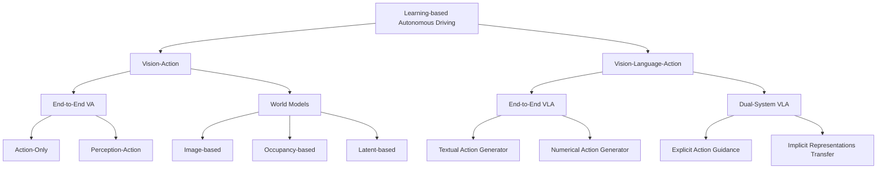
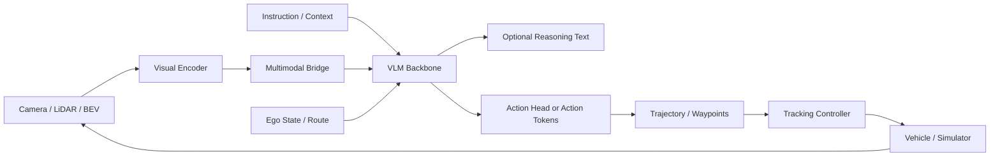
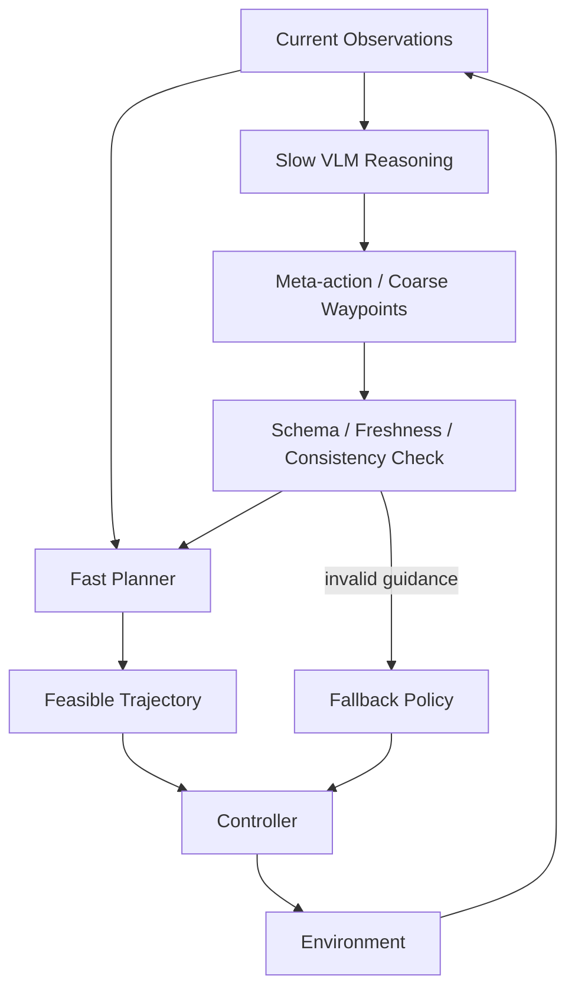
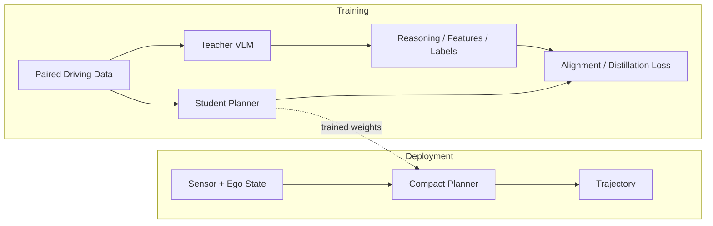
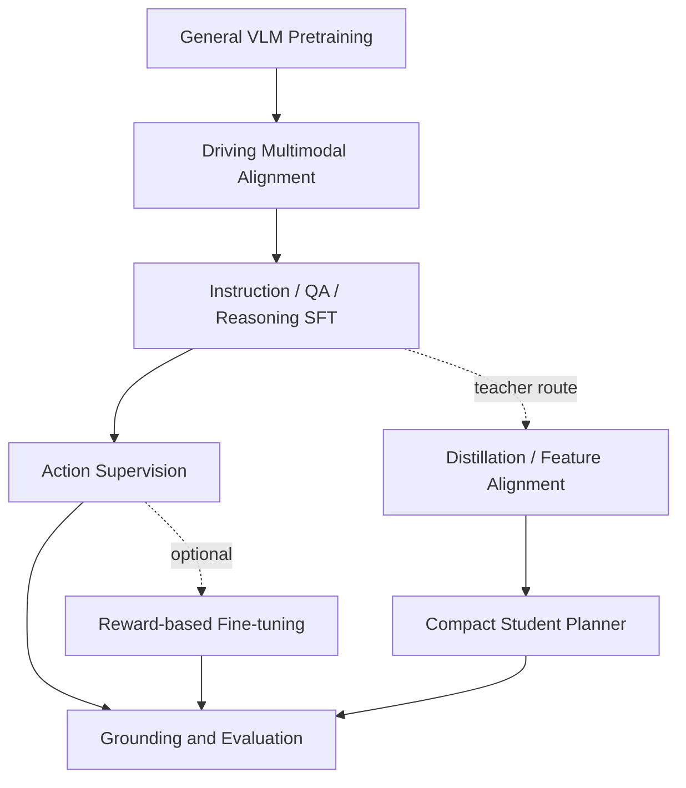
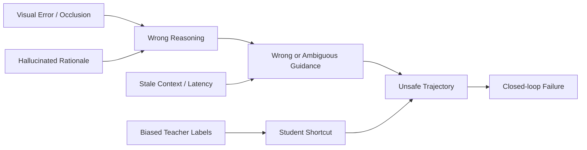

# Week 01. VLA for AD 지형도와 taxonomy

- 학습일: 2026-10-13 (Asia/Seoul)
- 주차: 1 / 12 — 세 번째 순환의 시작
- 원문: *Vision-Language-Action Models for Autonomous Driving: Past, Present, and Future*
- 한국어 제목: **자율주행을 위한 Vision-Language-Action 모델: 과거, 현재, 그리고 미래**
- 저자: Tianshuai Hu 외, WorldBench Team
- URL: https://arxiv.org/abs/2512.16760v2
- 원문 버전: v1 2025-12-18 / v2 2026-01-04
- taxonomy: Survey → VA의 발전 계보 + End-to-End VLA / Dual-System VLA
- reading mode: arXiv Abstract 번역 + HTML 본문의 구조·방법·평가·한계 중심 심독, project page 및 awesome README 훑어읽기
- 읽기 범위: 본문 HTML을 확보하여 핵심 절과 평가 설명을 확인했다. PDF 전체의 문장별 번역이나 모든 인용 논문의 독립 재현은 하지 않았다. 아래 architecture는 여러 모델을 설명하는 **학습용 추상화**이며, survey 자체의 새로운 구현 모델이 아니다.
- 자료 시점: survey v2는 2026-01 기준, README는 열람 당시 2026-10-11 업데이트 표기. 최신 목록의 존재와 개별 논문의 실험 검증을 구분한다.

## 1. 이번 주 한 문장 결론

**VLA를 읽을 때는 “언어로 설명하는가?”보다 “언어가 어떤 인터페이스를 통해 실제 trajectory와 control을 바꾸며, 그 효과를 어떤 평가로 증명했는가?”를 먼저 확인해야 한다.**

예를 들어 “보행자가 있어 감속한다”라는 답변만 생성하면 driving QA에 가까울 수 있다. 그 판단이 감속 trajectory로 변환되고 controller가 실행하며 이후 관측으로 다시 판단해야 실행 가능한 driving system이다. 설명의 그럴듯함은 안전성의 증거가 아니다.

이번 순환에서는 다음 세 축을 모든 논문 메모의 기본 좌표로 삼는다.

| 좌표 | 질문 | 기록 예시 |
|---|---|---|
| 구조 | 한 모델이 action을 생성하는가, 별도 planner가 실행하는가? | End-to-End / Dual-System |
| 출력 | 사람이 읽는 문자열인가, action code인가, 연속값인가? | meta-action / textual waypoint / action token / trajectory |
| 언어의 시점 | deployment에 필요한가, training teacher인가? | runtime reasoning / instruction / offline distillation |

## 2. 논문 제목·Abstract 한국어 번역

### 제목

**자율주행을 위한 Vision-Language-Action 모델: 과거, 현재, 그리고 미래**

### Abstract 번역

자율주행은 오랫동안 모듈화된 “인지–판단–행동(Perception–Decision–Action)” pipeline에 의존해 왔다. 이 구조의 수작업으로 설계된 인터페이스와 규칙 기반 구성 요소는 복잡하거나 long-tail에 속하는 상황에서 자주 한계를 드러낸다. 또한 단계가 연쇄적으로 연결되는 설계 때문에 인지 오류가 전파되어 후속 planning과 control의 성능이 저하된다. Vision-Action(VA) 모델은 시각 입력에서 action으로 직접 연결되는 mapping을 학습하여 일부 한계를 해결하지만, 여전히 내부 판단을 해석하기 어렵고 distribution shift에 민감하며 구조화된 reasoning이나 instruction following 능력이 부족하다.

최근 Large Language Model(LLM)과 multimodal learning의 발전으로, 인지와 언어에 기반한 의사결정을 통합하는 Vision-Language-Action(VLA) framework가 등장했다. VLA는 시각 이해, 언어 reasoning, 실행 가능한 출력을 하나로 연결함으로써 더 해석 가능하고 일반화 능력이 높으며 인간의 의도에 부합하는 driving policy로 나아갈 가능성을 제시한다.

이 연구는 자율주행 분야에서 형성되고 있는 VLA 지형을 구조적으로 정리한다. 초기 VA 접근에서 현대 VLA framework로 이어지는 발전을 추적하고, 기존 방법을 두 가지 주요 paradigm으로 분류한다. **End-to-End VLA**는 인지·reasoning·planning을 하나의 모델 안에 통합하고, **Dual-System VLA**는 VLM을 이용한 느린 숙고와 planner를 이용한 빠르고 안전에 중요한 실행을 분리한다. 각 paradigm 안에서는 textual action generator와 numerical action generator, explicit guidance와 implicit guidance 같은 세부 유형을 추가로 구분한다.

또한 VLA 기반 driving system을 평가하는 대표 dataset과 benchmark를 정리하고, robustness, interpretability, instruction fidelity를 포함한 핵심 과제와 열린 연구 방향을 제시한다. 이 연구의 목표는 인간과 양립 가능한 자율주행 시스템의 발전을 위한 일관된 기초를 마련하는 것이다.

> 번역 기준: arXiv Abstract 페이지. “가능성을 제시한다”는 연구 동기를 옮긴 것이며, 모든 VLA가 VA보다 안전하거나 일반화가 우수하다는 검증된 명제로 받아들이지 않는다.

## 3. 핵심 기여 3~5개

원문 Introduction의 네 가지 기여를 한국어로 정리했다.

1. **VA에서 VLA로 이어지는 발전 계보를 정리한다.** 초기 직접 action 예측, perception–planning 통합, world model에서 언어 기반 판단으로 이동한 동기를 설명한다.
2. **End-to-End와 Dual-System을 중심으로 architecture taxonomy를 제안한다.** action 출력 형식과 VLM–planner 연결 방식을 추가로 구분하여 모델별 장점과 한계를 비교한다.
3. **Dataset과 평가 benchmark를 구조적으로 종합한다.** vision/action data와 language annotation을 구분하고 trajectory·text·closed-loop 평가를 함께 정리한다.
4. **실제 deployment의 과제와 향후 연구 방향을 제시한다.** latency, long-tail generalization, hallucination, 시간적 일관성, world model 결합 등을 다룬다.

### 절별 한국어 요약

| 원문 절 | 핵심 내용 | 읽으며 남길 질문 |
|---|---|---|
| §1 Introduction | 모듈형의 오류 전파, VA의 한계, VLA의 동기 | 언어가 실제로 해결하는 문제는 무엇인가? |
| §2 Preliminary Foundations | input, VLM backbone, action head, action 표현 | 어떤 정보가 어느 head까지 전달되는가? |
| §3 Vision-Action Models | action-only, perception-action, image/occupancy/latent world model | 기존 VA의 planning 능력과 비교했는가? |
| §4 Vision-Language-Action Models | 두 paradigm과 네 세부 유형 | 설명 생성과 실행 경로를 혼동하지 않았는가? |
| §5 Datasets & Benchmark | annotation, trajectory/text metric, benchmark 결과 | 같은 protocol의 숫자인가? |
| §6 Challenges & Future Directions | 효율, data 비용, long-tail, hallucination, temporal coherence | 실제 failure mode를 측정했는가? |
| §7 Conclusion | 인간과 상호작용 가능한 driving system을 위한 연구 기반 | taxonomy가 deployment 설계에 어떤 도움을 주는가? |

## 4. VLA for AD taxonomy 위치



### VA / VLA 비교표

| 항목 | VA | VLA |
|---|---|---|
| 입력 | camera, LiDAR, ego state, map 등 | VA 입력 + instruction, description, rule, context 등 |
| 언어 역할 | 없어도 동작; 단순 route command는 가능 | 이해·reasoning·action 표현·supervision·distillation |
| 출력 | trajectory, waypoint, control 등 | text decision, textual waypoint, action token, numeric action 등 |
| 일반적인 학습 | imitation learning, RL, generative planning | VA 학습 + multimodal alignment, instruction tuning, reasoning supervision |
| 장점으로 기대하는 것 | 직접 planning 최적화와 비교적 단순한 실행 경로 | instruction following, 의미 정보 활용, human interaction |
| 주요 위험 | distribution shift, shortcut, 오류 누적 | 왼쪽 위험 + hallucination, 언어/action 불일치, latency |
| 주의 | VA도 BEV와 world model로 구조적 추론을 할 수 있다 | 언어가 있다고 generalization·안전성이 자동 향상되지 않는다 |

### End-to-End / Dual-System 비교표

| 항목 | End-to-End VLA | Dual-System VLA |
|---|---|---|
| 중심 구조 | VLM backbone과 action 생성 경로가 강하게 통합 | VLM guidance/teacher와 별도 driving module |
| action grounding | language head, regression head, generative head, action token decoder | meta-action/waypoint/feature를 planner로 전달하거나 training에서 distill |
| 시간 예산 | reasoning과 action 생성 비용이 실행 경로에 함께 들어갈 수 있음 | 느린 판단과 빠른 실행을 분리할 수 있음 |
| 해석 가능성 | 명시적 text를 출력할 때 interface 관찰 가능 | explicit guidance는 읽기 쉽고 implicit transfer는 덜 직접적 |
| 안전성 | 출력 수치의 feasibility 검사가 필요 | planner가 제약을 적용할 수 있지만 잘못된 guidance 자체는 남음 |
| 핵심 질문 | action head가 reasoning을 실제 사용했는가? | interface 오류·오래된 guidance·teacher 오류를 어떻게 처리하는가? |

**분류상의 함정:** textual waypoint는 숫자를 문자열로 출력하는 방식이다. 반면 action token은 learned codebook의 항목을 decoder로 복원하는 방식일 수 있다. 둘 다 token으로 출력된다고 같은 분류가 아니다. 또 Dual-System의 implicit transfer에는 training-only teacher도 포함되므로 “항상 runtime에 두 모델이 동시에 돈다”는 뜻이 아니다.

## 5. Architecture / pipeline 시각화

Survey §2의 기본식은 `a_t = H(F(x | θ))`이다. `F`는 multimodal/VLM backbone, `H`는 action 생성 head, `x`는 sensor·language·ego state 등을 뜻한다. 이 식만으로 language가 action에 인과적으로 기여했다는 사실까지 보장되지는 않는다.

### A. End-to-End VLA — 학습용 block diagram



R과 H를 병렬로 출력하는 모델이라면 “reasoning text → action” 연결은 자동으로 성립하지 않는다. text를 바꾸거나 제거했을 때 action이 어떻게 바뀌는지 확인해야 한다.

### B. Dual-System explicit guidance — 학습용 안전 설계 예시



Schema, freshness 검사와 fallback은 **본 노트의 engineering 제안**이다. survey에 등장하는 모든 모델이 이 장치를 구현했다는 뜻은 아니다. fast planner가 존재해도 safety guarantee는 별도로 검증해야 한다.

### C. Implicit transfer — training과 deployment 분리



Teacher를 빼고 실행할 수 있는지, 여전히 runtime feature provider가 필요한지 논문마다 구분한다.

## 6. Input → Reasoning → Action Grounding 분석

### 네 세부 유형의 핵심 인터페이스

| 유형 | Input | language / reasoning 역할 | action grounding | 최종 출력 | 검증해야 할 실패 |
|---|---|---|---|---|---|
| Textual generator | image + instruction/context | 상황 설명, CoT, symbolic decision | parser로 meta-action 해석 또는 문자열 좌표 복원 | decision / textual waypoint | 형식 오류, 모호한 명령, 좌표 정밀도 |
| Numerical generator | multimodal sensor + language + state | backbone conditioning, instruction alignment | regression/generative head 또는 action code decoder | waypoint / trajectory / control | quantization, 불가능한 곡률, action shortcut |
| Explicit guidance | scene + route/state | 느린 상황 판단과 high-level intent | 별도 planner가 guidance를 정제 | planner trajectory | 잘못되거나 오래된 guidance |
| Implicit transfer | training 시 sensor + language/teacher | semantic supervision, representation transfer | student feature와 planning objective 정렬 | compact planner trajectory | teacher bias, 과도한 compression, runtime 정보 손실 |

### 예제로 보는 grounding의 단계

상황: “다음 교차로에서 좌회전하되 횡단보도 앞에서는 보행자를 우선하라.”

| 단계 | 필요한 정보 | 잘못될 수 있는 지점 |
|---|---|---|
| Visual grounding | 해당 교차로·횡단보도·보행자의 위치 | 다른 교차로나 광고판을 지시 대상으로 오인 |
| Temporal reasoning | 보행자 이동 방향, ego speed, 신호 상태 | 단일 frame만 보고 진입 가능하다고 판단 |
| Intent | 좌회전 goal + 보행자에게 양보 | route instruction을 안전보다 우선 |
| Action grounding | 정지/감속 waypoint, 회전 path, 시간 정보 | “양보”라고 말하면서 trajectory는 계속 진행 |
| Execution | controller와 vehicle dynamics | 추종 오차나 통신 지연으로 정지 위치 이탈 |
| Feedback | 실행 뒤 새 관측 | 초기 판단을 고집하여 새 위험을 놓침 |

**본 노트의 action grounding 체크리스트:** 출력 공간과 좌표계, 시간 간격, parser/decoder, controller, feasibility constraint, language ablation, closed-loop test를 모두 찾는다. 이 체크리스트는 원문 taxonomy를 실무 분석 도구로 확장한 것이다.

## 7. Training recipe

이 논문은 survey이므로 하나의 optimizer, learning rate, batch size 또는 통일된 training dataset을 제안하지 않는다. 다음은 원문이 정리한 모델군을 이해하기 위한 공통 recipe이며 모든 모델의 필수 단계가 아니다.



| 학습 단계 | 목적 | supervision 예시 | 주의점 |
|---|---|---|---|
| General pretraining | visual-language 의미 기반 확보 | image-text, video-language | 교통 규칙·거리·vehicle dynamics가 부족할 수 있음 |
| Driving alignment | sensor/BEV와 language embedding 연결 | scene caption, structured query, feature alignment | caption이 중요한 작은 객체를 누락할 수 있음 |
| Instruction / reasoning SFT | task 이해와 상황 설명 | QA, CoT, navigation instruction | rationale을 외우는 것이 action 개선과 다름 |
| Action supervision | 실제 driving output 학습 | expert waypoint, trajectory, control, action code | 행동 다양성 및 covariate shift 문제 |
| RL fine-tuning | reasoning/action/효율 목적 보완 | decision·trajectory·format reward | reward hacking, 안전보다 진행량 우선 |
| Distillation | teacher 지식을 작은 planner에 전달 | surrogate task, feature, behavior label | teacher hallucination을 student에 전파 가능 |

학습용 loss 분해 예: `L = L_action + λ_lang L_language + λ_align L_alignment`. 이는 설명용 형태이며 survey가 모든 모델에 공통으로 사용한 공식이 아니다. 같은 training budget과 sensor input에서 language-related loss를 제거한 ablation이 있어야 언어의 기여를 판단하기 쉽다.

**읽은 대표 사례:** DiMA Abstract는 shared scene encoder와 surrogate tasks를 이용한 joint training, inference 시 optional LLM을 명시한다. 따라서 “LLM을 썼다”와 “차량에서 항상 LLM을 실행한다”를 분리해 기록해야 한다.

## 8. Dataset / Benchmark / Metric 분석

### Dataset / annotation matrix

| 자원 | 중심 데이터/annotation | 확인할 능력 | 이것만으로 알 수 없는 것 |
|---|---|---|---|
| nuScenes | real-world multimodal scene, trajectory 및 perception data | open-loop planning과 scene representation | policy 실행 후 feedback에 대한 복구 |
| nuPlan | real-world driving log 기반 planning benchmark | simulation protocol별 planning 성능 | 전체 sensor-to-control 실차 안전성 |
| BDD-X | driving video + 행동 설명/정당화 text | 설명과 행동 정보의 연결 | 자유로운 instruction의 안정적 실행 |
| Talk2Car | 자연어 command와 대상/trajectory 관련 annotation | language의 공간적 grounding | 복잡한 traffic interaction 전반 |
| DriveLM | perception–prediction–planning의 graph VQA | 구조화된 scene reasoning | QA 점수만으로 closed-loop 안전성 입증 |
| CoVLA | vision–language–action data | caption과 trajectory 정렬 | 낯선 환경의 안전한 실행 |
| LMDrive / LangAuto | instruction-following driving clips, language driving benchmark | complex instruction 기반 closed-loop driving | real-world deployment로의 직접 일반화 |
| WOD-E2E | long-tail scene, ego/status, route, trajectory preference | ADE + human preference RFS | interactive feedback까지 포함한 성공 |

숫자 규모는 frame·clip·segment·QA가 섞이므로 이 표에서는 단순 크기 순위를 만들지 않았다. LMDrive Abstract는 약 64K instruction-following clips를 명시하지만, 그 수가 곧 독립적인 long-tail scenario 수는 아니다.

### 평가 mode와 metric matrix

| 평가 | 대표 benchmark | metric 예 | 장점 | blind spot |
|---|---|---|---|---|
| Open-loop trajectory | nuScenes | L2, ADE, FDE, collision 관련 metric | log 기반 반복 비교 용이 | 누적 정책 오류·reactive interaction 부족 |
| Open-loop long-tail/preference | WOD-E2E | ADE, RFS | expert와 다른 타당한 행동도 평가할 여지 | 실제 interaction의 feedback은 별개 |
| Non-reactive short-horizon simulation | NAVSIM | PDMS: NC, DAC, TTC, EP, comfort | 단순 displacement보다 driving quality를 반영 | ego와 environment가 서로 반응하는 full closed-loop는 아님 |
| Interactive closed-loop | CARLA / Bench2Drive / LangAuto | route completion, driving score, success, infractions | action→관측→action feedback 평가 | simulator realism과 sim-to-real gap |
| Text / QA | language-annotated dataset | BLEU, ROUGE, CIDEr, QA/decision accuracy | 표현·정답·annotation alignment 평가 | 문장 유사도가 안전한 control을 보장하지 않음 |

**원문을 그대로 받아들이면 안 되는 두 지점:**

1. Survey §5.3.3은 NAVSIM을 closed-loop 환경으로 표현한다. 그러나 NAVSIM 원논문 Abstract는 **non-reactive simulator**, **policy와 environment가 서로 영향을 주지 않음**, **short simulation horizon**을 명시한다. 본 노트는 원논문의 정의에 따라 중간 평가 paradigm으로 구분한다. 따라서 NAVSIM 점수를 CARLA interactive closed-loop 성공률과 같은 증거로 취급하지 않는다.
2. Survey Table 6의 caption에는 RFS에 아래 방향 화살표가 있으나 column header에는 위 방향 화살표가 표시되어 있다. 방향 표기가 불일치하므로 이 노트에서는 검증 없이 RFS의 최적화 방향이나 순위를 단정하지 않는다. 공식 benchmark의 metric 정의와 implementation을 추가 확인해야 한다.

### 숫자 비교 전에 확인할 protocol

- ego status 제공 여부: speed/acceleration 입력 차이가 모델보다 큰 영향을 줄 수 있다.
- input modality와 camera 수: LiDAR 포함 모델과 camera-only 모델을 그대로 비교하지 않는다.
- planning horizon, 평가 시점, collision 구현, data split을 맞춘다.
- 단일 후보 실행과 Best-of-N/oracle selection을 구분한다. 정답을 이용한 후보 선택은 deployable planner의 능력과 다르다.
- latency는 hardware, precision, visual token 수, reasoning 길이, controller까지 포함한 end-to-end 지연을 함께 기록한다.

## 9. 관련 논문 비교표

아래는 survey/anchor 자료를 바탕으로 한 **대표 논문 skim 수준 비교**다. LMDrive와 DiMA는 개별 Abstract도 확인했다. 각 논문의 전체 training configuration과 모든 실험을 재검증한 표는 아니다.

| 논문 | taxonomy | input → output | language 역할 / grounding | training 핵심 | dataset / 평가 | safety·한계 |
|---|---|---|---|---|---|---|
| UniAD | VA, perception-action | multimodal visual scene → planning trajectory | language가 핵심 실행 요소가 아님; task query를 planning에 연결 | perception/prediction/planning 통합 supervision | nuScenes open-loop | 좋은 planning error가 closed-loop 복구 능력은 아님 |
| DriveLM | textual action generator | multi-view scene + question → graph QA / textualized waypoint | 단계별 perception–prediction–planning reasoning, 좌표 출력 연결 | graph QA supervision | DriveLM data; QA와 planning 구분 필요 | textual rationale/좌표와 executable control 사이 확인 필요 |
| LMDrive | numerical action generator | multimodal sensor + instruction → driving action 경로 | instruction을 end-to-end action prediction과 연결 | sensor/language/action 학습; 상세 loss는 원논문 확인 | 약 64K clips, LangAuto, CARLA closed-loop | sim-to-real, 복잡한 command, 지연 |
| AutoVLA | numerical action generator | scene + language → reasoning/action tokens | trajectory codebook의 action token decoding | action supervision, adaptive reasoning, RL fine-tuning | survey의 여러 planning benchmark 비교 | quantization, latency, 후보 선택 protocol |
| DriveVLM 계열 | explicit guidance | scene → meta-action / coarse waypoint → planner trajectory | 느린 VLM 판단을 downstream planning이 정제 | reasoning/planning supervision; 상세 stage 별도 확인 | SUP-AD 등; system variant별 평가 확인 | 잘못된/낡은 guidance, interface 전달 오류 |
| DiMA | implicit transfer | shared scene representation → vision planner trajectory | multimodal LLM의 지식과 surrogate task supervision 전달 | shared encoder joint training, distillation | nuScenes planning, long-tail 분석 | inference LLM optional; teacher 오류와 전이 한계 |

### 대표 논문 읽기 목록

- [UniAD: Planning-Oriented Autonomous Driving](https://arxiv.org/abs/2212.10156) — 다음 주 deep-read.
- [DriveLM: Driving with Graph Visual Question Answering](https://arxiv.org/abs/2312.14150) — 설명과 action 연결.
- [LMDrive: Closed-Loop End-to-End Driving with Large Language Models](https://arxiv.org/abs/2312.07488) — instruction-following closed-loop.
- [AutoVLA](https://arxiv.org/abs/2506.13757) — adaptive reasoning과 action token.
- [DriveVLM](https://arxiv.org/abs/2402.12289) — VLM/planner 분업.
- [DiMA](https://arxiv.org/abs/2501.09757) — training-only teacher 관점.

### 이번 순환의 최신성 메모

README에서 [Towards Reliable Vision-Language Models for Autonomous Driving](https://arxiv.org/abs/2610.01531)를 발견하고 arXiv Abstract를 확인했다. 이 연구는 visual corruption 아래 다섯 VLM의 driving QA 성능과 confidence reliability를 비교하고, Visual Evidence Augmentation의 효과가 모델·dataset별로 일관되지 않음을 보고한다.

**학습상 의미:** visual-language backbone의 신뢰도를 따로 측정해야 한다는 문제의식은 Week 1의 safety 축과 연결된다. 다만 이 논문은 여기서 확인한 범위상 QA reliability 연구이며, executable driving policy의 closed-loop 안전성 증명으로 해석하면 안 된다. 전체 architecture/training/trajectory 평가 분석은 이번 주 수행하지 않았으므로 심독 대상이 아니라 후속 읽기 후보로 남긴다.

## 10. 강점과 한계

### Survey의 강점

- VA와 world model을 배경으로 포함하여 VLA가 무엇을 추가하는지 설명한다.
- action의 표현과 VLM–planner interface를 taxonomy에 넣어 구현 관점의 비교가 가능하다.
- dataset과 text/trajectory 평가를 함께 다루므로 “설명이 좋은 모델”과 “운전이 좋은 모델”을 구분하는 출발점이 된다.
- deployment 효율과 long-tail, hallucination, temporal coherence를 동시에 문제로 제시한다.

### 한계와 비판적 해석

| 한계 | 해석 | 이후 보완 |
|---|---|---|
| Survey v2의 시점 | 2026-01 자료가 2026-10 전체 지형을 포괄하지 않음 | README 후보를 원논문으로 다시 확인 |
| 분류 경계가 겹침 | output text와 별도 planner가 함께 존재할 수 있음 | action 표현·runtime topology·training teacher를 독립 기록 |
| 일부 설명/표의 불일치 | NAVSIM mode, RFS 방향처럼 원자료 확인이 필요 | 공식 benchmark 기준으로 protocol 명시 |
| paper 간 입력/평가 차이 | 표의 좋은 숫자가 language의 인과적 효과는 아님 | 동일 budget/input ablation, deployment 조건 비교 |
| explanation faithfulness | CoT는 생성된 설명이지 내부 인과 과정의 보증이 아님 | reasoning intervention, consistency test, failure slice |
| 실차 안전성 증거 부족 | benchmark를 통과해도 operational domain 전체는 별개 | runtime monitor, fallback, 지역/날씨별 검증 |

### Safety / long-tail 위험 지도 — 본 노트의 분석



위험은 단순히 “LLM이 말을 틀림”이 아니다. 감속해야 할 상황을 놓친 guidance, 맞는 설명과 충돌하는 trajectory, 지연된 판단을 최신처럼 실행하는 인터페이스 모두 안전 실패로 이어질 수 있다.

## 11. 실전 학습 포인트

### 논문을 받으면 작성할 research card

```text
Taxonomy:
Runtime VLM 필요 여부:
Input modality / history / ego state:
Language role:
Output representation / coordinate / horizon:
Action grounding interface / controller:
Training data / action label / loss / teacher / RL:
Open-loop dataset / metric / protocol:
Closed-loop environment / feedback / failure metric:
Latency hardware / precision / reasoning length:
Safety and long-tail slices:
Language ablation / reasoning-action consistency:
Unverified claims / implementation gaps:
```

### 예제 중심 연습

1. **VA baseline을 먼저 이해한다.** UniAD의 perception과 prediction이 planning query에 어떤 정보를 주는지 그린다. language가 없는 모델의 강점을 알아야 VLA 개선의 의미가 보인다.
2. **같은 장면에서 language의 필요성을 시험한다.** “좌회전”과 “직진” instruction에서 action 차이가 생기는지 확인하는 실험을 설계한다. 본 노트에서는 실험을 실행하지 않았다.
3. **설명과 실행을 따로 채점한다.** “양보한다”라는 텍스트가 맞아도 trajectory가 보행자 공간을 지나가면 action 실패로 기록한다.
4. **long-tail slice를 만든다.** occlusion, emergency vehicle, construction, atypical pedestrian, degraded camera처럼 분리한다. 평균 metric이 높은 것만으로 작은 slice의 실패를 가리지 않는다.
5. **oracle과 실제 selector를 구분한다.** 여러 trajectory 중 정답과 가장 가까운 것을 사후 선택한 성능은 실제 policy가 좋은 후보를 선택한 성능과 다르다.

### 이번 주 회수할 세 가지 산출물

- taxonomy map: §4 Mermaid와 구조/표현/언어 시점의 세 좌표.
- VA/VLA 비교표: §4의 input·output·학습·위험 비교.
- 대표 논문 목록: §9의 여섯 편과 후속 reliability 후보.

## 12. 다음 주 질문

다음 주 주제: **Week 02. End-to-End AD 기본기**

Deep-read: **UniAD — Planning-Oriented Autonomous Driving**

Skim: TransFuser, ST-P3, VAD.

- UniAD에서 detection/tracking, map, motion, occupancy, planning은 query와 feature를 어떻게 공유하는가?
- BEV는 camera observation을 planning에 필요한 공간 정보로 어떻게 바꾸는가?
- 중간 perception task를 함께 최적화하면 action-only 모델과 무엇이 달라지는가?
- open-loop planning L2와 collision 관련 metric의 정확한 protocol은 무엇인가?
- UniAD에 language를 넣는다면 instruction conditioning, explicit guidance, training distillation 중 어느 interface가 타당한가?

**다음 주 목표 산출물:** Modular AD vs End-to-End AD 비교표와 UniAD의 perception → prediction → planning architecture map.

## 13. 참고 링크

### 이번 실행에서 직접 확인한 자료

1. [Survey Abstract 및 metadata](https://arxiv.org/abs/2512.16760v2) — 제목·Abstract 번역, 버전 정보.
2. [Survey HTML 본문](https://arxiv.org/html/2512.16760v2) — §1–§6 핵심 구조, taxonomy, 평가, 한계와 방향.
3. [VLA4AD project page](https://worldbench.github.io/vla4ad) — VA/VLA 정의와 collection 구조. 정적 HTML의 항목 수 0은 동적 rendering 전 placeholder이므로 실제 collection이 비었다고 판단하지 않았다.
4. [awesome-vla-for-ad](https://github.com/worldbench/awesome-vla-for-ad) / [Raw README](https://raw.githubusercontent.com/worldbench/awesome-vla-for-ad/main/README.md) — 논문·dataset 분류, 최신 후보 목록.
5. [LMDrive Abstract](https://arxiv.org/abs/2312.07488) — instruction-following data 및 closed-loop 목표.
6. [DiMA Abstract](https://arxiv.org/abs/2501.09757) — shared encoder, surrogate tasks, inference의 optional LLM.
7. [NAVSIM 원논문 Abstract](https://arxiv.org/abs/2406.15349) — non-reactive simulation 정의; survey 표현과의 차이 확인.
8. [Towards Reliable Vision-Language Models for Autonomous Driving Abstract](https://arxiv.org/abs/2610.01531) — visual corruption / confidence reliability 후속 읽기 후보.

### 해석과 검증 범위

- 번역·taxonomy·절별 요약은 위 원문 자료를 바탕으로 작성했다.
- 추가 안전 인터페이스, research card, 실험 제안은 본 학습 노트의 분석이다.
- 모델 실행, benchmark 재현, 실차 실험은 수행하지 않았다. 상대 성능 숫자를 재현한 것으로 주장하지 않는다.
- 전체 PDF의 줄별 번역이나 모든 관련 논문 전문 검토가 아니라, 원문 survey를 중심으로 한 한국어 학습·비판 노트다.
