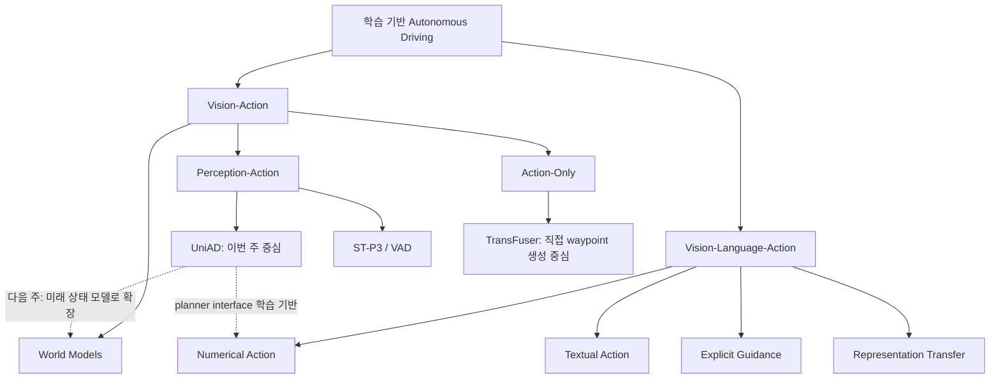
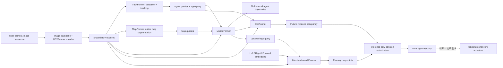
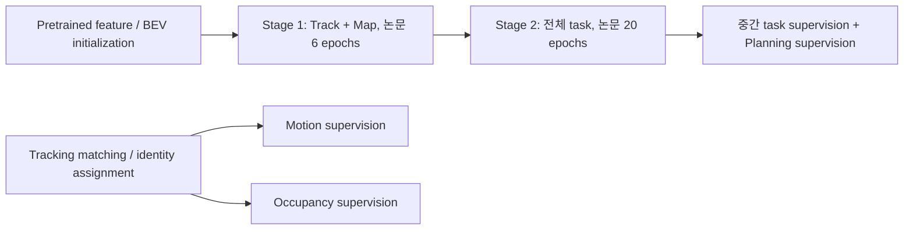
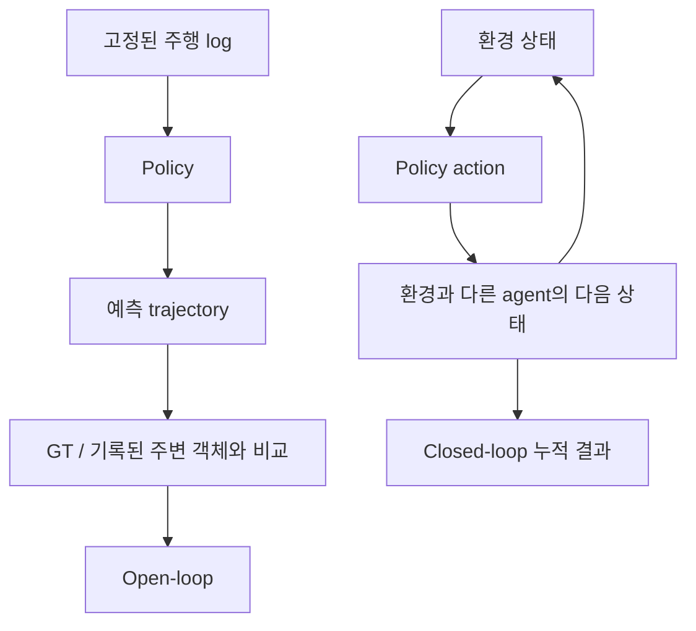
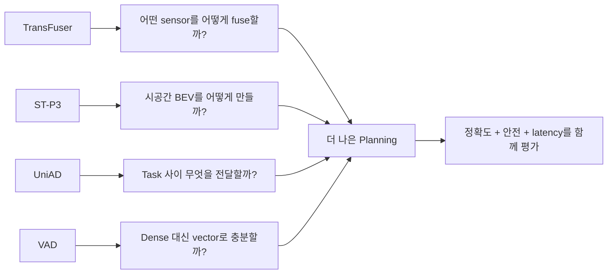

# Week 02. End-to-End AD 기본기 — UniAD로 이해하는 planning-oriented perception

- 학습일: 2026-10-20 (Asia/Seoul)
- 주차: 2 / 12
- 원문: **Planning-oriented Autonomous Driving** — Yihan Hu 외, CVPR 2023
- Curriculum 표기: UniAD: Planning-Oriented Autonomous Driving. UniAD는 모델명이며 arXiv의 실제 논문 제목에는 접두사 `UniAD:`가 없습니다.
- 원문 URL: https://arxiv.org/abs/2212.10156v2
- Taxonomy: **VA → Perception-Action Models**; language-free, structured end-to-end AD
- 읽기 모드: UniAD 심층 읽기 + TransFuser / ST-P3 / VAD skim
- 출처 범위: arXiv v2 Abstract와 HTML 본문, 공식 UniAD README, 관련 논문 Abstract 및 TransFuser 공식 README를 확인했습니다. 전체 PDF의 문장별 번역은 하지 않았으며, 아래는 Abstract 번역·절별 요약·설계 해설입니다. Supplementary 전체 및 학습 코드는 전수 검토하지 않았습니다.
- 구분: **[원문]**은 논문/공식 자료 내용, **[해설]**은 학습용 해석, **[제안]**은 아직 실행하지 않은 실험입니다. 모델 학습·벤치마크 재현을 수행한 결과가 아닙니다.

## 1. 이번 주 한 문장 결론

**End-to-end AD의 핵심은 모듈을 없애는 것이 아니라, perception과 prediction의 표현·연결·학습 목표를 최종 ego planning에 맞추는 것입니다.**

UniAD는 “물체를 정확히 찾기”에서 멈추지 않고, “그 물체가 어떻게 움직이며 내 trajectory를 어떻게 바꾸어야 하는가?”까지 query로 연결합니다. 언어가 없으므로 VLA 자체는 아니지만, 앞으로 VLM이 무엇을 planner에 전달해야 하는지 이해하는 기준점입니다.

> 먼저 구분할 것: **BEV feature ≠ occupancy ≠ trajectory ≠ control**. 순서대로 표현 공간, 공간 점유 예측, 미래 이동 계획, 차량 actuator 명령입니다.

## 2. 논문 제목·Abstract 한국어 번역

### 제목

**Planning-oriented Autonomous Driving → 주행 계획 중심 자율주행**

### Abstract 번역

현대 자율주행 시스템은 perception, prediction, planning이라는 모듈형 작업이 순서대로 이어지는 구조를 특징으로 합니다. 다양한 작업을 수행하고 높은 수준의 지능을 달성하기 위해, 기존 접근법은 작업마다 독립적인 모델을 배치하거나 개별 head를 갖춘 multi-task 구조를 설계합니다. 그러나 이러한 방식은 오류가 누적되거나 작업 간 협력이 충분하지 않은 문제를 겪을 수 있습니다.

이에 우리는 바람직한 프레임워크가 궁극적인 목표, 즉 자율주행 차량의 planning을 추구하도록 설계되고 최적화되어야 한다고 주장합니다. 이 관점에서 perception과 prediction의 핵심 구성요소를 다시 살펴보고, 모든 작업이 planning에 기여하도록 작업의 우선순위를 정합니다.

우리는 전체 주행 작업을 하나의 네트워크에 통합한 포괄적인 프레임워크인 Unified Autonomous Driving(UniAD)을 소개합니다. UniAD는 각 모듈의 장점을 활용하고, 전역적인 관점에서 agent 간 상호작용을 위한 상호보완적 feature abstraction을 제공하도록 정교하게 설계되었습니다. 작업들은 통일된 query interface를 통해 소통하며 planning을 향해 서로를 돕습니다.

우리는 도전적인 nuScenes benchmark에서 UniAD를 구현했습니다. 광범위한 ablation을 통해, 기존 최고 성능 방법들을 여러 측면에서 크게 능가함으로써 이러한 설계 철학의 효과를 입증합니다. 코드와 모델은 공개되어 있습니다.

**읽기 주의:** 마지막 성능 문장은 저자 주장에 대한 번역입니다. 모든 perception class와 모든 현실 주행 조건에서 우월하다는 뜻은 아닙니다. 본문 §3.2도 일부 mapping class 및 tracking-by-detection 방법 대비 한계를 인정합니다.

## 3. 핵심 기여 3~5개

1. **Planning 중심의 전체 설계 [원문]**: 독립 모듈의 단순 연결이나 shared backbone + 독립 head 대신, perception → prediction → planning의 정보 흐름을 계층적으로 설계합니다.
2. **Query를 공통 interface로 사용 [원문]**: TrackFormer, MapFormer, MotionFormer, OccFormer, Planner가 학습된 feature를 주고받습니다. Bounding box 같은 압축된 결과만 전달하는 것보다 풍부한 문맥을 공유합니다.
3. **Agent와 scene 표현의 결합 [원문]**: agent trajectory와 dense future occupancy를 함께 사용합니다. “어떤 객체가 어떻게 움직이는가”와 “어디가 점유될 것인가”를 보완적으로 연결합니다.
4. **Ego query를 prediction부터 포함 [원문]**: ego를 다른 agent와 상호작용하는 참여자로 모델링하고 그 query를 planning에 사용합니다.
5. **모듈 조합 ablation [원문]**: 구성요소를 추가·제거하며 planning 기여를 확인합니다. 단순히 head 수가 많아져서 좋아졌다는 설명보다 task coordination의 근거를 제시합니다.

## 4. VLA for AD taxonomy 위치



TransFuser는 직접 policy 학습이라는 관점에서 Action-Only 쪽에 두었지만, 선택한 확장판에는 auxiliary perception supervision도 있으므로 절대적인 단일 분류로 보지 않습니다. 분류 기준은 최종 출력과 주된 계산 경로입니다.

| 질문 | UniAD 판정 | 이유 |
|---|---|---|
| End-to-end인가? | 구조화된 E2E | 중간 task를 보존하면서 연결된 네트워크로 공동 학습 |
| VLA인가? | 아니요, VA | 자연어 입력·언어 reasoning·LLM이 없음 |
| `turn left` command는 language인가? | 이 모델에서는 categorical navigation signal | 세 방향 command embedding이지 자유로운 문장 이해가 아님 |
| World model인가? | future prediction은 있지만 일반적인 action-conditioned world model과는 구별 | occupancy forecasting만으로 임의 action의 결과를 rollout하는 모델이 되지는 않음 |
| Action grounding은 어디인가? | query/BEV → ego waypoints → occupancy 기반 보정 | sensor feature를 수치 계획에 연결 |

### 필수 산출물: Modular AD vs End-to-End AD 비교표

| 비교축 | 전통적 modular AD | 단순 multi-task E2E | UniAD형 structured E2E |
|---|---|---|---|
| 기본 구성 | detector / tracker / predictor / planner | shared backbone + task별 head | planning에 맞춰 task query를 연결 |
| 모듈 사이 전달 | box, track, map 등 명시적 결과 | 주로 backbone feature 공유 | agent/map/motion/ego query + BEV |
| 학습 목표 | task마다 별도 최적화하는 경우가 많음 | 여러 loss를 함께 최적화 | 중간 task supervision + planning-oriented 연결 |
| 오류 전달 | 초기 miss와 좌표 오차가 downstream에 전파 | feature 공유만으로 협력이 보장되지 않음 | 풍부한 feature로 완화하지만 miss를 제거하지는 못함 |
| 디버깅 | interface·규칙 단위 추적이 상대적으로 쉬움 | head별 진단 가능 | 모듈 관찰 가능하나 query 의존성 진단은 어려움 |
| 안전 제약 | 명시적 규칙/최적화 넣기 쉬움 | 별도 설계 필요 | occupancy 보정이 있으나 안전 보장은 아님 |
| 변경 영향 | 한 모듈 교체 가능, interface 유지 필요 | 공유 feature 변화가 여러 task에 영향 | upstream 변경 시 전체 task 재검증 필요 |
| 핵심 함정 | 각 모듈 최적 ≠ 전체 주행 최적 | loss 합산 ≠ task coordination | 공동 학습 ≠ 실제 closed-loop 안전 인증 |

이 표는 대표 경향 비교입니다. Modular 시스템도 공동 최적화를 할 수 있고, E2E 시스템도 rule-based controller·safety layer와 결합할 수 있습니다.

## 5. Architecture / pipeline 시각화

### 전체 정보 흐름



Controller는 원 논문의 핵심 학습 출력이 아니므로 점선으로 분리했습니다. “이미지에서 steering까지 모두 하나의 differentiable graph”라고 해석하면 부정확합니다. 추론 시 trajectory 최적화도 별도로 있습니다.

### BEV를 쉽게 이해하기 [해설]

여러 카메라에서는 같은 차량이 서로 다른 위치·크기로 보입니다. BEV는 그 정보를 차량 주변의 평면 좌표계로 모아 “내 차 기준 앞쪽의 어느 위치에 무엇이 있는가?”를 처리하기 쉽게 합니다.

```text
카메라 좌표의 image features
        ↓ calibration + 공간/시간 attention
BEV feature B: [H, W, D]      ← 각 cell이 학습된 문맥 vector
        ├─ agent query [N, D] → 객체별 track / motion
        ├─ map query [M, D]   → 차선·횡단보도 등의 표현
        └─ occupancy [T,H,W] → 미래 cell 점유
                                  ↓
                         ego trajectory [T_plan,2]
```

Shape는 개념도이며 특정 config의 실제 tensor axis 순서를 보장하지 않습니다. BEV feature 자체는 binary map도, 사람이 바로 읽는 semantic map도 아닙니다. BEV 위치를 잘못 정렬하면 “feature는 강하지만 계획은 틀린” 시스템이 됩니다.

### 원문 절별 한국어 요약

| 원문 절 | 주요 내용 | 공부할 질문 |
|---|---|---|
| §1 Introduction | 독립 모듈과 단순 MTL의 한계, planning-oriented 설계 | 무엇을 공유해야 실제 planning이 좋아지는가? |
| §2 Overview | BEV encoder + 4개 perception/prediction decoder + planner | query가 단순한 결과값 전달과 어떻게 다른가? |
| §2.1 Tracking / Mapping | detection query와 시간에 걸친 track query; map query | 객체 identity와 도로 구조가 어떻게 유지되는가? |
| §2.2 Motion | agent-agent / agent-map / agent-goal interaction; multi-modal future | 다른 차량의 복수 미래를 어떻게 다루는가? |
| §2.3 Occupancy | dense scene feature에 agent feature를 주입, instance occupancy | 객체 중심과 공간 중심 표현이 왜 모두 필요한가? |
| §2.4 Planning | ego query + navigation command → waypoints; 추론 때 collision 보정 | 신경망 출력과 후처리 결과를 구분했는가? |
| §2.5 Learning | 2-stage 학습, detection/tracking matching을 prediction에 재사용 | 같은 agent를 task 사이에서 일관되게 감독하는가? |
| §3 Experiments | task 조합 ablation, 모듈별 결과, 설계 ablation | 성능 상승의 근거가 open-loop에 한정되는가? |

## 6. Input → Reasoning → Action Grounding 분석

| 단계 | 입력 | 처리 / 출력 | Action에 주는 의미 | 주의할 실패 |
|---|---|---|---|---|
| Observation | multi-view RGB sequence, calibration/ego-motion 등 구현 metadata | temporal BEV | 여러 시점 정보를 공통 공간에 정렬 | 가림·악천후·calibration drift |
| Perception | BEV | agent queries / map queries | 누가 있고 도로가 어떤 구조인지 제공 | detector miss, ID switch, map 오인 |
| Numerical reasoning | agent/map/goal context | motion queries, 복수 agent trajectory | “옆 차가 진입할 수 있다”를 수치 feature로 표현 | 희귀 행동·상호작용 uncertainty |
| Scene prediction | BEV + agent/motion features | future occupancy | 회피해야 할 미래 공간 표현 | 누락 agent, 공간 해상도 한계 |
| Planning | ego query + BEV + categorical command | ego waypoints | 실제 경로를 수치 좌표로 결정 | imitation bias, multimodal 의도 압축 |
| Grounding refinement | predicted waypoints + occupancy | 최적화된 trajectory | 원 예측 근처에서 점유 공간 회피 | 잘못된 occupancy에는 잘못된 보정 |
| Execution interface [해설] | trajectory + 현재 차량 상태 | controller의 steer/throttle/brake | 차량 dynamics에 맞춰 추종 | 지연·마찰·actuation saturation |

**Language role: 없음.** 여기서 reasoning은 attention 기반 상호작용 계산을 설명하는 말이지, 자연어 CoT를 생성한다는 뜻이 아닙니다.

### 예시: 옆 차가 내 차선으로 끼어드는 상황 [해설]

1. Track query가 옆 차 identity와 이동 문맥을 유지합니다.
2. MotionFormer가 agent-agent와 map 정보를 사용해 직진/차선 변경 등 가능한 미래를 예측합니다.
3. OccFormer가 그 차가 차지할 미래 공간을 예측합니다.
4. Ego query 기반 planner가 waypoint를 생성합니다.
5. Occupancy와 겹치는 waypoint는 추론 단계 최적화로 조정합니다.

이것은 구조의 의도를 설명한 예이지, 논문이 모든 cut-in을 해결했다는 검증 결과가 아닙니다. 처음부터 차량이 검출되지 않으면 이후 모듈의 구조만으로 안전을 보장하지 못합니다.

## 7. Training recipe

### UniAD의 두 단계 [원문 §2.5 / 공식 README]



| 항목 | 확인된 recipe | 해석 |
|---|---|---|
| Stage 1 | tracking + mapping 공동 학습 | downstream이 사용할 query를 먼저 안정화 |
| Stage 2 | perception + prediction + planning 공동 학습 | 단순한 box 전달 대신 연결된 표현을 학습 |
| Loss 개념식 | `L = L_track + L_map + L_motion + L_occ + L_plan` | 설명용 축약식; 실제 가중치·하위 loss·freeze 설정은 config 확인 필요 |
| Shared matching | tracking assignment를 motion/occupancy에 재사용 | task 간 agent identity 불일치를 줄임 |
| Motion target smoothing | 학습 시 nonlinear smoother로 target 보정 | 부정확한 시작 위치에서도 물리적으로 무리한 target을 완화 |
| Planning collision optimization | **추론 때만** occupancy를 사용해 보정 | 학습 target smoother와 목적·실행 시점이 다름 |
| Language / RL | 원 방법에 language instruction tuning이나 RL이 없음 | imitation/task supervision 기반이며 VLM fine-tuning이 아님 |

**구현 재현 주의 [공식 README]:** Stage 1은 `queue_length = 5`, Stage 2는 `queue_length = 3`으로 기재되어 있습니다. 2023-06-12 수정 공지는 잘못 추가된 `loss_past_traj` 제거와 `img_neck`, `BN` unfreeze를 명시합니다. “같은 논문 architecture”라도 코드 revision·학습 세부 설정이 다르면 성능이 달라집니다.

**중요한 구분:** “전체를 end-to-end로 학습한다”는 서술만으로 모든 pretrained backbone parameter가 모든 stage에서 업데이트된다고 단정할 수 없습니다. 정확한 optimizer param group, freeze 범위, loss weight는 재현 대상 config를 고정한 뒤 확인해야 합니다.

## 8. Dataset / Benchmark / Metric 분석

### 무엇을 측정하는가?

| 평가 축 | Dataset / benchmark | Metric 예 | 의미 | 증명하지 못하는 것 |
|---|---|---|---|---|
| Tracking | nuScenes validation | AMOTA ↑, AMOTP ↓, ID switches ↓ | detection/tracking 정확도와 identity 유지 | ego의 주행 안전 |
| Online mapping | nuScenes | class별 IoU ↑ | 도로 구조 추정 | 모든 도로 규칙 이해 |
| Motion | nuScenes | minADE ↓, minFDE ↓, MR ↓ | 복수 후보 중 GT와 가까운 trajectory | 실제 선택한 미래가 맞는지, 확률 calibration |
| Occupancy | nuScenes | IoU, VPQ ↑; near/far | 미래 점유와 instance 일관성 | 관측하지 못한 객체·모든 희귀 상황 |
| Ego planning | nuScenes logs | L2 ↓, collision rate ↓ | 기록된 scene에서 예측 ego 계획 평가 | 내가 다른 행동을 했을 때 타 차량 반응 |
| Interactive driving | CARLA 등 | driving score, route completion, infractions | action이 다음 observation을 바꾸는 closed-loop | sim-to-real 일반화와 현실 안전 인증 |

### Open-loop와 closed-loop를 분리하기



원 UniAD 논문의 주요 실험은 **nuScenes open-loop**입니다. 공식 README의 **2024-08-27 Bench2Drive/CARLA 구현 안내는 후속 자원**이므로 CVPR 2023 원 논문의 closed-loop 실험으로 소급해서 쓰면 안 됩니다.

### 원문 ablation을 읽는 작은 실험표

아래는 **원문 Table 2**의 일부이며 직접 재현한 수치가 아닙니다. `avg.L2`는 m, `avg.Col.`은 % 표기입니다. 이 ablation 설정의 결과를 최종 모델 headline 수치와 섞지 않습니다.

| Table 2 ID | 구성 | avg.L2 ↓ | avg.Col. ↓ | 읽을 점 |
|---|---|---:|---:|---|
| 0 | shared backbone + 독립 task head MTL | 1.154 | 0.941 | 단순 공유의 baseline |
| 10 | planning only | 1.131 | 0.773 | 중간 task 없는 direct planning |
| 11 | Track + Map + Motion + Plan | 1.014 | 0.717 | agent 중심 예측 경로 추가 |
| 12 | Track + Map + Motion + Occ + Plan | 1.004 | 0.430 | occupancy 결합으로 collision 지표 개선 |

**해설:** ID 11→12에서 L2의 변화보다 collision의 변화가 두드러집니다. 사람의 GT trajectory에 가깝다는 것과 충돌 위험이 낮다는 것이 동일한 목적이 아님을 보여 줍니다. 다만 이 표만으로 occupancy의 보편적 인과효과나 모든 조건에서의 우월성을 입증하지는 못합니다.

### 재현성 체크리스트

- 동일 validation split, 동일 sensor 입력과 ego 상태 사용 여부를 확인합니다.
- L2가 특정 시점 endpoint인지 해당 시점까지의 평균인지 구분합니다.
- Collision 계산의 ego footprint, 객체 class, 유효 sample mask, horizon 집계를 맞춥니다.
- Occupancy 기반 post-processing의 적용 여부와 계산 시간을 포함합니다.
- 공식 README도 planning metric 비교 주의사항으로 issue #29를 연결합니다. 이 노트는 해당 issue thread 전체를 검토하지 않았으므로 구체적 protocol 차이는 재현 전에 직접 확인해야 합니다.
- 서로 다른 표·checkpoint·논문 revision의 숫자를 한 leaderboard에 혼합하지 않습니다. README headline, checkpoint 표, 논문 ablation의 collision 값이 다를 수 있습니다.

## 9. 관련 논문 비교표

### 제목 및 skim 핵심 기여 번역

| 논문 | 제목의 한국어 의미 | 확인한 핵심 기여 |
|---|---|---|
| TransFuser (PAMI 확장판) | Transformer 기반 sensor fusion을 통한 자율주행 imitation learning | RGB와 LiDAR의 feature fusion으로 waypoint policy 학습; CARLA 기반 데이터·closed-loop 자원 |
| ST-P3 | 시공간 feature 학습을 통한 end-to-end vision 기반 자율주행 | perception·prediction·planning에 유용한 시공간 표현; ego-aligned accumulation, dual-path prediction, temporal refinement |
| VAD | 효율적인 자율주행을 위한 vectorized scene representation | dense raster 대신 vectorized agent motion/map으로 planning 제약을 표현, 계산량과 안전 지표 개선 추구 |

TransFuser는 CVPR 2021 원판과 PAMI 확장판이 있습니다. 여기서는 공식 `2022` branch가 설명하는 **arXiv:2205.15997 / PAMI 2023 확장판**을 기준으로 하며 두 버전의 dataset·점수를 섞지 않습니다.

### 공통 분석 축 1: taxonomy·입출력·language·action grounding

| 축 | UniAD | TransFuser 확장판 | ST-P3 | VAD |
|---|---|---|---|---|
| Taxonomy | VA / structured Perception-Action | VA / sensor-fusion waypoint policy | VA / interpretable Perception-Action | VA / vectorized Perception-Action |
| 주요 입력 | multi-camera sequence + navigation | RGB + LiDAR + navigation/ego inputs | camera sequence + navigation | multi-camera + navigation/ego inputs |
| 중간 표현 | BEV + agent/map/motion queries + occupancy | fused sensor feature | spatial-temporal BEV / task representations | vectorized agent motion + map |
| 주 출력 | ego waypoints / trajectory | waypoints → controller | planned trajectory → control interface | ego trajectory |
| Language role | 없음; 방향 command embedding | 없음; navigation target은 자연어 reasoning 아님 | 없음 | 없음 |
| Action grounding | ego query→waypoints→occupancy 보정 | fused feature→waypoints→controller | scene representation→trajectory planning | agent/map vector constraint→trajectory |

### 공통 분석 축 2: training·benchmark·평가·risk·한계

| 축 | UniAD | TransFuser 확장판 | ST-P3 | VAD |
|---|---|---|---|---|
| Training recipe | track/map warm-up + 전체 task 공동 학습 | CARLA privileged autopilot demonstration 기반 imitation learning | perception/prediction/planning을 위한 공동 시공간 학습 | vectorized perception/prediction + planning supervision/constraints |
| Dataset / benchmark | nuScenes | CARLA, 공식 README의 Longest6 | nuScenes + CARLA | 주요 비교는 nuScenes |
| Open-loop | 원 논문 핵심 실험 | waypoint loss만으로 평가를 대체하면 안 됨 | nuScenes 실험 명시 | nuScenes planning 실험 |
| Closed-loop | 원 논문 핵심 근거 아님; 후속 Bench2Drive 별도 | CARLA benchmark / driving infractions | Abstract에서 CARLA closed-loop 명시 | 이번 skim 자료만으로 closed-loop 우월성 단정 안 함 |
| Safety / long-tail risk | occupancy miss와 prediction error | sensor corruption, expert coverage, sim-to-real | 가림·future scene prediction error | 누락 agent/map과 vector 제약 실패 |
| 한계 | task annotation·복잡도, 원 평가의 interactive gap | 시뮬레이터와 expert 데이터에 의존 | dense 표현 비용 및 예측 오류 | vector 표현이 유용한 정보 전부를 담는지 불명확 |

**자료 깊이 제한:** UniAD는 본문을 확인했으나 ST-P3와 VAD의 optimizer·epoch·loss weight는 이번 skim에서 확인하지 않았습니다. 위 training 설명은 방법 수준이며 완전한 재현 recipe가 아닙니다. 비교표의 risk는 구조로부터 도출한 해설이지 동일 조건의 정량 safety ranking이 아닙니다.

### 개념 지도



## 10. 강점과 한계

### 강점

- **설계 논리가 읽힌다:** 최종 planning에 왜 tracking, mapping, motion, occupancy가 필요한지 정보 흐름으로 설명합니다.
- **Ablation이 구체적이다:** 단순 MTL과 연결된 query 설계를 비교하고 모듈 조합을 진단합니다.
- **중간 결과가 있다:** 실패를 perception / prediction / planning별로 나누어 관찰할 여지가 있습니다.
- **VLA의 action interface를 설계하는 기준점이다:** 언어 설명을 추가하기 전에 planner가 실제로 어떤 수치·공간 정보를 요구하는지 알 수 있습니다.

### 한계와 safety / long-tail 위험 [해설]

| 위험 | 실패 경로 | 추가 검증 / 완화 아이디어 |
|---|---|---|
| 가림 보행자 | perception miss → motion/occupancy 누락 → 계획 실패 | occlusion-aware scenario, uncertainty, 보수적 제어 |
| 희귀 cut-in | multimodal predictor가 실제 의도를 누락 | interaction-heavy closed-loop test |
| Occupancy 오차 | false negative는 충돌, false positive는 불필요 정지 | calibration / threshold sweep / near-miss 분석 |
| Covariate shift | expert log와 다른 ego action → 새로운 observation | closed-loop stress test, recovery 평가 |
| Task conflict | 더 낮은 perception loss가 planning 개선으로 이어지지 않음 | loss/gradient 및 task별 ablation |
| Runtime 부담 | 여러 decoder + dense occupancy + 최적화 | 모듈별 latency와 end-to-end tail latency 측정 |
| 물리적 실행 | feasible한 waypoint도 controller가 못 따라갈 수 있음 | dynamics, jerk, actuator saturation 포함 검증 |
| 설명의 착각 | query/attention 시각화가 인과적 설명처럼 보임 | intervention으로 action 변화 확인 |

**핵심 경계:** collision optimization은 잘못된 예측이나 미관측 위험을 모두 해결하는 safety shield가 아닙니다. 이 논문은 production-ready 안전 보증을 제시한 것으로 읽어서는 안 됩니다.

## 11. 실전 학습 포인트

### 세 가지 직관

1. **Query는 “객체에 붙은 학습 가능한 메모”로 생각합니다.** Box 좌표뿐 아니라 시간·상호작용 문맥을 담을 수 있습니다. 다만 자연어 memory는 아닙니다.
2. **Planning-oriented는 perception 점수를 버리는 것이 아닙니다.** 동일한 capacity·데이터 조건에서 최종 주행 목적에 기여하는 표현과 연결을 선택한다는 뜻입니다.
3. **좋은 설명과 좋은 action은 다릅니다.** 앞으로 VLA를 읽을 때도 “문장이 그럴듯한가?”보다 “언어가 어떤 tensor/constraint로 바뀌어 trajectory를 바꾸는가?”를 봅니다.

### 손으로 해볼 연습 [제안; 미실행]

- 빈 종이에 `BEV → track/map → motion → occupancy → ego plan`을 그리되, 실제 graph처럼 BEV와 agent의 skip 연결도 표시합니다.
- 각 화살표에 box / feature query / occupancy grid 중 무엇이 전달되는지 적습니다.
- Map query를 제거했을 때 차선 경계를 이해하지 못하는 것과, agent query를 제거했을 때 identity를 놓치는 것을 구분해 설명합니다.
- Table 2의 planning-only와 전체 모델을 비교하고 “collision 개선이 왜 곧 현실 안전을 뜻하지 않는가?”를 3문장으로 답합니다.

### 구현을 읽는 순서 [공식 경로]

```text
projects/mmdet3d_plugin/uniad/detectors/uniad_e2e.py
    ↓ 전체 orchestration
projects/mmdet3d_plugin/uniad/dense_heads/motion_head.py
    ↓ agent / ego query 연결 이해
projects/configs/stage1_track_map/base_track_map.py
projects/configs/stage2_e2e/base_e2e.py
    ↓ freeze / queue / loss / 평가 protocol 확인
```

위 파일들은 공식 README에서 경로를 확인한 읽기 가이드입니다. 이 실행에서 해당 코드 전부를 읽거나 실행한 것은 아닙니다.

### 작은 실험 설계표 [제안; 미실행]

| 변경 | 고정할 조건 | 측정할 것 | 검증 질문 |
|---|---|---|---|
| occupancy on/off | checkpoint recipe, horizon, split | L2 / collision / runtime | 안전 지표와 imitation 오차가 함께 변하는가? |
| raw / optimized trajectory | 동일 모델·sample | collision / jerk / latency | 개선이 network인가 후처리인가? |
| perception perturbation | 동일 scene와 planner | miss별 collision / recovery | 어떤 upstream 오차가 위험한가? |
| language adapter 추가 | 동일 sensor/planner 및 지시 조건 | instruction compliance / closed-loop risk | language가 실제 action에 인과적으로 기여하는가? |

### 이번 주 최신 논문 짧은 점검

2026-10-20 arXiv API에서 `all:"vision language action" AND all:"autonomous driving"`를 submittedDate 내림차순으로 조회하고 상위 3편의 metadata/Abstract를 확인했습니다. 다음은 **읽기 후보**이며 이번 주 심층 비교표의 평가 대상이나 재현 결과가 아닙니다.

- **SafeDriveVLA** — arXiv:2610.20609, 2026-10-14. Navigation을 그대로 따르면 위험한 상황을 world model dreaming과 compliance mode로 다루려는 접근입니다. 다음 주에는 “미래 예측이 실제 action 조건에 연결되는가?”라는 질문으로 연결합니다.
- **TacitVLA** — arXiv:2610.17540, 2026-10-13. 현재 call의 reasoning text를 action expert가 기다리지 않고, reasoning supervision이 개선한 representation을 활용하는 설계입니다. 단순히 “CoT가 없으니 VA”라고 결론 내리지 않고 학습 시 language 역할과 추론 의존성을 분리해야 합니다.
- **AUGUstus** — arXiv:2610.16985, 2026-10-12. Diffusion action generation과 autoregressive CoT를 결합하고 action-first 순서로 latency를 줄이려는 접근입니다. 세부 성능·실차 주장은 원문 추가 검증 전까지 저자 보고로만 취급합니다.

## 12. 다음 주 질문

**Week 03: World Model 기초 — Drive-WM 중심, OccWorld와 비교**

1. UniAD의 future occupancy prediction과 action-conditioned world model은 입력·목적함수·rollout 사용법에서 어떻게 다른가요?
2. Image-based world model은 시각적 fidelity가 높아도 planning-critical geometry를 틀릴 수 있지 않을까요?
3. Occupancy-based world model은 appearance를 버리는 대신 어떤 정보와 계산 효율을 얻나요?
4. 후보 ego action을 바꾸면 주변 차량의 미래도 달라지는가요? 그 반응을 학습·평가했나요?
5. World model의 rollout error가 쌓일 때 planner가 잘못된 미래를 악용하는 현상을 어떻게 찾을까요?

다음 주 산출물: **image / occupancy / latent world model 비교표**, “forecasting vs action-conditioned simulation” 구분도.

## 13. 참고 링크

### 이번 주 직접 확인한 주요 출처

1. [UniAD arXiv Abstract / metadata](https://arxiv.org/abs/2212.10156v2)
2. [UniAD HTML 본문 — §1–3 및 ablation](https://arxiv.org/html/2212.10156v2)
3. [UniAD 공식 repository](https://github.com/OpenDriveLab/UniAD) — README의 stage 정보, bugfix, metric 안내, Bench2Drive 후속 연결
4. [TransFuser 공식 2022 branch README](https://github.com/autonomousvision/transfuser/tree/2022) — PAMI 확장판, dataset/training 및 CARLA Longest6
5. [ST-P3 Abstract](https://arxiv.org/abs/2207.07601)
6. [VAD Abstract](https://arxiv.org/abs/2303.12077)
7. [VLA4AD taxonomy anchor](https://worldbench.github.io/vla4ad)
8. [Awesome VLA for AD](https://github.com/worldbench/awesome-vla-for-ad)

### 재현·후속 읽기 링크

- [Planning metric 주의사항 issue #29](https://github.com/OpenDriveLab/UniAD/issues/29) — README에서 안내된 링크; 전체 thread는 미검토
- [UniAD 학습·평가 안내](https://github.com/OpenDriveLab/UniAD/blob/main/docs/TRAIN_EVAL.md) — 재현 전 확인할 자원
- [Bench2Drive](https://github.com/Thinklab-SJTU/Bench2Drive) — 후속 CARLA/closed-loop 구현 자원
- [TransFuser PAMI 확장판](https://arxiv.org/abs/2205.15997)
- [TransFuser CVPR 2021 원판](https://arxiv.org/abs/2104.09224)
- [다음 주 Drive-WM](https://arxiv.org/abs/2311.17918)
- [SafeDriveVLA](https://arxiv.org/abs/2610.20609)
- [TacitVLA](https://arxiv.org/abs/2610.17540)
- [AUGUstus](https://arxiv.org/abs/2610.16985)

> 학습 완료 기준: **모듈이 있는 E2E가 왜 모순이 아닌지**, **BEV와 occupancy가 왜 다른지**, **open-loop collision 개선을 왜 closed-loop 안전으로 해석하면 안 되는지**를 자기 말로 설명할 수 있어야 합니다.
