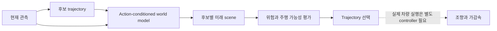
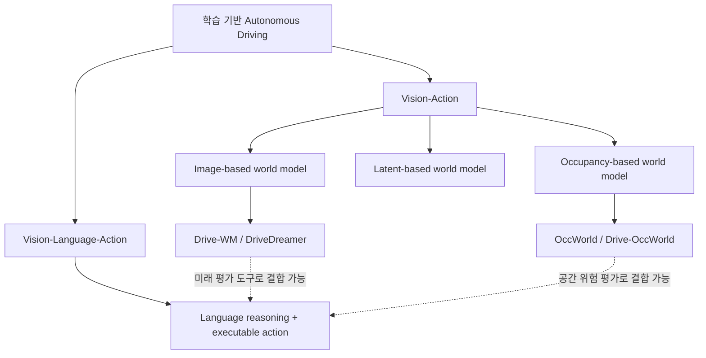
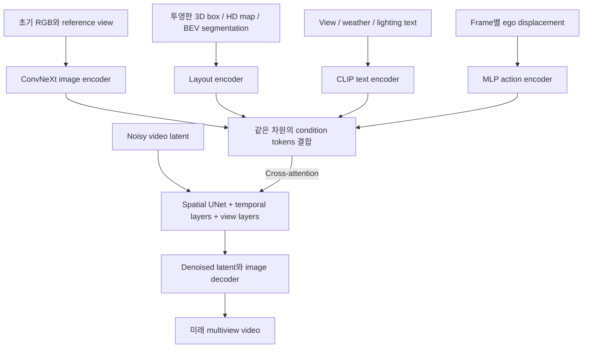
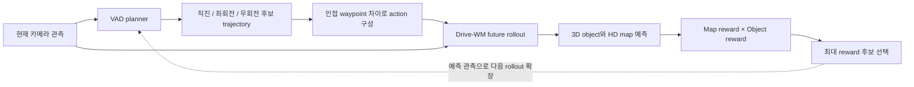
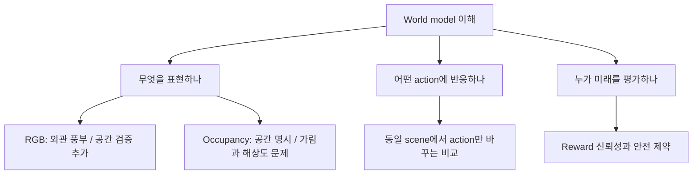

# Week 03. World Model 기초: 미래 영상을 그리는 모델과 미래 공간을 예측하는 모델

- 날짜: 2026-10-27 (Asia/Seoul)
- 주차: 3 / 12
- Deep read: **Drive-WM — Driving into the Future: Multiview Visual Forecasting and Planning with World Model for Autonomous Driving**
- 원문: https://arxiv.org/abs/2311.17918 (v1, 2023-11-29)
- Taxonomy: Vision-Action → Image-Based World Models. 자연어 추론 기반 VLA 자체가 아니라 VLA의 예측·평가 기반 기술입니다.
- Reading mode: Drive-WM HTML 본문 §1–6 및 부록 B/C 정독, DriveDreamer와 Drive-OccWorld 방법·실험 관련 HTML/공식 README 선별 읽기, OccWorld abstract 비교 읽기.
- 이번 주 산출물: world model 유형 비교표, action-conditioned planning 구조도, 평가 해석 matrix.
- 범위: 논문 전체 PDF의 문장별 번역이 아닌 한국어 학습 노트입니다. 핵심 논문은 HTML 원문을 확인했으며 아래 수치는 저자 보고값으로, 이 환경에서 모델을 학습하거나 재현한 결과가 아닙니다. 비교 논문의 읽기 깊이는 서로 다릅니다.

## 1. 이번 주 한 문장 결론

**World model의 주행 가치는 ‘그럴듯한 미래’를 만드는 것보다, 서로 다른 action이 만드는 미래를 구분하고 그 차이를 안전한 trajectory 선택에 연결하는 데 있습니다.**

예를 들어 앞차가 멈췄을 때, 정책 모델은 바로 waypoint를 낼 수 있습니다. World model을 붙이면 먼저 ‘직진할 때’, ‘왼쪽으로 피할 때’의 미래를 예측하고 비교합니다. 단, 예측 영상에서 앞차가 사라지면 오히려 위험한 후보를 선택할 수 있으므로 생성 품질과 안전성은 따로 검증해야 합니다.



## 2. 논문 제목·Abstract 한국어 번역

### 제목

**미래를 향한 주행: 자율주행을 위한 World Model 기반 다중 시점 시각 예측과 Planning**

원제: *Driving into the Future: Multiview Visual Forecasting and Planning with World Model for Autonomous Driving*

### Abstract 번역

자율주행에서 앞으로 일어날 사건을 미리 예측하고 예상 가능한 위험을 평가하면 차량은 행동을 더 잘 계획할 수 있으며, 도로에서의 안전성과 효율성을 높일 수 있습니다. 이를 위해 저자들은 기존 end-to-end planning 모델과 호환되는 최초의 주행 world model이라고 소개하는 **Drive-WM**을 제안합니다. View factorization을 활용한 공동 시공간 모델링을 통해 주행 장면의 고품질 multiview 영상을 생성합니다.

이러한 생성 능력을 바탕으로, 저자들은 안전한 주행 planning에 world model을 적용할 가능성을 처음으로 보여준다고 설명합니다. 구체적으로 Drive-WM은 서로 다른 주행 maneuver에 따라 여러 미래를 생성하고, image-based reward를 이용해 최적의 trajectory를 결정합니다. 실제 주행 데이터셋에서의 평가는 이 방법이 품질이 높고 일관되며 제어 가능한 multiview 영상을 생성할 수 있음을 보여주며, 실제 환경을 위한 simulation과 안전한 planning의 가능성을 제시합니다.

> ‘최초’는 논문 발표 시점의 저자 주장입니다. 실제 도로에서 안전성을 인증했다는 의미도, 2026년 현재 최고 성능이라는 의미도 아닙니다.

### 비교 논문 제목 번역

- **DriveDreamer: 실제 주행 데이터에 기반한 자율주행 World Model을 향하여** — 구조화된 교통 조건과 action을 이용하는 diffusion world model.
- **OccWorld: 자율주행을 위한 3D Occupancy World Model 학습** — occupancy scene token과 ego token으로 미래 공간·trajectory를 함께 예측.
- **Driving in the Occupancy World: 자율주행을 위한 Vision 중심 4D Occupancy 예측과 World Model 기반 Planning** — Drive-OccWorld의 정식 논문 제목. OccWorld와는 별도 연구입니다.

## 3. 핵심 기여 3~5개

1. **시간과 카메라 시점을 함께 다루는 multiview video world model**: 이미지 diffusion backbone에 temporal layer와 multiview layer를 추가해 주변 카메라 영상의 미래를 함께 생성합니다.
2. **View factorization으로 중첩 영역 일관성 개선**: 모든 시점을 단순히 공동 생성하는 대신 reference view를 먼저 만들고, 이웃 reference를 조건으로 stitched view를 생성합니다.
3. **이질적인 조건을 통합하는 unified condition interface**: 초기 이미지, text, layout, ego action을 같은 feature 차원의 token으로 바꿔 denoising UNet에 전달합니다.
4. **기존 planner와 결합하는 미래 평가 구조**: VAD가 제안한 trajectory를 world model에서 rollout하고, 생성 영상의 perception 결과로 reward를 계산해 후보를 선택합니다. 별도로 생성한 OOD 영상으로 planner를 fine-tune하는 실험도 수행합니다.

이 기여들은 각각 **생성 모델**, **공간 일관성**, **조건 인터페이스**, **planning 활용**에 대응합니다. 한 항목의 개선이 나머지 항목의 개선을 자동으로 보장하지는 않습니다.

## 4. VLA for AD taxonomy 위치



| 구분 기준 | Drive-WM의 위치 | 주의할 오해 |
|---|---|---|
| 모델의 주요 출력 | 미래 multiview RGB video | 영상 생성 자체가 실행 가능한 action은 아님 |
| Language role | CLIP text encoding을 통한 날씨·조명·view 조건 | 운전 규칙을 추론하는 LLM CoT가 아님 |
| Action role | 후보 trajectory의 ego displacement를 생성 조건으로 사용 | 세계를 예측하는 action 입력과 정책의 action 출력을 구분 |
| Planning 연결 | 후보 생성 → 미래 생성 → reward → 선택 | generator 단독 end-to-end control이 아님 |
| VLA와의 관계 | VA 계열 world model 기반 기술 | text prompt가 있다고 모두 VLA는 아님 |

**핵심 구분:** 이미지 모델이 VAE latent에서 계산한다고 해서 taxonomy상 latent-based world model로 곧바로 옮겨 분류하지 않습니다. 여기서는 외부로 어떤 scene을 예측하고 planning에 어떻게 연결하는지를 기준으로 구분합니다.

## 5. Architecture / pipeline 시각화

### 5.1 생성 모델 내부



- **Spatial layer**: 각 frame의 형태와 외관을 모델링합니다.
- **Temporal layer**: 같은 view의 시간 변화와 이동을 모델링합니다.
- **View layer**: 같은 시점의 여러 카메라 사이에 정보를 전달합니다.
- **조건 token**: 무엇을 바꾸고 무엇을 유지할지 알려줍니다. Action-based 생성에서는 현재 layout과 미래 ego action을 사용하며, layout-based 생성에서는 frame별 layout을 제공할 수 있습니다. 두 실험 설정을 혼동하면 미래 정보 누출을 놓칠 수 있습니다.

### 5.2 왜 view factorization이 필요한가?

같은 차량이 front와 front-left 카메라에 걸쳐 보인다면, 두 영상에서 차량의 위치·색·움직임이 맞아야 합니다. 스타일이 비슷한 두 장의 이미지만 만드는 것으로는 충분하지 않습니다.

```text
1단계: Joint model → reference videos: Front / Back-Left / Back-Right
2단계: Front + Back-Left → Front-Left stitched video
       Front + Back-Right → Front-Right stitched video
       Back-Left + Back-Right → Back stitched video
결과: 주변 여섯 카메라의 영상 구성
```

Stitched view 생성에는 해당 view의 이전 생성 frame도 조건으로 사용합니다. 완전히 독립된 여섯 영상을 만든 뒤 단순히 붙이는 방식이 아닙니다.

### 5.3 Planning 구조와 본문 section별 요약



| 원문 section | 한국어 요약 | 읽을 때의 질문 |
|---|---|---|
| §1 Introduction | Expert trajectory만 배운 planner는 ego 위치가 벗어나면 실패할 수 있음 | 모델이 action 결과를 실제로 이해하는가? |
| §2 Related Works | 영상 생성과 world-model planning 연구를 연결 | 생성 모델과 정책 모델을 구별했는가? |
| §3 Multi-view Video Generation | Temporal/view layer, factorization, 조건 통합 | 같은 객체가 시간과 카메라 사이에서 유지되는가? |
| §4 World Model for End-to-End Planning | 후보 action의 미래를 생성하고 image-based reward로 선택 | Reward가 실제 위험을 놓치지는 않는가? |
| §5 Experiments | 생성·일관성·제어성 평가와 open-loop planning/OOD 실험 | GT command baseline보다 좋은가, random보다 좋은가? |
| §6 Conclusion | World model을 planning에 연결할 가능성 제시 | 실도로 closed-loop 검증과는 얼마나 떨어져 있는가? |
| 부록 B/C | 학습 schedule, inference, 데이터 준비·action 재표집 | 재현 비용과 학습 분포가 어떻게 구성되는가? |

## 6. Input → Reasoning → Action Grounding 분석

여기서 **Reasoning**은 자연어 사고 과정이 아니라 ‘후보 미래를 생성하고 평가하는 계산’입니다.

| 논문 | Input | Reasoning / dynamics | Action grounding | Language role |
|---|---|---|---|---|
| Drive-WM | 현재 multiview RGB, 현재 layout, text, 후보 ego displacement | Action-conditioned diffusion으로 미래 RGB 생성, perception reward 평가 | 기존 VAD trajectory 후보를 선택. Low-level controller는 별도 문제 | CLIP 기반 생성 조건; 부록 GPT-4V reward 예시는 정성적 탐색 |
| DriveDreamer | 초기 이미지, HD map, 3D box, text 및 action 조건 | 구조 이해 후 미래 video/action 생성 | 행동 생성 실험은 있지만 배포 가능한 controller·closed-loop 안전을 의미하지 않음 | 날씨·시간 등 text prompt로 생성 제어 |
| OccWorld | 과거 3D occupancy와 ego 정보 | Scene tokenizer + GPT-like spatiotemporal token prediction | 미래 ego token을 trajectory로 decode | Abstract에서 언어 추론 모듈을 제안하지 않음 |
| Drive-OccWorld | 과거 multi-camera 관측, BEV memory, action 조건 | Semantic/motion-conditional memory와 world decoder로 occupancy/flow 예측 | 미래 occupancy에 대한 cost로 trajectory 선택 | 수치 action 및 maneuver command는 자연어 reasoning과 다름 |

### Trajectory와 action의 작은 연결 고리

Drive-WM planning 경로에서는 trajectory의 연속 ego 위치 차이를 action으로 둡니다.

`a_t = (x_(t+1) - x_t, y_(t+1) - y_t)`

이 값은 **상대 이동량**이지 throttle·brake 명령이 아닙니다. 좌표계, timestep, 차량의 운동학적 제약을 맞춰야 의미가 있습니다. 부록에는 speed·steering 조건을 바꾸는 생성 예시도 있지만, 본문의 VAD 연결은 displacement 정의를 따릅니다.

### Reward 구성

- **Map reward**: curb와의 거리, centerline consistency로 주행 영역 이탈과 불필요한 횡방향 이동을 억제합니다.
- **Object reward**: 다른 도로 이용자와의 종·횡방향 거리를 평가합니다.
- **Total reward**: 두 reward의 곱. 위험 요소를 관측하는 perception 모델이 실패하면 reward도 잘못될 수 있습니다.

## 7. Training recipe

### 7.1 Drive-WM: 이미지 사전지식 → 시공간 모델 → 활용

| 단계 | 학습 대상과 목적 | 원문에 보고된 설정 |
|---|---|---|
| Conditional image diffusion | Stable Diffusion에서 초기화, scene 조건을 반영하는 image model 학습 | 60,000 iterations, total batch 768, AdamW, learning rate 1e-4 |
| Multiview temporal tuning | Spatial parameters를 freeze하고 temporal/view layers 학습 | 40,000 iterations, batch 32, clip length 8, AdamW, learning rate 5e-5 |
| Factorized model | 이웃 reference와 이전 frame으로 stitched view 생성 | Reference image 조건을 추가; 학습 시 stitched view 하나를 생성 |
| Condition dropout | Classifier-free guidance를 위한 조건 없는 경우 학습 | 각 condition을 확률 20%로 drop |
| Inference | 반복 denoising으로 영상 생성 | DDIM 50 steps, eta 1.0, CFG 5.0 |
| OOD planner fine-tuning | 생성한 편향 관측에서 복귀 trajectory 학습 | Ego 위치를 횡방향 0.5 m 이동시킨 상황 |

- **데이터**: nuScenes train 700 scene / validation 150 scene, 여섯 surround cameras. 원본 1600×900에서 상단을 잘라 1600×800으로 만든 뒤 384×192로 resize합니다.
- **학습 장비**: A40 48 GB GPU 사용. 본 노트에서는 확인하지 않은 GPU 수·총 학습 시간을 추정하지 않습니다.
- **Action 조건 supervision**: 학습은 GT ego movement, planning inference는 VAD 출력 사용. 이 차이 자체가 distribution shift입니다.
- **불균형 보정**: 드문 steering/speed 조합을 재표집합니다. 다만 동일 rare clip을 반복하는 것과 새로운 rare event를 관측하는 것은 다릅니다.
- **중요한 구분**: generator의 diffusion 학습과 planner fine-tuning은 별도 단계입니다. 전체를 RL로 학습했다고 읽으면 안 됩니다.

### 7.2 비교 논문의 학습 방식

| 논문 | Training recipe | 이번 읽기의 확인 범위 |
|---|---|---|
| DriveDreamer | 1단계에서 single-frame 구조 조건 학습 후 video로 확장; 2단계에서 초기 관측·action을 이용한 미래 video/action 예측 | HTML 방법과 condition encoder 부록 선별 확인. 세부 schedule은 생략 |
| OccWorld | Reconstruction-based occupancy scene tokenizer를 학습하고, discrete scene/ego token의 미래를 generative transformer로 모델링 | Abstract 확인. Loss 계수·optimizer·epoch는 이번에 확인하지 않음 |
| Drive-OccWorld | BEVFormer 계열 historical encoder, memory, world decoder 및 occupancy/flow prediction 학습 | HTML 부록 C.3: AdamW, 초기 learning rate 2e-4, cosine scheduler, A100 8장; 과거 multi-view 입력으로 미래 2초 예측 |

재현할 때는 Drive-OccWorld의 inflated occupancy와 fine-grained occupancy 설정을 분리해야 합니다. 공식 문서도 GMO/MMO 및 static-object 포함 여부에 따라 config를 나눕니다. 서로 다른 voxel/label 정의의 mIoU는 직접 비교하지 않습니다.

## 8. Dataset / Benchmark / Metric 분석

### 8.1 Drive-WM 평가 matrix

| 평가 대상 | Dataset / 설정 | Metric | 의미 | 보장하지 않는 것 |
|---|---|---|---|---|
| 외관 품질 | nuScenes validation | FID ↓ | 생성 이미지와 실제 이미지 feature 분포의 유사성 | 장애물 위치의 정확성 |
| 영상 품질 | nuScenes validation | FVD ↓ | 영상 feature 분포의 유사성 | action의 물리적 인과성 |
| 시점 일관성 | 인접 카메라 중첩 영역 | KPM ↑ | 생성 영상의 matched keypoint 수를 실제 영상에 대한 비율로 평가 | 모든 3D geometry의 정확성 |
| 조건 준수 | 생성 영상을 perception 모델에 입력 | Object/map mAP, foreground/background mIoU | 주어진 layout이 인식 결과로 복원되는 정도 | perception 밖의 위험·미지 객체 |
| Planning | nuScenes 기록 기반 open-loop | GT trajectory L2 ↓, collision rate ↓ | 기록된 scene에서 후보 trajectory 평가 | ego 행동에 반응하는 traffic과 장기 안전성 |
| OOD 복귀 | Ego lateral shift 0.5 m | L2, collision rate | 제한된 위치 편향에 대한 fine-tuning 효과 | 일반적인 모든 long-tail 대응 |

### 8.2 원문 표에서 읽어야 하는 실제 수치

Drive-WM v1 **Table 2(c)**, layout-based video generation ablation:

| 설정 | KPM (%) ↑ | FVD ↓ | FID ↓ |
|---|---:|---:|---:|
| Joint modeling | 45.8 | 122.7 | 15.8 |
| Factorized generation | 94.4 | 116.6 | 16.4 |

Factorization은 KPM과 FVD를 개선하지만 FID는 약간 나빠집니다. 따라서 ‘모든 품질 지표가 개선’이라고 요약하면 틀립니다. KPM 94.4%는 안전 성공률이 아닙니다.

Drive-WM v1 **Table 3**, 1/2/3초 결과의 논문 보고 Avg:

| Planning 설정 | Avg L2 (m) ↓ | Avg collision (%) ↓ |
|---|---:|---:|
| VAD, GT command | 0.72 | 0.22 |
| VAD, random command | 1.02 | 0.93 |
| Drive-WM 기반 command 선택 | 0.80 | 0.26 |

**해석:** 미래 평가를 이용한 선택은 random command보다 좋지만, 올바른 GT command가 주어진 VAD보다 좋지는 않습니다. ‘VAD를 전반적으로 능가했다’고 말할 근거가 아닙니다.

Drive-WM v1 **Table 5**, 위치 편향 OOD 실험:

| 상황 | Avg L2 (m) ↓ | Avg collision (%) ↓ |
|---|---:|---:|
| 정상 관측 | 0.72 | 0.22 |
| 0.5 m lateral shift | 1.02 | 1.59 |
| Shift + generated-data fine-tuning | 0.82 | 0.91 |

개선은 있지만 정상 관측 수준의 collision으로 회복되지는 않습니다. 이 fine-tuning 효과와 Table 3의 rollout 후보 선택 효과는 서로 다른 실험입니다.

### 8.3 비교 논문의 evaluation 범위

| 논문 | 확인한 dataset / benchmark | 확인한 평가 관점 | Closed-loop 해석 |
|---|---|---|---|
| DriveDreamer | nuScenes | FID/FVD 생성 평가, 구조 제어, downstream 3D detection 활용 및 driving action 생성 실험 | 이번에 확인한 자료로 상호작용 closed-loop 안전을 입증했다고 보지 않음 |
| OccWorld | nuScenes | 미래 occupancy와 ego planning; instance/map supervision 없이 경쟁력 있다는 abstract 주장 | Abstract만으로 closed-loop 검증 유무·성과를 단정하지 않음 |
| Drive-OccWorld | nuScenes, nuScenes-Occupancy, Lyft-Level5 | Occupancy forecasting mIoU와 trajectory L2/collision 등 | Continuous forecasting/planning 데모를 reactive traffic closed-loop benchmark와 동일시하지 않음 |

> **Open-loop**는 기록된 세계 위에서 예측을 비교합니다. **Closed-loop**는 ego 실행이 다음 관측과 다른 agent 반응에 영향을 줍니다. World model 내부에서 반복 rollout하는 것만으로 후자의 검증을 대체할 수 없습니다.

## 9. 관련 논문 비교표

### 9.1 World model 유형 비교 — 이번 주 핵심 산출물

| 유형 | 주요 예측 공간 | 대표 논문 | Planning 연결 | 장점 | 핵심 위험 |
|---|---|---|---|---|---|
| Image-based | 미래 RGB / multiview video | Drive-WM, DriveDreamer | 생성 영상 재인식 → reward, 또는 action 생성·데이터 증강 | 외관·날씨·복잡한 시각 현상을 표현 | 생성 hallucination, multiview 불일치, 긴 inference |
| Occupancy-based | 미래 3D semantic occupancy와 시간 변화 | OccWorld, Drive-OccWorld | Ego trajectory decoding 또는 occupancy cost | 공간 충돌·가용 공간과 직접 연결 | voxel 양자화, 가려진 공간 불확실성, label 비용 |
| Latent-based | 압축된 hidden state의 dynamics | 일반적인 Dreamer 계열 관점 | Latent rollout의 value/reward로 policy 학습 | 매번 RGB 전체를 생성할 필요가 적음 | 해석·안전 검사 어려움, latent가 위험 요소를 버릴 수 있음 |

마지막 행은 유형 이해를 위한 일반론이며 이번 주 추가 deep-read 논문은 아닙니다. Occupancy도 내부 latent를 쓸 수 있으므로 세 유형을 ‘사용하는 신경망 부품이 완전히 배타적’이라고 이해하지 마십시오.

### 9.2 논문별 차이

| 질문 | Drive-WM | DriveDreamer | OccWorld | Drive-OccWorld |
|---|---|---|---|---|
| 핵심 설계 | Multiview diffusion + view factorization | 구조 조건을 배우는 diffusion + 미래 예측 | Occupancy tokenizer + GPT-like dynamics | BEV memory + world decoder |
| Scene 출력 | Multiview RGB video | Driving video | 3D occupancy | 4D occupancy와 flow |
| Action 사용 | 후보 displacement로 미래 생성 | Action 조건과 미래 action 생성 | Ego token의 미래 예측 | Velocity/steering/trajectory/command 조건 |
| Planner 연결 | 기존 VAD 후보의 image-based reward 선택 | 생성 및 policy 가능성 탐색 | Ego trajectory decode | Occupancy-based cost로 선택 |
| 자연어 reasoning | 핵심 구조 아님 | 핵심 구조 아님 | 이번 abstract에 제시되지 않음 | 핵심 구조 아님 |
| 논문을 읽는 깊이 | 본문·학습 부록 deep read | 방법·실험 skim | Abstract skim | 방법·학습·평가 skim |

**버전 주의:** DriveDreamer의 text prompt와 DriveDreamer-2의 LLM 활용을 섞지 않습니다. 또한 Drive-OccWorld 저장소는 후속 IR-WM도 안내하므로 이번 노트의 대상 arXiv ID는 **2408.14197**로 고정합니다.

## 10. 강점과 한계

### 강점

- 기존 planner를 교체하지 않고 후보 평가에 world model을 연결한다는 점이 실용적인 연구 출발점입니다.
- 단일 전방 카메라를 넘어 주변 multiview 일관성을 명시적으로 다룹니다.
- 생성 영상이 planner 학습에 유용한지 OOD fine-tuning 실험으로 따로 확인합니다.
- 이미지 외관과 공간 표현을 비교하면, 어떤 예측 공간이 downstream task에 필요한지 질문할 수 있습니다.

### 한계와 안전·long-tail 위험

| Failure mode | 왜 위험한가 | 추가 검증 또는 완화 아이디어 — 학습자 제안 |
|---|---|---|
| 작은 보행자가 생성 중 사라짐 | Reward가 충돌 없는 미래로 오판 | 작은 객체 조건별 recall, 보수적인 occupancy fallback |
| 가려진 객체 미래를 한 가지로 고정 | 드물지만 치명적인 미래를 제외 | 여러 future sample, risk-sensitive 후보 선택 |
| 생성 영상의 perception 오류 | Generator와 detector의 편향이 결합 | 서로 다른 evaluator, 실제 scene 기반 검증 |
| 장기 rollout drift | 초기 작은 오차가 이후 판단을 왜곡 | Horizon별 error와 실제 관측 재동기화 |
| 후보 자체가 잘못됨 | Selector는 없는 안전 trajectory를 고를 수 없음 | 비상 감속 후보, kinodynamic feasibility 검사 |
| 알려지지 않은 상황을 그럴듯하게 생성 | 시각적 자연스러움을 물리적 타당성으로 착각 | Action intervention consistency 및 OOD 검사 |
| Diffusion과 tree search latency | 판단이 완료되기 전에 scene이 바뀜 | 전체 pipeline latency 및 tail latency 측정 |
| 0.5 m 편향 결과의 과도한 일반화 | 무단횡단·공사·센서 고장까지 해결했다고 오인 | Failure taxonomy별 시나리오 평가 |

논문은 DDIM sampling 50 steps를 사용합니다. 이것만으로 정확한 주행 FPS를 계산할 수는 없지만, 매 후보마다 영상을 생성·재인식하는 비용을 반드시 따져야 합니다. GPT-4V reward의 부록 예시도 안전 인증된 evaluator로 취급하지 않습니다.

## 11. 실전 학습 포인트

### 11.1 세 가지 질문으로 구현을 읽기

1. **Observation model:** 모델은 무엇을 세계의 상태로 보나요? RGB, occupancy, hidden state 중 무엇인가요?
2. **Transition model:** 같은 관측에 다른 action을 넣었을 때 미래가 의미 있게 달라지나요?
3. **Decision rule:** 그 미래가 어떤 reward/cost를 거쳐 실행 가능한 trajectory 선택으로 바뀌나요?



### 11.2 따라 해 볼 사고 실험

**상황:** 앞차가 정지했고 왼쪽 차로 후방에서 다른 차가 다가옵니다.

- 전방 영상만 보면 왼쪽 회피가 좋아 보입니다.
- Multiview world model은 왼쪽·후방 정보를 유지해야 합니다.
- Occupancy world model은 현재 공간뿐 아니라 접근 차량의 미래 점유를 예측해야 합니다.
- Planner는 ‘충돌이 없는가’ 외에도 회피 trajectory의 실행 가능성과 감속 후보를 비교해야 합니다.

| 점검 질문 | 좋은 답의 기준 |
|---|---|
| 미래 영상이 예쁘면 충분한가? | 아니요. 위험 객체와 기하·action 반응을 별도로 확인 |
| Occupancy가 있으면 안전한가? | 아니요. Unknown/free 구분과 uncertainty가 필요 |
| 텍스트 ‘왼쪽으로 피해’가 action인가? | 방향 지시일 뿐. 수치 trajectory와 controller 연결 필요 |
| 내부 rollout이 closed-loop인가? | 학습된 모델 안의 rollout과 외부 상호작용 benchmark를 구별 |

### 11.3 재현 실험 설계 초안 — 이번 실행에서는 미수행

- 동일 관측에서 직진·감속·회피 후보를 고정합니다.
- Action만 바꾸고 생성 scene이 얼마나 일관되게 반응하는지 확인합니다.
- 후보별 작은 객체 보존, 미래 occupancy 충돌, route 준수, latency를 기록합니다.
- GT future layout을 쓰는 oracle 설정과 실제 사용 가능한 현재 정보 설정을 나눕니다.
- 최종적으로 reactive simulator에서 충돌·위반·comfort·route completion을 확인합니다.

연구 아이디어는 **‘VLM은 후보 maneuver를 제안하고, world model은 미래를 예측하며, 별도 safety checker가 수치 trajectory를 검증’**하는 구조입니다. 이는 이번 논문이 검증한 시스템이 아니라 다음 단계의 설계 가설입니다.

## 12. 다음 주 질문

다음 주 **Week 04 — Early VLA와 explainable driving**, deep read는 **DriveLM: Driving with Graph Visual Question Answering**입니다.

- ‘앞차가 정지했으므로 감속한다’라는 설명은 실제 action 선택의 원인인가요, 사후 설명인가요?
- Graph VQA의 perception → prediction → planning 연결은 오늘의 world-model pipeline과 어떻게 다른가요?
- Language가 틀렸을 때 trajectory도 바뀌는지 어떤 intervention으로 검사할 수 있나요?
- DriveGPT4·DriveMLM의 텍스트 출력과 수치 action grounding을 어떻게 구분해야 하나요?
- World model의 위험 예측과 VLM 설명이 충돌할 때 어떤 모듈을 신뢰해야 하나요?

## 13. 참고 링크

### Primary / deep read

1. Drive-WM abstract: https://arxiv.org/abs/2311.17918
2. Drive-WM v1 HTML — §3 구조, §4 planning, Table 2/3/5, 부록 B/C: https://arxiv.org/html/2311.17918v1
3. Drive-WM project: https://drive-wm.github.io/
4. Drive-WM code: https://github.com/BraveGroup/Drive-WM

### Comparison / skim

5. DriveDreamer abstract: https://arxiv.org/abs/2309.09777
6. DriveDreamer v2 HTML: https://arxiv.org/html/2309.09777v2
7. DriveDreamer 공식 README: https://github.com/JeffWang987/DriveDreamer
8. OccWorld abstract — 이번에는 abstract 수준 확인: https://arxiv.org/abs/2311.16038
9. Drive-OccWorld abstract: https://arxiv.org/abs/2408.14197
10. Drive-OccWorld v3 HTML: https://arxiv.org/html/2408.14197v3
11. Drive-OccWorld 공식 저장소: https://github.com/yuyang-cloud/Drive-OccWorld
12. Drive-OccWorld 학습·평가 설정: https://github.com/yuyang-cloud/Drive-OccWorld/blob/main/DOCS/TRAIN_EVAL.MD

### Taxonomy / 다음 주

13. VLA4AD taxonomy: https://worldbench.github.io/vla4ad
14. Awesome VLA for AD — taxonomy와 논문 식별에 사용: https://github.com/worldbench/awesome-vla-for-ad
15. 다음 주 DriveLM: https://arxiv.org/abs/2312.14150

---

**학습 체크:** ‘미래를 생성한다’, ‘후보 action을 평가한다’, ‘실제로 차를 제어한다’의 차이를 설명할 수 있으면 이번 주 핵심을 이해한 것입니다.
