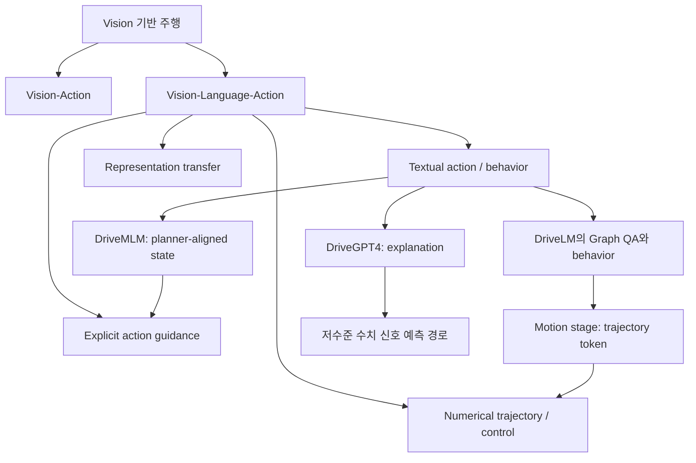
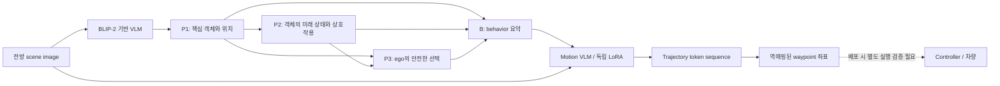
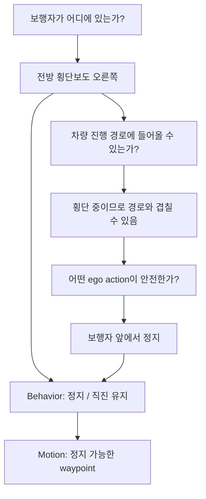
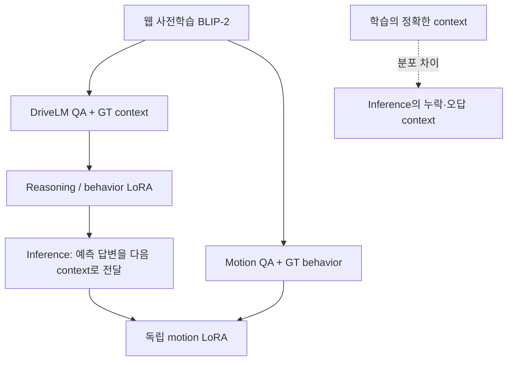
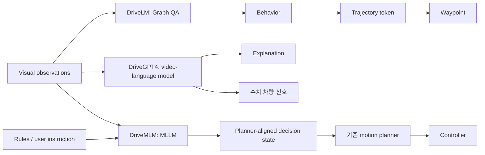

# Week 04. 초기 VLA와 설명 가능한 주행: 말에서 실행 가능한 action으로

- 날짜: 2026-11-03 (Asia/Seoul)
- 주차: 4 / 12 — Early VLA와 explainable driving
- 집중 논문: **DriveLM: Driving with Graph Visual Question Answering**
- 한국어 제목: **DriveLM: 그래프 시각 질의응답을 활용한 자율주행**
- 원문: https://arxiv.org/abs/2312.14150
- 읽은 버전: [arXiv HTML v3](https://arxiv.org/html/2312.14150v3), 2025-01-16 개정본, ECCV 2024 Oral
- 비교 논문: DriveGPT4 v5, DriveMLM v3
- Taxonomy: Graph VQA 기반 reasoning + textual behavior + tokenized numerical trajectory
- Reading mode: DriveLM 본문·부록 집중 읽기, 비교 논문 abstract·HTML 발췌 skim, 공식 README 및 VLA4AD taxonomy 확인
- 이번 주 산출물: **Explanation VLA vs Action VLA 구분표**, action grounding 지도, 평가 해석 체크리스트

> **읽기 범위와 근거:** PDF 전체 줄별 번역이 아니라 접근 가능한 HTML 본문과 부록을 바탕으로 작성한 학습 노트입니다. 초록 번역은 HTML v3의 Abstract를 기준으로 합니다. arXiv abstract 페이지와 HTML 본문에는 일부 문구 차이가 있습니다. 수치는 DriveLM v3 Table 1·2·4·11을 기준으로 하며, 서로 다른 benchmark의 수치를 단일 순위로 합치지 않습니다. 아래의 가상 주행 예시·실험 제안은 논문 결과와 구분해 표시합니다.

## 1. 이번 주 한 문장 결론

**주행 이유를 자연스럽게 설명하는 능력과 실제로 안전한 action을 만드는 능력은 다르며, DriveLM은 `Graph VQA → behavior → trajectory token`이라는 연결을 제시했지만 주된 실험 근거는 open-loop이므로 closed-loop 안전성까지 입증한 것은 아닙니다.**

지난주 world model이 “이 action을 하면 미래가 어떻게 달라지는가?”를 다뤘다면, 이번 주는 “무엇을 보고 왜 그렇게 판단했으며 그 판단을 어떤 action 표현에 연결하는가?”를 다룹니다. DriveLM의 prediction QA는 언어로 미래 상태를 답하는 것이지, action-conditioned world model의 rollout과 같지 않습니다.

## 2. 논문 제목·Abstract 한국어 번역

### 제목

**DriveLM: 그래프 시각 질의응답을 활용한 자율주행**

### Abstract 한국어 번역 — HTML v3 기준

웹 규모 데이터로 학습한 vision-language model(VLM)을 end-to-end 주행 시스템에 통합하여 일반화 능력을 높이고 사람과의 상호작용을 가능하게 하는 방법을 연구합니다. 기존 접근법은 단일 라운드의 visual question answering(VQA)으로 VLM을 주행에 적용하지만, 사람 운전자는 여러 단계를 거쳐 의사결정을 추론합니다. 핵심 객체의 위치를 파악한 뒤 객체 간 상호작용을 예상하고 행동을 결정합니다.

핵심 아이디어는 perception, prediction, planning의 질문·답변 쌍을 통해 그래프 구조의 reasoning을 모델링하는 **Graph VQA**라는 과제를 제안하면, 사람의 reasoning 과정을 모사하기에 적합한 대리 과제(proxy task)를 얻을 수 있다는 것입니다. 이를 위해 nuScenes와 CARLA에 기반한 데이터셋인 DriveLM-Data를 구축하고, Graph VQA와 end-to-end 주행을 함께 수행하는 VLM 기반 baseline인 DriveLM-Agent를 제안합니다.

실험을 통해 Graph VQA가 주행 장면을 reasoning하는 단순하고 원칙적인 틀을 제공하며, DriveLM-Data가 이 과제를 위한 도전적인 benchmark임을 보입니다. DriveLM-Agent baseline은 주행 전용 최신 아키텍처와 비교해 경쟁력 있는 end-to-end 자율주행 성능을 보입니다. 특히 학습에서 보지 못한 센서 구성에 zero-shot으로 적용할 때 장점이 두드러집니다. 질문별 ablation에서는 그래프 구조에 포함된 풍부한 prediction·planning QA annotation이 성능 향상에 기여하는 것으로 나타났습니다. 모든 데이터, 모델, 공식 평가 서버는 프로젝트 GitHub에서 제공합니다.

> **번역과 검증의 구분:** 마지막 공개 범위는 초록의 저자 주장입니다. 실제 README에는 DriveLM-Agent 및 CARLA inference 관련 미완료 TODO가 남아 있으므로, 모든 실행 경로가 완전 공개·재현 가능하다고 단정하지 않습니다.

## 3. 핵심 기여 3~5개

1. **단발성 VQA를 Graph VQA로 확장했습니다.** QA pair를 노드로, 논리 의존성을 방향 간선으로 표현합니다. 객체 하나에 대한 질문뿐 아니라 서로 다른 객체 사이의 영향도 연결합니다.
2. **주행의 여러 reasoning 단계를 하나의 과제로 정리했습니다.** Perception(P1), Prediction(P2), Planning(P3), Behavior(B), Motion(M)을 구분해 장면 이해에서 trajectory까지 이어지는 인터페이스를 만듭니다.
3. **DriveLM-Data와 단계별 평가 체계를 제시했습니다.** nuScenes의 human-in-the-loop annotation과 CARLA의 rule-based annotation을 사용하고, QA·behavior·motion을 서로 다른 metric으로 평가합니다.
4. **기존 VLM을 활용하는 간단한 baseline을 제시했습니다.** BLIP-2에 parent QA context를 붙이고 LoRA로 fine-tuning하며, 별도의 motion LoRA와 trajectory tokenization으로 수치 출력을 연결합니다. Graph neural network를 새로 발명한 논문은 아닙니다.
5. **일반화와 병목을 실험으로 드러냈습니다.** Waymo zero-shot에서는 Graph context의 이점이 있지만 in-domain에서는 항상 우세하지 않습니다. 미관측 보행자 실험은 언어 사전학습만으로 안전 문제가 해결되지 않음을 보여줍니다.

## 4. VLA for AD taxonomy 위치

### 분류 라벨보다 출력 인터페이스를 먼저 확인하기

VLA4AD/awesome 목록은 DriveLM·DriveGPT4·DriveMLM을 Textual Action Generator 항목에 배치합니다. 그러나 이 라벨만으로 실제 numerical output이 없다고 해석하면 틀립니다. **서베이의 분류 단위와 논문 내부의 실행 경로를 함께 읽어야 합니다.**



| 구분 축 | DriveLM의 위치 | 혼동하면 안 되는 점 |
|---|---|---|
| Language 역할 | 객체별 scene reasoning, 단계별 context, behavior 표현 | 설명이 있다는 것과 설명이 action의 충실한 원인이라는 것은 다름 |
| 구조 | P1→P2→P3→B→M의 단계적 VLM 호출 | 모든 단계를 하나의 forward pass에서 동시에 수행하는 구조가 아님 |
| Action 표현 | 언어 behavior와 tokenized waypoint | “감속하세요”라는 문장만 출력하는 시스템이 아님 |
| Grounding | trajectory 좌표를 discrete bin과 token에 대응 | token 복원만으로 동역학적 실행 가능성·충돌 회피가 보장되지는 않음 |
| World model 여부 | 미래 객체 상태를 QA로 예측 | action-conditioned scene generation 모델과 다름 |
| Dual-system 여부 | reasoning/motion에 독립 LoRA를 쓰는 다단계 baseline | 별도 고속 safety planner가 항상 병행하는 전형적인 dual-system과 동일시하지 않음 |

### Explanation VLA vs Action VLA 구분표 — 이번 주 핵심 산출물

여기서 두 이름은 이해를 위한 **기능적 구분**이며, 서로 배타적인 공식 모델 계열명은 아닙니다.

| 확인 항목 | Explanation 중심 기능 | Action-grounded 기능 |
|---|---|---|
| 대표 출력 | “보행자가 있어 감속한다” | planner state, trajectory, control signal |
| 사용자 가치 | 이해·대화·디버깅 | 차량이 실제로 수행할 목표 생성 |
| 필수 연결 | 영상↔언어 의미 정합성 | 언어/시각↔실행 인터페이스의 정의 |
| 기본 평가 | QA accuracy, SPICE, GPT Score | trajectory error, state accuracy, control error |
| 추가로 필요한 검증 | 설명이 관측에 근거하는가 | closed-loop collision·진행·규칙 준수·latency |
| 대표 실패 | 보이지 않는 보행자를 설명에 추가 | 설명은 정지인데 trajectory는 계속 전진 |
| DriveLM | Graph VQA와 behavior에서 구현 | motion tokenizer와 waypoint에서 구현 |
| DriveGPT4 | 행동 설명·정당화·질의응답 | 수치 차량 신호 예측도 수행; 설명 전용으로 분류하면 부정확 |
| DriveMLM | decision 설명 | 표준화된 behavior state를 기존 planner에 연결 |

## 5. Architecture / pipeline 시각화

### 5.1 Graph VQA: 질문의 순서가 아니라 의존성의 구조



- QA 노드는 `질문 q + 답 a`입니다. 간선은 parent QA의 결과가 child QA의 context로 들어간다는 뜻입니다.
- **Task-level edge:** perception의 결과를 prediction·planning에 활용합니다.
- **Object-level edge:** 보행자에 대한 관측이 다른 차량의 움직임과 ego 판단에 영향을 줄 수 있습니다.
- 구현은 graph message-passing network가 아니라 **parent QA를 `Context:` 뒤에 붙이는 prompting**입니다.
- 학습은 가용 QA를 사용하지만 inference에서는 heuristic으로 선택한 subgraph를 사용할 수 있습니다. 따라서 graph 크기와 latency는 설계 선택입니다.

### 5.2 학습용 가상 예시: 횡단보도 앞 보행자



이 예시는 논문 결과를 그대로 옮긴 것이 아닙니다. “정지”라는 문장을 정확히 만들었더라도 M 단계가 충분한 제동 거리를 반영하지 못하면 실패합니다. 반대로 action이 안전해도 설명이 실제 결정 원인을 충실히 반영하는지는 별도 검증이 필요합니다.

### 5.3 Motion tokenization

```text
학습 trajectory의 좌표 분포
  → x·y 각 축을 256 discrete bin으로 구분
  → 선택한 vocabulary token ID에 bin을 대응
  → SOT + 좌표 token sequence + EOT
  → 모델이 token을 예측
  → bin/좌표 역매핑
  → waypoint trajectory
```

부록은 기존 numeric token 중 single-digit token을 제외하고 256개 ID를 선택하는 방식을 설명합니다. 여기서 256은 **미래 경로 후보 256개**가 아니라 좌표 축의 discretization 해상도입니다. 좌표 단위·범위·시간 간격·frame 변환을 잘못 연결하면 그럴듯한 token도 잘못된 실제 경로가 됩니다.

## 6. Input → Reasoning → Action Grounding 분석

| 단계 | Input | 출력 | Language 역할 | Action grounding 수준 | 주요 실패 |
|---|---|---|---|---|---|
| P1 perception | image + 객체 질문 | 객체·위치 설명 | 시각 evidence를 언어로 표현 | 객체 grounding | 작은 보행자 누락, 위치 혼동 |
| P2 prediction | image + parent QA | 예상 이동·상호작용 | 미래 위험 추론 | 간접 연결 | 단일 프레임에서 속도 추정 오류 |
| P3 planning | image + 이전 QA | 가능한 안전 행동 | 객체별 대응 판단 | 아직 언어 수준 | 충돌 가능성을 놓침 |
| B behavior | image + P1~P3 context | discretized driving behavior | reasoning을 결정으로 압축 | 의미적 action 연결 | 설명과 behavior 불일치 |
| M motion | image + behavior | trajectory tokens → waypoints | behavior 조건부 수치 출력 | numerical grounding | quantization, 경로 불연속, infeasible trajectory |
| 실행 검증 | waypoints + 차량 상태 | 실제 제어와 다음 관측 | 언어 이외 안전 인터페이스 필요 | closed-loop 실행 | latency·제동·센서 오류 누적 |

**주의:** 데이터셋이 multi-view 이미지를 포함한다는 사실과 baseline이 모든 view를 사용한다는 사실은 다릅니다. 본문의 주요 VLM 주행 비교는 front-view 입력을 사용합니다. Waymo 실험에서 UniAD-Single은 rear camera 입력을 제거하므로 sensor/domain shift의 영향을 함께 받습니다.

학습용 점검 원칙:

> `설명 품질` ≠ `behavior 정확도` ≠ `trajectory 정확도` ≠ `closed-loop 안전성`

각 화살표를 연결하는 인터페이스와 각각의 실패율을 따로 기록해야 합니다.

## 7. Training recipe

### 7.1 DriveLM

| 항목 | 원문에서 확인한 설정 | 학습상 의미 |
|---|---|---|
| 출발 모델 | BLIP-2, 상세 baseline은 blip-2-flan-t5-xl | 웹 규모 사전학습을 주행에 재사용 |
| Fine-tuning | LoRA | 전체 backbone을 처음부터 학습하는 방식이 아님 |
| Context 학습 | ground-truth parent QA를 쓰는 teacher forcing | inference의 잘못된 예측 context와 분포 차이 발생 |
| Motion stage | 동일 VLM architecture, 독립 LoRA; motion QA만 사용 | reasoning stage와 파라미터 업데이트 경로를 구분 |
| nuScenes | 10 epochs, GPU당 batch size 2, 8 V100, 약 7시간 | 저자 환경의 시간이며 재현 보장값 아님 |
| CARLA | train keyframe으로 6 epochs, 4 A100, 약 6시간 | 전체 frame 규모와 실제 학습 subset을 구분 |
| Optimizer 관련 공개값 | learning rate 0.0001, scheduler 없음, seed 1234 | 부록 0.F.1 기준; 미확인 세부값은 임의로 채우지 않음 |
| Sequence length | 최대 400 | context 확대 시 잘림과 비용 고려 |
| 미관측 보행자 실험 | CARLA와 COCO·GQA 샘플을 함께 활용 | 일반 시각 데이터의 지식 재사용; 모든 실험의 공통 recipe는 아님 |



**Teacher forcing의 함정:** 학습 때 P1이 항상 맞았다고 가정하고 P2를 학습하면, 배포 때 P1이 보행자를 놓쳤을 때 downstream이 회복하지 못할 수 있습니다. 이 논문을 읽을 때 “단계가 더 많아져 설명 가능하다”와 “단계별 오류가 더 잘 제어된다”를 분리해야 합니다.

### 7.2 비교 논문 recipe — skim 범위

- **DriveGPT4:** ChatGPT를 활용한 주행 visual instruction data와 일반 instruction data로 mix-finetuning합니다. HTML v5에는 56K 주행 video-text 예제와 223K 일반 instruction 예제를 기술하며, 효율을 위해 일반 데이터 fine-tuning 뒤 domain-specific fine-tuning을 수행한다고 설명합니다. 이를 무조건 단일 혼합 batch 학습으로 해석하지 않습니다.
- **DriveMLM:** data engine으로 decision state와 설명 annotation을 수집하고, MLLM이 기존 modular stack의 behavior-planning state를 출력하도록 학습합니다. 핵심은 기존 motion planner와 state 의미를 맞추는 supervised alignment입니다. 이번 skim에서는 optimizer·batch·epoch의 세부 recipe를 완전 재현 수준으로 확인하지 않았습니다.
- 세 논문의 핵심을 모두 RL이라고 묶으면 안 됩니다. 이 주차의 중심은 QA/instruction supervision과 action 인터페이스의 정렬입니다.

## 8. Dataset / Benchmark / Metric 분석

### 8.1 데이터와 annotation

DriveLM v3 Table 1 기준입니다. QA category별 합계에는 반올림이 있으므로 전체 합계를 정확한 정수처럼 재계산하지 않습니다.

| 데이터 | Frame 수 | 평균 QA / frame | Annotation 성격 | 적합한 분석 |
|---|---:|---:|---|---|
| DriveLM-nuScenes | 4,871 | 91.4 | semi-rule-based + human annotation, 다회 quality check | 실제 장면에서 GVQA·behavior·open-loop motion |
| DriveLM-CARLA 전체 | 64,285 | 24.4 | PDM-Lite expert 기반 rule-based 생성 | simulation annotation과 task transfer |
| DriveLM-CARLA keyframe | 5,721 | 24.8 | 전체 데이터의 keyframe subset | 논문 baseline의 학습 규모 확인 |
| Waymo 평가 subset | 1,000 sampled frames | 해당 없음 | nuScenes 학습 후 zero-shot 평가 | sensor/domain shift에 대한 open-loop 일반화 |
| DriveLM-CARLA-ped | 이 표에서는 미기재 | 해당 없음 | 주행 학습에 없던 보행자 장면 | 미관측 객체 behavior 실패 분석 |

CARLA-ped의 “unseen pedestrian”은 **driving train/validation split에 없었다는 뜻**입니다. 웹 사전학습과 COCO·GQA에 보행자가 전혀 없었다는 뜻이 아닙니다.

### 8.2 평가 matrix

| 평가 층위 | Metric / protocol | 무엇을 확인하는가 | 확인하지 못하는 것 |
|---|---|---|---|
| P1~P3 QA | SPICE, GPT Score | 구조적·의미적 답변 정합성 | 실제 제어 안전성, reasoning의 causal faithfulness |
| Behavior | 전체 / speed / steer accuracy | 원하는 이산 의사결정과 일치하는가 | 수치 경로와 제동 타이밍 |
| Motion | ADE, FDE, predicted-trajectory collision | 기록된 미래와의 차이·경로 위험 | action 후 환경이 반응할 때의 실제 안전성 |
| Zero-shot Waymo | 재학습 없는 open-loop 평가 | dataset/sensor 변화 견딤 | 모든 센서 배치·날씨에서의 일반화 |
| CARLA-ped | behavior accuracy | 새로운 보행자에 대한 정지 판단 | 긴 route의 closed-loop collision rate |
| 배포 검증 — 추가 필요 | closed-loop route completion, collision, 규칙 위반, latency | 반복 관측·행동 하의 시스템 안전성 | 실제 도로 안전을 완전 보장하지는 않음 |

GPT Score는 question·정답·예측·채점 prompt를 ChatGPT-3.5에 제공하는 방식입니다. 사람에게 그럴듯한 답을 선호할 수 있으며, judge 버전·prompt·반복 변동성이 재현성에 영향을 줍니다.

### 8.3 Open-loop Table 2를 정확하게 읽기

ADE는 낮을수록 좋습니다. 아래는 원문의 ADE 열만 발췌한 값이며 같은 표의 collision 열과 혼합하지 않습니다.

| 모델 / context | nuScenes ADE ↓ | Waymo ADE ↓ |
|---|---:|---:|
| UniAD-Single | 1.80 | 4.16 |
| BLIP-RT-2 | 2.63 | 2.78 |
| DriveLM-Agent None | **1.39** | 2.76 |
| DriveLM-Agent Chain | 2.07 | 2.85 |
| DriveLM-Agent Graph | 1.74 | **2.63** |
| UniAD, video input | 0.80 | 미보고 |

- in-domain nuScenes에서는 **None이 Graph보다 좋은 ADE**를 보입니다. “Graph가 항상 더 좋다”는 결론은 표와 맞지 않습니다.
- Waymo에서는 Graph가 None·Chain보다 좋습니다. 이 결과가 graph reasoning의 일반화 이점을 지지하지만, 모든 조건에서의 우월성을 뜻하지 않습니다.
- video UniAD와 single-frame baseline은 사용 가능한 시간 정보가 다릅니다. 수치만 보고 동일 입력 조건의 승패로 해석하지 않습니다.
- Graph의 nuScenes QA 지표는 Table 4에서 None 대비 SPICE 42.56→49.54, GPT Score 71.39→72.51로 좋아집니다. **QA 향상과 ADE 향상이 동일하게 움직이지 않는다**는 점이 중요합니다.

### 8.4 Long-tail 경고: Table 11의 보행자

| CARLA-ped 설정 | Behavior accuracy ↑ | 해석 |
|---|---:|---|
| TransFuser++ | 8.72 | unseen pedestrian에서 크게 실패 |
| DriveLM-Agent | 4.59 | VLM이라고 자동으로 보행자에 안전한 것은 아님 |
| DriveLM-Agent + Pedestrian QA | 27.04 | 질문 추가가 도움이 되지만 여전히 심각한 실패가 남음 |
| DriveLM-Agent GT context + Pedestrian QA | 92.35 | oracle context 상한; 배포 성능이 아님 |

해당 보행자는 직선 도로를 횡단하므로 steer accuracy는 모두 100%입니다. 이 쉬운 축의 점수만 보고 주행을 잘한다고 판단하면 안 됩니다. 또한 27.04를 실제 collision-free driving 성공률로 번역해서는 안 됩니다.

## 9. 관련 논문 비교표

### 9.1 세 초기 VLA의 설계 차이

| 분석 축 | DriveLM — deep read | DriveGPT4 — skim | DriveMLM — skim |
|---|---|---|---|
| 한국어 제목 | 그래프 시각 질의응답을 활용한 자율주행 | LLM을 통한 해석 가능한 end-to-end 자율주행 | 자율주행을 위해 MLLM과 behavior-planning state를 정렬하기 |
| Taxonomy | Graph reasoning + behavior + numerical motion | 설명·대화 + 수치 차량 신호 예측 | textual/structured decision + explicit planner guidance |
| Input | scene image, question, parent QA context | multi-frame video, text query | camera·LiDAR 등 sensor, driving rules, user commands |
| Output | QA, behavior, tokenized waypoint | 행동 설명·이유·수치 control 관련 신호 | planner-compatible decision state와 설명 |
| Language 역할 | 단계적 reasoning과 context 전달 | instruction following·해석·신호 예측 | 규칙·사용자 명령을 behavior decision으로 변환 |
| Action grounding | 좌표 bin ↔ trajectory token | 수치 출력 예측; actuator 연동은 별도 검증 대상 | state schema ↔ 기존 motion planner |
| Training | BLIP-2 LoRA + teacher forcing + motion LoRA | 일반/주행 visual instruction tuning | data engine의 state·설명 supervision |
| Dataset / benchmark | nuScenes, CARLA, Waymo transfer | BDD-X | 자체 수집 데이터, CARLA Town05 Long 등 |
| Open/closed-loop | 핵심 motion 표는 open-loop | BDD-X offline 평가 중심; v2 결과를 섞지 않음 | 기존 Autopilot/Apollo와 simulator closed-loop |
| Evaluation 초점 | QA·behavior·ADE/FDE·collision proxy | text metric과 numerical prediction | driving score 등 실제 route 수행 |
| Safety / long-tail | graph 오류 전파, 보행자 누락 | hallucination, 설명과 신호의 불일치 | 사용자 instruction과 교통 규칙 충돌 |
| Limitations | latency, single-frame, oracle와 배포 차이 | offline signal 예측만으로 closed-loop 안전 입증 불가 | state vocabulary·planner·기반 stack에 의존 |

DriveMLM 최신 abstract는 Autopilot/Apollo behavior 모듈을 대체했을 때 CARLA Town05 Long에서 각각 3.2/4.7점 개선을 보고합니다. 이 값은 DriveLM ADE와 단위·환경·시스템이 다르므로 모델 순위를 만드는 데 사용하지 않습니다.

### 9.2 세 방식의 action interface 지도



**핵심 기여 번역 — 비교 논문 요약:**
- DriveGPT4: multimodal LLM으로 설명과 주행 관련 수치 예측을 함께 다루고, 주행 visual instruction dataset과 mix-finetuning을 제시합니다.
- DriveMLM: 언어 판단과 실제 제어 사이의 간극을 behavior state 표준화로 연결하고, 기존 AD stack에 넣을 수 있는 MLLM behavior planner와 annotation data engine을 제안합니다.

## 10. 강점과 한계

### 강점

- **디버깅 단위가 명확합니다.** 보행자를 못 봤는지, 이동 예측을 틀렸는지, 정지 판단을 못 했는지, waypoint가 잘못됐는지 나눠 볼 수 있습니다.
- **기존 VLM 지식을 활용합니다.** 주행 데이터에서 부족한 시각적 개념을 일반 데이터와 연결할 여지가 있습니다.
- **Task·data·metric을 함께 제공합니다.** 논문의 핵심은 복잡한 새 neural architecture보다는 연구 과제를 비교 가능한 형태로 만드는 데 있습니다.
- **좋은 결과만 보여주지 않습니다.** in-domain Graph의 한계와 보행자 실패는 이후 연구 질문을 구체화해 줍니다.

### 한계와 안전 위험

| 위험 | 발생 경로 | 실무적으로 추가 확인할 항목 |
|---|---|---|
| Hallucination / 누락 | P1의 잘못된 객체 설명 → 전체 graph 오염 | 객체별 grounding 검증과 uncertainty |
| Error propagation | teacher-forced 학습 → 예측 context inference | noisy-context 및 recovery 평가 |
| 설명-action 불일치 | plausible text인데 motion이 다른 evidence를 활용 | reasoning intervention, counterfactual object removal |
| Temporal ambiguity | single-frame에서 상대 속도·의도 추정 | temporal input, motion cue, occlusion 평가 |
| Quantization / feasibility | token 좌표가 실제 차량 제약을 무시 | curvature·acceleration·jerk·collision 검사 |
| Latency | QA 노드 수와 순차 호출 증가 | end-to-end wall-clock과 worst-case latency |
| Metric misalignment | 좋은 GPT Score·낮은 ADE를 안전으로 오인 | route-level closed-loop·long-tail 지표 |
| Instruction conflict | 사용자 명령이 교통 규칙과 충돌 | 고정된 safety priority와 instruction validation |

위 오른쪽 열은 **학습자의 설계·평가 제안**이지 DriveLM이 모두 구현했다는 뜻이 아닙니다.

DriveMLM HTML은 빨간불 진행 명령에 따라 행동이 바뀌는 예시를 보여줍니다. 이는 instruction sensitivity를 보여주지만 동시에 **instruction following이 safety compliance와 동일하지 않다**는 경고입니다.

공식 DriveLM README에는 CARLA inference 관련 미완료 항목이 남아 있습니다. CARLA 데이터를 만들었다는 사실, CARLA에서 QA를 평가했다는 사실, runnable closed-loop agent가 완전히 공개됐다는 주장은 서로 구분해야 합니다.

## 11. 실전 학습 포인트

### 11.1 섹션별 다시 읽기 지도

| 원문 섹션 | 한국어 핵심 요약 | 다시 볼 질문 |
|---|---|---|
| §1 Introduction | 단일 VQA에서 다중 객체·다단계 reasoning으로 확장 | 왜 chain이 아니라 graph가 필요한가? |
| §2 Task / Data / Metrics | QA DAG와 P1~M, 데이터 생성, 단계별 평가 정의 | annotation graph와 inference graph는 같은가? |
| §3 Agent | context prompting과 motion tokenization | reasoning이 실제 수치 action에 닿는 위치는 어디인가? |
| §4 Experiments | open-loop·Waymo·질문별 ablation | Graph가 좋아지는 조건과 나빠지는 조건은? |
| §5 Related Work | E2E driving, VLM, driving-language의 접점 | 기존 기능과 새 task formulation을 구분했는가? |
| §6 Discussion | 일반화 가능성과 남은 제약 | 설명 가능성과 실시간성을 어떻게 함께 검증할까? |
| Appendix 0.E / 0.F / 0.G | token 세부, teacher forcing, 보행자 일반화와 실패 사례 | oracle 점수와 실제 inference 점수를 구분했는가? |

### 11.2 30분 미니 실습 — 모델 실행 없이 interface 사고하기

아래는 **실행한 실험 결과가 아니라 학습 과제**입니다.

1. 횡단보도 장면을 하나 고르고 P1·P2·P3·B를 각각 한 문장으로 적습니다.
2. 각 문장에 “어떤 픽셀 evidence가 근거인가?”를 붙입니다. 추측은 추측이라고 표시합니다.
3. B가 `stop`이면 M에 요구할 조건을 적습니다: 정지 위치, 현재 속도, 제동 여유, 보행자 경로와의 간격.
4. P1에서 보행자 한 명을 지워 보거나 P2를 반대로 바꿉니다. 어떤 downstream 출력이 변해야 하는지 예상합니다.
5. 설명은 바뀌었는데 trajectory가 그대로면 무엇을 의심해야 하는지 정리합니다.

### 11.3 실험을 한다면 필요한 ablation

| 실험 제안 | 고정할 요소 | 바꿀 요소 | 확인 목적 |
|---|---|---|---|
| None vs Chain vs Graph | backbone, 데이터, 입력 view | context topology | 구조의 효과와 token 수 효과 분리 |
| GT vs predicted context | 질문·scene·모델 | context의 출처 | 오류 전파 크기 |
| 의미 반전 vs 길이 일치 무의미 문장 | token 길이·영상 | reasoning 의미 | text의 실질적 action 영향 |
| 객체 제거 counterfactual | scene의 나머지 부분 | 핵심 객체 | visual evidence→reasoning→action 연결 |
| 고정 graph vs adaptive subgraph | 안전 시나리오 분포 | 질문 수·선택 방식 | latency와 위험 누락 trade-off |

### 11.4 이번 주 최신 논문 연결 — abstract 수준만 확인

2026-11-03 arXiv API에서 `all:"vision language action" AND all:"autonomous driving"`, submittedDate 내림차순으로 조회했습니다. 키워드 검색이므로 전체 최신 논문을 빠짐없이 찾았다는 뜻은 아닙니다.

- **Measuring the Reasoning-Action Coupling in Driving Vision-Language-Action Models through Counterfactuals**, [2610.30953](https://arxiv.org/abs/2610.30953), 2026-10-22.
- 확인한 abstract는 네 개 driving VLA에 reasoning 및 scene-level counterfactual intervention을 적용하고, 생성된 reasoning과 행동의 결합이 약하다는 결과를 보고합니다.
- 이번 주와의 연결: DriveLM처럼 reasoning 경로를 명시했다고 해서 그 문장이 행동의 실제 원인이라는 보장은 없습니다. **답이 그럴듯한가**에서 **개입했을 때 action이 의미에 맞게 변하는가**로 검증 질문을 확장해야 합니다.
- 이 논문은 이번 주 deep-read 대상이 아니므로 상세 architecture·데이터·안전성 결과까지 검증했다고 주장하지 않습니다.

### 11.5 이해도 체크

- [ ] Graph VQA를 graph neural network와 구별할 수 있다.
- [ ] P3 planning text, B behavior, M motion을 구별할 수 있다.
- [ ] 256 bin이 무엇을 discretize하는지 설명할 수 있다.
- [ ] DriveGPT4를 설명만 생성하는 모델이라고 부르면 왜 부정확한지 안다.
- [ ] DriveMLM의 action grounding을 state schema와 planner 관점에서 설명할 수 있다.
- [ ] nuScenes에서 None이 Graph보다 좋은 ADE를 보인다는 반례를 기억한다.
- [ ] GT-context 성능과 실제 배포 성능을 구별한다.
- [ ] CARLA에서 만든 데이터와 closed-loop 주행 검증을 혼동하지 않는다.

## 12. 다음 주 질문

**Week 05: CoT, Retrieval, Instruction Following — RAG-Driver 집중 읽기**

1. Retrieval은 비슷한 장면의 설명을 찾는 것인가, 안전한 의사결정의 근거를 찾는 것인가?
2. 가까운 demonstration이 잘못된 action을 제시하면 어떻게 걸러야 할까?
3. CoT를 길게 생성하면 실제 action이 개선되는가, 설명만 풍부해지는가?
4. Retrieved example의 결론을 반대로 바꾸면 behavior와 numerical action은 각각 얼마나 달라질까?
5. Instruction following과 교통 규칙·안전 제약이 충돌하면 어느 모듈이 우선순위를 결정해야 할까?

다음 주 산출물: **Reasoning usefulness checklist** — evidence grounding, causal usefulness, action consistency, latency, closed-loop benefit을 각각 점검합니다.

## 13. 참고 링크

### 집중 논문과 공식 자료

1. [DriveLM arXiv abstract](https://arxiv.org/abs/2312.14150)
2. [DriveLM HTML v3 — 본문·부록·실험표](https://arxiv.org/html/2312.14150v3)
3. [DriveLM 공식 GitHub / README](https://github.com/OpenDriveLab/DriveLM)
4. [DriveLM 프로젝트](https://opendrivelab.com/DriveLM/)

### 비교 논문

5. [DriveGPT4 abstract](https://arxiv.org/abs/2310.01412)
6. [DriveGPT4 HTML v5](https://arxiv.org/html/2310.01412v5)
7. [DriveMLM abstract](https://arxiv.org/abs/2312.09245)
8. [DriveMLM HTML v3](https://arxiv.org/html/2312.09245v3)

### Taxonomy, 최신 연결, 다음 주

9. [VLA4AD taxonomy 프로젝트](https://worldbench.github.io/vla4ad)
10. [awesome-vla-for-ad](https://github.com/worldbench/awesome-vla-for-ad)
11. [Reasoning-Action Coupling through Counterfactuals](https://arxiv.org/abs/2610.30953)
12. [다음 주 RAG-Driver](https://arxiv.org/abs/2402.10828)

수치 출처 요약: 데이터 규모는 DriveLM v3 Table 1, ADE는 Table 2, QA context 비교는 Table 4, 보행자 behavior는 Table 11, training 세부는 §4 setup 및 Appendix 0.E·0.F.1입니다. 비교 논문은 skim이므로 상세 재현 recipe가 아닌 인터페이스와 평가 차이에 초점을 맞췄습니다.
