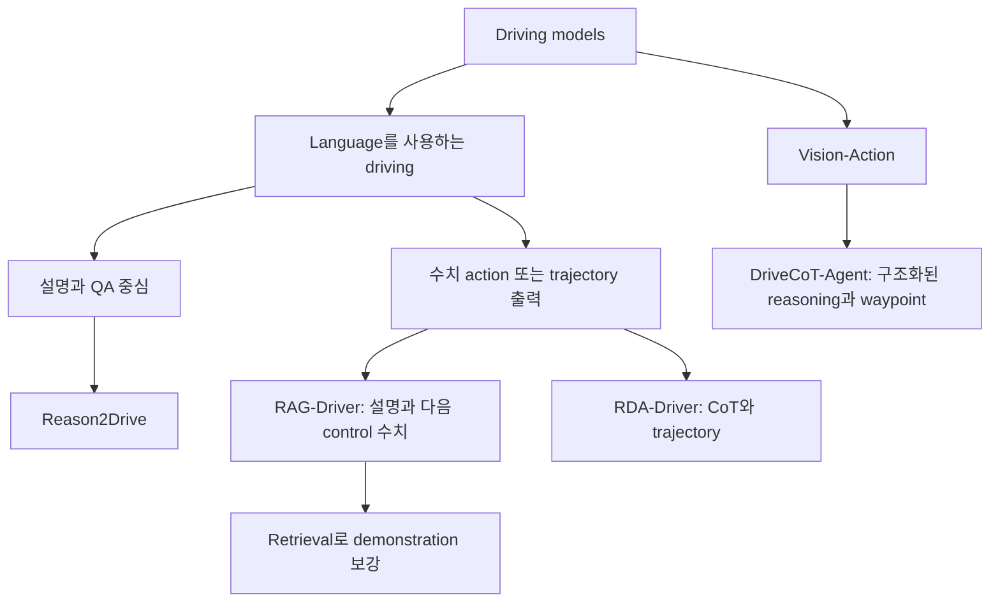
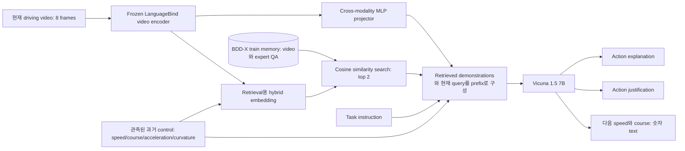
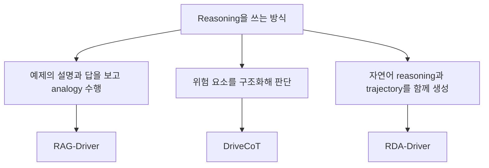

# Week 05. CoT·Retrieval·Instruction Following: 설명이 실제 주행에 도움이 되는 조건

- 학습일: 2026-11-10 (Asia/Seoul)
- 주차: 5 / 12
- Deep reading: **RAG-Driver: Generalisable Driving Explanations with Retrieval-Augmented In-Context Learning in Multi-Modal Large Language Model**
- 원문: https://arxiv.org/abs/2402.10828
- 본문 기준: [arXiv v3 HTML](https://arxiv.org/html/2402.10828v3), 2026-03-06 개정; RSS 2024 논문
- Skim: Reason2Drive(v3), DriveCoT(v1), RDA-Driver(v1)
- Taxonomy: retrieval-augmented MLLM / explanation + textual numerical action prediction / open-loop 검증 중심
- 읽기 모드: RAG-Driver의 abstract·방법·실험·한계·부록을 중심으로 읽고, 관련 논문은 architecture·training·평가 축을 비교
- 이번 주 산출물: **Reasoning usefulness checklist**

> 범위: 전문 PDF를 줄별로 번역한 문서가 아니라, 원문 HTML에 근거한 한국어 학습 노트입니다. RAG-Driver abstract는 한국어 번역이며, 관련 논문 abstract는 요약 번역입니다. 논문의 보고 결과와 이 노트의 해석·실험 제안을 구분합니다. 모델 학습이나 CARLA 재현 실험은 실행하지 않았습니다.

## 1. 이번 주 한 문장 결론

**Retrieval과 CoT는 그럴듯한 설명을 만드는 데 도움이 되지만, 그 설명이 센서 사실에 맞고 실제 action을 일관되게 바꾸며 closed-loop 안전성을 높인다는 것은 별도로 입증해야 합니다.**

지난주에는 explanation VLA와 action VLA를 구분했습니다. 이번 주에는 그 구분을 한 단계 더 밀어붙입니다. 숫자를 출력하는 모델이라도, 설명이 action에 실제로 기여했는지와 차량을 안전하게 제어할 수 있는지는 다른 질문입니다.

| 구분 | 쉬운 질문 | 필요한 증거 |
|---|---|---|
| Explanation quality | 사람이 이해할 만한가? | 설명 평가, 사용자 평가 |
| Factual grounding | 말한 보행자·표지판이 실제 있는가? | object·위치·시간 근거 대조 |
| Reasoning–action consistency | 감속한다고 말하고 가속하지는 않는가? | 설명–action 모순 검사 |
| Causal usefulness | reasoning이 없으면 action이 나빠지는가? | 통제된 ablation·intervention |
| Driving safety | 다른 차가 반응해도 안전하게 달리는가? | closed-loop, 충돌·위반·개입률 |

## 2. 논문 제목·Abstract 한국어 번역

### 2.1 RAG-Driver 제목

**RAG-Driver: 멀티모달 대규모 언어 모델에서 Retrieval-Augmented In-Context Learning을 활용한 일반화 가능한 주행 설명**

### 2.2 RAG-Driver Abstract 한국어 번역

우리는 작동 방식을 알기 어려운 AI 기법을 사용하는 로봇을 신뢰할 수 있어야 합니다. 로봇은 자신의 행동을 우리에게 설명할 수 있어야 하고, 우리도 그 설명을 신뢰할 수 있어야 합니다. 이러한 관점에서 설명가능성은 신뢰할 수 있는 자율적 의사결정에 핵심적인 역할을 합니다. 특히 복잡한 자율주행 환경에서는 최종 사용자에게 투명성을 제공하고 기술의 수용성을 높이는 데 중요합니다.

최근 멀티모달 대규모 언어 모델(MLLM)의 발전은 자연어 설명과 함께 제어 신호를 예측함으로써 주행 에이전트의 설명가능성을 높일 잠재력을 보여주었습니다. 그러나 높은 annotation 비용으로 인한 심각한 데이터 부족과 데이터셋 간 큰 domain gap 때문에 견고하고 일반화 가능한 시스템을 개발하기는 매우 어렵습니다. 또한 MLLM의 막대한 학습 비용과 아직 해결되지 않은 catastrophic forgetting 문제는 배포 이후의 일반화 능력을 더욱 제한합니다.

이러한 문제를 해결하기 위해 저자들은 고성능이면서 설명 가능하고 일반화 가능한 자율주행을 목표로, in-context learning을 활용하는 새로운 retrieval-augmented MLLM인 RAG-Driver를 제안합니다. 검색한 전문가 시연 사례에 근거하도록 함으로써, RAG-Driver가 주행 행동 설명, 행동의 이유 설명, 제어 신호 예측에서 당시 최고 수준의 성능을 달성함을 실험으로 검증합니다. 더 중요하게는 추가 학습 없이도 보지 못한 환경으로 뛰어난 zero-shot 일반화 능력을 보인다고 보고합니다.

> 해석 주의: 위의 성능·일반화 표현은 저자 주장입니다. 실제 근거는 BDD-X의 offline 평가와 58개 Spoken-SAX 테스트 QA에 한정되며, closed-loop 배포 성공을 뜻하지 않습니다.

### 2.3 관련 논문 제목과 Abstract 요약 번역

- **Reason2Drive: 자율주행을 위한 해석 가능하고 chain 기반인 reasoning을 향하여.** 주행 의사결정의 reasoning chain annotation 부족을 해결하기 위해 nuScenes·Waymo·ONCE에서 60만 개 이상의 video–text pair를 구축합니다. Perception → prediction → reasoning으로 과제를 분해하고, 기존 caption metric의 한계를 보완하는 평가법과 object-level 정보를 활용하는 모델을 제안합니다. 핵심은 reasoning benchmark이며, 실제 차량 제어 성능을 입증하는 논문으로 읽어서는 안 됩니다.
- **DriveCoT: Chain-of-Thought reasoning과 End-to-End 주행의 통합.** CARLA leaderboard 2.0의 복잡한 시나리오에서 rule-based expert가 차량을 제어하면서 센서·결정·중간 reasoning label을 수집합니다. 이 데이터셋으로 학습한 DriveCoT-Agent는 중간 판단과 최종 결정을 예측하며 open-loop와 closed-loop에서 평가됩니다. 여기서 CoT는 자유로운 자연어 독백이 아니라 구조화된 driving aspect와 결정 절차입니다.
- **Making Large Language Models Better Planners with Reasoning-Decision Alignment: Reasoning–Decision Alignment로 LLM planner 개선하기(RDA-Driver).** CoT fine-tuning만으로는 설명과 최종 planning이 어긋날 수 있다는 문제를 다룹니다. 멀티모달 LLM이 reasoning과 trajectory를 함께 출력하도록 하고, 올바른 reasoning–decision 조합을 틀린 조합보다 선호하게 만드는 alignment constraint를 추가합니다. nuScenes와 DriveLM-nuScenes에서 planning을 평가하지만, 해당 결과를 실제 주행 중 충돌 확률로 해석할 수는 없습니다.

## 3. 핵심 기여 3~5개

RAG-Driver의 주요 기여를 한국어로 정리하면 다음과 같습니다.

1. **주행 경험을 검색하는 RA-ICL 도입.** 현재 상황과 유사한 전문가의 주행 video·상태·설명·정답을 찾아 MLLM의 demonstration으로 제공합니다. 일반 문서 검색 RAG라기보다, 주행 예제를 검색해 analogy를 유도하는 방식입니다.
2. **설명과 수치 action을 하나의 MLLM으로 처리.** Action explanation, justification, 다음 control signal 예측을 instruction QA 형태로 통합합니다. 숫자도 language token으로 생성합니다.
3. **BDD-X에서 높은 설명 성능 보고.** 당시 specialist·generalist baseline과 비교해 주요 caption metric과 control RMSE를 제시합니다. 모든 metric에서 모든 baseline을 이긴 것은 아닙니다.
4. **새 환경에서 추가 모델 학습 없는 일반화 실험.** BDD-X로 학습하고 BDD-X memory를 유지한 채 London의 Spoken-SAX에서 평가합니다. 이 zero-shot은 '처음부터 학습하지 않음'이 아니라 'target-domain 추가 학습 없음'입니다.

Hybrid retrieval은 위 첫 번째 기여를 구현하는 핵심입니다. 도로 풍경만 비슷한 예제보다, 현재 ego의 움직임과 행동 맥락까지 비슷한 예제를 찾도록 학습합니다.

## 4. VLA for AD taxonomy 위치



이 그림은 **학습용 taxonomy**입니다. 논문 제목에 CoT가 들어간다고 모두 LLM/VLA인 것은 아닙니다.

| 논문 | Taxonomy 판정 | Language role | Action grounding |
|---|---|---|---|
| RAG-Driver | Retrieval-augmented MLLM; action 출력이 있는 초기 VLA 계열 | task instruction·전문가 demonstration·설명·숫자 출력 | speed/course를 text token으로 예측; offline 정답과 비교 |
| Reason2Drive | Driving reasoning VLM + benchmark | QA와 단계별 reasoning, perception 요청 token | object 위치·motion grounding; ego actuator grounding과 다름 |
| DriveCoT | 구조화된 CoT-supervised VA; LLM 기반 VLA와 구분 | 주된 agent가 자연어 생성을 필요로 하지 않음 | target speed·waypoint → PID → low-level control |
| RDA-Driver | BEV 기반 MLLM planner; reasoning–decision alignment | perception·prediction·decision·planning의 multi-turn CoT | trajectory 수치와 paired reasoning을 함께 학습 |

**Instruction following의 범위도 구분해야 합니다.** '지금 행동을 설명하라' 같은 QA instruction을 따르는 능력과, '다음 교차로에서 우회전하라'는 운전자 지시를 closed-loop로 이행하는 능력은 동일하지 않습니다. RAG-Driver의 주요 실험은 전자와 offline control prediction에 가깝습니다.

## 5. Architecture / pipeline 시각화

### 5.1 RAG-Driver의 두 경로



**두 projector를 혼동하지 마세요.**

| 구성요소 | 변환 대상 | 목적 |
|---|---|---|
| Cross-modality projector | video feature → LLM embedding | 영상을 언어 모델이 읽게 하기 |
| Retrieval embedding projector | video summary + control history → hybrid vector | 적절한 전문가 예제를 찾기 |

Memory에 현재 test의 정답을 넣는 구조가 아닙니다. 기본 평가에서는 **BDD-X training split만 memory로 사용**합니다. 현재 query에는 관측 가능한 과거 control이 들어가고, 예측해야 하는 다음 control과 구분됩니다.

### 5.2 왜 visual similarity만으로 부족할까?

학습용 예시입니다. 도로 풍경이 비슷해도 A는 앞차가 멈춰 감속해야 하고, B는 앞차가 멀어져 속도를 유지할 수 있습니다. 배경 위주 visual embedding은 이 둘을 가까이 둘 수 있습니다. Hybrid retrieval은 ego의 상태와 행동 annotation의 유사성까지 반영하려 합니다.

다만 **ego가 이미 감속 중이라는 정보**가 주어지면 예측이 쉬워질 수 있습니다. 따라서 이 결과를 camera-only perception의 개선이라고 해석하면 안 됩니다. 영상 없이 control history만 사용하는 baseline도 확인해야 합니다.

### 5.3 원문 section별 읽기 지도

| 원문 section | 한국어 요약 | 읽으면서 확인할 질문 |
|---|---|---|
| I Introduction | 설명 데이터 부족·domain shift·재학습 비용이 문제 | 일반화 대상이 설명인가, 실제 주행인가? |
| II Related Work | specialist explainer·MLLM·ICL/RAG의 연결 | 기존 CoT 방법과 무엇이 다른가? |
| III-A Architecture | frozen video encoder + MLP + Vicuna | vision, control history, instruction의 합류 지점은? |
| III-B Training | video–language alignment 후 driving instruction tuning | ICL을 학습 때도 보여주는가? |
| III-C RA-ICL | hybrid embedding으로 전문가 예제를 검색 | retrieval이 실제 관측과 맞는가? |
| IV-A~D Experiments | BDD-X 설명·control 및 retrieval ablation | 어느 metric이 개선되지 않는가? |
| IV-E~G Transfer | Spoken-SAX 평가와 retriever 추가 tuning 실험 | zero-shot 실험과 target tuning 실험을 분리했는가? |
| V Limitations | context·데이터·hallucination·closed-loop 한계 | 배포 주장에 빠진 증거는 무엇인가? |
| VI / Appendix | 결론·학습 세부·ICL 해석·action representation | 구현에 필요한 설정이 일관적인가? |

## 6. Input → Reasoning → Action Grounding 분석

| 단계 | 입력 | 내부 처리 / 출력 | Grounding 판정과 위험 |
|---|---|---|---|
| Video | 8 frames, 224×224 | LanguageBind visual feature | 작은 표지판·빠른 cut-in 정보 손실 가능 |
| Ego state | 과거 speed·course·acceleration·curvature | text context 및 retrieval hybrid feature | 미래 값 leakage와 timestamp 정합성 점검 필요 |
| Retrieval | video summary + control history | 1024차원 hybrid embedding; top-2 사례 | 비슷한 사례가 정답이라는 보장은 없음 |
| ICL | 예제 video·QA + 현재 query | contextual analogy | 과거 예제의 원인을 현재 영상의 사실처럼 복사할 수 있음 |
| Explanation | task instruction | 행동 설명: 무엇을 하는가 | 이해하기 쉬움과 factuality는 다름 |
| Justification | task instruction + context | 이유: 왜 그러는가 | 관측되지 않은 stop sign을 만들어내는 실패가 원문에 있음 |
| Action | 동일 MLLM context | 다음 speed/course의 floating-point text | 숫자 parse·범위·단위·시간 지평은 별도 계약 필요 |
| Vehicle control | 본 논문 실험의 경계 밖 | actuator·controller·feedback loop | production control loop 검증으로 확장하지 말 것 |

### CoT라는 말의 세 가지 뜻



RAG-Driver는 reasoning demonstration을 제공하지만, 생성된 justification이 실제 numerical action의 유일한 causal 경로라는 것은 보이지 않습니다. 두 출력이 같은 backbone을 공유한다는 사실만으로 causal faithfulness가 보장되지 않습니다.

또한 RAG-Driver의 표에는 **Course**가 쓰이고 본문에는 turning/steering angle 표현도 등장합니다. 이를 차량의 steering-wheel actuator angle과 같은 값으로 단정하지 마세요. 재현에서는 데이터의 course 정의·단위·sampling interval을 먼저 고정해야 합니다.

## 7. Training recipe

### 7.1 RAG-Driver: 세 부분으로 분리

| 부분 | 데이터·목표 | 학습 내용 | 확인된 정보 |
|---|---|---|---|
| Video–language alignment | VIDAL-10M 중 약 3M video-caption pairs | video encoder·LLM freeze, cross-modality projector 학습 | next-token cross-entropy; 본문 1 epoch |
| Driving instruction tuning | BDD-X train QA + retrieved examples | driving explanation·justification·next control의 answer token 학습 | Video-LLaVA checkpoint 사용; 본문 2 epochs |
| Retrieval metric learning | video + 28차원 control vector; text similarity로 triplet 구성 | hybrid embedding projector 학습 | TF-IDF로 positive/negative 선택, triplet loss 후 cosine retrieval |

Retrieval 학습은 개념적으로 다음과 같습니다.

```text
anchor: 현재와 같은 주행 사례
positive: 행동·이유 설명이 비슷한 사례
negative: 행동·이유 설명이 다른 사례

목표: distance(anchor, positive)를 작게,
      distance(anchor, negative)를 크게
추론: hybrid embedding의 cosine similarity로 top-2 검색
```

본문은 retriever가 single A100에서 약 30분, MLLM fine-tuning은 8×A100에서 약 6시간이라고 보고합니다. 전체 single-round inference는 single A100에서 약 4초입니다. 이것은 본 노트에서 측정한 시간이 아닙니다.

### 7.2 재현 전에 반드시 해결할 원문 내부 불일치

| 항목 | 본문 / 부록 기재 | 처리 원칙 |
|---|---|---|
| Retriever epochs | IV-A는 300, Appendix A는 200 | 임의로 하나를 정답으로 선택하지 않기 |
| Retriever MLP | Appendix A에 three-layer와 four-layer가 함께 기재 | 실제 code/config 대조 필요 |
| Effective batch | batch 4, accumulation 2, 8 GPUs와 effective 128 병기 | 추가 설정 누락 가능; 그대로 복사하지 않기 |
| Warm-up | 2 epochs 학습과 first 5 epochs warm-up 표현이 함께 존재 | warm-up ratio 0.03과 구현 확인 필요 |
| Video tokens | III-A의 2048-token feature와 V-A의 1024-token 설명 | pooling·sampling·checkpoint별 실제 sequence 확인 |

MLLM learning rate 2e-5, cosine scheduler 등은 부록에 보고되어 있으나, 이 표의 충돌 때문에 **이 문서만으로 완전 재현 가능한 recipe라고 주장하지 않습니다.**

### 7.3 관련 논문의 training 차이

- **Reason2Drive:** InstructBLIP 초기화 후 prior tokenizer·Q-former·instructed vision decoder를 정렬합니다. Fine-tuning에서는 LLM에 LoRA를 적용하고, text cross-entropy와 perception loss(BCE/MSE)를 함께 사용합니다. 자유로운 설명만이 아니라 object 위치·motion을 명시적으로 학습합니다.
- **DriveCoT:** CARLA rule expert의 중간 label을 classification/regression target으로 만듭니다. Video SwinTransformer와 transformer fusion·task query를 학습하고 path GRU가 waypoint를 생성합니다. Focal loss와 L1 loss를 사용하며 본문 기본 학습은 20 epochs입니다. LLM next-token training과 다릅니다.
- **RDA-Driver:** object-detection pretraining을 거친 BEV encoder와 adapter, Llama decoder를 사용합니다. Vanilla CoT/trajectory fine-tuning 후 모델이 생성한 후보의 trajectory L2 순위 및 유사 장면에서 reasoning/action을 교환한 negative를 활용합니다. 최종 목적함수는 vanilla loss + ranking alignment + binary alignment입니다. PPO 같은 환경 상호작용 RL이라고 분류하면 안 됩니다.

### 7.4 Training-free와 zero-shot을 정확히 읽기

RAG-Driver는 **이미 학습한 모델이 target domain에 갈 때** 추가 weight update 없이 ICL을 사용할 수 있다는 뜻입니다. 학습 자체가 필요 없다는 뜻이 아닙니다. Table III에서는 ICL demonstration 없이 학습한 모델에 추론 때만 예제를 넣으면 제대로 된 답이나 숫자를 생성하지 못하는 사례를 보고합니다.

또한 IV-F의 Spoken-SAX 데이터를 이용한 retriever fine-tuning 실험은 기본 zero-shot transfer와 별도입니다. Target annotation을 사용한 결과를 zero-shot 결과와 섞으면 안 됩니다.

## 8. Dataset / Benchmark / Metric 분석

### 8.1 RAG-Driver 평가 설정

| 축 | BDD-X | Spoken-SAX |
|---|---|---|
| 환경 | 미국의 다양한 도로·날씨, 원 데이터 약 77시간 video | 영국 London, 전문가 driving instructor narration |
| 사용 규모 | train QA 16,803 / test QA 2,123 | test QA 58 |
| 역할 | training + in-distribution offline test | out-of-distribution zero-shot explanation test |
| 기본 memory | BDD-X train | BDD-X train 유지 |
| 텍스트 metric | BLEU-4, METEOR, CIDEr | 같은 계열; justification 표는 BLEU-3 사용 |
| Control metric | speed/course RMSE, tolerance accuracy | 표의 주된 transfer 근거는 explanation/justification |
| Closed-loop | 보고하지 않음 | 보고하지 않음 |

**QA 개수를 독립적인 주행 episode 수로 해석하지 마세요.** 하나의 주행 장면에 여러 질문이 있을 수 있습니다. 또한 58개 QA에서의 향상은 대규모 지역 일반화 또는 long-tail 안전성의 충분한 근거가 아닙니다.

### 8.2 주요 보고 수치: 같은 표의 동일 조건끼리 읽기

다음은 RAG-Driver v3 Table I·II의 값입니다. 별도 재현 결과가 아닙니다.

| BDD-X metric | DriveGPT4 | RAG-Driver | 읽는 법 |
|---|---:|---:|---|
| Action CIDEr ↑ | 214.0 | 260.8 | 행동 묘사의 reference 일치 향상 |
| Justification CIDEr ↑ | 102.7 | 109.1 | 이유 설명의 caption metric 향상 |
| Course RMSE, degree ↓ | 4.57 | 4.48 | offline next-control 오차 |
| Speed RMSE, m/s ↓ | 1.09 | 0.69 | offline speed 예측 오차 |

- Spoken-SAX Action CIDEr: Base without ICL **5.7**, RAG-Driver with ICL **48.9**; Justification CIDEr는 **4.7 → 17.1**입니다.
- 다만 BDD-X speed의 매우 엄격한 tolerance accuracy A0.1은 DriveGPT4 **56.93**, RAG-Driver **51.12**로, RMSE 개선과 모든 threshold 성능 개선은 같은 말이 아닙니다.
- Table I의 Action CIDEr 260.8과 ablation table의 260.9에는 작은 차이가 있습니다. 표 간 반올림·보고 차이의 원인은 확정하지 않습니다.
- ICL example 1개 → 2개에서 explanation은 좋아지지만 course error는 **4.15 → 4.48**로 악화됩니다(Table IV). **설명 개선과 action 개선이 자동으로 동행하지 않는 직접적인 학습 포인트**입니다.

### 8.3 네 논문의 evaluation matrix

| 논문 | Dataset / benchmark | Metric 중심 | Open-loop | Closed-loop | 안전성·long-tail 해석 |
|---|---|---|---|---|---|
| RAG-Driver | BDD-X, Spoken-SAX | caption metric, control RMSE, tolerance accuracy | 있음 | 없음 | grounding 실패·지연·상호작용 안전성 미해결 |
| Reason2Drive | nuScenes·Waymo·ONCE 기반 632,955 pairs | ADRScore, ADRScore-S, caption metric | QA 평가 있음 | driving 검증으로 제시하지 않음 | reference reasoning 점수는 사고 방지 증거가 아님 |
| DriveCoT | 자체 CARLA data; leaderboard 2.0, Town05Long | aspect/decision F1, waypoint 관련 accuracy, route/infraction 기반 주행 평가 | 있음 | 있음 | simulation 검증; 실제 도로 transfer는 별도 |
| RDA-Driver | nuScenes, DriveLM-nuScenes | trajectory L2, collision metric | planning 평가 있음 | 본 skim에서 closed-loop 근거 확인하지 않음 | logged environment 기준 collision metric이지 실제 사고율 아님 |

Reason2Drive의 **ADRScore**는 reasoning alignment·redundancy·missing step을 함께 평가하고, **ADRScore-S**는 spatial perception 오차도 반영합니다. 단순 n-gram overlap보다 목적에 맞지만, reference에 없는 정당한 reasoning까지 충분히 다루는지와 실제 행동 안전성은 별도 문제입니다.

## 9. 관련 논문 비교표

| 분석 축 | RAG-Driver | Reason2Drive | DriveCoT | RDA-Driver |
|---|---|---|---|---|
| 핵심 질문 | 유사 경험으로 설명과 control 예측을 개선할 수 있는가? | reasoning을 어떻게 데이터화·평가하는가? | 중간 판단을 감독하면 주행이 나아지는가? | 설명과 planning의 모순을 줄일 수 있는가? |
| Input | video + control history + task QA | video + perceptual priors + QA | 6-view video + speed/navigation/target point | multi-view images + ego status + multi-turn prompt |
| Reasoning | retrieval demonstration 기반 ICL | perception→prediction→reasoning; object grounded | hazard·앞차·도로 등 구조화 task | perception→prediction→decision→trajectory |
| Output | action 설명·justification·다음 speed/course | text + object location/motion | driving aspects·target speed·waypoints | CoT answer + trajectory |
| 주요 구조 | LanguageBind + MLP + Vicuna 7B + memory | prior tokenizer + Q-former + instructed vision decoder | Video Swin + fusion transformer + heads/GRU | BEV encoder + region adapter + Llama |
| 핵심 학습 | instruction tuning + triplet retrieval | text·perception 공동 학습, LoRA | expert imitation, Focal/L1 | vanilla + ranking/binary alignment |
| 강점 | 배포 후 새 query에 예제를 동적으로 제공 | grounding과 reasoning metric을 분리해 다룸 | 중간 상태를 검사하고 PID까지 연결 가능 | reasoning–action alignment를 직접 문제화 |
| 한계 | retrieval 오류·hallucination·4초 지연·closed-loop 없음 | annotation/metric 의존, 직접 주행 증거 부족 | expert rule bias·sim-to-real gap | negative 구성·offline expert 경로에 대한 의존 |

### 연결해서 읽는 순서

```text
Reason2Drive: reasoning의 정답과 평가법을 마련한다
        ↓
RAG-Driver: 그 예제를 검색해서 현재 답을 돕는다
        ↓
RDA-Driver: 그 reasoning과 trajectory의 모순을 줄인다
        ↓
DriveCoT: 중간 판단을 controller까지 연결해 closed-loop에서 본다
```

위 순서는 교육용 개념 연결이지, 네 논문이 같은 데이터·모델을 순차 확장했다는 뜻은 아닙니다. 성능 숫자를 한 줄로 세워 ranking해서도 안 됩니다.

## 10. 강점과 한계

### 10.1 RAG-Driver가 잘 보여준 것

- Expert demonstration을 memory에 두고 현재 query에 맞춰 불러오는 방식은, 모든 경험을 모델 weight에만 저장하는 접근의 대안입니다.
- Visual-only 검색보다 video + control 기반 검색이 유리할 수 있음을 ablation으로 보여줍니다.
- 새로운 지역에 대한 offline explanation transfer를 실험하며, 추가 tuning 없이 가능한 범위를 보여줍니다.
- 같은 모델이 설명과 numerical action을 다루므로 언어와 action representation을 함께 분석하기 좋습니다.

### 10.2 안전성과 long-tail failure map

| Failure mode | 가능한 경로 | 필요한 방어·검증 — 아래는 학습 제안 |
|---|---|---|
| Retrieval-induced hallucination | 검색 예제의 stop sign을 현재 장면에도 있다고 간주 | 현재 frame object verification, evidence attribution |
| Spurious control shortcut | 과거 감속만 보고 이유를 임의로 붙임 | control-only·video-only ablation, state-matched evaluation |
| Long-tail retrieval miss | 평범한 사례만 memory에 존재 | rare-event slice, no-good-match 거절, fallback planner |
| Wrong instruction compliance | 안전하지 않은 지시를 그대로 실행 | instruction safety hierarchy·제약 검사 |
| Numerical formatting failure | floating-point text 생성·parse 실패 | schema validator, 단위·범위 검사, safe fallback |
| Stale reasoning | 생성이 끝났을 때 도로 상황 변화 | deadline·staleness check, 빠른 control loop 분리 |
| Reasoning/action contradiction | 정지를 설명하지만 trajectory는 교차로 진입 | paired consistency 검사·trajectory feasibility checker |
| Offline optimism | logged trajectory는 맞지만 타 차량이 반응하면 실패 | 동일 조건 closed-loop, 교란·counterfactual 평가 |

원문 V-C는 **실제로 존재하지 않는 stop sign으로 감속 이유를 설명하는 실패**를 명시합니다. 따라서 'RAG를 붙이면 hallucination이 사라진다'는 결론은 원문과 모순됩니다. Caption metric이 올랐다고 hallucination 빈도가 직접 측정·입증된 것도 아닙니다.

약 4초라는 single-round inference 보고 역시 real-time actuator control의 충분한 근거가 아닙니다. 이를 사용하려면 비동기 reasoning, fast planner, stale-output rejection 같은 설계가 필요할 수 있으나, 그것은 본 논문의 검증 결과가 아니라 후속 시스템 제안입니다.

### 10.3 ICL 이론을 과도하게 읽지 않기

원문은 softmax-free linear attention으로 ICL의 효과를 implicit meta-optimisation 관점에서 설명합니다. 이를 실제 nonlinear MLLM 전체가 추론 중 정확히 gradient descent를 수행한다는 정리로 확대하지 마세요. Inference 때 모델 weight를 업데이트한다는 뜻도 아닙니다. 유용한 해석과 전체 시스템에 대한 보장은 다른 수준입니다.

## 11. 실전 학습 포인트

### 11.1 Reasoning usefulness checklist — 이번 주 핵심 산출물

논문을 읽거나 본인 모델을 만들 때 다음을 순서대로 확인합니다.

- [ ] **Task contract:** 설명·고수준 decision·다음 speed·waypoint 중 무엇이 target인가?
- [ ] **Observation boundary:** 현재 시점에 쓸 수 있는 센서와 과거 state만 쓰는가? 미래 label은 분리됐는가?
- [ ] **Evidence grounding:** 각 핵심 주장에 object·위치·시간 근거가 있는가?
- [ ] **Retrieval hygiene:** memory는 train-only인가? 동일 scene/video가 split을 넘나들지 않는가?
- [ ] **Retrieval relevance:** 보기 좋은 배경보다 safety-relevant 상황을 찾는가? 맞는 사례가 없을 때 거절하는가?
- [ ] **Fair ablation:** no-reasoning·random-example·visual-only·hybrid를 같은 backbone·학습량·입력 조건에서 비교했는가?
- [ ] **Causal intervention:** 틀린 explanation만 넣거나 핵심 evidence를 바꾸면 action이 예상대로 변하는가?
- [ ] **Consistency:** '정지' 설명과 speed/trajectory가 일치하는가? 단, 텍스트만 서로 일치한다고 충분하지는 않다.
- [ ] **Numerical interface:** 단위·좌표계·horizon·sampling interval·parse failure·범위를 명시했는가?
- [ ] **Metric separation:** language quality·factuality·action error·safety를 각각 보고하는가?
- [ ] **Loop test:** closed-loop에서 충돌·위반·진행률·comfort·다른 agent 반응을 확인했는가?
- [ ] **Long-tail & latency:** rare-event slice와 end-to-end 지연·deadline miss·fallback까지 보고하는가?

**RAG-Driver에 적용한 판정:** task·train-memory·기본 ablation·offline 수치 예측은 근거가 있습니다. 반면 reasoning의 causal usefulness, factuality 정량 검증, closed-loop safety, production interface 계약은 충분히 입증됐다고 판단할 수 없습니다.

### 11.2 예제: 같은 감속이라도 이유는 다르다

학습용 가상 상황이며 논문 실험 결과가 아닙니다.

```text
관측: ego가 감속 중이며 앞차의 brake lamp가 켜짐
검색: 비슷한 속도의 감속 사례, 단 그 사례에는 stop sign이 있음

나쁜 답: "정지 표지판 때문에 감속한다."
좋은 검증 순서:
  1. 현재 영상에 stop sign이 있는지 확인
  2. 앞차와의 거리·relative motion 근거 확인
  3. 확인된 사실만으로 감속의 이유를 제한
  4. 다음 speed와 안전거리 제약이 맞는지 검사
```

핵심은 '검색 사례가 정답을 증명한다'가 아니라, **검색은 hypothesis를 돕고 현재 관측이 그 hypothesis를 검증한다**는 것입니다.

### 11.3 작은 연구 실험 설계 — 미실행 제안

| Condition | 바꾸는 것 | 고정할 것 | 핵심 측정 |
|---|---|---|---|
| A | no retrieval | backbone·training budget·관측 정보 | action/control baseline |
| B | random top-2 examples | example 수·token budget | 단순 context 증가 효과 |
| C | visual retrieval | instruction·memory split | 배경 유사성의 효과 |
| D | hybrid retrieval | 같은 memory와 task | state-aware retrieval 효과 |
| E | D의 justification을 잘못된 이유로 교체 | 가능한 한 video·state·길이 유지 | action 변화·모순·hallucination |
| F | D에서 설명 생성을 생략하는 matching variant | 학습 조건·예측 horizon | 설명의 latency/성능 trade-off |

Output dashboard는 하나의 종합 점수보다 다음 네 칸으로 나눕니다.

```text
Language: caption metric + factual error
Action: RMSE/L2 + 수치 parse failure
Safety: closed-loop collision + infraction + completion
System: latency distribution + deadline miss + fallback
```

공정한 matching variant를 만들기 어렵다면, E/F 결과를 깔끔한 causal proof로 포장하지 말고 그 한계를 명시해야 합니다.

### 11.4 오늘 이해해야 할 네 문장

1. Retrieval은 현재 장면의 사실을 보증하는 oracle이 아닙니다.
2. Natural-language CoT, structured reasoning, numerical trajectory는 다른 representation입니다.
3. Explanation score 향상과 action·closed-loop safety 향상은 분리해서 검증합니다.
4. 'Training-free transfer'와 '학습 불필요', 'instruction QA'와 '주행 지시 이행'을 혼동하지 않습니다.

## 12. 다음 주 질문

다음 주는 **Week 06. Numerical Action Generator 1 — LMDrive**입니다.

- LMDrive는 language instruction을 어떻게 waypoint·trajectory에 연결하나요?
- Textual numerical output과 전용 numerical action head는 어떤 차이가 있나요?
- Controller에 넘기는 좌표계·horizon·단위·실패 처리 계약은 무엇인가요?
- Closed-loop CARLA에서 instruction following은 어떤 지표로 평가하나요?
- 느린 language reasoning과 빠른 주행 제어를 연결하는 설계는 무엇인가요?

다음 주 산출물: **Textual action vs Numerical action 비교표**.

## 13. 참고 링크

1. [RAG-Driver arXiv / metadata / abstract](https://arxiv.org/abs/2402.10828)
2. [RAG-Driver v3 full HTML — 방법·Table I~V·한계·부록](https://arxiv.org/html/2402.10828v3)
3. [RAG-Driver v2 HTML — 이전 RSS 2024 판본](https://arxiv.org/html/2402.10828v2)
4. [Reason2Drive abstract](https://arxiv.org/abs/2312.03661)
5. [Reason2Drive v3 HTML — dataset·ADRScore·architecture·training](https://arxiv.org/html/2312.03661v3)
6. [DriveCoT abstract](https://arxiv.org/abs/2403.16996)
7. [DriveCoT v1 HTML — structured CoT·waypoint/PID·closed-loop](https://arxiv.org/html/2403.16996v1)
8. [RDA-Driver v1 HTML — Making Large Language Models Better Planners with Reasoning-Decision Alignment](https://arxiv.org/html/2408.13890v1)
9. [RDA-Driver 공식 GitHub README](https://github.com/zhijian11/RDA-Driver) — 확인 당시 README는 논문명과 공식 repository 안내 위주이며, 이를 완전한 재현 code 공개의 증거로 보지 않았습니다.
10. [다음 주 LMDrive](https://arxiv.org/abs/2312.07488)

### Source / verification note

- 위 네 논문의 arXiv HTML을 실제 조회하여 방법·평가 설명에 사용했습니다. RAG-Driver의 최신 metadata는 v3이며 본 노트의 수치도 v3 표를 기준으로 합니다.
- PDF extraction 실패 때문에 abstract만으로 내용을 추측한 것은 아닙니다. 다만 HTML의 수식·표 변환, token 수와 학습 설정의 원문 내부 불일치가 있어, 구현 세부를 확정하지 않았습니다.
- 저자 보고 수치와 노트 작성자의 비판·가상 예시·미실행 실험 설계를 구분했습니다. Closed-loop 미검증을 caption/control metric으로 대체하지 않았습니다.
- 이번 작업은 지정된 `raw/vla_study/` 학습 자료와 상태 갱신 범위입니다. 별도 wiki ingest·graph rebuild는 수행하지 않습니다.
