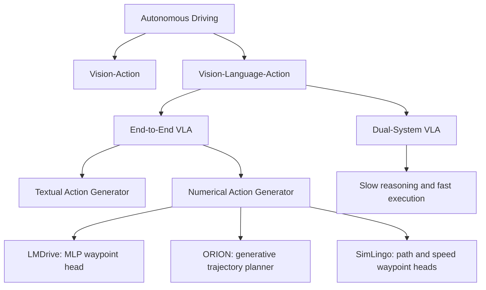
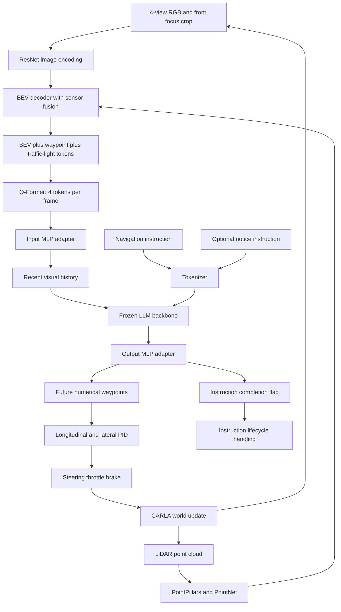
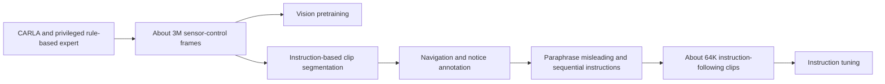
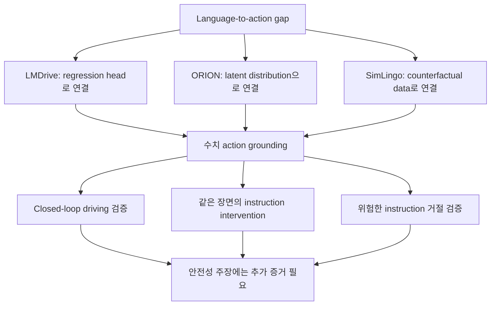

# Week 06. 수치 Action 생성 ①: LMDrive로 이해하는 언어 → Waypoint → Closed-loop 주행

- 학습일: 2026-11-17 (Asia/Seoul)
- 주차: 6 / 12
- Deep reading: **LMDrive: Closed-Loop End-to-End Driving with Large Language Models**
- 한국어 제목: **LMDrive: 대규모 언어 모델을 활용한 Closed-loop End-to-End 주행**
- 원문: https://arxiv.org/abs/2312.07488
- 본문 기준: [LMDrive v2 HTML](https://arxiv.org/html/2312.07488v2), 2023-12-21 개정; CVPR 2024
- Skim: [ORION v1](https://arxiv.org/html/2503.19755v1), [SimLingo v1](https://arxiv.org/html/2503.09594v1)
- Taxonomy: End-to-End VLA / Numerical Action Generator / language-conditioned waypoint policy
- 읽기 모드: LMDrive abstract·방법·실험·부록 심화 읽기, ORION·SimLingo architecture·training·평가 비교 읽기
- 이번 주 산출물: **Textual action vs Numerical action 비교표**, action grounding 지도, 평가·안전성 체크리스트

> 범위와 근거: 공개 arXiv HTML 본문 및 공식 GitHub README를 확인한 한국어 학습 노트입니다. LMDrive abstract는 한국어 번역, 관련 논문 abstract는 요약 번역입니다. PDF 전문의 줄별 번역은 하지 않았으며, HTML의 수식·표는 텍스트 추출 과정에서 배열과 기호가 중복될 수 있어 핵심 주장과 표의 행·열을 함께 대조했습니다. ORION·SimLingo의 v2 HTML URL은 404여서 접근 가능한 **v1을 명시해** 읽었습니다. 최신판 전체를 확인했다는 뜻은 아닙니다. 아래 수치는 저자 보고값이며, 모델 학습·추론·CARLA 재현 실험을 이번 작업에서 실행한 것은 아닙니다.

## 1. 이번 주 한 문장 결론

**LMDrive의 핵심은 LLM이 좌표를 문장으로 말하게 하는 것이 아니라, 센서와 언어를 함께 받은 hidden representation을 수치 waypoint head로 연결하고 PID controller를 통해 실제 CARLA 행동으로 되먹임하는 데 있습니다.**

지난주 RAG-Driver에서 숫자 control을 language token으로 생성하는 방법을 봤습니다. 이번 주에는 **숫자를 텍스트로 쓰는 것**과 **연속값 action head를 학습하는 것**을 분리합니다. 둘 다 숫자를 출력할 수 있지만, loss·오류·latency·controller 연결 방식이 다릅니다.

| 학습 질문 | 답을 찾을 위치 | 가장 중요한 구분 |
|---|---|---|
| LLM은 정확히 무엇을 출력하나요? | §5–6 | hidden action token → MLP waypoint이지 좌표 문자열 생성이 아님 |
| end-to-end인데 PID가 있어도 되나요? | §4–5 | 학습 가능한 sensor-to-waypoint 경로와 고정 tracking controller의 구분 |
| closed-loop라면 RL로 학습했나요? | §7–8 | imitation learning 기반 학습과 simulator closed-loop 평가의 구분 |
| VQA를 잘하면 행동도 맞나요? | §9 | 언어 점수와 instruction–action alignment는 별도 증거 필요 |
| 최신 모델과 DS 숫자로 순위를 매겨도 되나요? | §8–9 | LangAuto와 Bench2Drive, 데이터·controller·navigation 조건이 다름 |

## 2. 논문 제목·Abstract 한국어 번역

### 2.1 LMDrive 제목

**LMDrive: 대규모 언어 모델을 활용한 Closed-loop End-to-End 주행**

- *Closed-loop*: 차량의 행동으로 환경과 다음 관측이 바뀌며, 그 관측을 다시 받아 계속 주행합니다.
- *End-to-End*: 센서와 언어에서 driving action까지 신경망 경로를 연결한다는 의미입니다. 모든 부품이 항상 함께 업데이트되거나 PID까지 미분한다는 의미는 아닙니다.

### 2.2 LMDrive Abstract 한국어 번역

자율주행 분야는 최근 크게 발전했지만, 현재의 방법들은 예측하지 못한 long-tail 사건이나 까다로운 도심 상황을 만나면 여전히 어려움을 겪으며 심각한 사고를 일으킬 수 있습니다. 한편, 대규모 언어 모델(LLM)은 범용 인공지능(AGI)에 가까워지는 인상적인 reasoning 능력을 보여주었습니다. 반면 기존 자율주행 방법은 센서 데이터나 navigation waypoint처럼 제한된 형식의 입력에 의존하는 경향이 있어, 차량이 언어 정보를 이해하고 사람과 상호작용할 수 있는 능력이 제한됩니다.

이를 해결하기 위해 이 논문은 언어로 안내되는 새로운 End-to-End closed-loop 자율주행 framework인 LMDrive를 제안합니다. LMDrive는 멀티모달 센서 데이터와 자연어 instruction을 함께 처리하고 통합함으로써, 현실적인 instruction 환경에서 사람 및 navigation software와 상호작용할 수 있게 합니다.

언어 기반 closed-loop 자율주행의 후속 연구를 촉진하기 위해, 약 6만 4천 개의 instruction-following 데이터 clip으로 구성된 데이터셋과 복잡한 instruction 및 어려운 주행 상황에 대한 시스템의 대응 능력을 평가하는 LangAuto benchmark도 공개합니다. 광범위한 closed-loop 실험을 통해 LMDrive의 효과를 보입니다. 저자들이 아는 한, 이 연구는 LLM을 closed-loop End-to-End 자율주행에 활용한 최초의 연구입니다. 코드·모델·데이터셋은 공식 저장소에서 확인할 수 있습니다.

> 번역 주의: AGI와 ‘최초’는 abstract의 **저자 표현**을 옮긴 것입니다. 일반적 reasoning 능력이나 도로 안전성을 이 논문이 입증했다는 뜻은 아닙니다. 마지막 공개 자료 문장은 arXiv abstract 페이지 기준이며 HTML 본문 abstract는 코드 공개를 더 짧게 표현합니다.

### 2.3 관련 논문 제목·Abstract 요약 번역

**ORION: Vision-Language 지시에 따른 Action 생성으로 통합한 End-to-End 자율주행 Framework**

기존 End-to-End 주행 모델은 상호작용하는 closed-loop 환경에서 올바른 결정을 내리기 어렵고, VLM의 의미적 reasoning 공간과 수치 trajectory 공간 사이에도 간극이 있습니다. ORION은 장기 history를 집약하는 QT-Former, 주행 상황을 reasoning하는 LLM, 정밀 trajectory를 만드는 generative planner를 결합합니다. VQA와 planning을 통합 최적화하며 Bench2Drive에서 DS 77.74, SR 54.62%를 보고합니다. 이 값은 해당 논문의 데이터·프로토콜 기준이지 현재의 보편적 SOTA 순위가 아닙니다.

**SimLingo: Language–Action Alignment를 갖춘 Vision-Only Closed-loop 자율주행**

LLM을 자율주행에 통합하면 일반화와 설명가능성을 높일 수 있으나, 높은 driving 성능과 폭넓은 언어 이해 능력을 함께 얻기는 어렵습니다. 특히 VQA 답변이 action과 연결되지 않으면 설명과 실제 행동이 모순될 수 있습니다. SimLingo는 closed-loop driving, vision-language understanding, language-action alignment를 하나의 camera-only VLM 기반 모델에서 다룹니다. CARLA 및 Bench2Drive의 강한 주행 성능과 다양한 언어 과제 성능을 보고합니다. **공식 CARLA challenge 제출 모델은 언어 기능이 없는 SimLingo-BASE이며, 최종 SimLingo VLA와 구분해야 합니다.**

## 3. 핵심 기여 3~5개

LMDrive의 기여를 한국어로 정리하면 다음과 같습니다.

1. **자연어와 멀티모달 센서를 함께 사용하는 closed-loop driving policy.** Camera·LiDAR·navigation instruction·선택적 notice를 통합하고, waypoint와 instruction 완료 여부를 예측합니다. 행동을 로그와 대조하는 데 그치지 않고 CARLA에서 실제 실행해 평가합니다.
2. **언어와 행동을 연결하는 약 64K instruction-following clip 공개.** 약 3M expert frame에서 2–20초 clip을 만들고 navigation·notice·잘못된 instruction·연속 instruction을 포함합니다. 본문은 notice instruction 총 464K개를 보고합니다.
3. **Language-guided closed-loop benchmark인 LangAuto 제안.** 기본 navigation뿐 아니라 notice의 효과, 이어진 복합 instruction, 잘못된 instruction 대응을 살펴봅니다.
4. **Driving-specific visual pretraining과 adapter 기반 action grounding의 효과 분석.** Detection·waypoint·traffic light pretraining, BEV token, Q-Former, pretrained LLM backbone의 기여를 ablation으로 평가합니다.

**핵심 해석:** 일반 LLM에 센서 feature를 붙이는 것만으로 완성되는 구조가 아닙니다. Driving-specific visual supervision과 수치 action supervision이 언어 능력을 실제 주행에 연결하는 다리입니다.

## 4. VLA for AD taxonomy 위치



| 축 | LMDrive의 위치 | 잘못 읽기 쉬운 부분 |
|---|---|---|
| VA vs VLA | 자연어 instruction을 action 조건으로 사용하는 VLA | 언어가 단순 사후 caption이 아님 |
| End-to-End vs Dual-System | frozen LLM에 adapter를 연결하는 End-to-End VLA | 별도의 느린 LLM이 meta-action만 빠른 policy에 전달하는 구조가 아님 |
| Action representation | continuous waypoint + completion flag | steering·throttle 숫자 문자열을 LLM이 직접 생성하지 않음 |
| Language role | navigation 및 notice instruction 이해 | 명시적 자연어 CoT를 생성하는 것이 핵심은 아님 |
| World model인가? | 관측 history를 조건으로 action을 예측하는 policy | 미래 영상·occupancy·환경 transition을 학습하는 world model로 분류하지 않음 |
| 학습/실행 경계 | visual pretraining 후 Q-Former·adapter 학습, PID tracking | 모든 parameter를 공동 업데이트한다는 뜻의 end-to-end가 아님 |

> Taxonomy 메모: VLA4AD project와 awesome list를 학습일에 확인했습니다. 분류는 읽기 지도이며 architecture의 세부 차이를 대체하지 않습니다. 외부 후속 논문이 LMDrive를 Town05Long 중심으로 요약하더라도, **이번 deep-read의 primary protocol은 LMDrive 원문의 LangAuto**로 유지합니다.

## 5. Architecture / pipeline 시각화

### 5.1 전체 pipeline



- **4개 물리 camera**에서 front·left·right·rear를 얻고 front 중앙 crop을 focus view로 추가합니다. Camera 5개라고 읽지 않습니다.
- Vision encoder는 image와 LiDAR를 fusion하고, BEV·waypoint·traffic-light token을 만듭니다.
- Q-Former가 각 frame의 feature를 4개 token으로 압축합니다. Input MLP가 LLM embedding 차원에 맞춥니다.
- 최근 sensor history와 instruction을 LLM에 넣습니다. 부록의 최대 history 길이는 40 frame이며 training sampling interval은 2입니다.
- Output MLP가 LLM의 action representation에서 future waypoint와 완료 flag를 예측합니다.
- PID가 waypoint를 track합니다. 실제로 환경을 움직이는 값은 steering·throttle·brake입니다.

### 5.2 Pretraining 전용 head와 실행 head를 분리하기

```text
[Stage A: vision pretraining]
RGB + LiDAR → encoder → BEV / waypoint / traffic-light tokens
                         ├─ detection head → object boxes, velocity
                         ├─ GRU head       → future waypoints
                         └─ MLP head       → traffic-light state

[Stage B / inference]
위 prediction heads 제거 + vision encoder freeze
  → Q-Former → input adapter → frozen LLM → output adapter
  → numerical waypoints + completed flag → PID → vehicle
```

**중요:** Pretraining의 waypoint GRU head와 최종 LLM 뒤의 output adapter를 같은 head라고 생각하면 pipeline을 잘못 이해하게 됩니다.

### 5.3 원문에서 함께 확인해야 하는 token 수

부록 A는 Q-Former 입력을 **400 BEV + 5 waypoint + 1 traffic-light = 406 token**이라고 명시합니다. 반면 실험 setup에는 BEV 관련 H/W 값으로 50/50이 기술되어 있습니다. 이 둘을 그대로 곱해 동일 단계의 token 수라고 단정하면 맞지 않습니다. 논문 텍스트만으로 중간 feature map과 최종 token sampling 관계가 완전히 해명되지 않으므로, 구현 재현 시 encoder의 출력 shape를 직접 확인해야 합니다. 이 노트는 **Q-Former가 받는 최종 token 수는 부록 설명**, frame당 압축 후 token 수는 **M=4**로 구분해 기록합니다.

## 6. Input → Reasoning → Action Grounding 분석

### 6.1 인터페이스별 입출력

| 경계 | 입력 | 처리 / 역할 | 출력 | 검증할 오류 |
|---|---|---|---|---|
| Sensor → visual feature | Multi-view RGB + LiDAR | Image encoding, 3D encoding, BEV fusion | Scene·waypoint·signal token | 작은 신호등, 가림, calibration |
| Visual feature → LLM | Frame별 visual token | Q-Former 압축 + adapter | History visual embeddings | 위험 object 정보 손실 |
| Language → LLM | Navigation + optional notice | Tokenization, 상황 조건화 | Instruction embeddings | 잘못된 방향·거리·순서 해석 |
| LLM → action head | Sensor history + text | Latent instruction-conditioned processing | Hidden action representation | 설명을 잘해도 action 무관할 수 있음 |
| Action head → planner output | Hidden representation | 2-layer MLP regression/classification | Future waypoints + 완료 flag | 좌표계·scale·시점 오류 |
| Waypoint → actuator | 예측 경로 | PID tracking | Steering, throttle, brake | 추종 지연, 과조향, 급제동 |
| Actuator → next observation | 실행 control | CARLA dynamics + 다른 agent 반응 | 다음 RGB·LiDAR | 학습 분포 밖 상태, 누적 오차 |

여기서 **Reasoning**은 주로 LLM 내부의 latent processing을 뜻합니다. LMDrive가 매 step ‘보행자를 발견했으니 정지한다’라는 자연어 reasoning trace를 출력하거나, 그 trace의 인과성을 검증했다는 뜻은 아닙니다.

### 6.2 Textual action vs Numerical action — 이번 주 핵심 산출물

| 항목 | Textual meta-action | 숫자를 text token으로 생성 | Continuous numerical action head |
|---|---|---|---|
| 예시 | “왼쪽 차선으로 이동” | `[(x1,y1), (x2,y2)]` 문자열 | Float tensor의 waypoint / trajectory |
| 최종 의미 | 이산적 maneuver 의도 | 문자열을 parsing한 수치 계획 | 바로 수치로 해석 가능한 계획 |
| 일반적인 학습 | Class loss 또는 language CE | Next-token CE | L1 / SmoothL1 / MSE 등 회귀 loss |
| 추가 bridge | Planner가 의도를 경로로 변환 | Parser·단위·format 처리 필요 | Waypoint tracking controller 필요 |
| 대표 오류 | ‘얼마나·언제’가 불명확 | 형식 실패·수치 tokenization·좌표 오류 | 비현실적 곡률·회귀 평균화·제어 불안정 |
| LMDrive와의 관계 | 주된 최종 output 아님 | LMDrive output 방식이 아님 | **LMDrive output adapter** |
| 검증 포인트 | 실제 maneuver가 맞는가? | Parsing 성공 + 수치 타당성 | 기하·동역학 타당성 + closed-loop |

**Textual/Numerical이라는 분류는 숫자가 화면에 보이는지보다 ‘action이 어떤 head와 loss로 학습되고 실행되는지’로 판단하는 편이 정확합니다.** Continuous output도 물리적 안전성을 자동 보장하지는 않습니다.

### 6.3 쉬운 예: 같은 장면에서 instruction만 바꾸기

```text
공통 관측: 좌회전 가능한 교차로, 전방 차량, 현재 ego 상태

A: “다음 교차로에서 좌회전하세요.”
   → 좌측으로 휘는 future waypoints → PID 조향 → 다음 센서 관측

B: “교차로에서 직진하세요.”
   → 직진 future waypoints → PID 조향 → 다른 다음 관측

C: “보행자를 주의하세요.”라는 notice 추가
   → 장면의 보행자와 함께 해석 → 감속/정지에 맞는 계획이 필요한지 평가
```

이는 개념 예시이며 모델을 이번에 실행한 결과가 아닙니다. Alignment를 검증하려면 동일 장면의 instruction 교체 실험에 더해, **불가능하거나 위험한 instruction을 거절하는지**도 확인해야 합니다.

## 7. Training recipe

### 7.1 LMDrive의 두 단계

| 단계 | 데이터 | 학습되는 부분 | 고정 / 제거되는 부분 | Objective |
|---|---|---|---|---|
| A. Vision pretraining | Instruction clip 이전의 약 3M CARLA frame | Vision encoder와 pretraining heads | LLM 연결 이전 | Detection + waypoint L1 + traffic-light CE |
| B. Instruction tuning | 약 64K annotated clip | Q-Former + input/output adapters | Vision encoder와 LLM frozen; A의 prediction heads 제거 | Waypoint L1 + instruction completion CE |

개념적으로 최종 loss는 다음과 같습니다. 가중치·reduction 표기는 설명용이며, 코드의 정확한 loss 구현을 대체하지 않습니다.

```text
L_instruction = L_waypoint + L_completed
L_waypoint    = predicted waypoint와 expert waypoint의 L1 오차
L_completed   = instruction 완료 여부의 classification loss
```

- Pretraining: AdamW, cosine schedule, 35 epochs, 초반 5 epochs warm-up, RGB random scaling·color jitter.
- Instruction tuning: initial LR 1e-4, batch size 32, 15 epochs, 2,000-step warm-up, weight decay 0.07.
- History: 최대 40 frame, training frame interval 2, interval 내 temporal shift augmentation.
- Notice 비율: clip의 75%에서는 notice를 제거하고, 나머지는 최대 1개만 포함해 notice 의존·과도한 보수성을 줄입니다.
- Misleading instruction: 잘못된 instruction이 약 1초 주어진 후 completed로 label하여 넘기도록 학습합니다.
- History의 각 frame에 prediction supervision을 주지만, inference에서는 최신 frame prediction만 실행합니다.

**‘Closed-loop training’ 표현을 해석할 때 주의:** 이 모델은 rule-based expert의 수집 데이터를 이용하는 supervised imitation recipe입니다. 논문이 closed-loop를 강조한다고 해서 online RL, closed-loop backpropagation, DAgger를 사용했다고 바꾸어 적으면 안 됩니다.

### 7.2 관련 논문의 training 차이

| 논문 | Training recipe | Language–action alignment 장치 | 주의할 한계 |
|---|---|---|---|
| LMDrive | Visual pretraining → frozen LLM/encoder + Q-Former/adapters tuning | Instruction-conditioned waypoint L1, completion CE | Expert clip에서 언어를 무시하는 shortcut이 얼마나 남는지 별도 검증 필요 |
| ORION | 3D vision-language alignment → language-action alignment → VQA+planning joint tuning; 각 6 epochs | Planning token과 GT trajectory의 latent Gaussian을 KL로 align, planning MSE·collision·boundary loss | Latent 정렬이 reasoning 설명의 causal correctness를 증명하지 않음 |
| SimLingo | Driving·VQA·Commentary·Action Dreaming mixture; LLM LoRA, 나머지 component fine-tuning | 같은 visual context에 여러 instruction–action pair 제공, 안전/위험 flag | Counterfactual data의 world-on-rails 근사와 safety label 품질에 의존 |

ORION은 EVA-02-L vision encoder, Vicuna v1.5 + LoRA를 사용하며 memory bank에 16 frame을 저장합니다. 기본 generative planner는 **VAE + GRU decoder**이고 diffusion은 대안 실험입니다. ‘Generative planner = 반드시 diffusion’으로 기억하지 않습니다.

SimLingo는 InternVL2-1B 기반이며 InternViT-300M과 Qwen2-0.5B-Instruct를 사용합니다. Expert/dream trajectory를 50:50으로 섞고, dream sample에서는 Dreamer flag 활성/비활성을 50:50으로 학습합니다. Action은 SmoothL1, 언어는 CE로 supervision합니다. 8×A100 80GB, 14 epochs, 약 24시간이라는 수치는 해당 논문의 보고 조건이지 이번 실행 환경의 성능이 아닙니다.

## 8. Dataset / Benchmark / Metric 분석

### 8.1 LMDrive 데이터 생성



| 항목 | 원문 보고 | 해석 |
|---|---|---|
| 수집 환경 | 2.5K routes, 8 towns, 21 environmental conditions | 수집 다양성이 real-world coverage를 뜻하지 않음 |
| 센서 | 4 RGB cameras + LiDAR, front focus crop | Vision-only 모델과 센서 비용이 다름 |
| Annotation | Navigation + optional notice, 56 instruction types, 의미별 8개 phrasing | 자연어 자유도가 무제한은 아님 |
| Clip | 약 64K, 2–20초 | 긴 route 수행은 여러 clip의 history/완료 판단으로 이어져야 함 |
| 평가 환경 | CARLA 0.9.10.1, 8 towns, 16 environmental conditions | 수집의 21 conditions와 구분 |
| Misleading instruction | 평가 중 약 5%, 1–2초 | 학습된 오류 형태를 넘어서는 robustness는 미검증 |

수집과 평가 모두 8 towns를 사용한다는 기술만으로 **미관측 town 일반화**를 주장할 수 없습니다. Route·weather·instruction split을 별도로 점검해야 합니다.

### 8.2 LangAuto 평가 matrix

| Track | 무엇을 바꾸나요? | 핵심 질문 | 평가 방식 |
|---|---|---|---|
| LangAuto | 500m 초과 route | 긴 instruction sequence에서 누적 오차를 버티나? | Closed-loop DS / RC / IS |
| LangAuto-Short | 150–500m route | 중간 길이에서 얼마나 안정적인가? | Closed-loop |
| LangAuto-Tiny | 150m 미만 route | 짧은 행동을 수행할 수 있나? | Closed-loop |
| LangAuto-Notice | 기본 track + hazard notice | 언어가 위험 대응을 돕나? | Closed-loop infraction 및 event/km |
| LangAuto-Sequential | 연속 instruction 일부를 2–3개로 연결 | 순서·완료 상태를 기억하나? | Closed-loop |

### 8.3 Metrics를 혼동하지 않기

- **RC (Route Completion):** 예정 route를 얼마나 진행했는가.
- **IS (Infraction Score):** 충돌·위반에 따른 penalty를 반영하며 높을수록 좋습니다. 충돌 횟수가 아닙니다.
- **DS (Driving Score):** Route 단위 RC × IS를 집계하는 성격의 지표입니다. 평균 RC와 평균 IS를 곱해 논문의 평균 DS를 재구성하면 일치하지 않을 수 있습니다.
- **Event/km:** 충돌·적색신호 위반 등을 실제 주행거리로 normalize한 값입니다. Percentage나 사고 확률이 아닙니다.
- **Open-loop trajectory error:** Expert future와의 거리 오차이며, 행동 실행 이후 상태 변화와 다른 agent 반응은 측정하지 못합니다.

### 8.4 주요 저자 보고 결과

LMDrive v2, Table 2, **LLaVA-v1.5 backbone**, 3회 평가 보고값:

| Track | DS ↑ | RC ↑ | IS ↑ |
|---|---:|---:|---:|
| LangAuto | 36.2 ± 2.3 | 46.5 ± 4.3 | 0.81 ± 0.03 |
| LangAuto-Short | 50.6 ± 1.7 | 60.0 ± 3.4 | 0.84 ± 0.04 |
| LangAuto-Tiny | 66.5 ± 3.6 | 77.9 ± 2.3 | 0.85 ± 0.02 |

짧은 route의 좋은 score를 긴 자율주행의 성공률로 옮기면 안 됩니다. 같은 모델도 route가 길어지면 완료율이 낮아집니다.

LMDrive v2, Table 3, LangAuto module ablation:

| 설정 | DS ↑ | 읽을 수 있는 결론 |
|---|---:|---|
| Baseline LLaVA-v1.5 | 36.2 ± 2.3 | 전체 구성 기준 |
| Q-Former 대신 BEV downsampling | 31.7 ± 3.5 | Token 압축 설계가 영향을 줌 |
| BEV token 제외 | 33.9 ± 3.9 | 다른 token만으로 주변 구조를 충분히 대체하기 어려움 |
| Visual pretraining 제거 | 16.9 ± 5.1 | Driving-specific visual representation의 중요성 |

마지막 ablation은 단순 head 하나 제거가 아니라 vision representation의 학습 조건도 달라지는 비교입니다. 단일 수치로 인과 기여를 완벽히 분리했다고 읽지 않습니다.

LMDrive v2, Table 4, LLaVA-v1.5:

| 지표 | LangAuto | LangAuto-Notice |
|---|---:|---:|
| IS ↑ | 0.81 | 0.87 |
| Vehicle collisions / km ↓ | 0.33 | 0.17 |
| Pedestrian collisions / km ↓ | 0.03 | 0.02 |
| Red-light violations / km ↓ | 0.92 | 0.50 |
| Blocked infractions / km ↓ | 0.22 | 0.27 |

**Notice가 여러 위험 지표를 개선해도 모든 항목이 개선되는 것은 아닙니다.** Blocked infraction 증가처럼 진행성과 안전성의 trade-off도 같이 봐야 합니다. 정확한 notice 제공자를 가정한 결과가 오정보·지연된 notice에서도 유지되는지는 별도 질문입니다.

## 9. 관련 논문 비교표

### 9.1 Architecture / input / output / language

| 축 | LMDrive — deep | ORION — skim | SimLingo — skim |
|---|---|---|---|
| Taxonomy | Numerical Action Generator | Numerical Action Generator | Numerical Action Generator |
| Sensor input | Multi-view RGB + LiDAR | Multi-view RGB | Camera image, LiDAR 없음 |
| 추가 조건 | Navigation·notice·sensor history | NC·user QA·history context | Speed + GPS target points 또는 HLC + task prompt |
| Temporal context | 최근 visual tokens, Q-Former 압축 | QT-Former + long-term query memory | 본문 기본 입력은 현재 camera image·navigation·speed |
| Language 역할 | Instruction following | VQA·scene/action reasoning | VQA·Commentary·instruction following |
| Action grounding | LLM hidden representation → MLP | LLM planning token → VAE latent → GRU trajectory | Action queries → MLP → path/speed waypoints |
| Action output | Numerical future waypoints + 완료 flag | Multimodal trajectory | Temporal speed waypoints + geometric path waypoints |
| Execution bridge | 두 PID controller | Trajectory를 driving agent의 제어 경로로 전달; 세부 controller 구현은 이번 skim에서 미검증 | Temporal waypoints에서 speed, geometric waypoints에서 angle → 두 PID |
| World model 여부 | 환경 transition model 아님 | Generative trajectory planner ≠ 환경 world model | Action Dreaming ≠ 학습된 미래 영상 world model |

### 9.2 Dataset / evaluation / safety / limitations

| 축 | LMDrive | ORION | SimLingo |
|---|---|---|---|
| Training data | CARLA expert 약 3M frame, 64K clip | Bench2Drive base 1,000 clip 중 950 train/50 validation, Chat-B2D | PDM-lite 수집 약 3.1M sample, VQA·Commentary·Dreaming |
| Closed-loop benchmark | LangAuto 계열 | Bench2Drive 220 routes / 44 scenarios | Bench2Drive 220 routes; 공식 LB는 BASE 제출 구분 |
| Open-loop 평가 | 주된 성능 주장은 LangAuto closed-loop | Bench2Drive L2, nuScenes 부록 별도 변형 모델 | Action Dreaming alignment SR, VQA·Commentary |
| 대표 결과 | LangAuto DS 36.2 | Bench2Drive DS 77.74 / SR 54.62% | Bench2Drive TP DS 85.07 ± 0.95 / SR 67.27 ± 2.11% |
| Safety 장치/증거 | Misleading instruction 학습, notice, infraction 평가 | Collision·boundary planning loss, interactive scenarios | Safe/unsafe label과 Dreamer flag로 거절·상상 모드 구분 |
| Long-tail risk | Template 범위 밖 instruction, 잘못된 notice | Annotation hallucination, rare scenario, reasoning–action 모순 | World-on-rails 근사, 위험 dream의 실행 경계 |
| 주요 한계 | CARLA 중심, 7B LLM·sensor 비용, 언어의 인과적 기여 검증 제한 | 데이터·VQA 품질·큰 학습 자원, soft loss는 안전 보장 아님 | Counterfactual 안전성의 근사, latency·controller 의존 |

**위 결과는 순위표가 아닙니다.** LMDrive는 다른 simulator 버전과 LangAuto를 사용합니다. ORION과 SimLingo는 같은 Bench2Drive 평가 route를 사용하더라도 training expert·수집량·조건·controller가 다릅니다. 숫자 차이를 language alignment 방식 하나의 효과로 환원할 수 없습니다.

### 9.3 세 논문을 연결하는 concept map



### 9.4 SimLingo에서 특히 배울 점

- **Temporal speed waypoints:** 특정 미래 시각의 위치입니다. 속도 계획에 사용합니다.
- **Geometric path waypoints:** 시간과 무관한 경로상의 위치입니다. 조향에 사용합니다. 정지 중에도 경로 shape를 supervision할 수 있습니다.
- Language는 autoregressive하게 생성하되, action embeddings는 추가 한 번의 forward pass에서 병렬 예측합니다. **언어 생성 전체가 한 번에 끝난다는 뜻은 아닙니다.**
- Action Dreaming은 동일 visual state에서 서로 다른 instruction에 대응하는 여러 trajectory를 구성해, vision만 보고 expert action을 복사하는 shortcut을 줄입니다.
- Dreamer flag가 켜진 안전한 분석 모드에서 위험 action을 ‘상상’하는 것과, 실제 주행 모드에서 이를 거절하는 것을 분리합니다. **안전하지 않은 dream trajectory를 actuator에 연결하면 안 됩니다.**
- World-on-rails로 다른 차량 반응을 고정하기 때문에 counterfactual safety가 완전한 interactive closed-loop safety는 아닙니다.

## 10. 강점과 한계

### 10.1 LMDrive의 강점

1. **명확한 행동 경로:** Language·sensor → hidden representation → waypoint → PID라는 실행 interface를 제시합니다.
2. **Closed-loop를 primary evidence로 사용:** 짧은 open-loop prediction으로 가려지는 누적 오차·instruction 전환 문제를 드러냅니다.
3. **Driving-specific representation:** BEV·traffic-light·waypoint supervision이 일반 image encoder만으로 부족한 구조를 보완합니다.
4. **상호작용을 평가 항목에 포함:** Notice·misleading·sequential instruction을 다뤄 언어의 역할을 구체화합니다.

### 10.2 한계와 safety/long-tail risk

| 위험 | 왜 생기나요? | 이번 논문만으로 부족한 증거 | 후속 검증 제안 — 이 노트의 제안 |
|---|---|---|---|
| Perception 누락 | 압축 token이 작은 위험 object를 놓칠 수 있음 | 세밀한 OOD object·가림별 분석 | Object size·occlusion별 intervention |
| 언어 무시 shortcut | 장면만으로 expert 행동을 맞힐 수 있음 | 같은 state에서 instruction의 인과적 기여 | Counterfactual instruction–action pairs |
| 거절의 형식화 | Misleading을 completed로 처리 | 자유로운 위험·모순 instruction 대응 | 안전 위반 instruction taxonomy별 rejection 평가 |
| False notice | 사람이 위험을 잘못 알림 | Notice 신뢰도·지연·모순 강건성 | True/false/delayed notice 교차 실험 |
| Temporal 누적 오차 | History 제한, 완료 flag 오류 | 긴 multi-step memory 안정성 | Instruction ordering·reset·completion 오류 분석 |
| 동역학 불일치 | Waypoint가 물리 한계와 맞지 않음 | Real vehicle steering·brake limit | Curvature·acceleration·jerk feasibility 검사 |
| Runtime latency | 7B LLM + sensor encoding + history | 실차 수준 p95/p99 timing 보장 | Sensor-to-actuator latency·deadline miss 측정 |
| Sim-to-real | CARLA rendering·expert·traffic distribution | 실제 도로 closed-loop 검증 | Calibrated simulation·shadow mode·단계적 실차 검증 |

> **LLM backbone이 frozen이라고 가볍게 실행되는 것은 아닙니다.** 학습 parameter 수와 inference FLOPs·memory·latency는 별도입니다. 논문 서술의 ‘real-time’만으로 deployment deadline을 만족한다고 결론 내리지 않습니다.

### 10.3 절별 한국어 요약과 비판적 읽기

| LMDrive 절 | 한국어 요약 | 비판적 질문 |
|---|---|---|
| §1 Introduction | 고정 형식 입력만으로는 사람·navigation 언어와 상호작용하기 어렵고, open-loop로는 누적 오차를 평가하기 어려움 | Language가 어떤 사건에서 실제로 도움이 되는가? |
| §2 Related Works | End-to-End driving과 LLM 기반 driving을 대비하고 closed-loop의 필요성을 강조 | 당시의 ‘최초’ 주장을 현재 전체 분야로 일반화하지 않는가? |
| §3 Dataset generation | Expert sensor-control 수집 후 clip 분할·instruction annotation·phrasing 다양화 | Human notice가 privileged oracle처럼 작동하지 않는가? |
| §4 Method | Vision pretraining, Q-Former·adapter, frozen LLM, waypoint·completion head | Head 성능과 언어 이해 기여를 분리했는가? |
| §5 LangAuto | Route 길이·notice·sequential·misleading instruction을 closed-loop로 평가 | Unseen town·instruction·traffic의 coverage는 충분한가? |
| §6 Experiments | Backbone·visual pretraining·BEV·Q-Former·notice의 효과 보고 | 평가 반복·metric trade-off·split별 실패는 어떻게 다른가? |
| §7 Conclusion | Language-guided closed-loop driving의 출발점 제시 | 실제 도로 안전성까지 주장 범위를 넓히지 않는가? |
| Appendix A–D | Optimizer·history·sampling·notice 비율·instruction 목록 구체화 | Shape·controller·sensor preprocessing을 코드에서 재확인했는가? |

## 11. 실전 학습 포인트

### 11.1 15분 복습: Action grounding 체크리스트

- [ ] LLM output이 text인가, latent token인가, float tensor인가를 구분할 수 있습니다.
- [ ] Waypoint와 low-level control 사이에 어떤 controller가 있는지 설명할 수 있습니다.
- [ ] Sensor-to-waypoint learning과 전체 actuator 경로의 differentiability를 구분할 수 있습니다.
- [ ] Closed-loop evaluation과 online RL training을 구분할 수 있습니다.
- [ ] 같은 image라도 instruction에 따라 action이 달라져야 하는 예를 만들 수 있습니다.
- [ ] 안전하지 않은 instruction은 ‘잘 따르는 것’보다 거절이 중요함을 설명할 수 있습니다.
- [ ] Alignment benchmark가 open-loop인지 closed-loop인지 적을 수 있습니다.
- [ ] DS·RC·IS와 event/km를 각각 읽고 하나의 숫자로 안전성을 대신하지 않습니다.

### 11.2 구현을 읽는 순서

1. **Sensor interface:** 4개 camera·front crop·LiDAR preprocessing, calibration, timestamp.
2. **Encoder output shapes:** BEV/waypoint/light token과 Q-Former 입출력 shape.
3. **History handling:** 실제 inference sampling, 최대 horizon, instruction 변경 시 history reset 정책.
4. **Action adapter:** Waypoint 좌표계·시간 간격·normalization·completion threshold.
5. **PID:** Heading·speed 계산, throttle/brake arbitration, steering limit.
6. **Evaluator:** Misleading injection, route 종료 조건, collisions/km의 분모.

이는 이번에 실행한 reproduction 결과가 아니라 **향후 코드 읽기·재현 실험 순서**입니다.

### 11.3 최소 ablation 설계

| 실험 | 고정할 항목 | 변경할 항목 | 보고할 지표 | 검증하려는 주장 |
|---|---|---|---|---|
| Language intervention | Scene·ego state·seed | 좌/우/직진 instruction | Trajectory·maneuver consistency | Action이 언어에 반응하는가 |
| Notice reliability | Route·hazard 발생 | 없음/정확/거짓/지연 notice | Collision/km, RC, blocked | Notice가 oracle일 때만 유효한가 |
| Completion robustness | Route·instruction set | Flag 지연/조기 종료 | 순서 오류·route failure | 명령 lifecycle이 중요한가 |
| Runtime budget | Hardware·model·precision | History 길이·token 수 | p50/p95 latency, DS | 압축 이득과 안전성 손실 |
| Controller isolation | Predicted waypoint sequence | PID gain·tracking method | Tracking error, jerk, collision | 정책 개선과 제어 개선 분리 |

이 표의 실험은 제안이며 수행하지 않았습니다. 논문 수치와 혼합해 제시하지 않습니다.

### 11.4 오늘의 이해 확인 문제

**Q. 모델이 ‘빨간불이라 정지해야 한다’고 정확히 답하면 좋은 driver인가요?**

아직 아닙니다. Action head가 정지 trajectory를 내는지, controller가 실제로 정지하는지, 뒤차·보행자 등 다른 agent와 상호작용해도 안전한지 검증해야 합니다.

**Q. Numerical action이면 text action보다 항상 좋은가요?**

아닙니다. Format parsing 문제는 줄일 수 있지만, multimodal한 미래를 평균내는 regression 오류와 동역학 위반이 생길 수 있습니다. ORION은 generative distribution, SimLingo는 data alignment와 path/speed 분리로 서로 다른 부분을 보완합니다.

**Q. 이번 주의 가장 중요한 발전 방향은 무엇인가요?**

‘언어를 이해한다’는 언어 점수보다, **언어 조건의 변화가 올바른 수치 action 변화를 만들고 위험한 명령은 거절하도록 만드는 interface·data·closed-loop 평가**입니다.

## 12. 다음 주 질문

다음 주: **Week 07 — Numerical Action Generator 2: 효율성과 최신 구조**

- Deep reading 후보: AutoVLA 또는 OpenDriveVLA
- Skim 후보: DriveMoE, FastDriveVLA, OpenDriveVLA
- 목표 산출물: **VLA inference cost / latency 정리**

1. 매번 긴 reasoning을 생성해야 하나요, 아니면 위험한 상황에서만 reasoning을 늘릴 수 있나요?
2. Adaptive reasoning·MoE·token pruning은 어느 단계의 연산을 줄이나요?
3. Frozen parameter 수가 아니라 **전체 sensor-to-actuator p95 latency**를 어떻게 공정하게 비교하나요?
4. Numerical action head가 빨라도 language generation이 병목이면 어떤 구조 변경이 필요한가요?
5. Token·history를 줄일 때 희귀 보행자·신호등·가림 정보를 먼저 잃지는 않나요?
6. Efficiency 비교에서 DS뿐 아니라 collision·deadline miss·fallback activation을 함께 보고하나요?

## 13. 참고 링크

### Primary sources — 2026-11-17 확인

1. [LMDrive arXiv abstract](https://arxiv.org/abs/2312.07488) — 제목·abstract·v2 metadata.
2. [LMDrive v2 HTML](https://arxiv.org/html/2312.07488v2) — §3 dataset, §4 architecture/training, §5 LangAuto, §6/Table 2–5, Appendix A–D/Table 6–12.
3. [LMDrive 공식 GitHub](https://github.com/opendilab/LMDrive) — 공개 코드·모델·데이터 및 재현 안내.
4. [LMDrive project](https://hao-shao.com/projects/lmdrive.html) — arXiv 및 공식 README가 연결하는 project URL; 별도 project 본문은 이번 분석의 직접 근거로 사용하지 않음.
5. [ORION v1 HTML](https://arxiv.org/html/2503.19755v1) — §3 QT-Former/LLM/generative planner/loss, §4 Bench2Drive, Appendix B training 및 C nuScenes 조건.
6. [ORION 공식 GitHub](https://github.com/xiaomi-mlab/Orion) — architecture 개요·Chat-B2D·training/evaluation 안내, 후속 MindDrive 공지 확인.
7. [SimLingo v1 HTML](https://arxiv.org/html/2503.09594v1) — §3 Action Dreaming·input/output·training, §4/Table 1–4의 closed-loop·언어 평가.
8. [SimLingo 공식 GitHub](https://github.com/RenzKa/simlingo) — PDM-lite·dataset·Dreamer data·training 및 evaluation 구조.
9. [VLA4AD project](https://worldbench.github.io/vla4ad) — VA/VLA와 End-to-End/Dual-System 분류 지도.
10. [Awesome VLA for AD](https://github.com/worldbench/awesome-vla-for-ad) — LMDrive·ORION·SimLingo의 논문 ID와 공식 링크 교차 확인, 학습일 최신 목록 점검.

### 출처 사용과 최신 동향의 경계

- 이번 주에는 정해진 curriculum의 LMDrive에 집중했으며, 최신 목록에 나온 모든 논문을 새로 deep-read하지 않았습니다.
- ORION 공식 README의 2026-06-20 공지에서 후속 **MindDrive**와 closed-loop RL 방향을 확인했습니다. 후속 논문의 내용·성능은 이번에 본문을 읽지 않았으므로 비교 수치에 넣지 않았습니다.
- 관련 논문 skim의 핵심은 이름·성능 경쟁이 아니라 **LMDrive의 MLP grounding → ORION의 latent alignment → SimLingo의 counterfactual data alignment**라는 설계 축을 이해하는 데 있습니다.
