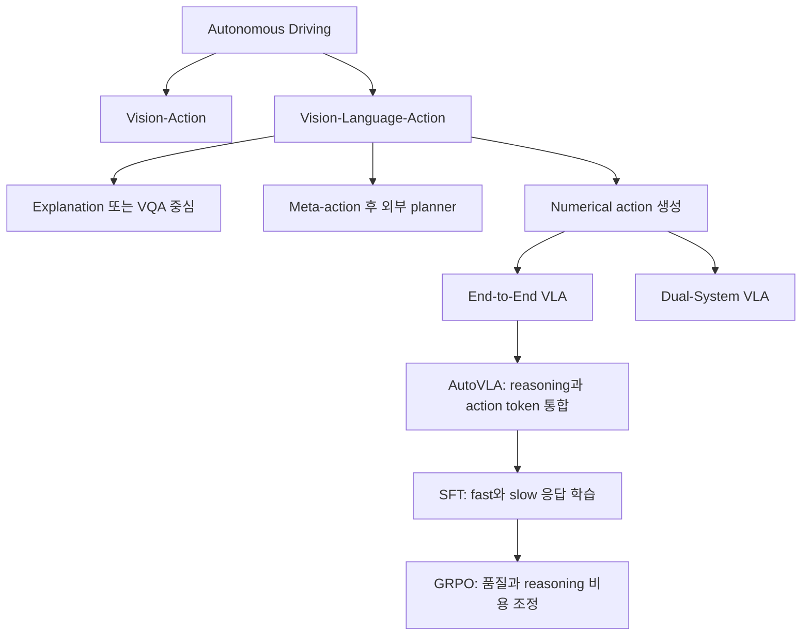
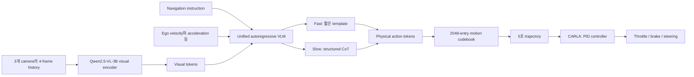
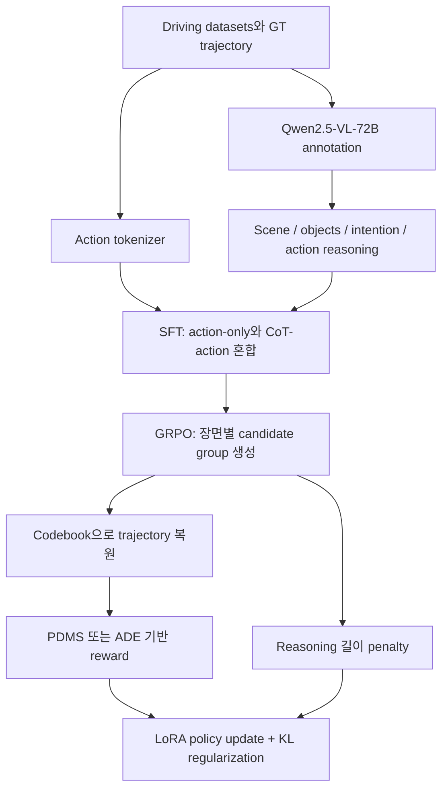
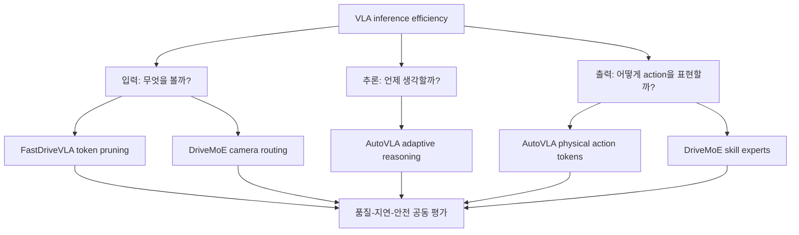

# Week 07. Numerical Action Generator 2: 효율성과 최신 구조

- 학습일: 2026-11-24 (Asia/Seoul)
- 주차: 7 / 12
- 정독 논문: **AutoVLA: A Vision-Language-Action Model for End-to-End Autonomous Driving with Adaptive Reasoning and Reinforcement Fine-Tuning**
- 원문: https://arxiv.org/abs/2506.13757v3 (2025-11-05 개정판)
- 저자: Zewei Zhou, Tianhui Cai, Seth Z. Zhao, Yun Zhang, Zhiyu Huang, Bolei Zhou, Jiaqi Ma (UCLA)
- Taxonomy: End-to-End VLA / numerical trajectory / physical action tokens / adaptive reasoning / SFT + GRPO RFT
- 읽기 모드: AutoVLA HTML 본문·부록 정독, 프로젝트 페이지 확인. DriveMoE v2, FastDriveVLA v4, OpenDriveVLA v2는 arXiv abstract 중심 skim.
- 이번 주 산출물: **VLA inference cost / latency 분석과 비교 체크리스트**
- 출처 범위: AutoVLA는 HTML로 본문 및 부록 텍스트를 확인했으며 PDF 전체 대조·코드 실행·벤치마크 재현은 하지 않았습니다. 비교 논문은 abstract 수준에서 확인한 사실과 연구자 관점의 해석을 구분합니다. 수치는 논문의 역사적 보고값이지 현재 leaderboard 순위가 아닙니다.
- 이용 조건: AutoVLA arXiv 표시 라이선스 CC BY-NC-SA 4.0. 제목·abstract를 한국어로 번역하고 나머지는 독립적인 학습 해설로 재구성했습니다. 원저작자와 원문은 위 링크에 표시했습니다.

## 1. 이번 주 한 문장 결론

**VLA의 효율화는 “더 작은 모델”만의 문제가 아니라, 어떤 visual input을 처리하고, 언제 reasoning을 생략하며, 어떤 action 표현을 얼마나 길게 생성할지 결정하는 문제입니다.**

AutoVLA의 핵심은 하나의 autoregressive VLM에서 reasoning과 physical action token 생성을 통합하고, GRPO로 “주행 품질은 높이고 불필요한 CoT는 줄이는” 방향을 학습하는 것입니다. 그러나 fast mode도 평균 1.072초이므로, 논문의 CARLA 2 Hz 설정을 곧바로 실제 차량의 wall-clock 2 Hz 실시간 성능으로 받아들이면 안 됩니다.[1, §4.2, §5, 부록 F.4]

> 지난주 LMDrive와 연결: “언어가 numerical waypoint/trajectory까지 연결되는가?”에서 한 걸음 더 나아가, 이번 주는 “그 연결이 정해진 시간 안에 안전하게 끝나는가?”를 묻습니다.

## 2. 논문 제목·Abstract 한국어 번역

### 제목

**AutoVLA: Adaptive Reasoning과 Reinforcement Fine-Tuning을 활용한 End-to-End 자율주행용 Vision-Language-Action 모델**

### Abstract 번역

최근 Vision-Language-Action(VLA) 모델은 세계 지식과 reasoning 능력을 활용하여 end-to-end 자율주행에 적용될 가능성을 보여주었습니다. 하지만 기존 VLA 모델은 물리적으로 실행 불가능한 action 출력, 복잡한 모델 구조, 또는 불필요하게 긴 reasoning이라는 문제를 자주 겪습니다. 이 논문에서는 end-to-end 자율주행을 위해 reasoning과 action 생성을 하나의 autoregressive 생성 모델 안에 통합한 새로운 VLA 모델 AutoVLA를 제안합니다.

AutoVLA는 원시 visual input과 언어 instruction으로부터 직접 의미적 reasoning과 trajectory planning을 수행합니다. 연속적인 trajectory를 이산적이고 실행 가능한 action으로 tokenization하여 language model에 직접 통합할 수 있게 합니다. 학습에서는 supervised fine-tuning을 통해 fast thinking(trajectory만 출력)과 slow thinking(chain-of-thought reasoning을 추가)이라는 두 가지 thinking mode를 모델에 학습시킵니다.

Planning 성능과 효율을 더욱 높이기 위해 Group Relative Policy Optimization(GRPO)에 기반한 reinforcement fine-tuning 방법을 도입하여 단순한 상황에서 불필요한 reasoning을 줄입니다. nuPlan, nuScenes, Waymo, CARLA를 포함한 실제 주행 및 시뮬레이션 데이터셋·벤치마크 전반의 실험에서 AutoVLA는 open-loop와 closed-loop 양쪽에서 경쟁력 있는 성능을 보였습니다. 정성적 결과는 다양한 상황에서 adaptive reasoning과 정확한 planning이 가능함을 보여줍니다.[1, Abstract]

### 본문을 읽는 순서: section-by-section 지도

| 원문 구간 | 한국어 핵심 요약 | 읽을 때 확인할 질문 |
|---|---|---|
| §1 Introduction | 텍스트 좌표 출력의 불안정성과 고정 CoT의 비용을 함께 문제로 설정 | action 표현과 reasoning 길이가 각각 어떤 병목인가? |
| §2 Related Work | VLM 이해, meta-action, 직접 trajectory 생성 접근을 구분 | 언어 설명이 아니라 실제 action을 생성하는 위치는 어디인가? |
| §3.1 Framework | Qwen2.5-VL-3B에 physical action vocabulary를 추가 | token 하나가 차량 운동과 어떻게 대응하는가? |
| §3.2 Reasoning Data | 대형 VLM으로 구조화한 reasoning을 소형 모델로 distillation | GT action을 힌트로 준 explanation은 사후 합리화일 수 있는가? |
| §3.3 SFT | action-only와 CoT+action 학습을 섞고 action loss를 강조 | 긴 language sequence에 짧은 action supervision이 묻히지 않는가? |
| §3.4 RFT | driving reward와 CoT 길이 penalty로 GRPO 학습 | 짧은 답을 보상하다 위험 장면의 reasoning까지 없애지 않는가? |
| §4 Experiments | 데이터 규모, action tokenization, RFT 효과 검증 | 다른 benchmark·sampling mode·oracle 조건을 섞지 않는가? |
| §5 Conclusions | 통합 모델의 장점과 GPU 의존·실시간 한계 인정 | 차량 탑재 가능한 latency와 memory 증거가 충분한가? |
| 부록 A–C | codebook, reasoning annotation, SFT 세부사항 | 좌표계·trajectory decoding과 annotation 누수를 확인 |
| 부록 D–F | reward 공식, 데이터 크기, inference 및 추가 결과 | RFT split·CARLA 별도 모델·2 Hz 의미를 확인 |
| 부록 G | 언어 instruction 공격과 안전한 모델 배포 논의 | unsafe instruction을 실제로 차단한 실험이 있는가? |

## 3. 핵심 기여 3~5개

1. **Physical action token을 VLM에 직접 통합**: 사람이 읽는 좌표 문자열 대신 차량의 짧은 시간 운동을 표현하는 discrete token을 생성합니다. VLM에서 trajectory까지의 action grounding 경로가 명시적입니다.
2. **하나의 autoregressive 모델로 reasoning과 planning 통합**: 항상 별도의 slow VLM과 fast planner를 호출하는 방식이 아니라 동일 모델이 짧은 응답 또는 CoT 후 action을 출력합니다.
3. **GRPO 기반 adaptive reasoning**: driving quality reward와 reasoning length penalty를 함께 사용해 불필요한 CoT를 줄입니다. 단순히 “CoT가 길면 좋다”는 가정에서 벗어납니다.
4. **여러 데이터셋과 평가 체계에서 검증**: NAVSIM, nuScenes, Waymo 및 CARLA Bench2Drive를 함께 다룹니다. 단, 동일 weight 하나의 zero-shot 성능이 아니라 데이터셋별 학습·fine-tuning 설정이 있습니다.[1, §1, §3, 부록 E.3]

첫 세 항목은 원문 기여를 번역·재구성했고, 마지막은 실험 범위를 설명한 것입니다. 다중 benchmark 결과가 실제 도로 안전 보증을 뜻하지는 않습니다.

## 4. VLA for AD taxonomy 위치



| 분류 축 | AutoVLA의 위치 | 혼동하지 않을 점 |
|---|---|---|
| 입출력 | camera history + instruction + ego state → action token → trajectory | throttle/brake/steering 직접 생성 모델은 아님 |
| 언어 역할 | navigation instruction 및 optional structured CoT | 설명 생성만 수행하는 VQA 모델이 아님 |
| action grounding | motion codebook으로 token을 metric trajectory로 해석 | 텍스트 “좌회전”만으로 grounding이 끝나지 않음 |
| end-to-end 범위 | sensor-conditioned token generation 학습 | CARLA의 최종 control에는 별도 PID controller 사용 |
| fast/slow 구조 | 같은 VLM의 생성 경로·길이 차이 | 두 모델로 분리된 Dual-System과 다름 |
| world model | 명시적 future scene rollout을 핵심으로 삼지 않음 | CoT에 예측 문장이 있다고 world model인 것은 아님 |
| 효율화 위치 | 출력 action 표현과 reasoning 길이 | visual token pruning이나 MoE가 AutoVLA의 핵심이라고 말하면 부정확 |

## 5. Architecture / pipeline 시각화

### 5.1 추론 경로



주 모델 입력은 front/front-left/front-right의 각 4개 frame, 2 Hz입니다. CARLA에서는 **별도로 학습한 front-only 모델**을 사용하므로 위의 3-camera 입력을 CARLA에도 그대로 적용한다고 생각하면 안 됩니다.[1, §3.1, 부록 E.3]

### 5.2 학습 경로



### 5.3 Action token을 숫자 예제로 이해하기

- token은 코드북의 특정 **상대 운동 `(Δx, Δy, Δθ)`**를 가리킵니다.
- 각 token은 0.5초 움직임을 표현하고 10개 token으로 5초 trajectory를 만듭니다.
- 좌표계 변환을 누적하여 ego frame의 전체 trajectory를 복원합니다. 단순히 모든 `(Δx, Δy)`를 동일 global 축에서 더하는 방식으로 구현하면 회전 구간에서 틀릴 수 있습니다.
- 예를 들어 “앞으로 진행하는 motion token → 회전 성분이 있는 token → 다시 직진 token”이라는 구조를 생각할 수 있습니다. 이는 개념 예시이며, 실제 token ID나 코드북 수치를 제시한 것은 아닙니다.

**물리적 운동 패턴으로 구성한 codebook은 숫자 출력의 구조를 개선하지만, 모든 token 조합에 대해 충돌 회피나 마찰 한계 준수를 수학적으로 보장하는 safety filter는 아닙니다.**

## 6. Input → Reasoning → Action Grounding 분석

| 단계 | 실제 표현 | 모델이 배울 것 | 주요 실패 모드 |
|---|---|---|---|
| Input: vision | multi-view, multi-frame RGB | 신호, 객체, lane, temporal motion | 가려진 보행자·작은 신호 인지 실패 |
| Input: language | high-level navigation instruction | 목적 방향과 장면의 연결 | unsafe instruction을 문자 그대로 따름 |
| Input: ego state | 속도·가속도, 데이터셋별 history | 현재 운동 상태에 맞는 planning | ego shortcut: 시각적 장애물을 무시하고 관성 주행 |
| Reasoning | scene → key objects → intentions → decision | 필요한 상호작용을 구조화 | GT action에 맞춘 사후 합리화·hallucination |
| Fast response | 짧은 fixed template + action | 단순 장면에서 불필요한 설명 생략 | “단순해 보이는” long-tail을 놓침 |
| Action tokens | 추가 vocabulary 2048개에서 sequence 생성 | 물리 운동 단위 조합 | 희귀 운동 coverage 부족·error accumulation |
| Grounding | codebook lookup + pose composition | metric trajectory 복원 | 좌표계·heading·시간 간격 불일치 |
| Control | CARLA PID | trajectory 추종 | controller saturation·지연·tracking 오차 |

### 언어가 정말 action에 영향을 주었는지 확인하는 intervention

**학습 제안이며 원문 재현 결과가 아닙니다.** 같은 장면에서 instruction만 바꾸어 경로가 바뀌는지, 같은 instruction에서 보행자만 삽입하면 감속하는지, CoT를 제거하거나 교체하면 action이 어떻게 변하는지 비교합니다. 단, CoT 문장을 교체하면 분포 자체가 달라질 수 있으므로 결과 하나만으로 reasoning의 인과성을 단정하지 않습니다.

## 7. Training recipe

### 7.1 데이터와 teacher reasoning

- teacher: **Qwen2.5-VL-72B**.
- 구조: 장면 설명 → 핵심 객체 → 주변 agent 의도 → 주행 결정.
- nuPlan reasoning 약 45.6k, Waymo reasoning 약 7.2k.
- nuScenes/CARLA에는 DriveLM VQA를 재구성한 reasoning을 추가합니다.
- teacher에게 GT action을 힌트로 제공합니다. annotation 일관성은 좋아질 수 있지만 **그럴듯한 explanation이 실제 원인에 충실한가**는 별도 문제입니다.[1, §3.2]

### 7.2 SFT

```text
L_SFT(sample) = w(sample) × [L_LM + λ_action × L_action]

w = λ_CoT   if GT contains CoT
w = 1       otherwise
```

- `L_LM`: reasoning과 action을 포함한 전체 target sequence의 causal LM loss.
- `L_action`: action token 구간에 별도 부여한 loss.
- 원문 설정: `λ_action=1`, `λ_CoT=40`, learning rate `1e-5`.
- 8 NVIDIA L40S GPU, FSDP, 5 epochs.
- GPU당 batch 1, gradient accumulation 4, effective batch 32.

**직관:** 긴 reasoning 1개 안의 짧은 action sequence를 잊지 않도록 action loss를 별도 강조하고, 적은 수의 CoT sample에는 sample weight를 줍니다. 이는 “loss만 낮추면 driving quality가 좋아진다”는 뜻이 아닙니다.[1, §3.3, §4.1]

### 7.3 GRPO RFT

```text
장면 q → G개 reasoning/action candidate
       → 각 trajectory의 driving reward 계산
       → CoT length penalty 차감
       → 같은 group 안에서 상대 advantage 계산
       → SFT reference와 너무 멀어지지 않도록 KL regularization
```

- NAVSIM: driving reward에 **PDMS** 사용.
- Waymo: RFS annotation 제약 때문에 **normalized ADE 기반 reward** 사용. ADE를 키우는 것이 아니라 낮을수록 reward가 커지도록 변환합니다.
- 최종 reward: `r = r_driving − λ_r × r_CoT`.
- CoT penalty는 길이에 대한 sigmoid 형태입니다. tolerance `400`, slope `0.002`, `λ_r=0.3`.
- vision encoder frozen, LoRA rank/alpha `8/8`, dropout `0.1`.
- learning rate `3e-5`, KL weight `0.04`, 6000 steps.
- 원문 구현은 step마다 한 번 policy update하여 일반 GRPO 표기의 old-policy 관리·clipping을 단순화합니다.[1, §4.1, 부록 D]

**Split 주의:** NAVSIM RFT는 `navtrain`, Waymo RFT는 validation split을 사용했다고 명시합니다. 따라서 Waymo validation을 완전히 untouched인 최종 generalization set처럼 해석하면 안 됩니다. test 결과와 RFT에 사용한 split을 분리해 읽어야 합니다.

## 8. Dataset / Benchmark / Metric 분석

### 8.1 데이터 규모와 평가 방식

| 데이터 / benchmark | 전처리 후 train / reasoning / test sample | 평가 | 지표와 한계 |
|---|---|---|---|
| nuPlan → NAVSIM | 166.3k / 45.6k / 12.1k | 원문에서는 open-loop로 분류; non-reactive simulation 기반 평가라는 점을 함께 읽기 | PDMS: collision, drivable area, progress, TTC, comfort; 완전 reactive closed-loop 아님 |
| nuScenes | 19.0k / 2.9k / 5.6k | open-loop | L2·collision, ST-P3와 UniAD protocol 구분 필요 |
| Waymo E2E | 23.8k / 7.2k / 약 1.5k | log 기반 trajectory/RFS 평가 | ADE와 human-rated reference 기반 RFS; 모델과 환경의 장시간 feedback 아님 |
| CARLA Garage → Bench2Drive | 274.5k / 53.2k / train 표의 test 항목 없음 | CARLA closed-loop | Driving Score, Success Rate, Efficiency, Comfortness; sim-to-real gap 남음 |

위 수치는 원문 Table S1의 **전처리 sample 수**입니다. 원본 dataset의 scene·segment 수와 섞지 않습니다. 특히 CARLA test 항목이 표에 없다는 것이 평가하지 않았다는 뜻은 아닙니다.[1, 부록 E.1]

### 8.2 AutoVLA 핵심 성능: 조건을 함께 기록

| 실험 | 보고값 | 올바른 해석 |
|---|---|---|
| NAVSIM One-shot | PDMS 80.54 | baseline sampling 조건 |
| NAVSIM Post-RFT | PDMS 89.11 | 8.57 point 상승, 약 10.6% 상대 개선 |
| NAVSIM Best-of-N | PDMS 92.12 | 6개 candidate에 **oracle scorer** 적용; 실제 배포 가능한 selector 성능과 다름 |
| CARLA Bench2Drive | Driving Score 78.84 / Success Rate 57.73% | 별도 front-only SFT 모델, closed-loop 시뮬레이션 |
| Waymo test Post-RFT | RFS overall 7.5566 / 5s ADE 2.9580 m | 논문에 실린 역사적 값; 최신 leaderboard 주장 금지 |
| nuScenes UniAD protocol, CoT | 평균 L2 0.70 m / 평균 collision 0.31% | action-only 0.71 m / 0.35%와 작은 차이; 다른 protocol과 혼합 금지 |

NAVSIM에서는 논문의 TrajHF 93.95 같은 더 높은 baseline도 있습니다. 따라서 “AutoVLA가 모든 방법 중 최고”라고 요약하면 안 됩니다. Best-of-N이 AutoVLA 자체 설정 중 높다는 것과 전체 benchmark SOTA는 다른 주장입니다.[1, Tables 1, 3, S2–S4]

### 8.3 이번 주 핵심: inference cost / latency

| 비교 | 보고된 runtime | 무엇을 줄였나? | 해석 주의 |
|---|---|---|---|
| Fast mode (Table 2) | min 0.997 / max 1.116 / avg **1.072 s** | 긴 CoT 생략 | max는 관측 sample의 최대이지 WCET 보증 아님 |
| Slow mode (Table 2) | min 7.607 / max 13.706 / avg **10.518 s** | reasoning을 생성하므로 비쌈 | fast보다 평균 약 **9.81배** 오래 걸림 |
| RFT 전후 (Fig. 5) | 평균 runtime **66.8% 감소**, 500 test scenarios | 불필요한 reasoning 감소 | Table 2의 fast-only와 같은 비교라고 단정 금지 |
| Text waypoint → physical action (Table 5) | **7.65 → 3.95 s** | 숫자 문자열 생성 대신 action token | Table 2와 조건이 같다고 가정해 3.95 s를 fast latency로 쓰지 않기 |
| CARLA planning schedule | **2 Hz** | simulator에서 0.5초마다 replan | wall-clock inference가 0.5초 이내라는 증거가 아님 |

#### 비용을 분해해서 보기

```text
T_end-to-end = T_sensor/preprocess
            + T_visual_encoder
            + T_prefill
            + T_reasoning_decode
            + T_action_decode
            + T_grounding/controller
            + T_queue/transfer
```

- **AutoVLA**: 주로 `T_reasoning_decode`, `T_action_decode`를 줄이는 접근.
- **FastDriveVLA**: visual token 수를 줄여 VLM processing 비용을 낮추는 접근. pruner 자체 비용도 포함해야 합니다.
- **DriveMoE**: camera 선택과 expert routing으로 필요한 처리·specialization을 조정. router·expert dispatch overhead가 있습니다.
- **OpenDriveVLA**: structured 2D/3D alignment와 interaction modeling이 핵심. 저비용 inference를 증명한 논문으로 자동 분류하면 안 됩니다.

이 분해는 학습용 분석 모델이며 원문의 계측 breakdown이 아닙니다. Dense attention의 sequence-length 비용이 크다는 사실만으로 token을 일정 비율 줄였을 때 wall-clock도 같은 비율로 줄어든다고 계산하면 안 됩니다.

### 8.4 배포 검증용 평가 matrix — 제안

| 평가 축 | 반드시 기록할 항목 | 왜 필요한가? |
|---|---|---|
| Hardware | GPU/SoC, precision, memory, software version | L40S 학습 설정은 inference hardware 증거가 아님 |
| Workload | camera/frame 수, 해상도, token budget, batch=1 여부 | 입력이 다르면 latency 비교 불가 |
| Timing | cold/warm, p50/p95/p99, sensor-to-action, queue | 평균만으로 deadline miss를 숨길 수 있음 |
| Quality | PDMS/L2 외 closed-loop SR, collision, progress | 빨라졌지만 멈춰 있기만 하는 정책 배제 |
| Difficulty | occlusion, cut-in, rare turn, 야간·악천후 | 평균 품질이 long-tail 실패를 가림 |
| Selection | one-shot vs multi-sample, oracle 여부 | sampling과 scoring 비용까지 공개 |
| Fail-safe | timeout, stale trajectory, emergency fallback | reasoning이 길어지는 순간의 안전성 확보 |

이 표의 실험은 본 학습에서 수행하지 않았습니다. 원문에 완전한 p99·차량 SoC·sensor-to-actuation 검증이 있다고 주장하지 않습니다.

## 9. 관련 논문 비교표

### 9.1 Architecture와 효율화 위치

| 논문 | 한국어 제목 / 핵심 | input → output / language 역할 | action grounding | 효율화 위치 |
|---|---|---|---|---|
| **AutoVLA** | Adaptive reasoning과 RFT 기반 end-to-end 자율주행 VLA | camera history·ego·instruction → optional CoT + action tokens | motion codebook → trajectory → CARLA PID | reasoning 길이와 action token 표현 |
| **DriveMoE** | End-to-end 자율주행 VLA를 위한 Mixture-of-Experts | multi-view input → 주행 action; Drive-π₀ 기반 | skill-specialized Action MoE; 출력 좌표·controller 세부는 skim에서 미확인 | Scene-Specialized Vision MoE의 camera routing + Action MoE |
| **FastDriveVLA** | Plug-and-play reconstruction-based token pruning을 통한 효율적 end-to-end 주행 | visual tokens를 pruning하여 host VLA에 전달 | host VLA의 action 경로를 사용; 독립 controller 아님 | ReconPruner로 foreground 중심 token 유지 |
| **OpenDriveVLA** | 대형 VLA 기반 end-to-end 자율주행을 향하여 | 2D/3D instance-aware visual representation·ego·commands → spatially grounded trajectory/QA | hierarchical vision-language alignment + structured interaction decoding | grounding·alignment가 핵심; 정량 latency는 이번 skim에서 미확인 |

### 9.2 각 논문의 training / benchmark / safety 분석

| 논문 | Training recipe: 확인 범위 | Dataset / benchmark와 평가 | safety·long-tail 위험 / 한계 |
|---|---|---|---|
| AutoVLA | mixed SFT + teacher CoT + GRPO RFT, 세부는 §7 | NAVSIM·nuScenes·Waymo log 기반 평가와 CARLA closed-loop | reward misspecification, reasoning hallucination, GPU/latency 의존, oracle selection gap |
| DriveMoE | Drive-π₀ baseline에 vision router와 skill-specific action experts 학습; loss·split·expert 수 미확인 | abstract에서 Bench2Drive **closed-loop** 확인; 수치와 추가 open-loop 유무 미확인 | 잘못된 camera routing으로 hazard 누락, rare skill expert의 데이터 부족. 이는 분석적 위험이며 검증된 실패율 아님 |
| FastDriveVLA | MAE-style pixel reconstruction, adversarial foreground/background reconstruction으로 ReconPruner 학습; 같은 visual encoder의 host VLA에 재사용 | **nuScenes-FG 241K image-mask pairs**, nuScenes **open-loop** planning | 작은·가려진 객체를 foreground mask가 놓치면 pruning이 위험 신호를 제거. closed-loop 안전성은 abstract로 확인 불가 |
| OpenDriveVLA | hierarchical 2D/3D vision-language alignment, structured agent/environment/ego interaction; detailed loss·stage·split 미확인 | nuScenes **open-loop** trajectory planning 및 driving QA | 공간 grounding 개선이 closed-loop 보증은 아님; 시각 입력 무시 shortcut과 temporal robustness는 별도 intervention 필요 |

### 9.3 Skim abstract의 한국어 핵심 요약

- **DriveMoE**: multi-view 데이터와 희귀 maneuver를 잘 다루기 위해 장면에 따라 camera를 고르는 Vision MoE와 행동 skill별 expert를 고르는 Action MoE를 결합합니다. 목표는 단순 연산 절감만이 아니라 모드 평균화(mode averaging)를 줄이는 specialization입니다.[3]
- **FastDriveVLA**: 일반 VLM의 token similarity/attention 기반 pruning을 driving에 그대로 적용하면 충분하지 않다는 문제에서 출발합니다. 주행 관련 foreground를 재구성하도록 ReconPruner를 학습시키고, 동일 visual encoder의 VLA에 재사용합니다. 따라서 “plug-and-play”는 모든 encoder에 무학습 적용된다는 뜻이 아닙니다.[4]
- **OpenDriveVLA**: 2D·3D instance-aware representation을 언어 공간에 정렬하고 agent/environment/ego 상호작용을 decoding에 반영하여 spatially grounded action을 생성합니다. 이번 비교에서는 효율화의 기준 모델이라기보다 grounding 품질을 강조하는 대조군입니다.[5]

**공정 비교 원칙:** 이 세 논문을 직접 실행하지 않았고 skim도 abstract 수준입니다. 따라서 서로 다른 hardware·dataset의 speedup을 한 줄로 순위화하지 않습니다. 미확인 항목은 “없음”이 아니라 “미확인”입니다.

## 10. 강점과 한계

### 강점

- action token의 의미가 물리 운동과 연결되어 숫자 문자열보다 compact하고 해석 가능한 interface를 제공합니다.
- reasoning 유무를 동일 모델 안에서 학습하므로 별도 slow/fast 모델 간 integration 비용을 줄이는 설계입니다.
- task reward와 reasoning cost를 함께 다뤄 품질·효율 trade-off를 명시합니다.
- open-loop 결과만이 아니라 CARLA closed-loop 결과도 제시합니다.

### 한계와 비판적 읽기

1. **실시간 주장에 경계가 필요합니다.** 논문도 near-real-time 1 Hz와 GPU 의존을 한계로 인정합니다. 2 Hz simulator schedule은 실제 deadline 충족과 다릅니다.
2. **CoT의 인과적 유용성은 별도 검증 대상입니다.** GT action hint로 얻은 explanation은 정답과 일관될 수 있어도 action의 실제 근거임을 보장하지 않습니다.
3. **Reward는 안전 전체를 표현하지 않습니다.** PDMS 최적화는 benchmark에 맞는 행동을 장려하지만 예상하지 못한 취약점을 남길 수 있고, ADE는 여러 합리적인 운전 선택 중 하나의 GT에 과도하게 맞출 수 있습니다.
4. **Fast/slow 선택의 안전 보증이 없습니다.** 긴 reasoning을 줄이는 penalty가 어려운 장면에도 작용할 수 있습니다. 원문 부록의 sampling temperature/top-p/top-k 차이도 mode에 영향을 주므로 deterministic safety gate라고 해석하면 안 됩니다.
5. **Codebook은 safety certificate가 아닙니다.** 토큰의 개별 물리적 타당성과 장시간 조합의 안정성·충돌 회피는 다릅니다.
6. **Best-of-N oracle 결과는 배포 격차가 큽니다.** 테스트 시 참조 정보가 필요한 scorer라면 실제 차량에서 같은 점수를 낼 수 없습니다.
7. **실차 closed-loop와 robustness 검증이 남습니다.** 악천후, sensor degradation, adversarial instruction, long-tail에 대한 충분한 안전 통계가 있다고 볼 수 없습니다.
8. **단일 모델의 범용성으로 과장하면 안 됩니다.** Waymo fine-tuning과 별도 CARLA 모델을 포함한 benchmark별 학습 설정이 있습니다.

### 위험 시나리오 예시 — 해설

“가려진 보행자 가능성이 있는 골목”에서 foreground pruning이 가림 단서를 제거하고, fast response가 선택되고, codebook이 직진 trajectory를 만들 수 있습니다. 각 구성요소의 평균 점수가 높아도 이러한 **복합 실패**는 남습니다. 이는 실제 보고된 사고 사례가 아니라 효율화 실험에서 추가해야 할 stress-test 예시입니다.

## 11. 실전 학습 포인트

### 11.1 “효율화 3축”을 구분하세요



MoE + pruning + adaptive reasoning을 함께 붙이면 무조건 빨라진다고 생각하면 안 됩니다. router/pruner overhead와 서로 다른 입력 분포 때문에 이득이 상쇄될 수 있습니다. 모듈별 ablation과 결합 ablation이 모두 필요합니다.

### 11.2 최소 ablation 설계 — 재현 실험 제안

| 실험 | 고정할 항목 | 바꿀 항목 | 함께 볼 지표 |
|---|---|---|---|
| A | 데이터·backbone·입력 | text waypoint vs action token | L2, collision, decode tokens, latency |
| B | action 표현·SFT 데이터 | action-only vs CoT | 난이도별 planning 품질과 runtime |
| C | SFT 초기 checkpoint | RFT 없음 / driving reward만 / length penalty 추가 | PDMS, reasoning 길이, fast 비율, p99 |
| D | 모델·hardware·precision | pruning ratio 또는 camera routing | closed-loop SR, small-object miss, total latency |
| E | 모든 policy 조건 | one-shot vs multi-sample + deployable scorer | scorer 포함 sensor-to-action latency |

### 11.3 학습 완료 체크리스트

- [ ] numerical coordinate 문자열과 physical action token의 차이를 설명할 수 있다.
- [ ] fast/slow thinking을 Dual-System architecture와 구분할 수 있다.
- [ ] 66.8% runtime 감소와 fast-only 1.072초가 서로 다른 비교라는 것을 안다.
- [ ] NAVSIM PDMS·nuScenes collision·CARLA SR을 같은 종류의 안전성 증거로 취급하지 않는다.
- [ ] oracle scorer 없는 one-shot 조건을 기준 성능으로 따로 기록한다.
- [ ] 성능을 유지하면서 latency를 줄였다는 주장에 hardware·precision·입력 크기·timing 범위를 요구한다.

### 11.4 논문을 읽고 바로 답해 볼 질문

1. 왜 길이가 짧은 action token에 별도 loss를 주나요? → 긴 reasoning sequence에 action supervision이 묻히는 문제를 완화하기 위해서입니다.
2. 왜 “scene이 단순하니 CoT가 불필요하다”를 모델이 완벽하게 판별한다고 가정하면 안 되나요? → 보이지 않는 위험과 OOD가 단순한 장면으로 오분류될 수 있기 때문입니다.
3. 왜 RFS를 ADE reward로 대체하면 평가 alignment 문제가 남나요? → 인간이 좋다고 보는 복수 trajectory와 하나의 GT에 대한 거리 최소화는 목적이 다르기 때문입니다.
4. 왜 throughput이 높아도 driving latency가 충분하지 않을 수 있나요? → batching·queueing이 sample당 sensor-to-action 지연을 늘릴 수 있기 때문입니다.

## 12. 다음 주 질문

**Week 08: Dual-System VLA — DriveVLM 정독, LeapAD / Senna / DualAD skim.**

- 느린 VLM과 빠른 planner를 분리하면 AutoVLA의 단일 모델 방식보다 tail latency를 관리하기 쉬울까요?
- VLM 출력이 stale해지면 fast planner는 어떤 정보까지 신뢰해야 할까요?
- 두 시스템 사이의 interface는 text, meta-action, latent feature 중 무엇이 안전 검증에 유리할까요?
- instruction이 물리적 위험과 충돌할 때 누가 override해야 할까요?
- 느린 reasoning이 완료되기 전에도 emergency control이 가능한 architecture는 어떻게 평가해야 할까요?

다음 주 산출물: **End-to-End VLA vs Dual-System VLA 비교표**, 특히 slow reasoning/fast control 사이의 safety-critical interface에 집중합니다.

## 13. 참고 링크

1. **AutoVLA v3** — [Abstract](https://arxiv.org/abs/2506.13757v3), [HTML 본문·부록](https://arxiv.org/html/2506.13757v3), [PDF](https://arxiv.org/pdf/2506.13757v3). 제목·abstract 번역, architecture, 학습 설정, 표 수치의 1차 출처.
2. **AutoVLA project** — https://autovla.github.io/ . 구조 설명과 RFT runtime 감소 결과 교차 확인. 페이지의 공개 예정 문구를 실제 dataset 공개 완료로 해석하지 않음.
3. **DriveMoE v2** — https://arxiv.org/abs/2505.16278v2 (2026-05-18 개정), [Project](https://thinklab-sjtu.github.io/DriveMoE/). 본 학습은 abstract를 확인했으며 프로젝트 세부 구현은 미검증.
4. **FastDriveVLA v4** — https://arxiv.org/abs/2507.23318v4 (2025-11-14 개정). Abstract에서 ReconPruner, reconstruction 학습, nuScenes-FG 규모 및 open-loop 평가 확인.
5. **OpenDriveVLA v2** — https://arxiv.org/abs/2503.23463v2 (2025-11-21 개정). Abstract에서 2D/3D alignment와 structured interaction modeling 확인.
6. 다음 주 **DriveVLM** — https://arxiv.org/abs/2402.12289 . 다음 주 정독 예정이며 이번 노트에서 상세 실험 결과를 인용하지 않음.

---

### 출처·검증 메모

- 조회일: 2026-11-24. 위 AutoVLA abstract/HTML/project 및 비교 논문 arXiv 검색·abstract 페이지에서 HTTP 200 응답을 확인했습니다.
- curriculum의 `deep`는 “AutoVLA or OpenDriveVLA”이지만 지정 URL `2506.13757`은 **AutoVLA**입니다. URL과 제목을 확인한 뒤 AutoVLA를 정독 대상으로 선택했습니다.
- 정량값은 원문 표와 부록에서 옮겼으며, 약 9.81배와 8.57 point·10.6% 관계는 원문 값을 사용해 계산했습니다.
- 본문 중 stress test, 비용 분해, intervention, 실험 matrix는 학습 제안이며 새로 수행한 실험 결과가 아닙니다.
